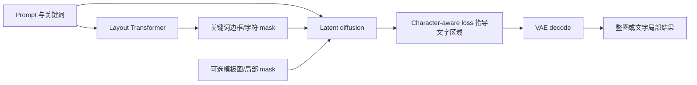

# TextDiffuser：先布局，再让扩散模型画字

来源：Chen et al., [*TextDiffuser: Diffusion Models as Text Painters*](https://arxiv.org/html/2305.10855v2)，固定 arXiv v2（2023-05-24）。重点阅读 §3–§5 与 Appendix Q；结果是作者在 MARIO 数据和 OCR/用户评测协议中报告的结果。

## 问题：语言模型会拼词，不代表图像模型会画出可读字符

一句“海报上写 OPEN”，同时要求模型选对字符、安排字号与位置、让文字融入背景。普通扩散模型把这些事隐式交给去噪网络，常出现字母错位、字符缺失、小字被 VAE latent 压缩抹掉等失效。TextDiffuser 把文字从一般语义条件中拆出来，显式预测它应出现在图像的哪里。

## 两阶段机制：文字布局成为图像生成的中间条件

第一阶段用 Layout Transformer 识别提示中的关键词，为每个关键词预测边框布局，并生成字符级 segmentation mask；提示编码、关键词标记和词宽嵌入共同帮助模型安排文字区域。第二阶段以 latent diffusion 生成图像，将文本、布局 mask、字符特征 mask 与带噪 latent 共同输入，并加入 character-aware loss，让固定的字符分割器对 latent 中的文字区域提供辅助监督。[§3.1–§3.3](https://arxiv.org/html/2305.10855v2)

同一生成器可用全图 mask 做整图生成，也可用局部 mask 做 part-image generation / text inpainting。推理时用户可以改布局或文本，再让扩散阶段重新绘制；这比让扩散网络自行定位全部文字更可控，但把错误前移到了布局阶段：关键词漏检、框重叠或宽度估计不准，都会约束后续渲染。[Figure 2、§3.3](https://arxiv.org/html/2305.10855v2)

训练时的分割监督指导网络关注文字 latent，推理时的布局条件则给出位置约束；二者不是输出后再用 OCR 修正。

## 数据、评测与限制

MARIO-10M 以 OCR 管线收集约千万图文样本，并提供识别、检测和字符级分割标注；MARIO-Eval 区分整图与局部文字生成。其评测同时使用 CLIPScore/FID 与文字检测、识别、定位等指标，因为整图语义相似度不能判断每个字符是否正确。[§4–§5](https://arxiv.org/html/2305.10855v2)

作者消融报告字符感知损失权重和整图/局部训练比例会共同改变 OCR、检测与定位结果；并非单独加大字符损失就越好。论文明确展示小字符和长文本失败：VAE latent 压缩损失细笔画，长关键词布局会相互重叠。[§5.2、Appendix Q](https://arxiv.org/html/2305.10855v2)

## 与 FonTS 的关系

TextDiffuser 主要解决**文字写什么、放在哪里**；后来的 [FonTS 精读](2412.00136-fonts.md)关注**指定哪个词使用什么字形/字体效果，以及参考风格如何不泄漏文本内容**。两者共同表明文字渲染并非扩散骨干单一能力：字符表示、布局监督、字形控制、VAE 保真和 OCR 评测需分别检验。
