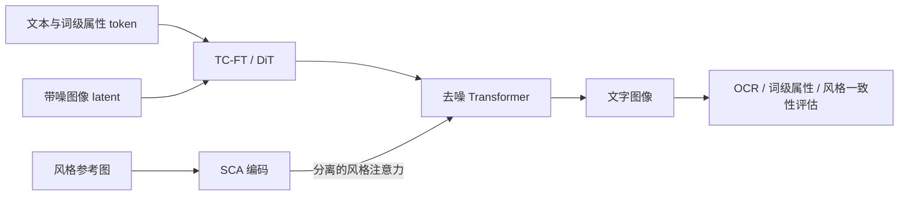

# FonTS：把词级字形与参考风格变成两个控制接口

来源：Shi et al., [*FonTS: Text Rendering with Typography and Style Controls*](https://arxiv.org/html/2412.00136v2)，固定 arXiv v2（2025-03-10）。重点阅读 §3–§4 与 Appendix B–G；结果依其 BTR、STR、ATR 三类文字任务分别解释。

## OCR 对了，字体和版式还可能错

海报生成不仅要写出正确词语，还可能要求“把 Love 加下划线”“在右上角用指定衬线体”“参考图的风格但保留新文字”。OCR accuracy 只能回答字符是否可识别，不能判断词级字体属性、风格一致或参考风格是否盖过了新文本内容。FonTS 把文字内容和视觉排版作为两个关联但不同的目标。

## TC-FT 与 ETC tokens：让属性局部作用于一个词

Basic Text Rendering (BTR) 中，Typography Control Fine-Tuning 使用 enclosing typography control tokens 把目标属性包在一个词周围，例如“仅对该词加粗/下划线”。训练针对 DiT 与 T5/CLIP 双编码器设置，使用参数高效微调，不直接照搬为单 CLIP U-Net 设计的 modifier token 方案。这样控制信号在文本序列里有词级边界，而不是把字体描述当作无定位的全局 prompt。[§3.1](https://arxiv.org/html/2412.00136v2)

## SCA 与 Decoupled Joint Attention：风格图不能覆盖字词语义

Artistic Text Rendering (ATR) 中，Style Control Adapter 从参考图抽取风格条件；Decoupled Joint Attention 将风格图特征与文字/图像 token 的 attention 分支分离，再以权重合成，避免参考图里的已有文字内容直接污染新生成词。它解决的是“风格和内容怎么并存”，不与 ETC token 的“哪个词应用什么属性”重复。[§3.2](https://arxiv.org/html/2412.00136v2)

FonTS 使用 HTML 渲染构造可控训练数据，并分开评测 OCR accuracy、word-level 属性、字体一致性和用户感知的 style consistency。作者报告在 BTR 中多数一致性/控制指标优于比较基线，但 OCR accuracy 仍略低于 Glyph-ByT5；该结果限定于文中数据、DiT 与指标设置，说明更强的字形控制不必然让每个文字识别指标都更好。[§4.1–§4.4](https://arxiv.org/html/2412.00136v2)

TC-FT 改的是“哪个词按什么样式出现”，SCA 改的是“整体风格信号从哪里进入”。分路能减少参考图字词内容泄漏，但不能代替文本正确性和风格一致性的独立评估。

## 和 TextDiffuser 的教学对照

[TextDiffuser](2305.10855-textdiffuser.md) 用布局 Transformer 先找关键词框、再用字符 mask 指导 latent diffusion；FonTS 在 DiT 文本 token 中加入局部属性标记，并以 adapter 单独提供视觉风格。前者把布局显式化，后者将字形属性和风格接口细化。共同边界是：小字/latent 压缩、词级属性分类、风格与内容冲突仍需要不同评测，不能以单个 OCR 或 CLIP 指标代表整体文字设计质量。
