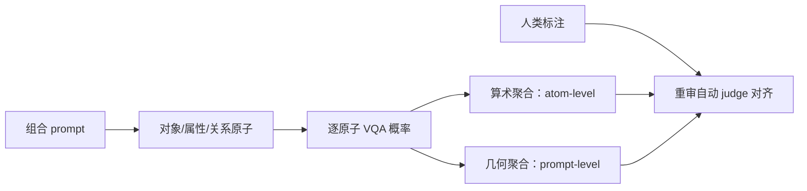

# GenEval 2：基准与判分器都可能随模型进步而漂移

来源：Kamath et al., [*GenEval 2: Addressing Benchmark Drift in Text-to-Image Evaluation*](https://arxiv.org/html/2512.16853v1)，arXiv v1（2025-12-18）。重点阅读 §3–§5；版本许可为 CC BY-NC-SA 4.0。

## 从拓展提示集转向先审计旧基准

GenEval 以 553 条受控提示测对象、颜色、计数、位置和颜色归属；它的自动评分依赖 COCO 类别检测器与 CLIP 颜色判断。模型输出分布升级后，检测器看不懂新对象或出现新式构图，就可能把 judge 失效记作模型失败。GenEval 2 重新做人类对照，作者报告旧 GenEval 上自动分数与人类分数的绝对差异最高达 17.7 个百分点，并认为原题集已接近饱和。[§3.1–§3.3、Table 1](https://arxiv.org/html/2512.16853v1)

这里的 benchmark drift 不只是“模型记住题目”：评分模型的词表和视觉特征也会跟不上新的生成图像。基准若只扩充模型名称却不重新核验 judge 与人类的一致性，排行榜仍可能失去辨别力。

## GenEval 2 与 Soft-TIFA 分别改题目和评分粒度

GenEval 2 扩展到 40 种对象、18 类属性、9 种关系和更广计数范围，包含 animate/inanimate 对象、材质/纹理、三维空间介词和动作关系；每条提示拆成多个可核验原子，同时保留由这些原子组成的 prompt-level 正确率。[§4.1–§4.3](https://arxiv.org/html/2512.16853v1)

Soft-TIFA 为每个原子生成一个 VQA 问题，以 VQA 模型对正确答案的概率评分；算术平均描述各原子表现，几何平均会惩罚某一原子严重失败，更接近“整条 prompt 是否都完成”。[§5.1–§5.3](https://arxiv.org/html/2512.16853v1) 作者报告其在 GenEval 2 上与人类判断更对齐，但方法仍依赖 VQA judge；模板任务的完整覆盖优势，也意味着真实用户表达和开放词汇覆盖仍有限。

## 放回组合性评测谱系

[GenEval](2310.11513-geneval.md) 的优势是可解释的对象级诊断；[T2I-CompBench++](2307.06350-t2i-compbench-plus.md) 扩大属性、关系和复杂组合的任务面；GenEval 2 复核旧基准的饱和与评分器漂移；[SANEval](2602.00249-saneval.md) 则用开放词汇解析和检测尝试输出更细的失败反馈。它们不是一个逐年替代的分数序列：题集覆盖、评测器、人工校验和诊断粒度各有取舍。
