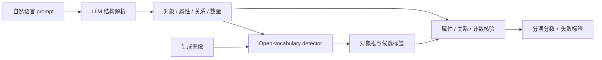

# SANEval：让开放词汇组合性评测能指出错在哪里

来源：Pramanik et al., [*SANEval: Open-Vocabulary Compositional Benchmarks with Failure-mode Diagnosis*](https://arxiv.org/html/2602.00249v1)，arXiv v1（2026-01-30，CC BY 4.0）。重点阅读 §3–§4 与 Appendix E–F。

## 固定类别检测器为什么会误判新对象

GenEval 等对象级评测易解释，但检测器词表封闭；提示里出现罕见动物、复合物体名或少见别称时，生成图可能画对了，judge 却没识别出来。SANEval 的目标是扩展提示词范围，同时保留逐项失败反馈，而不是只给单一总分。[§2](https://arxiv.org/html/2602.00249v1)

## 机制：解析 prompt，再按对象、属性、关系逐项匹配

Prompt Understanding Module 用 LLM 将自然语言拆成对象、颜色/形状/纹理属性、空间关系三元组和每类对象数量；对象检测模块用 LLM 扩展同义词，再查询 open-vocabulary detector，并把检测框与对象绑定。随后不同模块评属性、空间关系和数量，输出分数与结构化反馈。[§3.1–§3.6](https://arxiv.org/html/2602.00249v1)

数据分 Simple 与 Hard 两组：Simple 约 5,000 条程序化提示并经人工核验，Hard 是 250 条人类写的复杂提示，包含隐喻、密集场景和分布外逻辑。作者观察到各模型在 Hard 集上性能下降，排名/强项也有变化，说明模板条件下掌握对象计数不代表处理自然用户表达。[§3.1、§4.1–§4.3](https://arxiv.org/html/2602.00249v1)

## 诊断力提升，但 evaluator 也成为流水线一环

SANEval 能把“关系错了”细分为对象漏检、属性绑错、空间定位不符或数量错误。与 [GenEval 2](2512.16853-geneval2.md) 的原子问答式核验相比，它强调开放词汇 grounding 和可解释反馈；与 CompBench++ 相比，它把 prompt parser、同义词扩展和检测模块显式拆开。

代价是 benchmark 不再是纯粹的“生成器考试”：LLM 解析错对象、同义词展开过宽、检测框定位偏差都会影响最终诊断。作者报告替换所用 LLM 解析器后整体分数变化不大，但只在该组基准和模型中成立；开放词汇也不意味着所有新名词/抽象关系都被可靠验证。[§4.4–§4.5、Appendix E](https://arxiv.org/html/2602.00249v1)
