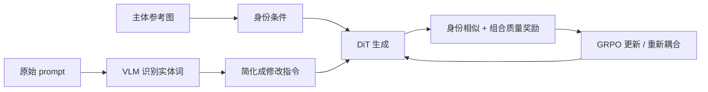

# DisCo：主体身份由参考图决定，文本只描述要改的部分

来源：Li et al., [*Disentangling to Re-couple: Resolving the Similarity-Controllability Paradox in Subject-Driven Text-to-Image Generation*](https://arxiv.org/html/2604.00849v1)，固定 arXiv v1（2026-04-01，CC BY-SA 4.0）。重点阅读 §3–§4，尤其 §3.2–§3.3 与 Tables 1–2；数字是论文在其 FLUX、Subjects200K 和指标设置中报告的结果。

## 个性化生成要同时守住两种相反目标

给一个参考物体，让它出现在新场景中，系统需要保住身份细节，又要按提示改变姿态、背景或交互。模型若过度听从文字，可能把参考主体重画成训练先验里的典型对象；若只锁定参考图，又可能无法融入新场景。DisCo 将这种“主体相似度—文本可控性”拉扯作为明确研究问题。

## 先分开条件，再学习把主体放回场景

Textual-Visual Decoupling (TVD) 先用 VLM 根据提示和参考图识别主体实体词，再把主体描述从 prompt 改写成代词/简化修改指令；主体身份主要由参考图 token 提供，文本主要承担上下文变化。其意图是避免主体名触发的通用先验盖过参考图细节。[§3.2](https://arxiv.org/html/2604.00849v1)

严格分开后又会出现 compositional gap：模型能保住主体，却不一定能把它自然放进新场景。第二阶段使用 GRPO，并训练专用 Qwen3-VL reward model，同时衡量主体与参考图的相似性以及主体—环境的组合质量。偏好数据通过构造身份被改坏或组合关系被破坏的负例得到。[§3.3](https://arxiv.org/html/2604.00849v1)

这个顺序很有教学价值：**解耦先减少条件竞争，重新耦合再恢复场景连贯性**。它不是简单增加一条 image cross-attention，也不是证明拆分后模型会自动理解所有视觉约束。

## 作者证据与适用边界

作者在 FLUX 设定上报告主体相似、文本可控与整体质量等指标；消融显示只进行 TVD 时主体保真较高，但文本遵循和整体质量较差，支持第二阶段在该设置中的作用。[§4.1–§4.3、Tables 1–2](https://arxiv.org/html/2604.00849v1)

该结论依赖 prompt simplification、主体实体识别、特定 reward model 和训练数据。奖赏模型一边衡量身份、一边衡量组合，也可能把自身判断偏差带进 policy update。与 [IP-Adapter](../../ControllableGen/report.md#33-ip-adapter-2023-tencent-arc-lab) 对读：IP-Adapter 提供与文本分开的参考图注意力路径；DisCo 进一步把“身份信息应由谁承担、何时再与文本重组”写进训练策略。两者应分别检查条件接口与条件优先级。
