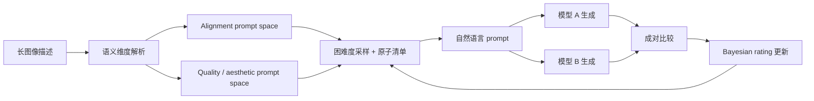

# DynT2I-Eval：动态提示流怎样减少固定题集适应

来源：Wang et al., [*DynT2I-Eval: A Dynamic Evaluation Framework for Text-to-Image Models*](https://arxiv.org/html/2605.06170v1)，arXiv v1（2026-05-07）。重点阅读 §1–§5 和 §6 limitations；这是评测协议论文，不提出图像生成模型。

## 更新题目会带来新的比较问题

公开 benchmark 让实验可复现，但 prompts 被反复使用后，模型和开发者可能逐渐适应固定题集；仅仅每轮换题，又会使新旧分数失去共同参照。DynT2I 将动态评测拆成两项：持续生成有效且有区分度的新提示，以及在 prompt 分布改变时仍能稳定比较模型。[§1–§2](https://arxiv.org/html/2605.06170v1)

## 结构化 prompt space、pairwise comparison 与在线排名

框架先把长图像描述拆成主体、逻辑约束、环境、光照氛围、镜头构图和媒介/格式等维度；对 alignment 与 perceptual/aesthetic quality 构造不同提示空间，再按难度采样组合并改写成自然语言。alignment prompts 同时带原子检查清单，便于将提示内容与评价目标对齐。[§3.1–§3.3](https://arxiv.org/html/2605.06170v1)

评测时模型针对同一批动态 prompts 两两比较，调度器优先分配给尚未充分比较或有排序信息量的模型对；微批次胜/负/平结果再通过带不确定度的 Bayesian rating 更新。作者因此分开发布 alignment、perceptual quality 和 aesthetics 三条排名，而不是把它们压成一个“最好图像模型”总分。[§4.1–§4.2](https://arxiv.org/html/2605.06170v1)

## 结论与边界

动态评测的贡献是尝试降低公开固定题集上的 prompt-set overfitting，并处理不断加入模型时的排序不确定性。作者报告不同评价维度会产生不同模型排序；动态 prompts 不会自动修复评价器对语义、审美或画面错误的偏差，论文也明确说人类判断仍是细腻质量评价的重要补充。[Table 1、§5–§6](https://arxiv.org/html/2605.06170v1)

固定基准适合复现和错误定位，动态基准适合持续跟踪变化；两者回答不同问题。完整评价路线还要说明 prompt space 怎样构造、judge 如何验证、pairwise 结果如何聚合及模型进入 leaderboard 的时间，不能只展示最终排名。
