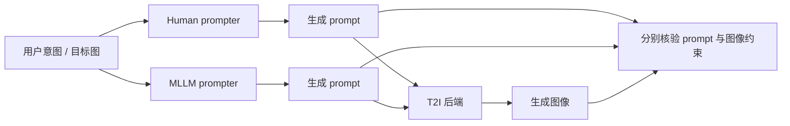

# AtelierEval：把“会写提示”与“会画图”分开评估

来源：Luo et al., [*AtelierEval: Agentic Evaluation of Humans & LLMs as Text-to-Image Prompters*](https://arxiv.org/html/2605.22645v1)，arXiv v1（2026-05-21）。重点阅读 §3–§6 与 Appendix A、F–I；论文为 prompter 评测研究，不是新的图像生成架构。

## 固定 prompt 的模型测试漏掉了上游能力

真实 T2I 系统可能先让用户或 MLLM 把抽象意图变成可执行提示。最终图像失败可能来自两处：prompter 没表达用户意图，或生成器没按提示作图。若所有模型使用同一条 prompt，benchmark 只测第二阶段，不测“人/LLM 如何组织指令”。

AtelierEval 将 prompter 任务分成开放创作（抽象意图变为完整提示）、约束创作（整合多条明确规则）和图像模仿（看目标图后描述视觉属性）三类，每类各 120 项；人类与 MLLM 使用统一的任务协议。它把 prompt 写作看成“用户意图→生成器可执行输入”的转换，而非添加越多形容词越好。[§3.1–§3.4](https://arxiv.org/html/2605.22645v1)

## AtelierJudge：分别检查“写进提示”与“画进图像”

AtelierJudge 同时做主观评分与客观约束核对。每项客观要求有两个检查点：原始意图是否写进提示、生成图是否实现要求。由此区分“未表达”与“表达了但模型没生成”。主观评估按任务类别路由不同技能，并检索带人类评分和理由的案例，校准提示质量、构图、光照等判断。[§4、Appendix I](https://arxiv.org/html/2605.22645v1)

作者比较 8 个 MLLM 与 48 名人类 prompter、4 种图像生成后端；其主要主观评分实验中，AtelierJudge 与人类排序的 Spearman 相关为 0.81，人类间为 0.83。[§5.1–§5.3、Table 2](https://arxiv.org/html/2605.22645v1) 这衡量该任务集和受试者协议下的 evaluator 对齐，不是 prompt 写作质量的普遍准确率。

论文还发现：在它构造的相近复杂度任务中，从目标图模仿视觉特征的 prompter，往往比只根据文字规则规划 prompt 更容易满足约束。作者将其视为“识别/模仿”可能比纯语言回忆细节更有效的证据；这一结果限于其图像模仿与约束创作任务，不能推广成所有提示设计都应优先用参考图。[§5.3](https://arxiv.org/html/2605.22645v1)

## 适用范围

该 benchmark 限于单轮纯文本提示，不覆盖多轮视觉反馈、图像作为输入、搜索式 prompt 优化或协作创作；人类参与者的构成也限制外推。[§6](https://arxiv.org/html/2605.22645v1) 与 [GenEval 2](2512.16853-geneval2.md) 的分工是：前者测 prompter 是否表达用户意图，后者测生成器是否实现 prompt 原子条件。端到端系统若只报最终图像分数，会把两个环节混在一起。
