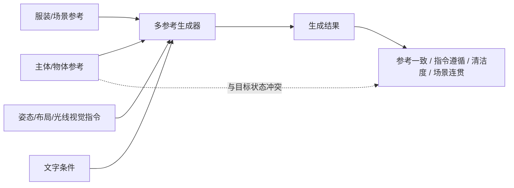

# VIF-Bench：多参考图、视觉指令和条件冲突要一起评测

来源：Oshima et al., [*VIF-Bench: Evaluating Visual Instruction Following in Multi-Reference Image Generation*](https://arxiv.org/html/2609.37709v1)，arXiv v1（2026-09-29，CC BY 4.0）。重点阅读 §3–§5 与 Appendix I；这是评测基准论文，不是新生成模型。

## 一个参考图 benchmark 为什么不够

多模态图像生成可同时接收主体照片、服饰/风格参照、布局框、姿态图和光线箭头。此时参考图不只是“提供身份”，也可能携带与目标指令冲突的旧状态：参考人物侧身，而指令要求正面；参考图是霓虹侧光，而视觉箭头要求正面白光。只测单张参考图的身份保持，无法看出模型如何处理多条件冲突。

VIF-Bench 构造 1,241 个多参考任务，最多使用 7 张参考图与 6 张异质视觉指令图，覆盖布局、姿态、方向、风、光照等条件，并在一部分任务中显式设计 reference–instruction conflict。对同一子集，作者还把视觉指令转换为不同详细度的文本条件，比较视觉控制和语言描述的信息损失。[§3.1–§3.3](https://arxiv.org/html/2609.37709v1)

## 评测揭示的是控制优先级，不只是“像不像”

作者用六个维度分别评分参考一致、视觉指令遵循、场景连贯、清洁度、视觉质量等。在其测试模型与条件下，参考图数增加会降低多项能力；当参考图显著表达某个属性而视觉指令要求覆盖它时，方向/姿态/风/光照控制尤其容易被忽略。论文还报告 adherence–artifact trade-off：强化视觉指令遵循有时会留下箭头、框线或指令痕迹。[§4.1–§4.5](https://arxiv.org/html/2609.37709v1)

它与 [DisCo](2604.00849-disco-subject-generation.md) 互补：VIF-Bench 让多条件冲突可测，DisCo 则尝试用解耦/再耦合训练处理主体身份和文本修改的拉扯。一个重在评测接口，一个重在训练机制。

## 证据边界

论文以多个 VLM judge 评分，并在 168 张图的人工子集上报告相关性；judge 间偏好仍可能不同。参考池混合了真实图与合成图，合成来源集中于少数生成器，论文也将来源多样化列为后续工作。[§4.6、Appendix G–I](https://arxiv.org/html/2609.37709v1)

因此，VIF-Bench 的结论支持“多参考视觉指令联合控制仍有独立瓶颈”，不能直接外推到纯文本文生图或所有图像编辑任务。实际阅读还需区分每类视觉指令、参考数、冲突类型和评价维度，不能把六项得分合并成单一“多模态生成能力”。
