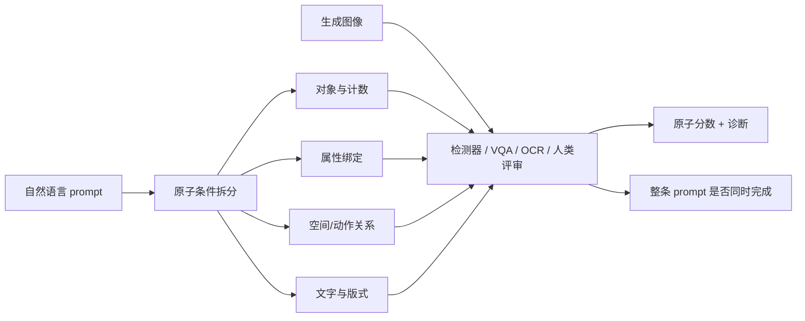

# 组合性提示与图像生成评测：从单个对象到开放条件

> 本篇串联图像生成中的 prompt adherence 与评测研究。它关心的不是“哪个模型分数最高”，而是：一条提示包含哪些可以独立失败的条件？评测器看到了什么？题集、judge 和用户 prompt 变化后，结论还能否成立？论文数字均为对应原文报告；本篇没有统一重跑不同基准。

## 一条提示其实是一组约束

例如“左边放一只蓝色猫，右边两只黄色狗，墙上写 OPEN”至少包含：猫和狗都出现、颜色分别绑定、对象数量、左右位置、文字内容与位置。生成器有可能只完成其中一部分。一个整体图文相似度无法告诉读者是哪项条件失败，因此组合性评测开始把 prompt 拆成原子条件，再设计对应的检查器。

关键是同时保留**原子正确率**和**整条提示正确率**：算术平均能回答“局部能力大致怎样”，整条 prompt 要求的几项全部满足时，则需看 conjunction/更严格聚合，否则会掩盖一项关键失败。

## 组合性评测如何演进

| 研究路线 | 代表工作 | 它怎样判定 | 新增的诊断能力 | 仍依赖的假设 |
|---|---|---|---|---|
| 固定对象级核验 | [GenEval](../papers/2310.11513-geneval.md) | COCO 检测器找对象/框，分类器判颜色 | 对象存在、数量、2D 位置和颜色绑定可拆分 | 检测器类别、提示模板和关系范围有限 |
| 多维组合 benchmark | [T2I-CompBench++](../papers/2307.06350-t2i-compbench-plus.md) | 属性/关系/数量/复杂组合使用不同 VQA、检测器或 MLLM | 任务覆盖更广，能比较评测器设计 | 多种 judge 分数不是同一尺度，3D 提示不代表 3D 已被可靠测量 |
| 新一代基准与原子判断 | [GenEval 2](../papers/2512.16853-geneval2.md) | 扩展对象、属性、关系和计数，人工重审旧基准；Soft-TIFA 对每个原子问 VQA | 可区分 judge 漂移、原子能力与 prompt-level 联合成功 | 模板化问题仍有限；VQA backbone 也会错 |
| 开放词汇诊断 | [SANEval](../papers/2602.00249-saneval.md) | LLM 解析对象/属性/关系，open-vocabulary detector grounding，分模块评分 | 同义词扩展与结构化错误反馈 | parser、同义词映射和检测器共同构成新的误差链 |
| 多参考视觉指令 | [VIF-Bench](../papers/2609.37709-vif-bench.md) | 多参考图与多张布局/姿态/光照等视觉指令联合输入 | 显式测试 reference–instruction 冲突和指令伪影 | 参考集含合成图，VLM judge 与候选模型分布会影响结果 |
| 条件分布指标 | cFreD [原文](https://arxiv.org/html/2503.21721v2) | 按同一 prompt 比较真实/生成图在特征空间中的条件分布 | 尝试兼顾图像质量与提示条件，而非把 FID、CLIP 简单分开 | 依赖特征编码器与参考数据；全局分布距离仍不会指出某条 prompt 哪个条件错了 |

这几条线互相补位，不是分数逐年升高的同一比赛：GenEval 的机制透明但词表小，SANEval 扩大开放词汇却要验证解析器；T2I-CompBench++ 覆盖多能力但评测器异质；GenEval 2 说明基准本身可能饱和并偏离人类判断；VIF-Bench 则测过去 benchmark 未覆盖的多参考条件冲突。

## Prompt 本身也可能是一个待评估的系统组件

AtelierEval 把 upstream prompter 拉进评价：同一原始意图先由人或 MLLM 改写为可执行 prompt，生成器再产图，评分分别检查提示有没有表达条件、图像有没有实现条件。它与图像生成器 benchmark 的重要区别是，不把一个好/坏输出全部归因给图像模型。[AtelierEval 精读](../papers/2605.22645-atelier-eval.md)

固定 benchmark 和动态 benchmark 也承担不同用途。[DynT2I-Eval](../papers/2605.06170-dynt2i-eval.md) 从长描述构造结构化 prompt space，持续采样并用成对比较更新多维排名，以降低对公开固定题目的适应。刷新 prompt 不能自动保证构念有效：新 prompt 仍由有限模板/LLM 构造，自动 evaluator 也可能保留系统偏好。

## 读一个分数前先追这四件事

1. **目标**：评分的是图像真实感、整体偏好、单个对象条件、关系组合，还是文字是否可读？
2. **可见性**：评测器能看到图像哪个对象/区域，还是只有整图—整句 embedding？有无检测框、原子问题和证据？
3. **judge 边界**：检测词表、OCR、VQA/MLLM 是否能识别目标类别、关系、细节和冲突？对 judge 换模型/提示是否做过敏感性分析？
4. **外推范围**：固定模板、已见词表、少量参考图、单轮生成与真实创作任务差多远？题库被公开和复用后，是否重新检查人类对齐？

因此，报告中的“prompt adherence”不宜用单一指标表示。更好的结论格式是：在某个固定条件集合下，哪些原子条件已测、哪些失效能被定位、评测组件本身会漏掉什么，以及哪些用户/数据分布没有覆盖。
