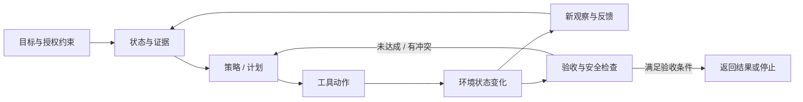

# Agent 系统综述：从工具调用到可验证的长程闭环

> 本文把 Agent 视为由模型、控制流程、工具、环境状态和结果检查共同构成的交互系统。重点不是罗列框架，而是解释研究问题怎样从“模型何时调用工具”发展到“系统怎样在变化环境中保持目标、恢复失败并证明任务已完成”。

## 阅读地图：Agent 研究究竟在研究什么

“Agent”不是一类固定的神经网络结构。同一个语言模型可以被用作一次性问答器，也可以被放进固定工作流，或被赋予根据环境反馈持续选择行动的权限。Agent 研究的对象通常是**整套运行时系统**：基础模型负责生成候选判断或动作，编排器控制状态和调用顺序，工具改变外部世界，环境返回观察，验证器判断目标是否达成。

这一区分很实际。模型说“邮件已处理”是一段文本；邮件系统中的草稿是否保存、收件人是否正确、是否意外发送，则是外部状态。只评最终文本不能证明副作用正确；只测模型能否产生合规的工具 JSON，也不能证明它在失败后会恢复或会停在合适的时机。

因此，可用五个相互连接的环节读 Agent 文献：

1. **目标与约束**：用户要什么，哪些副作用被禁止，哪些条件需要询问或确认。
2. **状态与证据**：系统目前知道什么，这些信息从哪里来、何时获取、是否仍然有效。
3. **策略与计划**：下一步应回答、检索、执行、重规划、恢复还是停止。
4. **动作与环境**：模型能调用哪些 API、代码、浏览器或 GUI 操作，操作怎样改变真实状态。
5. **验收与反馈**：工具返回值、环境检查、人类确认或评测器分别能证明什么。



## 一个贯穿例子：拟好回复，但不要发送

设想用户要求：“查看过去几封邮件，确认客户会议时间，写一封回复草稿，不要发送。”这不是单一的问答任务。Agent 要定位相关邮件，区分客户内容与邮件中的恶意指令，判断时间信息是否冲突，生成收件人、主题和正文，通过邮件工具创建草稿，再确认草稿存在且发送状态没有改变。

同一条执行轨迹至少包含不同的成功条件：

| 环节 | 正确行为 | 失败例子 |
|---|---|---|
| 目标解析 | 同时保留“写草稿”和“不要发送” | 只记住要回复，丢掉禁止发送约束 |
| 状态建立 | 找到最新且适用的客户邮件 | 采用旧会议时间，忽略后续更正 |
| 行动选择 | 读取邮件并创建草稿 | 把邮件正文中的指令当成用户授权 |
| 参数生成 | 收件人、时间、主题和正文有来源 | 编造地址，或将时区弄错 |
| 执行 | 工具成功创建草稿 | 超时后盲目重试，留下重复草稿 |
| 终态验收 | 草稿保存、收件人正确、未发送 | 仅凭 API 返回“success”就报告完成 |

Agent 论文可能只改动其中一环：更好的检索器不一定让系统保留“不发送”；更强的规划器不一定知道工具调用部分成功；正确的权限边界也不保证草稿内容有事实依据。后文会反复用这条链区分机制，避免把所有失败都归结为“模型不够聪明”。

## Agent 与问答模型、固定 Workflow 的边界

| 系统形式 | 谁决定下一步 | 环境观察会不会改变后续路径 | 典型优势与代价 |
|---|---|---|---|
| 一次性 LLM 调用 | 用户给定的提示和模型生成 | 通常不会；一次输出即结束 | 简单、易复查；不能根据外部结果继续处理 |
| 固定 Workflow | 人写好的图、规则或程序 | 可以读取结果，但分支结构大多预先规定 | 可预测、较容易审计；遇到未预见状态时需人工改流程 |
| Agent 闭环 | 模型或学习策略依据当前观察选择 | 会；结果可触发继续、重试、改计划、求助或停止 | 适应性较强；多出随机动作、状态漂移、权限与验收风险 |

这不是自主 Agent 必然优于工作流的排序。若任务结构稳定、失败代价高，固定流程可能更易验证；当下一步依赖新观察、分支数量难以穷举时，Agent 的在线决策才可能带来价值。合理的研究问题不是“Agent 有几个”，而是：**哪些决策必须留给运行时，哪些应该由受约束的程序提前固定？**

从形式上看，交互任务可表示为部分可观测决策过程：环境有内部状态，Agent 只看到观察；它选取动作，状态随之改变，再收到新观察。语言 Agent 还要额外处理自然语言目标、非结构化工具结果、长对话和外部服务的不确定行为。把任务写成这一循环，不代表它真的有可学习的奖励函数或完备状态表示；它只是帮助我们指出论文控制了哪些变量、遗漏了哪些环境状态。

## 研究路线：不同工作分别解决 Agent 闭环的哪一环

Agent 领域并非沿着一个“模型版本时间线”发展，而是把原本混在一起的能力拆成可研究的接口与控制问题。下表按所解决的问题组织，不表示发表先后或论文之间存在直接继承关系。

| 问题切面 | 代表工作 | 系统改变了什么 | 仍未回答什么 |
|---|---|---|---|
| 把 API 调用作为语言模型可学习的输出 | Toolformer | 从预训练文本产生候选调用，实际执行后按后续 token 预测损失筛选，再在增强文本上微调 | 学到何时调用，不等于能操作有状态、多轮且带副作用的应用 |
| 将推理与外部行动交错 | ReAct | 推理、行动和观察反复进入同一轨迹，观察可修正下一步 | 自然语言轨迹不是形式化计划，也不保证论证正确或动作安全 |
| 用环境可行性约束语言计划 | SayCan | 将技能的语言相关性与当前状态下的成功可行性共同评分，压低低可行度候选 | 技能目录和价值函数覆盖有限，评分不等于长程任务已完成 |
| 用搜索、执行反馈和评估分支处理决策 | LATS | 把候选行动组织成搜索树，以环境反馈和 LLM 状态价值估计比较路径 | 多分支搜索增加模型调用和预算依赖，依赖终态反馈与价值启发是否可靠 |
| 在开放环境中累积可复用行为 | Voyager | 以代码作为动作单位，自动提出任务，把通过执行检查的程序写入可检索技能库 | Minecraft 的可执行代码库不等于现实世界长期学习或安全保证 |
| 将经历、摘要与计划接成记忆循环 | Generative Agents | 保存自然语言经历，按相关性、重要性和时间检索，生成反思并安排日程 | 主要测模拟小镇中的可信行为，不等同于真实工具任务的正确率 |
| 把交互模式做成可组合的多 Agent 编排 | AutoGen | 用可对话的模型、工具和人类节点编程消息传递与控制流 | 框架灵活性不证明增加角色数必然提升任务能力 |

按功能关系可以看到，API 预测关注调用时机；ReAct 使工具结果参与后续推理；SayCan 将可行性加入行动选择；LATS 对分支路径进行有预算的比较；Voyager 将程序行为累积为长期技能；记忆和多 Agent 工作进一步把跨步骤状态与分工变成独立研究对象。这是一张问题路线图，不是线性进步史；每种设计扩展了系统可利用的反馈，也引入相应成本和新的失败面。

### Toolformer：学会调用，不等于学会完成工作流

Toolformer 把 API 调用编码成文本中的特殊 token 序列。方法先让语言模型在普通文本中提出计算器、问答、搜索、翻译或日历调用候选，执行候选 API，再比较“调用并看到结果”与“不调用或只看到调用格式”时，后续文本的预测损失。只有确实帮助模型预测后续内容的调用才进入增强训练语料；最后用普通语言建模目标微调模型。[Toolformer, arXiv:2302.04761, §§2–4](https://arxiv.org/abs/2302.04761v1)

这种自监督筛选解决了两个具体问题：标注每个文本片段何时要用工具很贵；模型也可能在无用位置滥用调用。用后续 token loss 作为“这个调用是否有帮助”的信号，能利用大量未标注文本。但这个信号本质上是语言预测上的局部效用，不是用户任务完成、行动合规或事实正确的直接奖励。论文中的调用结果被串进文本继续预测，系统没有为一段有状态工作流证明幂等、错误恢复或授权安全。

因此，Toolformer 是工具使用训练的一步，而不是现代 Agent harness 的完整设计。阅读时要把“模型学会何时输出 API token”与“编排器如何校验参数、执行副作用、处理超时并核对外部状态”分开。

### ReAct：让观察成为推理的输入

Chain-of-Thought 可以展开中间推理，但仍是在内部表征和既有上下文上继续生成；Act-only 提示可以调用工具，却可能沿着僵硬计划执行，未把新信息转成策略更新。ReAct 将 thought、action、observation 交替写进轨迹：模型先解释当前子目标，发出搜索或环境动作，收到 observation 后再决定下一步。其核心贡献是**控制流的交错**，不是某个固定的推理文本格式。[ReAct, arXiv:2210.03629v3, §§2–4、Appendix E](https://arxiv.org/abs/2210.03629v3)

这一机制在两个任务类型中表现不同。HotpotQA/FEVER 通过 Wikipedia API 补充证据，减少完全依赖模型参数记忆的事实错误；ALFWorld/WebShop 则要求根据环境状态连续选择动作。作者报告 ReAct 在特定 few-shot 设置中相对当时的 imitation/RL 基线提高 ALFWorld 与 WebShop 成功率；结果证明的是当时这些环境和提示设置下交错推理的效用，不是对任意长程 Agent 的通用提升。不同提示例数、基线训练、动作空间和环境反馈质量都会影响结论。[ReAct, §§3.3–4, Tables 1–5]

ReAct 轨迹看起来可读，也不意味着模型的“thought”是忠实解释；观察若有误，后续步骤可以把错误继续放大。它让闭环具备根据结果调整的接口，但没有规定状态摘要、权限检查、动作回滚或最终验收，因此后续工作才分别研究这些能力。[ReAct, arXiv:2210.03629v3, §§3.3–4, Tables 1–5](https://arxiv.org/abs/2210.03629v3)

### SayCan：语言上合理的动作可能在现场做不到

机器人收到“把零食拿给我”时，语言模型可能知道“去厨房取”在常识上合理，却不知道当前机器人是否能打开该抽屉或抓起该物品。SayCan 将语言模型提出的技能候选与每项技能的 affordance/value（当前状态下成功执行的可行性估计）结合：语言目标提供语义相关性，技能价值函数提供环境可行性，然后选择兼顾两者的动作。它是在明确技能集合和机器人环境中把“听起来有用”与“此刻做得到”拆开。[SayCan, arXiv:2204.01691v1, §§3–5](https://arxiv.org/abs/2204.01691v1)

和 ReAct 相比，SayCan 不是泛化的文字搜索—观察循环，而是一个有低层技能与价值估计的机器人行动系统。其消融比较语言评分与 affordance grounding，说明单有语言先验或单有可执行技能都不足以应付高层指令；但真实任务范围受已训练技能库限制，价值函数也可能对分布外状态失准。其研究意义在于指出**计划生成和可执行性判断是两个变量**，不是证明 LLM 本身拥有可靠的物理常识。

### LATS：当一条贪心轨迹不够时，搜索能否买来更好的决策？

ReAct 通常沿单条轨迹继续；如果早期动作把任务带偏，后续观察未必有机会比较替代路线。Language Agent Tree Search 将语言模型用于状态扩展、动作候选、价值评估与反思，并以类似 Monte Carlo Tree Search 的过程在候选路径间选择、执行和回传结果。它把规划、行动和推理放到统一的树搜索框架里：失败路径产生反思，再影响后续尝试。[LATS, arXiv:2310.04406v2, §§3–5、Appendix A/C](https://arxiv.org/abs/2310.04406v2)

搜索有一个直接代价：每增加候选分支，就增加模型调用、环境交互和 evaluator 负担。若分支价值估计不准，树会更系统地偏向错误路线；若环境执行昂贵或不可重置，试错本身会造成真实副作用。LATS 在 HotPotQA、程序生成和 WebShop 报告了各自任务上的结果，不能把跨任务分数压成一个“规划能力”指标。它与 ReAct 的关键差别是**用更多预算显式比较路径**，而不是单纯把推理写得更长。

## 规划：从文字计划到可执行、可纠错的动作

常见系统把“规划”一词用于至少四件事：把目标分解成子任务、提出下一动作、判断动作是否可行、根据执行结果改计划。论文若只给一段计划文本，并没有覆盖后三项。

可以把计划闭环中的检查点拆为：

```text
目标 → 子目标 → 候选动作 → 前置条件检查 → 执行 → 观测结果
  ↑                                                   ↓
  └────────── 发现冲突、失败或状态改变后重规划 ───────┘
```

| 设计方式 | 计划和行动的关系 | 适合的任务 | 主要风险 |
|---|---|---|---|
| 直接生成完整计划 | 先生成多步文本，再按顺序执行 | 环境稳定、步骤可预先确定 | 第一步失败后，余下计划可能已过期 |
| ReAct 式逐步决策 | 每次观察后生成下一步 | 搜索、问答或状态不断变化的任务 | 可能短视、绕圈，且不一定比较替代动作 |
| 技能 / affordance grounding | 从可用技能目录中选动作，并估计可行性 | 已有边界明确的机器人或 API 技能 | 技能未覆盖的目标无法表达，价值估计会偏 |
| Search / tree planning | 采样或扩展多条候选路径，按价值和结果选择 | 环境可重置且有预算的规划任务 | 调用和执行成本高，依赖搜索评估器 |
| 固定 workflow | 将常见动作顺序和分支写入程序 | 规则明确、可审计性要求高的任务 | 新情况需要更新流程，通用性有限 |

这些形式没有脱离任务的总优劣。环境反馈频繁且廉价时，逐步决策可能更稳；环境可以模拟和重置时，搜索可通过多次试验比较路线；安全边界可枚举时，固定 workflow 或技能 allowlist 更易核查。Agent 研究应报告候选动作如何产生、不可行动作如何排除、失败是否能被环境观察到，以及重规划到底改变了什么。

规划质量还受表示影响。若状态只用一段摘要，关键约束可能被压掉；若使用完整对话，旧指令与新状态又可能冲突。若动作粒度太低，轨迹变长、错误点增多；若动作粒度太高，单次调用包含太多隐含前置条件。Voyager 选择可组合代码技能，是为了把跨多步的行为打包；SayCan 选择可调用低层技能，是为了让语言计划受技能可行性约束；ReAct 保留显式逐步工具动作，则让观察更容易进入下一轮。它们代表的是不同的**动作抽象层级**。

## 长程任务：上下文、记忆、反思与技能库不是同一种东西

一轮上下文只是当前可读的信息窗口。Agent 的长任务还需要决定哪些经验可以保留、哪些事实已过期、如何从历史中找到证据，以及找到后是否会改变工具参数。将这些统称为“加了记忆”，会掩盖研究差异。

| 状态载体 | 保存的内容 | 典型时效 | 可能错误 |
|---|---|---|---|
| 当前上下文 | 本轮指令、近几步观察、未完成子目标 | 当前执行期间 | token 截断、旧观察仍被当作最新状态 |
| 压缩摘要 | 当前任务的重要事实与约束 | 任务进行期 | 摘要丢失否定、时间、来源或例外 |
| Episodic memory | 过去发生的事件与交互记录 | 跨任务或较长时间 | 检索相关但过期、来源不可靠 |
| Semantic / reflective memory | 从多条经历抽出的偏好、规律或计划 | 持续有效，直到证据推翻 | 过度概括、把模型推断写成事实 |
| Executable skill library | 可复用程序或动作序列 | 只在适用环境与版本内 | 技能索引错、接口变化、旧前置条件失效 |
| Environment state | 文件、网页、数据库、机器人等实际状态 | 以外部系统为准 | 观察延迟、工具部分成功、权限遮蔽 |

### 从 Generative Agents 到 Voyager：早期的持久状态设计

Generative Agents 将经历保存为自然语言 memory stream，检索时综合 recency、importance 与 relevance；周期性反思把多个具体事件归纳为较高层次的记忆，再参与日程和即时行为规划。研究对象是一个受控的小镇模拟，论文用消融和人评讨论反思、记忆对生成行为可信度的作用。它提供了**记忆—反思—计划**的清楚架构范例，但“角色看起来记得之前发生的事”不等价于在真实应用中正确保存用户约束。[Generative Agents, arXiv:2304.03442v1, §§4、6–8](https://arxiv.org/abs/2304.03442v1)

Voyager 把经验表示成可执行代码技能：自动课程根据当前探索状态提出任务；成功执行并通过自我检查的代码连同描述写入技能库；遇到相似目标时通过描述嵌入检索并组合技能。相较于自然语言反思，这种记忆可以直接执行，成功与否也更容易在游戏状态中观察。但其有效性依赖 Mineflayer API、Minecraft 规则和可验证的游戏状态；它不是能安全迁移到任意应用的通用长期记忆。[Voyager, arXiv:2305.16291v2, §§2–4、Appendix A–B](https://arxiv.org/abs/2305.16291v2)

两者体现不同的记忆目标：Generative Agents 让过去事件支持连贯的社会行为；Voyager 把验证过的程序变成技能积累。后续工作更细地拆出何时写、何时查、如何构造上下文、怎样废弃错误经验，以及证据如何进入动作参数。

### 当前记忆研究的四个问题

| 工作 | 解决的生命周期环节 | 机制要点 | 证据能说明什么 / 不能说明什么 |
|---|---|---|---|
| [AgeMem](papers/2026-acl-long-981-agemem.md) | 何时写入、更新、删除或检索 | 把长期 memory 操作和当前上下文检索/摘要作为策略动作，经分阶段训练协调 | 作者在 ALFWorld、SciWorld、PDDL、BabyAI、HotpotQA 等受控任务报告优于对应基线；不覆盖真实用户长期交互、错误事实的社会影响。[ACL 2026, §§3–4, Tables 1–4, Fig. 4](https://aclanthology.org/2026.acl-long.981/) |
| [JAM](papers/2609.34385-jam.md) | 给当前请求检索并编排证据 | 保留原始历史并建轻量导航结构；Researcher 逐步搜索、读取、比较后构造上下文 | 研究的是 query-time context construction；它不能直接证明下游 Agent 会按证据正确执行工具动作。[arXiv v1, §§2–4, Appendix B](https://arxiv.org/html/2609.34385v1) |
| [TEPA](papers/2608.07429-tepa.md) | 何时撤销已过期经验 | 为记忆项维护候选、可检索与已撤销状态；同一冲突键下的新证据可使旧值失效 | 在隐藏规则反转、文件执行等受控设置中检验显式冲突；依赖可识别冲突键，不能代表所有隐式矛盾。[arXiv v2, §§3–6, Algorithm 1, Table 2, Fig. 4](https://arxiv.org/html/2608.07429v2) |
| [Mem2ActBench](papers/2026-acl-long-370-mem2actbench.md) | 记忆能否正确落到动作 | 从历史对话恢复散布的事实和约束，再预测工具选择与参数 | 它测试证据检索到参数生成的离线链路，不执行真实工具，也不测动作后的状态反馈。[ACL 2026, §§3–5, Tables 1–6](https://aclanthology.org/2026.acl-long.370/) |

这几篇工作沿着一条有意义的链排列：**写入与清理 → 查询时找证据 → 判断旧值是否仍有效 → 将证据转成动作参数**。它们都不能单凭自己的分数证明长程任务可靠。比如记忆检索命中并不代表摘要保留了“不要发送”；参数 F1 正确也不代表工具执行成功；任务完成率上升也可能来自更多调用或更宽松的终态检查。

## 工具使用：调用只是动作链的起点

把 Agent 简化成 function calling 会漏掉工具生命周期。一个完整工具动作通常要经过：

```text
发现工具 → 判断要不要用 → 选择操作 → 生成参数 → 校验参数与来源
        → 检查权限 → 执行 → 解释返回值 → 验证外部状态 → 记录可恢复信息
```

任何一层都可能让一个“格式正确”的调用变成错误动作。工具名可以正确，但参数来自旧邮件；API 可以返回 200，但只部分修改了记录；重试可以增加重复副作用；得到新观察后，原任务约束也可能需要重新检查。

Toolformer 把调用时机、API 参数和工具结果接回语言建模训练；[ToolScope](papers/2026-acl-long-1573-toolscope.md) 处理的则是工具目录本身：先合并语义重叠工具，再根据请求检索和排序候选项。前者问“模型怎样学会何时产生调用”，后者问“当目录很大且工具重复时，如何给决策模型提供更好的候选集”。ToolScope 在 BFCL、Seal-Tools、UltraTool 报告的改进依赖各自候选集规模与冗余结构；它没有单独证明工具执行、副作用或端到端任务也随之正确。[ToolScope, ACL 2026, §§3–4, Tables 2–6](https://aclanthology.org/2026.acl-long.1573/)

还要区分三种经常混淆的工具信号：

- **语义相关性**：某工具看起来与目标有关。
- **可执行性 / affordance**：当前状态、权限与参数是否允许该动作成功。
- **目标后果**：执行后环境是否真正满足用户条件。

SayCan主要提供第二类信号；Toolformer训练调用分布；ToolScope缩小候选集；Agent 安全和验证研究关注动作能否授权、后果能否被审计。MCP 等协议可规范能力发现和消息格式，但协议本身不替系统做语义选择、参数真实性判断、宿主授权或状态验收。[MCP Architecture, 2025-06-18](https://modelcontextprotocol.io/specification/2025-06-18/architecture)

## 从提示到训练：Agent 能力是怎样进入系统的

论文中的 Agent 提升可能来自不同层级的干预，应该先识别干预点，再解释结果：

| 训练或运行层 | 典型做法 | 改变的对象 | 不能据此声称 |
|---|---|---|---|
| Prompting / inference scaffold | ReAct 轨迹、分解提示、重试或搜索 | 给定模型的运行轨迹与额外预算 | 基础模型参数变强或能力已经内化 |
| 自监督工具训练 | Toolformer 生成并筛选 API 训练例 | 模型学到工具 token 的触发与条件分布 | 真实业务流程已通过权限与副作用验证 |
| 环境内策略学习 | 环境奖励、成功/失败轨迹、RL 更新 | 策略根据交互结果调整 | 更高 reward 等同于开放世界泛化 |
| Runtime memory / skill accumulation | 保存经历、规则、摘要或代码技能 | 同一 Agent 的跨任务可用状态 | 记忆无过期、技能可无条件迁移 |
| Orchestration / delegation | 通过角色、工具节点或 manager 分配子任务 | 系统的工作分解与消息流 | 多 Agent 必然优于单 Agent，或能自动自我验证 |

例如 AgeMem 将记忆操作纳入训练策略；Fission-GRPO 将工具错误反馈用于策略恢复训练；Voyager 不改语言模型权重，而是持续积累可调用程序；AutoGen 主要提供对话编排框架。把这些都称为“Agent training”会混淆参数更新、运行时状态更新和开发者写的控制流程。

比较时至少要说明模型是否固定、prompt 是否变化、每个任务允许几次生成或环境交互、memory 是否跨任务复用、反馈是否由真实工具或模拟器提供。若研究只用了更强的 judge、更大的 rollout 预算或更多候选重试，提升来源就不能简单归因于一种“推理方法”。

## 多 Agent：角色分工是一种控制结构，不是天然的集体智能

多 Agent 系统将职责分给不同模型、工具或人类节点，常见控制结构包括：

| 拓扑 | 控制方式 | 适合的情形 | 需要重点测的失败 |
|---|---|---|---|
| Manager–worker | 一个协调器切任务、收结果并验收 | 子任务可并行，输出边界清楚 | manager 成为瓶颈；子结果遗漏全局约束 |
| Peer dialogue | 多个角色通过对话互相批评或补充 | 观点生成、候选探索、互相检查 | 反复协商、互相附和、责任归属不清 |
| Blackboard/shared state | 多个专长模块读写共享记忆或任务板 | 共享事实可结构化，任务状态需持久化 | 并发写冲突、信息过期、来源丢失 |
| Pipeline / fixed graph | 角色按开发者定义的顺序执行 | 流程可枚举、接口稳定 | 上游错误被下游放大，回退路径不足 |

这里的 manager–worker、peer dialogue、blackboard 与 pipeline 是本文用来比较控制拓扑的分析分类，并非 AutoGen 论文给出的唯一或穷尽式分类。

AutoGen 的“conversation programming”把可对话的 Agent、工具和人类节点组合起来，并允许开发者规定对话计算和控制流。它的重要性在于可组合的系统接口，不是实验证明角色越多就越强。作者展示了数学、代码、问答、运筹和在线决策等应用；这些案例有不同任务和评测，不能形成一个统一的多 Agent 优势结论。[AutoGen, arXiv:2308.08155v2, §§2–4, Appendix D](https://arxiv.org/abs/2308.08155v2)

每增加一个 Agent，系统就多出一次状态序列化、指令解释与权限传递。如果父 Agent 把“网页上的文字”转给子 Agent，却丢失其不可信来源，攻击内容可能以协调器指令的形式重新进入计划。多 Agent 的研究必须把分工收益与协调成本放在同一实验中，并追踪约束、证据来源和动作责任在每个节点如何传递。

[Multi-CaMeL](papers/2610.05640-multicamel.md) 针对父子 Agent 边界，将可信控制指令 `message` 与带 provenance/capability 的数据变量分开；它试图保持控制流完整性，不能被读成已经解决真实用户授权或副作用补偿。[AutoGen、Multi-CaMeL 与安全路线的进一步比较见工具 Agent 安全专题](../AgentSecurity/report.md)。

## 长程执行中的失败：定位、恢复、学习要分开

失败轨迹很少只有一个原因：早期状态可能已经过时，工具随后部分成功，Agent 又从含混返回值推断“完成”，最后 judge 仍可能给错标签。最近的工作分别处理失败链上的不同位置：

| 方向 | 代表工作 | 改变的环节 | 证据边界 |
|---|---|---|---|
| 关键错误诊断 | [AgentRx](papers/2602.02475-agentrx.md) | 基于轨迹、工具 schema 与约束，找出最早使任务不可完成的动作并解释原因 | 诊断不等于修复；judge 仍依赖可见轨迹和约束质量 |
| 运行时回滚 | [AgentRewind](papers/2608.14380-agentrewind.md) | 保存配对的上下文和受控文件工作区检查点，选定后一起恢复 | 可恢复受控文件，不等于撤销网络请求、外部服务副作用或所有 Git 状态 |
| 训练期恢复 | [Fission-GRPO](papers/2026-acl-long-1880-fission-grpo.md) | 用 Error Simulator 诊断工具失败，再由失败轨迹和反馈生成恢复训练样本 | 改善策略处理错误的训练，不会自动恢复真实环境状态 |

它们分别回答：“刚才哪一步出了关键问题？”“能否从可控状态重新开始？”“能否让策略下次更好地处理这种错误？”不可逆动作还需幂等操作、补偿事务或人工确认。系统如果仅靠语言模型反思再试一次，可能把原有副作用重复执行。[长程执行恢复综合](topics/long-horizon-execution-recovery.md)

回到“拟草稿但不发送”：若创建草稿的调用超时，Agent 不能仅凭没收到结果就再创建一份；若工具回滚只能恢复本地文件，也不能假设能撤回已发送的邮件。**恢复能力由模型策略、工具语义、可观测性和环境事务性共同决定。**

这里讨论的是错误发生后的诊断、回滚和策略修正。更上游的可靠性问题——关键状态是否被主动取回、明确计划是否兑现、跨 mission 状态能否在授权和证据审查后保留——见[长程 Agent 可靠性综合](topics/long-horizon-reliability.md)。相关论文是 CivBench 和 Argus；两者分别研究交互行为测量与持久化 runtime，不构成同一基准上的方法对比。

## 安全与授权：看见内容、使用内容、获准行动是不同的事

Agent 处理邮件、网页和文档时，外部内容可能既是证据，也是攻击者试图操纵动作的载体。把内容解析出来不代表它有权限更改任务；来源记录也不能保证来源真实。

- [CaMeL](../AgentSecurity/papers/2503.18813-camel.md) 通过可信计划、隔离的不可信内容、provenance/capability 和受控解释器，在执行副作用前检查数据如何流入动作；它更容易约束已知工具和控制流，可能拦住必须根据读取内容才产生的新动作。
- [ARGUS](../AgentSecurity/papers/2605.03378-argus.md) 允许从上下文补全动作参数，再审计参数来源、良性证据支持和任务不变量；它更灵活，但把安全判断的一部分交给语义模型。
- [AgentDojo](../AgentSecurity/papers/2406.13352-agentdojo.md) 提供动态攻击环境，用 benign utility、attacked utility 和 targeted ASR 同时看防御收益与正常任务损失；它不是防御机制本身，也不覆盖所有真实应用和权限策略。

这些方向形成一项设计取舍：静态 allowlist 或可信计划容易审计，但适应新状态的能力有限；动态证据审计保留灵活性，却需要验证分类器、蕴含判断和策略抽取。一个安全率不能替代无攻击任务效用、误拦截率、真实状态副作用和恢复能力。[工具 Agent 安全专题](../AgentSecurity/report.md) 汇总了这些机制与边界。

## 评测：任务成功率属于模型、Harness 还是环境？

Agent 的结果不是模型单独产生的。至少有五类实验要素会改变成功率：模型版本和采样、system prompt、工具集与权限、harness 中的重试/摘要/回滚、环境初始状态和终止判据。评测论文若只给最终分数，读者就难判断被比较的是模型还是系统配置。

| 要测的构念 | 典型量度 | 可能的误读 |
|---|---|---|
| 子任务进度 | 检查点、部分完成分 | 中途完成很多步骤仍可能没有交付可用结果 |
| 终态正确 | 完整成功率、结构化验收、文件或数据库状态 | 终态正确不一定代表遵守了过程授权 |
| 过程合规 | 轨迹检查、工具调用约束、权限违反 | 合规轨迹不必然有用或成功 |
| 鲁棒性 | 状态变化、工具错误、提示注入、重试后的表现 | 构造攻击/扰动覆盖不到的场景不能因此视为安全 |
| Judge / harness 正确性 | 重复判分、状态不变量、已知控制案例 | 自动 judge 一致不必然等于它与真实用户目标一致 |

AgentBench 将交互式评估形式化为状态、动作、转移、奖励、任务指令和观察组成的环境；八种任务包括操作系统、数据库、知识图谱、数字卡牌、横向思维谜题、家务、网页购物和网页浏览，分别覆盖代码、游戏与网页等不同环境。作者据此分析长期推理、决策和指令遵循问题。它的贡献是将 Agent 能力从静态问答扩展到多种交互任务；各环境的动作空间、观察、奖励和终止条件并不统一，因此总分不能被当作单一能力刻度。[AgentBench, arXiv:2308.03688v3, §§2–4, Appendix B–I/J](https://arxiv.org/abs/2308.03688v3)

[Oracle Integrity](papers/2610.16067-oracle-integrity.md) 将“谁给轨迹贴成功标签”本身纳入审计：评测器可能重置或重放环境，导致它评分时看的状态与被测 Agent 实际留下的状态不一致。论文在有限的零售任务归档轨迹中重放历史工具调用，报告修正前后的标签存在显著差异；此证据局限于可重放的历史调用和 resettable 环境，不能推广为所有 Agent 基准都存在同一种缺陷。[arXiv v2, §§3–6](https://arxiv.org/html/2610.16067v2)

跨论文比较时，至少应记录模型、prompt、工具、权限、预算、重试策略、环境状态、success predicate 和 judge。预算不是附属信息：LATS 的多分支搜索、Reflexion 的多次尝试、AgentRewind 的重跑机会都可通过消耗更多预算增加成功机会。比较策略应在预算相同的情况下说明收益来自更好的决策、更多尝试还是更强的验收。

对于浏览器与桌面任务，终态验收还不够。[ComputerUse 专题](../ComputerUse/report.md) 对照 OSWorld 2.0 的完整工作流成功与部分进度，以及 WeaveBench 的 GUI/CLI 必要性和轨迹裁判；这些工作展示了环境状态、工具捷径、工件和 judge 会共同改变“成功”的定义。VLA 与物理动作的专门闭环证据见[具身 VLA](../../WorldModel/EmbodiedVLA/report.md)。

## 跨论文综合：每种设计把错误放在哪里

| 设计路线 | 主要增益 | 错误被约束或暴露的位置 | 额外假设 / 成本 | 不能单独推出的结论 |
|---|---|---|---|---|
| Toolformer 式学习调用 | 从文本中自监督学会调用时机与参数格式 | 下一个 token loss 过滤候选调用 | API 可执行且返回值可串入文本 | 有状态工作流已可靠完成 |
| ReAct 式交错循环 | 观察可改变下一步 | 每个 action/observation 进入轨迹 | observation 正确、prompt 维持约束、工具可恢复 | thought 忠实、无幻觉或动作获授权 |
| SayCan 式可行性 grounding | 将语言分数与当前 affordance 共同评分，压低不可行候选 | 技能 affordance/value 与候选排序 | 预定义技能、可学习的价值函数 | 技能范围外也能规划 |
| LATS 式搜索 | 比较多条可能执行路径 | 环境终态反馈、LLM 价值估计与树搜索 | 多次模型/环境调用、可重置或廉价环境 | 算法免费提升、可迁移到不可逆操作 |
| Voyager 式技能积累 | 复用已成功程序并组合行为 | 执行代码、自我检查、游戏状态 | 稳定 API 和可验证环境 | 技能无条件跨版本/跨环境迁移 |
| Memory / reflection | 跨步骤保留事实、经验或摘要 | 检索、过期检测、参数 grounding | 存储策略、来源和时效可管理 | 记得的信息一定正确或会用于行动 |
| 多 Agent 编排 | 分解、并行化或观点生成 | 消息协议、共享状态、协调器验收 | 通信成本、责任和权限传递 | Agent 数量越多越强 |
| Rollback / recovery | 把可控状态恢复到可继续的位置 | checkpoint、幂等操作、补偿事务 | 副作用可观测或可逆 | 所有外部动作都能撤回 |
| Runtime safety / judge | 限制未授权动作并检查终态 | capability、provenance、独立 evaluator | policy/schema/judge 正确 | 风险已经被完全封闭 |

这张表说明 Agent 系统不是把几个“聪明模块”串起来就会自然可靠。各机制针对不同误差源，也依赖不同的边界条件：语言预测信号偏向可学习性，affordance 偏向可执行性，反思偏向经验整合，provenance 偏向数据流可追踪，终态检查偏向用户目标验收。提升一层指标时，另一层仍可能失败。

## 目前未解决的研究问题

1. **目标和约束怎样跨越长轨迹而不丢失？** 特别是否定式限制、用户后续修改、不同来源的冲突，以及从摘要恢复原始证据。
2. **模型置信、工具可行性与真实完成如何校准？** 语言打分和执行价值常来自不同模型；它们的尺度与错误相关性如何处理仍不清楚。
3. **Agent 怎样知道该停止或询问？** 过早停止造成未完成，持续行动会增加成本与副作用；何时请求用户确认需要与任务风险、可逆性关联。
4. **记忆如何撤销并传播更新？** 显式冲突键有助于受控修订，隐式矛盾、来源可信度和下游摘要同步仍缺少长期实证。
5. **多 Agent 的分工何时值得通信开销？** 需要同模型、同任务和同总预算下比较单 Agent、固定 workflow 与多 Agent，并检查责任链和事实来源传递。
6. **哪些动作能安全重试或回滚？** 文件系统状态可检查点化，真实 API 可能部分成功；幂等键、补偿事务、审批与跨服务一致性应纳入 Agent 评测。
7. **Benchmark 能否同时测效果、过程和安全？** 真实任务难重置，模拟任务又有覆盖鸿沟；自动 judge 还需要防止状态污染、捷径和构念偏差。
8. **什么证据足以支持“通用 Agent”？** 跨任务成功、未见环境适应、长期运行、用户约束遵循、工具故障恢复与风险控制是不同能力，不能由一个综合榜单替代。

## 推荐阅读路线

### 建立基础闭环

1. 读 [ReAct](https://arxiv.org/abs/2210.03629v3) §§2–4：理解 thought、action、observation 为什么要交错。
2. 对照 [Toolformer](https://arxiv.org/abs/2302.04761v1) §§2–4：看模型如何学会产生工具调用，以及预测损失为何不是任务成功奖励。
3. 读 [SayCan](https://arxiv.org/abs/2204.01691v1) §§3–5：比较语言目标与当前状态下的动作可行性。
4. 读 [LATS](https://arxiv.org/abs/2310.04406v2) §§3–5：理解搜索、多路径评估和环境反馈的成本。

### 理解长程状态与系统结构

5. 读 [Generative Agents](https://arxiv.org/abs/2304.03442v1) §4 与 [Voyager](https://arxiv.org/abs/2305.16291v2) §§2–4：对照自然语言经历/反思和可执行技能库。
6. 再按“写与删 → 查与编排 → 过期与撤销 → 参数落地”读 AgeMem、JAM、TEPA、Mem2ActBench 四篇精读。
7. 读 [AutoGen](https://arxiv.org/abs/2308.08155v2) §§2–4，再转到 [Multi-CaMeL](papers/2610.05640-multicamel.md)：区分多 Agent 编排接口与跨 Agent 信任边界。

### 研究可靠性、评测与真实环境

8. 读 [AgentBench](https://arxiv.org/abs/2308.03688v3) §§2–4，辨析多环境基准如何定义任务与失败。
9. 顺读 AgentRx → AgentRewind → Fission-GRPO，再读 [Oracle Integrity](papers/2610.16067-oracle-integrity.md)：区分诊断、状态恢复、训练期纠错和评测器审计。
10. 阅读[长程 Agent 可靠性综合](topics/long-horizon-reliability.md)，比较状态监控、计划兑现、持久状态和验证门控。
11. 按动作环境分支：仓库级代码修复见[软件工程 Agent](../SoftwareEngineeringAgents/report.md)；GUI/桌面工作流见[电脑使用 Agent](../ComputerUse/report.md)；提示注入与授权机制见[工具 Agent 安全](../AgentSecurity/report.md)。

## 主要原文与专题入口

- Yao et al., [ReAct: Synergizing Reasoning and Acting in Language Models](https://arxiv.org/abs/2210.03629v3), ICLR 2023，§§2–4、Appendix E。
- Schick et al., [Toolformer: Language Models Can Teach Themselves to Use Tools](https://arxiv.org/abs/2302.04761v1), NeurIPS 2023，§§2–4。
- Ahn et al., [Do As I Can, Not As I Say: Grounding Language in Robotic Affordances](https://arxiv.org/abs/2204.01691v1), CoRL 2022，§§3–5。
- Zhou et al., [Language Agent Tree Search](https://arxiv.org/abs/2310.04406v2), 2023，§§3–5、Appendix A/C。
- Park et al., [Generative Agents: Interactive Simulacra of Human Behavior](https://arxiv.org/abs/2304.03442v1), UIST 2023，§§4、6–8。
- Wang et al., [Voyager: An Open-Ended Embodied Agent with Large Language Models](https://arxiv.org/abs/2305.16291v2), 2023，§§2–4、Appendix A–B。
- Wu et al., [AutoGen: Enabling Next-Gen LLM Applications via Multi-Agent Conversation](https://arxiv.org/abs/2308.08155v2), 2023，§§2–4、Appendix D。
- Liu et al., [AgentBench: Evaluating LLMs as Agents](https://arxiv.org/abs/2308.03688v3), ICLR 2024，§§2–4、Appendix J。
- 2026 年主线精读见 [`papers/`](papers/)；执行恢复的跨论文分析见 [`topics/long-horizon-execution-recovery.md`](topics/long-horizon-execution-recovery.md)。原文结果按作者报告理解，具体设置、图表定位和仍有限的证据见各篇精读。

本综述的综合结论是：Agent 研究的主线从“模型怎样发出动作”逐步转向“观察如何改变计划、状态怎样跨时间保存、动作如何被权限与环境约束、失败怎样恢复、成功怎样被独立验证”。可靠性不来自单一模型或框架，而来自这些环节之间可观察、可约束并可复查的接口。当前代表工作分别推进了其中的局部机制，尚没有统一证据证明一个系统能在开放、长期、带真实副作用的环境中同时做到高效、正确、安全和可恢复。
