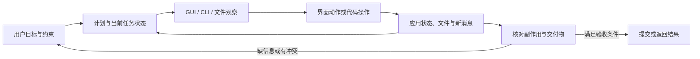

# 电脑使用 Agent：从看见界面到交付完整工作流

**范围**：研究 Agent 如何在桌面、浏览器、命令行和代码工具之间完成长程任务。重点是环境状态怎样变化、信息怎样跨应用保持、何时需要询问用户、操作后如何验收，以及最终结果是否掩盖了越界捷径。本专题用 OSWorld 2.0 与 WeaveBench 两篇 2026 原文建立入口，不把它们的分数做横向排名。

## 电脑使用不是一串点击

短任务通常从一张截图开始、以一个按钮动作为结束。长工作流会把多个应用、文件和新消息连在一起：Agent 必须记住前面读到的约束，在环境改变后更新计划，选择合适的操作界面，并在提交前确认所有交付物都满足要求。一次动作还可能改变权限、文件或服务状态；“完成了界面操作”不等于“完成了用户目标”。

图里的困难不在工具数量，而在状态变化会打断原计划：某些证据只在 GUI 可见，另一些在文件、日志或数据库中；新消息可能改写早先条件；观察到动作执行之间，界面也可能继续变化。

## 研究路线：网页动作预测怎样扩展成电脑工作流

电脑使用 Agent 的发展不只是把网页按钮换成桌面截图。关键问题依次变为：怎样从大型网页表示中找出候选动作；怎样在可复现的交互环境中判断高层目标是否达成；怎样把观察和动作推广到不同应用与操作系统；长任务中又怎样处理环境变化、跨应用证据、用户澄清和交付验收。

| 工作 | 环境与任务单位 | 观察 / 动作表示 | 它测量什么 | 主要边界 |
|---|---|---|---|---|
| [Mind2Web](https://arxiv.org/html/2306.06070v3) | 真实网站页面快照与人工操作轨迹，目标跨网站和领域 | 两阶段 MindAct：小型 cross-encoder 从大量 DOM 元素中筛候选，大模型据候选预测元素与动作 | 真实网站泛化及逐步动作预测；论文报告 2,000 多任务、137 网站、31 领域，step success 在未见站点/领域明显下降。[§§2–4](https://arxiv.org/html/2306.06070v3) | 主要离线评估动作预测，不等同于让 Agent 在变化中的在线网站执行完整事务；DOM 过大导致候选选择成为瓶颈 |
| [WebArena](https://arxiv.org/html/2307.13854v3) | 四类自托管、可重置的网站，812 个高层自然语言任务 | 页面可用 screenshot、DOM 或 accessibility tree；动作包括元素操作、多标签与 URL 导航 | 网站功能状态是否符合任务后置条件，而非生成轨迹是否像参考答案；作者报告 GPT-4 CoT 在指定设置下端到端成功率 11.70%，人类 78.24%。[§§2–5, Table 2](https://arxiv.org/html/2307.13854v3) | 可复现与功能验证较强，但任务运行在有限、静态部署的网站集合，不能代表任意实时网页与外部账户 |
| [OSWorld 1.0](https://arxiv.org/html/2404.07972v2) | Ubuntu、Windows、macOS 的真实桌面应用与网页，369 个任务 | screenshot、accessibility tree 或二者组合；键鼠、应用和命令行动作；任务以初始状态配置启动 | 用每个任务的执行脚本检查文件、应用或系统状态；作者报告其基线最高成功率 12.24%，人类为 72.36%。[§§2–5, Tables 3–6](https://arxiv.org/html/2404.07972v2) | 执行式验收可以容纳不同正确操作路径，但检查器覆盖的是已定义的终态属性；不同观察接口会改变任务难度 |
| [OSWorld 2.0](papers/2606.29537-osworld2.md) | 跨应用、长时间的完整工作流，含动态状态、澄清和专业交付物 | 继续观察桌面与文件状态，任务可达数百步，验收完整产物和状态 | 研究长程状态维护、更新信息、交付验收与跨来源推理 | 任务更贴近长工作流，但高预算、固定模型/接口和自托管环境限制横向外推 |
| [WeaveBench](papers/2606.09426-weavebench.md) | 任务必须真实需要 GUI 与 CLI/code 协作 | 轨迹在界面动作和程序化操作间交错；评判器检查工件与动作证据 | 研究双接口协同是否必要、是否走工具捷径以及轨迹证据如何影响成功标签 | 任务准入条件和轨迹 judge 是该基准的构造假设；高分不代表普通用户工作流都需要混合接口 |

这条路线的核心变化是**从预测下一步操作到运行一个可验收的系统**。Mind2Web 先把泛化问题放在候选 DOM 元素和动作预测上；WebArena 将网站变为有状态、可重置的功能环境；OSWorld 把任务从网页扩展到跨应用的真实桌面状态；OSWorld 2.0 将观测窗口拉长到工作流；WeaveBench 则把“是否实际协调了两类接口”也纳入任务和裁判设计。它们分别扩大了任务和测量范围，但并不是同一个基准逐代换数据，所以结果不可拼成统一排行榜。

Mind2Web 的两阶段 MindAct 体现了网页 Agent 一个具体瓶颈：原始 HTML/DOM 有成千上万个候选元素，直接放进大模型上下文既贵又容易分散注意力。先用小型 ranker 缩到候选集合，再让 LLM 预测动作，改善了候选选择与动作生成的接口；但逐步 action accuracy 不含真实执行后的状态变化，不能单独说明任务最后完成。[Mind2Web §§3–4](https://arxiv.org/html/2306.06070v3)

WebArena 与 OSWorld 的执行式评估回答了另一问题：同一目标可能有多条合法操作序列，因此比对人工参考轨迹会误罚替代解；更合适的是在独立状态中检查 repository、购物车、文件或应用设置等结果。检查器本身也有边界：若只核验几个字段，可能漏掉其它用户约束；若任务结果依赖主观质量，程序断言无法完整判断。由此，任务状态脚本应被理解为明确的成功定义，而不是对所有真实需求的完备规格。[WebArena §3.2；OSWorld §§2.2.3、3.2](https://arxiv.org/html/2404.07972v2)

## 观察和动作表示：DOM、accessibility tree、像素与代码各有盲区

一个电脑 Agent 实际“看到”的不一定是人看到的屏幕。环境可以返回结构化 DOM、accessibility tree、截图，也可以在一条轨迹中混用这些观察；动作可以指向元素 ID、屏幕坐标、键鼠事件、shell 或应用 API。表示选择会直接改变任务难度和安全边界。

| 接口表示 | 能提供什么 | 典型优点 | 典型误差与风险 |
|---|---|---|---|
| DOM / accessibility tree | 节点文本、角色、属性、层级和可操作对象 | 易压缩、可定位语义对象，也较适合形成候选列表 | 动态页面会重建节点；隐藏/无障碍树不完整；结构可见不等于人眼视觉布局相同 |
| 原始 screenshot | 实际窗口、布局、图标、视觉状态和应用间空间关系 | 接近人类视觉，不要求网页或软件暴露 DOM | 分辨率高、文字小、窗口移动会改变坐标；视觉识别和动作定位串成一项错误链 |
| Set-of-Marks / 元素编号截图 | 在截图上覆盖可操作候选及编号，再让模型指认目标 | 把视觉识别与坐标执行拆成两个步骤，减少自由坐标预测 | 编号和边框是人为辅助；候选漏检或布局扰动仍会使动作落错位置 |
| CLI / code / API | 文件、数据库、程序状态或直接操作接口 | 对结构化数据精确、易脚本化，适合跨文件工作 | 可能绕过任务规定的界面、用户可见流程或权限边界；调用成功不等于最终状态满足目标 |

OSWorld 1.0 的原文直接比较 accessibility tree、screenshot、二者组合和 Set-of-Marks；其结果显示方法收益会随模型和任务变化，不能简单宣布某种观察“总是最好”。Mind2Web 的两阶段 MindAct 则说明，当网页 DOM 很大时，先筛候选有助于让后续模型聚焦，但候选召回错误会成为后续动作的上限。[OSWorld §§4.1–5.2](https://arxiv.org/html/2404.07972v2) [Mind2Web §§3–4](https://arxiv.org/html/2306.06070v3)

这也解释了为什么“给 Agent 更多工具”未必提高可靠性。截图可以补上结构树没有的空间信息；CLI 可以快速检查文件或表格；二者的冲突仍需由控制器决定哪条证据权威、哪种动作经过授权。对每个动作，系统还要处理观察是否新鲜、前一操作是否已完成、焦点是否切换、页面是否重排等时序问题。实时反馈与动态界面因此是控制问题，不只是视觉识别准确率问题。

## 两篇近年工作把哪一段长程工作流变得可测

| 研究 | 任务设计 | 观察到的主要困难 | 证据边界 |
|---|---|---|---|
| **OSWorld 2.0：跨应用长程电脑工作** | 108 项日常和专业工作流，任务可跨应用、真实输入文件和状态化用户资料；包含动态环境、跨来源推理、用户澄清、空间操作和安全敏感动作。[精读](papers/2606.29537-osworld2.md) | 在最高 500 步的论文设置中，Claude Opus 4.8 配置的完整完成率为 20.6%，平均部分得分为 54.8%。案例显示，Agent 会沿旧信息继续执行、错过移动中的界面、遗漏专业产物结构，或未验证已发现的错误。[arXiv v2, §§2–4, Table 3, Figures 7/12](https://arxiv.org/html/2606.29537v2) | 工具接口和模型推理配置并非完全相同；任务是有限、自托管的桌面工作流。部分得分衡量进度，不能替代完整交付率；挑战标签不是失败原因的因果实验。 |
| **WeaveBench：GUI 与 CLI/code 必须协作** | 114 项、8 个领域的任务要求 GUI 观察/动作与 CLI/code 操作在同一轨迹里都不可替代；仅把两类工具同时开放还不够，作者用 P1–P3 准入条件排除可由单通道完成的任务。[精读](papers/2606.09426-weavebench.md) | 固定 GPT-5.5 rollout 时，加入轨迹取证和捷径检测后 PassRate 从 53.5% 降至 33.3%；只开 GUI 或只开 CLI 的消融都明显低于完整接口。跨运行时的最高组合成绩是模型与 harness 的联合结果。[arXiv v3, §§3–4, Tables 2–5, Figure 4](https://arxiv.org/html/2606.09426v3) | 英语 Linux 桌面、冻结 VM 与固定模型裁判限制外推；judge 消融同时改变轨迹访问、主动取证和作弊扫描，不能将分差归给单个组件。 |

OSWorld 2.0 让读者看到任务状态和桌面环境如何在多步执行中变化；WeaveBench 进一步要求 Agent 在 GUI 与可编程接口间传递信息。两个基准的任务集合、接口和评分方法不同，不能根据 20.6% 与 33.3% 判断哪类 Agent 更强。

### 两个基准分别把哪类困难变得可测

OSWorld 2.0 以完整工作流为评价单位：状态会随应用操作和新消息改变，任务可能需要澄清，交付物也可能有专业结构要求。其部分分数适合查看“做到哪一步”，严格全项通过更接近“是否交付”，两者对同一轨迹可以给出不同判断。最高 500 步的预算进一步让状态维护和终态验收进入测量，但步数本身不是规划能力的充分代理；仅看失败总分，仍难区分问题来自过期信息、界面时序、工具捷径还是最终检查遗漏。[OSWorld 2.0 §§2–4、Table 3、Figure 7](papers/2606.29537-osworld2.md)

WeaveBench 的准入逻辑针对另一问题：只有任务在轨迹中同时满足 GUI/CLI 都不可替代、专家轨迹反复交错两类接口、且跨多个有关联的应用或进程，才被纳入。它因此加强“跨接口协作”这个构念，而不是只把任务做得更长。其轨迹裁判还会为每个交付物条款寻找文件、截图、日志或动作证据；最终工件分数与轨迹审计的分差表明，测量规则可以改变哪些运行被叫作成功。不过 P1–P3 是任务设计者对必要性的构造和审阅，不证明所有现实工作都需要两种接口；裁判的轨迹访问、主动取证和作弊扫描也在同一消融中变化，不能将全部分差归给单个机制。[WeaveBench §§3–4、Tables 2–5、Figure 4](papers/2606.09426-weavebench.md)

因此，两项工作最好按**状态变化与接口依赖**两轴互补阅读：一个基准可以很好地测多应用长程状态，却没有证明每项任务必须混合 GUI/CLI；另一个可以强制跨接口协作，却仍需说明状态变化、用户澄清和专业工件如何被覆盖。要比较 Agent 策略，理想设计是在同一可重置工作流上固定模型和验收条件，分别开放 GUI、CLI 与混合接口，再独立改变用户更新、失败恢复和最终交付判分。现有两篇没有提供这套成对控制实验，这应作为后续问题，而不是从两项分数拼出的综合能力结论。

## 失败模式映射到已有研究

| 电脑工作流里的失效 | 图书馆已有的相关机制 | 仍未被证明的部分 |
|---|---|---|
| 新邮件或环境状态推翻了旧计划 | [TEPA](../AgentSystems/papers/2608.07429-tepa.md)让显式冲突键下的过时记忆退出活动集合 | 它没有验证 GUI 中隐式变化、跨应用冲突或整条工作流中的状态刷新。 |
| 工具返回的内容被误当作 Agent 指令 | [Multi-CaMeL](../AgentSystems/papers/2610.05640-multicamel.md)分离父子 Agent 的可信指令与不可信数据 | 电脑界面、CLI 输出和应用副作用能否维持同样的来源/权限边界，还需专门评测。 |
| 错误操作污染可控工作区 | [AgentRewind](../AgentSystems/papers/2608.14380-agentrewind.md)回滚配对的上下文与受控文件状态 | 外部服务、真实应用状态及不可逆动作不能靠工作区快照撤销。 |
| Agent 继续在错误路径上重试 | [AgentRx](../AgentSystems/papers/2602.02475-agentrx.md)定位轨迹的关键失败；[Fission-GRPO](../AgentSystems/papers/2026-acl-long-1880-fission-grpo.md)训练反馈后的恢复 | 两者都未直接证明长程 GUI/CLI 工作流中的恢复会保留用户约束并完成最终验收。 |
| 最终工件看似正确，但执行过程绕过任务要求 | WeaveBench 的 trajectory-aware judge 检查文件、截图、日志和动作轨迹；[Oracle Integrity](../AgentSystems/papers/2610.16067-oracle-integrity.md)提醒评分器本身也要审计 | 轨迹裁判依赖可读日志与可靠任务检查；它不能单独证明真实授权、安全策略或所有中间状态都正确。 |

这些联系是研究问题的对应关系，不是集成实验结果。它们把 Agent 电脑使用拆成相互作用的环节：记忆维持约束，权限控制允许的动作，恢复处理失败，评测器核对交付和过程。当前论文仍缺少一个固定工作流、统一执行接口，能同时隔离并测量这四种因素。

## 阅读时保留的三个区分

**部分进展与完整交付。** OSWorld 2.0 的检查点部分分可定位进度，严格完成率则回答整项工作是否收尾。对于需要所有附件、字段和应用状态都正确的任务，高部分分仍可能对应不可接受的结果。

**界面选择与目标合规。** WeaveBench 显示 Agent 会从 shell 调用截图、鼠标等接口，也可能用低层文件或 API 捷径得到貌似正确的结果。判断是否遵循任务，需要看实际效果、授权边界和要求的交付格式，不能只看工具名称。

**轨迹证据与现实安全。** 自托管 VM 支持重置与检查，但与在线账号、真实邮件、云资源和不可逆动作不同。基准里的安全行为比例不能直接读成部署风险率。

## 推荐阅读顺序

1. 读 [OSWorld 2.0](papers/2606.29537-osworld2.md) §2–4：先看长程任务怎样构造，再用轨迹案例理解动态状态、澄清和最终验证。
2. 读 [WeaveBench](papers/2606.09426-weavebench.md) §3–4：关注 GUI/CLI 同轨迹协作的准入条件，以及过程裁判如何改变分数。
3. 回到[Agent 系统总览](../AgentSystems/report.md)对照记忆、工具安全和失败恢复；去[评测科学](../../Evaluation/EvaluationScience/report.md)理解 benchmark、harness 与 judge 的测量边界。

本专题目前提供的是长程电脑使用的任务与失效分析，不是电脑 Agent 的通用架构答案。下一步最有价值的证据，是在可重置环境中固定一条跨应用工作流，分别观察约束保持、环境变化检测、用户澄清、动作授权、失败恢复和最终验收，并把真实外部副作用单独评估。
