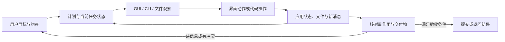

# 电脑使用 Agent：从看见界面到交付完整工作流

**范围**：研究 Agent 如何在桌面、浏览器、命令行和代码工具之间完成长程任务。重点是环境状态怎样变化、信息怎样跨应用保持、何时需要询问用户、操作后如何验收，以及最终结果是否掩盖了越界捷径。本专题用 OSWorld 2.0 与 WeaveBench 两篇 2026 原文建立入口，不把它们的分数做横向排名。

## 电脑使用不是一串点击

短任务通常从一张截图开始、以一个按钮动作为结束。长工作流会把多个应用、文件和新消息连在一起：Agent 必须记住前面读到的约束，在环境改变后更新计划，选择合适的操作界面，并在提交前确认所有交付物都满足要求。一次动作还可能改变权限、文件或服务状态；“完成了界面操作”不等于“完成了用户目标”。

图里的困难不在工具数量，而在状态变化会打断原计划：某些证据只在 GUI 可见，另一些在文件、日志或数据库中；新消息可能改写早先条件；观察到动作执行之间，界面也可能继续变化。

## 两篇论文分别把哪一段工作流变得可测

| 研究 | 任务设计 | 观察到的主要困难 | 证据边界 |
|---|---|---|---|
| **OSWorld 2.0：跨应用长程电脑工作** | 108 项日常和专业工作流，任务可跨应用、真实输入文件和状态化用户资料；包含动态环境、跨来源推理、用户澄清、空间操作和安全敏感动作。[精读](papers/2606.29537-osworld2.md) | 在最高 500 步的论文设置中，Claude Opus 4.8 配置的完整完成率为 20.6%，平均部分得分为 54.8%。案例显示，Agent 会沿旧信息继续执行、错过移动中的界面、遗漏专业产物结构，或未验证已发现的错误。[arXiv v2, §§2–4, Table 3, Figures 7/12](https://arxiv.org/html/2606.29537v2) | 工具接口和模型推理配置并非完全相同；任务是有限、自托管的桌面工作流。部分得分衡量进度，不能替代完整交付率；挑战标签不是失败原因的因果实验。 |
| **WeaveBench：GUI 与 CLI/code 必须协作** | 114 项、8 个领域的任务要求 GUI 观察/动作与 CLI/code 操作在同一轨迹里都不可替代；仅把两类工具同时开放还不够，作者用 P1–P3 准入条件排除可由单通道完成的任务。[精读](papers/2606.09426-weavebench.md) | 固定 GPT-5.5 rollout 时，加入轨迹取证和捷径检测后 PassRate 从 53.5% 降至 33.3%；只开 GUI 或只开 CLI 的消融都明显低于完整接口。跨运行时的最高组合成绩是模型与 harness 的联合结果。[arXiv v3, §§3–4, Tables 2–5, Figure 4](https://arxiv.org/html/2606.09426v3) | 英语 Linux 桌面、冻结 VM 与固定模型裁判限制外推；judge 消融同时改变轨迹访问、主动取证和作弊扫描，不能将分差归给单个组件。 |

OSWorld 2.0 让读者看到任务状态和桌面环境如何在多步执行中变化；WeaveBench 进一步要求 Agent 在 GUI 与可编程接口间传递信息。两个基准的任务集合、接口和评分方法不同，不能根据 20.6% 与 33.3% 判断哪类 Agent 更强。

## 失败模式映射到已有研究

| 电脑工作流里的失效 | 图书馆已有的相关机制 | 仍未被证明的部分 |
|---|---|---|
| 新邮件或环境状态推翻了旧计划 | [TEPA](../AgentSystems/papers/2608.07429-tepa.md)让显式冲突键下的过时记忆退出活动集合 | 它没有验证 GUI 中隐式变化、跨应用冲突或整条工作流中的状态刷新。 |
| 工具返回的内容被误当作 Agent 指令 | [Multi-CaMeL](../AgentSystems/papers/2610.05640-multicamel.md)分离父子 Agent 的可信指令与不可信数据 | 电脑界面、CLI 输出和应用副作用能否维持同样的来源/权限边界，还需专门评测。 |
| 错误操作污染可控工作区 | [AgentRewind](../AgentSystems/papers/2608.14380-agentrewind.md)回滚配对的上下文与受控文件状态 | 外部服务、真实应用状态及不可逆动作不能靠工作区快照撤销。 |
| Agent 继续在错误路径上重试 | [AgentRx](../AgentSystems/papers/2602.02475-agentrx.md)定位轨迹的关键失败；[Fission-GRPO](../AgentSystems/papers/2026-acl-long-1880-fission-grpo.md)训练反馈后的恢复 | 两者都未直接证明长程 GUI/CLI 工作流中的恢复会保留用户约束并完成最终验收。 |
| 最终工件看似正确，但执行过程绕过任务要求 | WeaveBench 的 trajectory-aware judge 检查文件、截图、日志和动作轨迹；[Oracle Integrity](../AgentSystems/papers/2610.16067-oracle-integrity.md)提醒评分器本身也要审计 | 轨迹裁判依赖可读日志与可靠任务检查；它不能单独证明真实授权、安全策略或所有中间状态都正确。 |

这些联系是研究问题的对应关系，不是集成实验结果。它们把 Agent 电脑使用拆成相互作用的环节：记忆维持约束，权限控制允许的动作，恢复处理失败，评测器核对交付和过程。当前论文仍缺少一个固定工作流、统一执行接口，能同时隔离并测量这四种因素。

## 阅读时保留的三个区分

**部分进展与完整交付。** OSWorld 2.0 的检查点部分分可定位进度，严格完成率则回答整项工作是否收尾。对于需要所有附件、字段和应用状态都正确的任务，高部分分仍可能对应不可接受的结果。

**界面选择与目标合规。** WeaveBench 显示 Agent 会从 shell 调用截图、鼠标等接口，也可能用低层文件或 API 捷径得到貌似正确的结果。判断是否遵循任务，需要看实际效果、授权边界和要求的交付格式，不能只看工具名称。

**轨迹证据与现实安全。** 自托管 VM 支持重置与检查，但与在线账号、真实邮件、云资源和不可逆动作不同。基准里的安全行为比例不能直接读成部署风险率。

## 推荐阅读顺序

1. 读 [OSWorld 2.0](papers/2606.29537-osworld2.md) §2–4：先看长程任务怎样构造，再用轨迹案例理解动态状态、澄清和最终验证。
2. 读 [WeaveBench](papers/2606.09426-weavebench.md) §3–4：关注 GUI/CLI 同轨迹协作的准入条件，以及过程裁判如何改变分数。
3. 回到[Agent 系统总览](../AgentSystems/report.md)对照记忆、工具安全和失败恢复；去[评测科学](../../Evaluation/EvaluationScience/report.md)理解 benchmark、harness 与 judge 的测量边界。

本专题目前提供的是长程电脑使用的任务与失效分析，不是电脑 Agent 的通用架构答案。下一步最有价值的证据，是在可重置环境中固定一条跨应用工作流，分别观察约束保持、环境变化检测、用户澄清、动作授权、失败恢复和最终验收，并把真实外部副作用单独评估。
