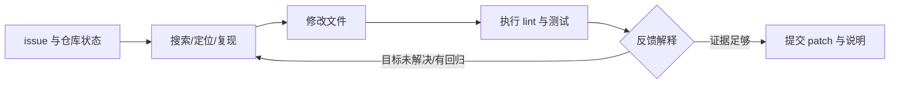

# 软件工程 Agent：从理解 issue 到验证 patch

> 代码模型补全一个函数，和 Agent 修复真实仓库，是两种不同任务。软件工程 Agent 要理解 issue、找到相关代码、修改文件、运行测试、解释失败，再决定是否继续改动。研究核心不只是“模型会不会写代码”，而是**工具/环境如何提供可用反馈，训练如何塑造执行环，基准又把什么叫成功**。

## 1. 先把任务单位说清楚

给模型一个闭合函数签名、输入和期望输出时，主要问题是局部代码生成；给它一个 GitHub issue 和代码仓库时，模型首先不知道答案在哪。它必须在大而不完整的上下文中定位实现，理解调用关系和测试，选择文件编辑，并判断测试输出意味着什么。最终 patch 可能改对目标，却破坏其他行为；也可能测试通过，但需求描述不完整或测试漏测。

因此仓库级工程任务可拆成五个判断：

1. **理解问题**：issue 的现象、期望行为、约束和复现条件是什么？
2. **定位状态**：相关文件、符号、调用路径和已有测试在哪里？
3. **提出修改**：patch 是局部修复、接口变化还是重构？
4. **获取反馈**：lint、单元测试、集成测试和人工审查分别揭示什么？
5. **判断交付**：哪些检查通过，仍有哪些未知副作用，是否该停止或请求信息？

这条循环不同于“模型生成一次 patch 再打分”：测试输出会变成下一步观察，决定 Agent 是否修复、回滚或解释。错误恢复、状态隔离和停止条件是算法行为的一部分。

## 2. Agent 与工具环境怎样组成执行环

### 2.1 SWE-agent：为仓库工作设计 action/observation 接口

SWE-agent 提出 Agent-Computer Interface（ACI）：不是把普通 shell 原样交给模型，而是设计针对 issue 修复的搜索、文件查看、编辑和 lint 工具。局部窗口和输出预算把大仓库观察分成可管理片段；lint 可即时反馈语法或格式问题，让 Agent 在测试之前发现一类错误。[SWE-agent 精读](papers/loop-swe-agent.md)

这一设计把工具接口当成研究变量：同一 LLM 用较好的命令和状态反馈，可能更有效地定位/编辑。但 lint 通过只说明语法/风格检查过了，不证明逻辑正确；工具输出太长、搜索结果太宽或状态压缩不当，仍会引发定位错误。论文在 SWE-Bench 子集上的 ablation 比较了具体 ACI，不能外推为每种仓库、语言和工具配置都有相同收益。

### 2.2 Agentless：把自主探索改成分阶段流水线

Agentless 以问题定位、候选 patch 生成、验证选择组成较固定的流程。定位阶段缩小相关文件/位置，生成阶段为若干候选提出修改，最后使用语法检查、测试及投票等规则选择。它减少了无限制交互搜索，也让每阶段更容易复查；代价是前一阶段漏掉正确位置时，后续 patch 候选难以补救。[Agentless 精读](papers/loop-agentless.md)

它提醒读者：软件修复不一定需要一个持续自我规划的自由 Agent。多阶段算法可以在更明确的搜索空间里完成任务，但要问每阶段是否可分解、候选数量如何控制、验证器是否能区分等价修复。它测得的并不是任意工具环境中的通用 Agent 能力。

### 2.3 OpenHands：Agent 抽象、事件状态和 sandbox runtime 分开

OpenHands 把 Agent、动作事件流、状态记录和执行 sandbox 作为可替换的系统组件。这个平台视角让相同模型可以接不同 Agent、不同运行环境，也让轨迹能保留工具调用和结果；但 framework 提供接口，不代表每种 Agent policy 都可靠。[OpenHands 精读](papers/loop-openhands.md)

三种路线的关键差异不是“自主程度排行榜”，而是**控制流在哪里**：SWE-agent 将交互压到专用 ACI，Agentless 采用有界阶段流程，OpenHands 提供通用 Agent/runtime 平台。发生失败时，应分别检查问题理解、工具选择、工作区状态、编辑范围、命令结果和验收逻辑。

## 3. 训练如何从仓库任务获得经验

代码 Agent 的训练信号可以来自多种任务构造与验证渠道；它们不应统称为“软件工程 RL”。

| 训练路线 | 任务/轨迹怎样获得 | 更新目标 | 主要假设与边界 |
| :-- | :-- | :-- | :-- |
| [SWE-Gym](papers/train-swe-gym.md) | 在可执行仓库环境中产生修复轨迹，筛选测试成功样本 | 成功轨迹监督微调，也可训练 outcome verifier | 测试决定成功标签；轨迹 SFT 不等于在线 RL |
| [SWE-smith](papers/train-swe-smith.md) | 从真实仓库合成 bug 任务，运行测试确认 bug/修复 | 生成专家轨迹并对学生做 SFT | 合成 bug 分布由生成器、AST 变换与测试覆盖共同限定 |
| [SWE-RL](papers/train-swe-rl.md) | 从历史 issue / PR 与 patch 构造训练样本 | GRPO 奖励 patch 与唯一 oracle patch 的相似度 | patch 相似度不等于执行测试通过；正确的不同写法可能被低估 |

**训练一个软件工程 Agent，至少要说明数据是什么、环境有没有执行、成功标签从哪来、策略是否在线更新。** SWE-Gym 的可运行环境将测试 pass 转成训练信号；SWE-smith 将构造任务规模化但把任务分布绑定到生成器与测试；SWE-RL 从软件演化记录优化 patch 生成，但用 patch 相似度近似修复质量。它们可互补，不能只因都使用 GitHub 数据就合并成同一种训练路线。

合成任务尤其需要区分“任务实例数”和“有效训练轨迹数”：环境可能无法安装，bug 没有被测试触发，教师轨迹未能修复，或过滤器排除了某种合法方案。每一层过滤都会改变学生接触到的工程行为分布。

## 4. 评测究竟把“修好”定义成什么

| 基准/方法 | 任务交付物 | 验收方式 | 能支持到哪里 |
| :-- | :-- | :-- | :-- |
| [SWE-bench](papers/eval-swe-bench.md) | 针对 GitHub issue 的仓库 patch | 在固定 base commit 上应用 patch 并运行 FAIL_TO_PASS / PASS_TO_PASS 测试 | 测指定测试集上的 issue resolve，不证明所有需求和未测输入正确 |
| [Terminal-Bench 2.0](papers/eval-terminal-bench.md) | 容器中的最终系统状态 | 环境 tests 检查任务目标属性，可经多种工具路径完成 | 测 terminal 工作流终态，不等于仓库级 patch 修复 |
| [SWE-Proof](papers/eval-swe-proof.md) | 满足形式化规格的 patch | 规格检查器证明实现符合给定 specification | 增加形式保证，但规格对自然语言需求是否完整仍是上游问题 |

SWE-bench 的 resolved 表示给定 patch 通过某组测试；Terminal-Bench 的任务成功表示容器终态满足指定属性；SWE-Proof 表示实现满足形式规格。它们不是同一个“正确率”。SWE-bench harness 还要锁定 base commit、依赖版本、patch 应用方式、测试套件与 agent scaffold；该基准 Verified 子集的人工筛选降低了一部分问题/测试缺陷，但并未把 tests 变成形式证明。[SWE-bench 精读](papers/eval-swe-bench.md)

对一个 coding-agent 成绩，至少追问：模型版本、Agent scaffold、工具权限、执行环境、问题/仓库快照、最大轮数与每次尝试预算、测试/规格覆盖、重试策略、是否允许投票，以及任务是否可能污染。SWE-bench Verified 复审说明部分测试仍会影响合理 patch 的判定；这不意味着该基准所有任务均无效，而是应对 resolved 结果作条件化解释。[OpenAI 官方复审材料](https://openai.com/index/why-we-no-longer-evaluate-swe-bench-verified/)

## 5. 把模型与工程系统分开读

软件工程 Agent 的最终结果更像一个系统交付：

- 模型生成搜索、计划、编辑和测试动作；
- harness 提供文件、命令、网络、测试与环境 reset；
- Agent policy 决定何时查看、修改、重试、验证或停止；
- benchmark tests/specifications 把用户意图映射为可评分状态；
- 预算和 retry policy 决定可以探索多少候选。

因此同一模型在不同 scaffold 上的差别，可能来自观察窗口、shell 接口、patch 编辑方法、验证工具或预算；不同模型在相同基准上的分差，也依赖相同的运行条件。**benchmark 分数是模型×Agent×harness×环境×验收协议的系统结果，不是裸模型代码能力。** 读模型系列报告时看其论文对 training 和 capability 的证据；读 OpenHands、DeepSeek Harness、mini-swe-agent 等仓库深读时再追固定版本的运行时和状态契约。

## 6. 与相邻专题的边界

- [智能体系统](../AgentSystems/report.md)解释规划、工具使用、状态、记忆与长程执行；本专题把范围缩到软件仓库和可执行修复流程。
- [电脑使用 Agent](../ComputerUse/report.md)研究视觉界面中的 grounding 与交互；shell/patch Agent 可直接读文件、执行测试，观测和动作空间不同。
- [测试时学习与适应](../../LLM/TestTimeAdaptation/report.md)研究模型参数/fast weights 更新；coding Agent 执行失败后修改工作区，通常是环境状态变化，不等于更新模型权重。
- [Agent 安全](../AgentSecurity/report.md)关注工具权限、提示注入和副作用；coding Agent 的 sandbox、secret access、test execution 和写权限是其具体安全面。
- [开源仓库深读](../../OpenSource/README.md)解释具体 harness/runtime 的实现；软件工程综述讲方法和评测差异，不替代固定版本源码分析。

## 7. 推荐阅读路线与开放问题

1. 先读 [SWE-bench](papers/eval-swe-bench.md)，理解 issue、base commit、测试补丁与 resolved 判据。
2. 对读 [SWE-agent](papers/loop-swe-agent.md) 与 [Agentless](papers/loop-agentless.md)，比较交互式循环和分阶段流水线。
3. 读 [SWE-Gym](papers/train-swe-gym.md)、[SWE-smith](papers/train-swe-smith.md)、[SWE-RL](papers/train-swe-rl.md)，区分可执行测试、合成任务和 patch-similarity 奖励。
4. 再看 [Terminal-Bench](papers/eval-terminal-bench.md) 与 [SWE-Proof](papers/eval-swe-proof.md)，从最终状态验收和形式规格理解不同正确性主张。
5. 最后读 [OpenHands](papers/loop-openhands.md)，将 Agent policy 放进事件流、sandbox 和平台抽象中理解。

开放问题包括：测试套件如何覆盖隐式产品需求、依赖升级和跨文件副作用；Agent 如何在失败后保留有效状态而不是重复编辑；代码生成与执行验证如何在预算内平衡；PR 级 patch 代理奖励何时可以替代真实测试；benchmark 任务如何减少公开数据训练污染；以及通过测试的 patch 能否满足维护者、用户和安全要求。
