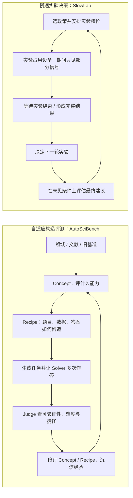

# 科学 Agent 的评测证据：基准能否跟上，实验是否真正闭环？

这两类问题常被“科学 Agent 评测”这个总称混在一起：一类问评测任务能否持续揭示当前 Agent 的失败，另一类问 Agent 能否在时间长、资源稀缺、结果延迟的实验中做出有效决策。前者主要改造**题目和基准的生成方式**，后者主要改造**Agent 所处的实验过程**。它们互补，但成功标准不同，也都不等于系统已经做出科学发现。

图中的两条循环回答不同的设计问题。AutoSciBench 让评测任务本身可被求解轨迹修订；SlowLab 让评测过程包含长等待、资源占用、不可逆选择和不完整观测。前者不能代替真实实验环境，后者也不能单独证明新实验设计具有一般科学价值。

## AutoSciBench：从“写一个难题”变成基准构造闭环

AutoSciBench 的高层 **concept** 规定评测目标：科学领域、数据模态和期望的分析操作；低层 **recipe** 把目标转成具体问题、输入文件、所需交互和可检验答案。执行阶段再产生任务实例，让求解 Agent 多次尝试；judge 根据求解轨迹和答案估计任务是否可验证、是否困难，以及是否能绕过预期的数据审查或证据整合。发现捷径后，系统可改 recipe 或 concept；已完成的修订经验又能影响后续概念生成。[AutoSciBench v1，§3.1–§3.4](https://arxiv.org/html/2610.05140v1)

这条设计路线针对一个测量问题：固定题集会逐渐饱和，而科学基准的更新需要领域专家、数据和可验证答案。论文从计算生物学、材料科学和临床影像的种子基准与文献工作流出发，报告生成任务在若干领域提高了当前求解器的挑战性；其质量评价则使用两种 LLM judge，对可验证性、科学用途和 Agent 适配度评分。关键机制不是“更难的题一定更好”，而是用**预期能力 → 任务 recipe → 求解轨迹 → 反馈修订**的循环，把隐藏的捷径和缺失操作显露出来。[§4.1–§4.5](https://arxiv.org/html/2610.05140v1)

**它能支持的判断**：在论文选定的三个科学领域和任务构造流程中，自动生成与反馈修订可以构造更具挑战性的任务，并可尝试随模型能力更新基准。作者报告，生成基准在计算生物学和材料科学中的平均 solver accuracy 分别比对应人工基准低 22.4 和 25.5 个百分点；这是论文指定基准、模型和执行配置下的结果，表示难度差异，不是科学 Agent 的真实性能损失或科学发现率。[摘要、§4.2](https://arxiv.org/html/2610.05140v1)

这组难度比较从 CompBioBench、MatTools 和 MedCTA 三个种子基准出发；作者用 Opus 4.8 与 GPT-5.6 Sol 生成任务，每域最终保留 50 项，模型也参与后续求解/ refinement。求解用每题三次独立 trial 和 exact match；原始临床影像基准因使用 LLM evaluator，不纳入这项 accuracy 对照。因此 22.4/25.5 个百分点对应计算生物学与材料科学，不是跨领域平均，更不是只有某一个 solver 的普适差距。[§4.1–§4.2、Appendix A.7–A.10](https://arxiv.org/html/2610.05140v1)

**它没有单独证明的事**：题目变难不等于构念效度更高；LLM judge 评出的“有用、适合 Agent”不等于领域专家认可或新科学知识成立；从旧基准和文献提炼的 concept 仍受已有知识分布约束。生成器、solver 和 judge 都可能共享模型偏差，因此要把“生成了新题”“难度有所提高”“测到了目标科学能力”作为不同主张。将来更有说服力的检验需要独立领域专家、保留生成/评判模型之外的隐藏测试集，并检查基准是否真正要求科学证据推理，而非只增加数据量或工具步骤。

## SlowLab：把时间、设备和不可逆选择放进实验任务

SlowLab 把 Agent 放进一个**模拟温室 campaign**：四个实验舱共享一年期资源；单批作物需要长期占用实验舱，启动后不能无损撤销；收获前只提供有噪声的过程测量，完整收益要等实验结束才揭晓；最终建议在未见天气条件下评分。它由此把一项决策拆成“选什么政策、何时启动、如何排设备、是否读取中途信号、如何从结束结果更新下一轮”，而不是只给一个即时可查询的目标函数。[SlowLab v1，§3.1–§3.3](https://arxiv.org/html/2610.34644v1)

证据来自预注册的 48 个 unseen sites：GLM-5.3 Flash、MiMo V2.6 Flash、DeepSeek V4.1 Flash 各在每个 site 做两次 Full/Endpoint 分支。比较基线是从标准种植者 reference 出发、带开发集调好的 local BO；模型没有获得同一 reference 起点，因此这是**通用 Agent 与领域先验优化器**的比较，不是同知识条件下的模型排名。论文还在发现字段顺序错误后，按新锁重跑全部 baseline campaign 与 26 条模型 Full branch；文中结果采用更正后的数据。[§4.1–§4.4、Appendix A–B](https://arxiv.org/html/2610.34644v1)

论文的 Full 与 Endpoint 分支共享同一初始实验设计，随后只在能否读取生长过程信号上不同；这使作者能对“更多中途数据是否改善最终推荐”做相对受控的比较。另一个 Reader-swap 分析将不同方法收集到的最终证据包交给其他读者，试图区分“实验过程中没收集/利用好信息”与“拿到数据后不会分析”。在该模拟任务中，语言模型 Agent 往往把四个舱安排为两批同步实验，中途读数很少改变后续安排；同一证据包换 Reader 的收益也没有显著改善结果。作者据此把主要短板定位在实验开始点、实验排程与设备利用，而非只归因于最终报告能力。[§4–§5.3](https://arxiv.org/html/2610.34644v1)

这项研究的教育价值在于**诊断决策环节**：如果实验不可逆、反馈延迟，Agent 是否会安排能产生信息的实验，而不是等所有实验结束才读取结果？将任务拆成有共享初态的分支和证据包重读，也比只比较最终总分更接近因果定位。

但 SlowLab 是温室的模拟环境，不是实际一年期种植实验；论文说明其执行器没有用真实温室校准，温湿度外部检查也未通过。结果只覆盖论文所设定的四个舱位、政策空间、仿真参数和三种语言模型；先验优化基线还带有领域信息。它支持“这套任务暴露了长周期、资源调度与反馈利用的困难”，不能推出真实实验室中所有 Agent 都有同样表现，更不能将模拟中的分数解释为已完成科学实验。[§6、Appendix D](https://arxiv.org/html/2610.34644v1)

## 两类评测互补在哪里

| 评测设计 | AutoSciBench | SlowLab |
| :-- | :-- | :-- |
| 改造对象 | benchmark 任务、数据与答案构造 | Agent 与实验环境的交互过程 |
| 主要风险 | 基准饱和、捷径、任务不再要求科学推理 | 延迟反馈、资源占用、实验不可撤销和排程不当 |
| 关键机制 | concept/recipe 分层、solver/judge 反馈修订、经验复用 | 隐藏站点、共享实验舱、Full/Endpoint 分支、最终私有评估 |
| 重要证据边界 | LLM judge 的质量评价不等于外部科学效度 | 模拟长实验不等于真实设施的前瞻性验证 |
| 它回答的问题 | “我们还能设计出测到失败的新任务吗？” | “Agent 能否在慢、贵、不可逆的实验过程中有效行动？” |

因此不应把两篇论文排进同一个“科学 Agent 排名”。AutoSciBench 是评测构造机制，SlowLab 是特定实验过程的环境与诊断机制；前者的强项是评测持续更新，后者的强项是让时间与资源约束进入实验决策。它们可以共同启发未来评测：用可更新任务测多阶段科学推理，同时将实验成本、等待、失败和设备占用纳入环境；但要支持“科学发现”主张，仍需真实前瞻实验、独立验证或机制干预。

## 接回图书馆现有路线

- 先读本专题主报告[从回顾性基准到闭环实验](../report.md)，建立证据强度阶梯；这里补充的是科学 Agent 基准更新与慢实验环境两种新的评测设计。
- 读[自主实验室](../../../AI4Science/AutonomousLabs/report.md)，对照已有物理设备闭环：真实执行、回顾性代理数据、单次 campaign 和独立复现不是同一证据层级。
- 读[评测科学总论](../../EvaluationScience/report.md)，把构念效度、外部效度与 Agent 轨迹/环境初态的可复现性放回通用评测框架。

## 原文与阅读定位

- [AutoSciBench v1](https://arxiv.org/html/2610.05140v1)：§1 区分 Agent 信息获取与科学间接证据推理；§3.1–§3.4 为 concept/recipe、生成、求解判断和反馈修订；§4.2–§4.5 为生成任务挑战性和质量评价；附录 B 报告 judge 间一致性。
- [SlowLab v1](https://arxiv.org/html/2610.34644v1)：§3.1–§3.5 为慢/不可逆环境、campaign 协议和 benchmark 有效性；§4 预注册与实验设计；§5.1–§5.3 为基线、Full/Endpoint 分支和 Reader swap；§6 与 Appendix D 为外部有效性、校准和限制。

本分册是对两类评测设计的跨论文综合。文中数字为论文在对应模拟领域、任务、模型、基线与协议下报告的结果；不能把这些模拟分数外推为真实实验成功率或已验证的科学发现。
