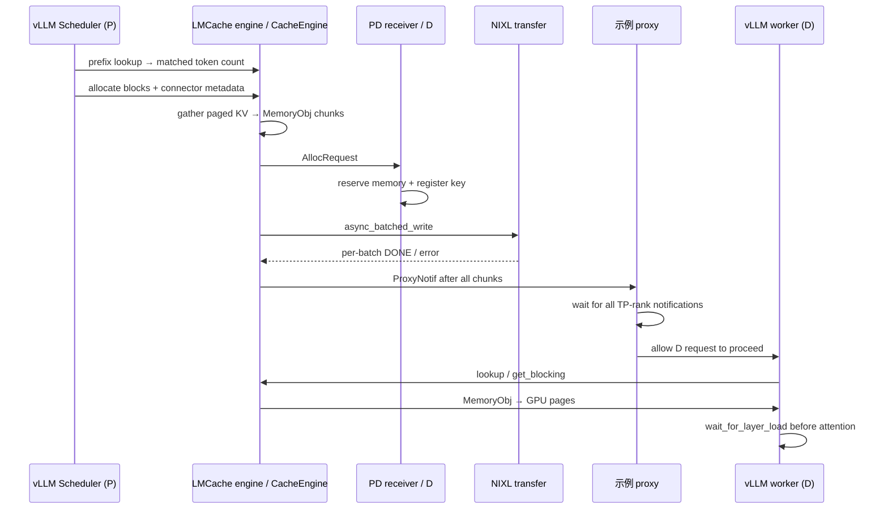

# KV Cache 服务与 Prefill/Decode 分离：什么时候复用，什么时候传输

**范围**：解释跨请求 KV 复用与同一请求 P→D KV 传输这两种系统路径，并用 LMCache 的固定 vLLM V1 集成切面追踪一个异步 transfer lifecycle。本文不比较所有存储后端，也不做吞吐复现。

**核心结论**：查到 prefix key、接收端分配了内存、RDMA/NIXL payload 写完、目标 GPU 层已能读取 KV，是四个不同状态。把它们统称为“KV hit”会掩盖错误处理、准入和取消边界。跨请求缓存是为了少算重复前缀；P/D 分离是把同一请求的 prefill 结果交给另一个 decode 实例；两者可以共用 KV 存储组件，但优化目标和完成条件不同。

## 1. 三种路径不能混为一个 KV 命中

| 路径 | 复用/传输对象 | 需要重复前缀吗？ | 核心等待条件 |
| :-- | :-- | :-- | :-- |
| 引擎内 prefix cache（如 vLLM APC / SGLang Radix） | 同一引擎本地已计算的前缀 KV blocks | 是 | 调度器找到本地 prefix，并把块分配到请求 |
| 跨请求 context caching（LMCache paper） | 先前请求写入的 KV chunk，可能位于 CPU/远端存储 | 通常需要匹配前缀 | 查到 key 后仍需读回、复制到 engine layout，再由计算层使用 |
| Prefill/Decode disaggregation | 当前请求由 P 实例新算出的 KV，交给 D 实例继续生成 | 否 | 请求级所有 chunk 完成传输、D 端接收/拷入 GPU，且协议准许执行 |

因此 LMCache 的“context caching”实验与“PD disaggregation”实验不是一个指标。前者的收益取决于请求前缀复用、容量和读取带宽；后者取决于传输/调度能否抵消把两阶段拆开的成本。[LMCache paper §8; Mooncake FAST ’25 §5]

## 2. 论文各自说明了什么

Mooncake 把 KV 缓存看作跨实例的共享资源，并由 Conductor 依据缓存前缀、排队时间、传输与 prefill 估计选择执行位置。这里仅用 FAST ’25 论文做架构层面的 bounded comparison，不据此声称读过或验证 Mooncake 源码。最终 FAST ’25 论文与后续 arXiv 长版的标题、实验范围和 headline 数字不同；本专题以 FAST ’25 的 155–170 页为主要论文证据，不把 arXiv v5 的扩展模拟结果并入会议版数字。[S1；固定版与表图定位见 sources/MANIFEST.md]

LMCache paper 将存储层插在引擎 connector 与 CPU/远端 backend 之间：connector 向调度器报告可复用 token 数，worker 的 layer hooks 负责 load/save，engine 把 paged KV 打包成 I/O chunk 后交给 storage manager。论文评测的是 LMCache v0.3.6；当前多进程（MP）官方文档和本次代码快照描述的是更新后的接口，不能把论文的 benchmark 直接当作当前 MP 代码性能验证。[S2, S3]

## 3. 一条 LMCache vLLM V1 P→D 路径

源码固定于 `LMCache/LMCache@ff9185d419e1ce55c9f4f1ad84a4f4f1f06af7be`，只追踪 `LMCacheConnectorV1Dynamic`、`lmcache.inprocess.v1` 和配置默认的 `PDBackendAsync`（[配置默认值](https://github.com/LMCache/LMCache/blob/ff9185d419e1ce55c9f4f1ad84a4f4f1f06af7be/lmcache/v1/config.py#L297-L305)、[factory 选择](https://github.com/LMCache/LMCache/blob/ff9185d419e1ce55c9f4f1ad84a4f4f1f06af7be/lmcache/v1/storage_backend/__init__.py#L132-L143)）。仓库内还存在 MP connector、同步后端及其他 storage backend；本文不概括它们。完整文件锚点见 [LMCache vLLM V1 实现追踪](implementation/lmcache-vllm-v1.md)。

这条链上有四个不同的可观察状态；“hit”只描述第一步，不能代替后面三步：

| 状态 | 源码能证明什么 | 不能据此声称什么 |
| :-- | :-- | :-- |
| **prefix metadata hit** | Scheduler/lookup client 找到连续 token chunk 的 key，并向 vLLM 报告可加载 token 数（`vllm_v1_adapter.py:1361-1536`；`cache_engine.py:1152-1267`）。 | 不证明当前进程已有完整 payload，更不证明它在 host RAM 或 vLLM 的 KV 页表中。跨存储 `contains` 后，实际 `batched_get` 仍可能返回 `None`（`cache_engine.py:1775-1802`）。 |
| **receiver staging object 可用** | `pd_buffer_device` 是必填配置，allocator 据它选 CPU 或 GPU 池（`config.py:239-243,757-765`; `pd_backend_async.py:257-283,441-513`）。Receiver 先 reserve、分配并登记 key，再返回 `AllocResponse`（`pd_backend_async.py:1294-1415,1472-1483`）；`contains` 只查本地 key→object 映射（`:638-654`）。 | “key 可见”不表示 NIXL 已写完。这里也不总是 **host availability**：仓库 1P1D 示例把 P/D `pd_buffer_device` 都设为 `cuda`（`examples/disagg_prefill/1p1d/configs/lmcache-prefiller-config.yaml:3-10`; `examples/disagg_prefill/1p1d/configs/lmcache-decoder-config.yaml:3-10`）。只有显式选 CPU buffer 时，host-resident staging 才是这个状态；GPU buffer 则是 receiver GPU staging。 |
| **payload transfer complete** | NIXL `async_batched_write` 轮询至 `DONE` 后返回（`nixl_channel.py:507-548`）；sender 只在收到最后一批且累计完成 chunk 数达到 request 总数后发 `ProxyNotif`（`pd_backend_async.py:949-956,1003-1028`）。示例 proxy 等各 TP rank 的通知后才放行 D（`disagg_proxy_server.py:355-396,520-565`）。 | 不表示 payload 已写入 vLLM 的 paged KV slots。`ProxyNotif` 是单向通知；跳过它时要由外部 orchestrator 承担 readiness gate（配置和 backend 见实现追踪）。 |
| **engine KV 可读** | `CacheEngine.retrieve` 先取回 `MemoryObj` 并填 `ret_mask`，随后调用 `gpu_connector.batched_to_gpu`（`cache_engine.py:1775-1802,898-937`）。因此内部 `ret_mask=True` 早于 cache-object→engine-KV copy。非 layerwise VLLM connector 调用 `TransferDirection.H2D` 并同步 load stream 后返回（`gpu_connectors.py:271-335,412-416`）；layerwise 路径则由每层 `wait_for_layer_load` 推进和等待（`vllm_v1_adapter.py:974-999`; `cache_engine.py:1001-1128`）。 | CPU source 时这对应 host→device copy；如果 PD buffer 配在 `cuda`，仅凭该 enum 名称不能推出数据一定经过 host/PCIe。对注意力而言，准入条件是该层写入 vLLM KV slots 的 copy 已完成，而不是 metadata hit、receiver key 可见或内部 `ret_mask` 已置位。 |

这也解释了为什么 P→D 示例需要 proxy/orchestrator 的完成门：receiver key 登记早于传输，单看 lookup 的命中不能安全地启动 decode。host RAM 是否出现、copy 是否经过 PCIe/H2D，取决于具体 `pd_buffer_device` 与 connector/backend；本专题不把它们泛化成每次传输都必经的步骤。`CacheEngine.retrieve` 也明确允许 MemoryObj 不在 pinned CPU memory 上，例如 RDMA/存储到 GPU 的路径（`cache_engine.py:898-902`）。

## 4. 部分命中、错误和取消边界

以下边界来自固定源码路径；完整行号映射见 [LMCache vLLM V1 实现追踪](implementation/lmcache-vllm-v1.md) 和 [来源清单](sources/MANIFEST.md)。

所选 cache lookup 顺序扫描 token chunks，遇到首个 miss 就返回连续命中前缀；后缀仍由模型计算。若 lookup 后实际读取缺 chunk，LMCache 将 `ret_mask` 在缺口后清零并报告对应失败 block IDs；本专题没有追 vLLM 后续调度恢复，因此不写成“必然自动重算”。接收端容量不足或 allocation 异常会回滚登记 keys 并释放 reservation；发送端只有全部 transfer batch 完成才通知示例 proxy。

abort 路径会清理 request tracking，并向 receiver 发 `CancelNotif` 移除已登记 keys/释放 reservation。但当前固定源没有显示一个可取消已提交 NIXL coroutine 的 transfer handle。因此源码支持“请求取消会触发这些状态清理”，不支持“取消能立即中止正在进行的 RDMA 写”，也不能证明 cancel 与 in-flight write 的竞争已被完全序列化。

当前 MP 文档另指出 request tags/TTL 是请求元数据，不自动成为 cache identity 或租户隔离规则；论文未给出稳定 wire format、完整 key namespace 或跨任意模型/量化/layout 的兼容契约。[S2–S4]

## 5. 实验数字的适用范围

Mooncake FAST ’25 的主部署试验使用 16 个节点、每节点 8×A800、RDMA 网络和 LLaMA3-70B dummy model；论文按 TTFT/TBT SLO 定义有效请求容量。不同 trace 与 TBT 阈值下有效容量提升差异很大；论文另报告单独的缓存命中、prefill 计算减少与 NVLink/RDMA transfer bandwidth 实验。这些量不可合并成一个通用 speedup。生产部署历史数字也与可复现实验 testbed 分开记载。[S1 §5.1–5.4]

LMCache 论文的“up to 15×”是重复文档问答等特定工作负载、v0.3.6、8×H100 与特定 CPU cache 容量下的吞吐结果；作者指出短上下文/低带宽时加载缓存可能不如重新 prefill。论文的 PD transfer 实验单独固定随机 8K 输入/200 输出、NVLink 配置，不能解释为 cache-hit 或所有模型部署收益。[S2 §8]

两篇论文不是同一 testbed 的 head-to-head benchmark。比较它们时应对齐 workload、prompt 重复率、缓存容量、模型、prefill/decode 实例数、网络带宽、测量指标和 SLO，而不是并排摘录各自最大倍数。

## 6. 阅读结论与未解决问题

KV 服务的主要系统问题不是“有没有 cache”，而是跨进程时谁拥有 key、buffer 和 request lifetime，以及什么时候数据真的能被读。论文给出传输原语和调度思路；固定 LMCache 实现进一步显示“预分配登记—payload—proxy gate—GPU scatter”这些状态不能折叠。后续应继续核对模型/量化/并行布局身份如何进入 key、跨租户隔离、in-flight cancellation、重复通知幂等和失败后的重算/重新准入契约。以上在本次源码切面中未能全部确立。

来源版本、表图和代码行号见 [来源清单](sources/MANIFEST.md)，未入选和延后阅读见 [候选清单](sources/CANDIDATES.md)。
