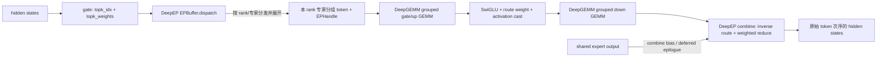

# DeepEP V2：一次 dispatch 怎样变成一次 combine

本文追 DeepInfer 固定提交中的显式 EP 执行路径。调用方版本为 `deepseek-ai/DeepInfer@9bd9cf243fc53ef9afbf8f04d391d989117d6ab9`；其 gitlink 固定 DeepEP 为 `f6aa38fe06cd4a0489e7730365d4e0114970a2f3`、DeepGEMM 为 `1fc9c66975ee322d628b3288534ca0e9ce12a64d`。这能把调用侧契约和被调用 API 对齐，而不是拿 DeepEP 最新接口反推一个旧调用方。[DeepInfer git tree](https://github.com/deepseek-ai/DeepInfer/tree/9bd9cf243fc53ef9afbf8f04d391d989117d6ab9) [DeepEP](https://github.com/deepseek-ai/DeepEP/tree/f6aa38fe06cd4a0489e7730365d4e0114970a2f3) [DeepGEMM](https://github.com/deepseek-ai/DeepGEMM/tree/1fc9c66975ee322d628b3288534ca0e9ce12a64d)

## 入口先分流：EPBuffer 还是 Mega MoE

`DeepseekMoE.forward` 先看 `use_mega_moe`。它在可用 GPU/受支持类型，并且 EP group 位于 NVLink domain 的条件下选择 Mega MoE；否则进入 gate、EPBuffer dispatch、routed experts、combine 的显式路径。[`mlp.py:184-201`](https://github.com/deepseek-ai/DeepInfer/blob/9bd9cf243fc53ef9afbf8f04d391d989117d6ab9/deepinfer/model_executor/models/v4_modules/mlp.py#L184-L201) [`mlp.py:565-585`](https://github.com/deepseek-ai/DeepInfer/blob/9bd9cf243fc53ef9afbf8f04d391d989117d6ab9/deepinfer/model_executor/models/v4_modules/mlp.py#L565-L585)

这一区分很重要：下文的 EPHandle 和独立 combine 是显式路径的接口，不应套到 Mega MoE 上。后者将对称缓冲区、gate/top-k 与 MoE 计算交给 `deep_gemm.*_mega_moe` 单次入口；它是另一种控制/数据布局，不是同一 API 的“更快 combine”。[`mlp.py:528-563`](https://github.com/deepseek-ai/DeepInfer/blob/9bd9cf243fc53ef9afbf8f04d391d989117d6ab9/deepinfer/model_executor/models/v4_modules/mlp.py#L528-L563) [`mega/__init__.py:168-191`](https://github.com/deepseek-ai/DeepGEMM/blob/1fc9c66975ee322d628b3288534ca0e9ce12a64d/deep_gemm/mega/__init__.py#L168-L191)

## 显式 EP 路径的数据流

图中的 `EPHandle` 把 dispatch 的布局元数据传给 GEMM 和 combine。DeepInfer `forward` 先调用 gate 生成索引/权重，dispatch 的输入取决于激活是否以 `(FP8, scale factors)` 元组表示；收到的 routed tokens/权重进入两次 grouped GEMM，中间以 SwiGLU 融合激活、路由权重和可选的量化 cast，最终 combine 恢复 token 并叠加 shared expert 输出。[`mlp.py:574-610`](https://github.com/deepseek-ai/DeepInfer/blob/9bd9cf243fc53ef9afbf8f04d391d989117d6ab9/deepinfer/model_executor/models/v4_modules/mlp.py#L574-L610) [`mlp.py:406-459`](https://github.com/deepseek-ai/DeepInfer/blob/9bd9cf243fc53ef9afbf8f04d391d989117d6ab9/deepinfer/model_executor/models/v4_modules/mlp.py#L406-L459)

### 1. 一个模型级 buffer 被多个 MoE 层复用

`allocate_userbuffer` 为非 Mega 路径调用 `userbuffer.allocate_ep`，传入 EP group、每 rank 最大 token 数、hidden size、physical top-k 与 physical expert 数；FP8 activation 会让 EPBuffer dispatch 以 FP8+scale 格式传激活。`userbuffer` 把 `EPBuffer` 保存在模型级单例对象里，必要时先确认已分配 buffer 足够大；创建时 `explicitly_destroy=True`，统一由 `close()` 显式销毁。[`mlp.py:303-324`](https://github.com/deepseek-ai/DeepInfer/blob/9bd9cf243fc53ef9afbf8f04d391d989117d6ab9/deepinfer/model_executor/models/v4_modules/mlp.py#L303-L324) [`userbuffer.py:55-95`](https://github.com/deepseek-ai/DeepInfer/blob/9bd9cf243fc53ef9afbf8f04d391d989117d6ab9/deepinfer/model_executor/parallel_utils/userbuffer.py#L55-L95) [`userbuffer.py:227-234`](https://github.com/deepseek-ai/DeepInfer/blob/9bd9cf243fc53ef9afbf8f04d391d989117d6ab9/deepinfer/model_executor/parallel_utils/userbuffer.py#L227-L234)

分配时 DeepInfer 启用 hybrid mode；若没有显式指定通信 SM 数，会基于 EPBuffer 的估算值，并预留一部分 SM 给计算，计算得到 `DEEPINFER_USERBUFFER_COMM_SMS`。这是源码中一个资源预算策略，不是硬件无关的最优值证明。[`userbuffer.py:72-93`](https://github.com/deepseek-ai/DeepInfer/blob/9bd9cf243fc53ef9afbf8f04d391d989117d6ab9/deepinfer/model_executor/parallel_utils/userbuffer.py#L72-L93)

### 2. dispatch 同时产生布局和逆路由凭证

DeepInfer 将 `topk_idx`、`topk_weights`、本地专家累计接收统计、physical expert 数、prefill/decode 对应的 token cap，以及专家对齐值送入 `EPBuffer.dispatch`。它设置 `do_expand=True`、`async_with_compute_stream=True`、`do_handle_copy=False`、`defer_epilogue=True`，FP8 激活时还选 TMA 对齐的 column-major scale 布局。这里输出不只是 `recv_x`：还要有 `psum_num_recv_tokens_per_expert`、源 token 元数据和之后 combine 所需的 handle。[`mlp.py:461-490`](https://github.com/deepseek-ai/DeepInfer/blob/9bd9cf243fc53ef9afbf8f04d391d989117d6ab9/deepinfer/model_executor/models/v4_modules/mlp.py#L461-L490) [DeepEP `dispatch` API](https://github.com/deepseek-ai/DeepEP/blob/f6aa38fe06cd4a0489e7730365d4e0114970a2f3/deep_ep/buffers/ep.py#L562-L636)

`EPHandle` 解释了为什么它不能被随手丢弃：它保存拓扑参数、对齐、rank prefix sums、每专家的接收布局、原始路由索引、源 token 元数据、目的 buffer slot，以及 hybrid mode 的分通道元数据。原始 `topk_idx` 以 tensor 引用存入 handle，且普通 PyTorch 原地修改可由版本计数检测；使用中的路由索引必须保持不变。[DeepEP `EPHandle`](https://github.com/deepseek-ai/DeepEP/blob/f6aa38fe06cd4a0489e7730365d4e0114970a2f3/deep_ep/buffers/ep.py#L27-L111)

`do_expand=True` 把逻辑上“token 被发给目标专家”变成“每个专家都有一个连续输入区间”。对齐后的间隔让每个专家 GEMM 的起点满足 kernel 要求，但布局不会自动等同于实际有效 token 数。DeepEP 文档说明 `psum_num_recv_tokens_per_expert` 在 expand 下编码真实计数和对齐累计值；DeepGEMM 的 PSUM layout 正是接受这个 prefix sum，并在 scale factor packing 中跳过 gap rows。[DeepEP `EPHandle` layout](https://github.com/deepseek-ai/DeepEP/blob/f6aa38fe06cd4a0489e7730365d4e0114970a2f3/deep_ep/buffers/ep.py#L43-L61) [DeepGEMM grouped GEMM](https://github.com/deepseek-ai/DeepGEMM/blob/1fc9c66975ee322d628b3288534ca0e9ce12a64d/csrc/apis/gemm.hpp#L181-L233)

### 3. 分组 GEMM 使用同一个专家布局

本地 `routed_experts_forward` 分两层计算：

1. gate/up grouped GEMM：输入按专家连续分组，权重按 `[groups, N, K]` 组织，grouped layout 是 handle 的 expert prefix sum。
2. SwiGLU：融合 gate/up 输出的激活、每 token scale、路由权重与可选 clamp；如果使用 FP8 activation，在此处得到面向 down projection 的量化表示。
3. down grouped GEMM：再用相同分组边界计算回 hidden size。

BF16 路径调用 `m_grouped_bf16_gemm_nt_contiguous`；FP8 activation 路径调用 `m_grouped_fp8_fp4_gemm_nt_contiguous`，按 granularity 传 activation/weight recipe，分别覆盖 FP8 和 FP4 权重。DeepGEMM C++ API 检查矩阵形状 `[M,K] @ [G,N,K]^T`、连续分组布局、输出类型与 grouped_layout 形状；其 PSUM 分支将 grouped layout 传给 scale-factor 布局转换，且当前函数在该 fixed commit 对 SM90/SM100 分别有不同 kernel 分支。[`mlp.py:109-138`](https://github.com/deepseek-ai/DeepInfer/blob/9bd9cf243fc53ef9afbf8f04d391d989117d6ab9/deepinfer/model_executor/models/v4_modules/mlp.py#L109-L138) [`mlp.py:406-459`](https://github.com/deepseek-ai/DeepInfer/blob/9bd9cf243fc53ef9afbf8f04d391d989117d6ab9/deepinfer/model_executor/models/v4_modules/mlp.py#L406-L459) [DeepGEMM `gemm.hpp:194-248`](https://github.com/deepseek-ai/DeepGEMM/blob/1fc9c66975ee322d628b3288534ca0e9ce12a64d/csrc/apis/gemm.hpp#L194-L248)

源码还在两次 GEMM 之间主动释放输入激活的存储引用，说明这个阶段存在有意的临时 buffer 生命周期管理。读/改路径时要把这一点与之后需要的 `moe_out_hidden`、handle 元数据分开考虑，不能只看 Python 变量是否仍在作用域里。[`mlp.py:417-457`](https://github.com/deepseek-ai/DeepInfer/blob/9bd9cf243fc53ef9afbf8f04d391d989117d6ab9/deepinfer/model_executor/models/v4_modules/mlp.py#L417-L457)

### 4. combine 消耗 handle，恢复源 token 并求和

combine 接收 routed expert 输出、dispatch handle、shared expert bias 和前置事件。DeepEP 将 handle 中的 `recv_src_metadata`、原始 `topk_idx`、scaleup prefix sum、hybrid metadata 等传给 C++ runtime；因此 dispatch 与 combine 必须在同一份 handle/路由计划上闭合。DeepEP 文档定义 `x` 为专家结果，`bias` 可为最终输出叠加的 hidden tensor；本调用方用它携带 shared expert 输出。[`mlp.py:493-511`](https://github.com/deepseek-ai/DeepInfer/blob/9bd9cf243fc53ef9afbf8f04d391d989117d6ab9/deepinfer/model_executor/models/v4_modules/mlp.py#L493-L511) [DeepEP `combine`](https://github.com/deepseek-ai/DeepEP/blob/f6aa38fe06cd4a0489e7730365d4e0114970a2f3/deep_ep/buffers/ep.py#L770-L843)

事件顺序决定了实际 overlap 的含义：

- dispatch 返回 `EventOverlap` 后，调用方立即 `current_stream_wait()`，取得 deferred epilogue 的 `(moe_in_hidden, routed_topk, weights, handle)`。因此当前 routed GEMM 消费前，当前计算流已等待 dispatch 对应 event。
- routed-expert 计算之后，`ep_buffer.capture()` 在当前 CUDA stream 捕获事件；随后 shared expert 在此 stream 上计算。
- combine 使用先前捕获的 event、`async_with_compute_stream=True`、`allocate_on_comm_stream=True` 和 `defer_epilogue=True`。它返回异步对象，再由 `current_stream_wait()` 获得合并输出。代码顺序为通信与 shared expert 提供交叠机会，但实际并发程度、等待位置和收益要通过 profiler/设备实验确定。

`EventOverlap.current_stream_wait()` 将当前 stream 排到 event 之后，然后运行注册的延迟 hook；因此 deferred dispatch 的 CPU 同步/拷贝尾段和 deferred combine reduction 也属于等待语义的一部分。不能把 `async_with_compute_stream=True` 单独读成“所有后续计算自动并行”。[DeepEP `EventOverlap`](https://github.com/deepseek-ai/DeepEP/blob/f6aa38fe06cd4a0489e7730365d4e0114970a2f3/deep_ep/utils/event.py#L39-L60) [DeepEP `dispatch` deferred epilogue](https://github.com/deepseek-ai/DeepEP/blob/f6aa38fe06cd4a0489e7730365d4e0114970a2f3/deep_ep/buffers/ep.py#L749-L757) [DeepInfer `forward`](https://github.com/deepseek-ai/DeepInfer/blob/9bd9cf243fc53ef9afbf8f04d391d989117d6ab9/deepinfer/model_executor/models/v4_modules/mlp.py#L574-L610)

## 失败边界和维护时要守的契约

- **路由索引/权重必须与 handle 匹配。** handle 里的 `topk_idx` 不能在 dispatch 和 combine 使用期间修改；cached dispatch 还要求 topk_idx 为空并复用原 handle布局。DeepInfer 当前主路径不启用缓存 handle，也不复制 handle（`do_handle_copy=False`）。[DeepEP `dispatch` arguments](https://github.com/deepseek-ai/DeepEP/blob/f6aa38fe06cd4a0489e7730365d4e0114970a2f3/deep_ep/buffers/ep.py#L593-L615) [DeepEP cached-handle checks](https://github.com/deepseek-ai/DeepEP/blob/f6aa38fe06cd4a0489e7730365d4e0114970a2f3/deep_ep/buffers/ep.py#L650-L663)
- **layout 对齐变化需要两侧同时变化。** `expert_alignment` 从 DeepGEMM 查询，传给 dispatch；dispatch expand 产生 grouped prefix sum；DeepGEMM以相同 `use_psum_layout=True` 消费。只改 token cap、对齐或 PSUM 解释都可能造成行边界错位。源码证明了接口耦合，不是已复现的故障报告。[DeepInfer dispatch](https://github.com/deepseek-ai/DeepInfer/blob/9bd9cf243fc53ef9afbf8f04d391d989117d6ab9/deepinfer/model_executor/models/v4_modules/mlp.py#L469-L488) [DeepInfer grouped GEMM](https://github.com/deepseek-ai/DeepInfer/blob/9bd9cf243fc53ef9afbf8f04d391d989117d6ab9/deepinfer/model_executor/models/v4_modules/mlp.py#L109-L138)
- **事件不等于 host 端已经拿到结果。**异步路径的中间张量、handle和延迟尾段都依赖 event 语义。错误的 stream/previous-event 传递可能使异步分配或共享 bias 的使用时序不成立；本报告没有触发这种竞争，也未证明任意重排是安全的。[DeepEP `dispatch` synchronization contract](https://github.com/deepseek-ai/DeepEP/blob/f6aa38fe06cd4a0489e7730365d4e0114970a2f3/deep_ep/buffers/ep.py#L607-L624) [DeepEP `combine` synchronization contract](https://github.com/deepseek-ai/DeepEP/blob/f6aa38fe06cd4a0489e7730365d4e0114970a2f3/deep_ep/buffers/ep.py#L793-L811)
- **容量与通信拓扑由 buffer 初始化时的配置约束。**DeepEP buffer 按最大 token/rank、hidden、top-k、FP8 dispatch 和 hybrid/reduction选项估计大小；DeepInfer初始化/复用时校验足够的buffer size。实际网络故障、GPU timeout、rank失联后的错误恢复，需要系统故障注入，不能从静态 wrapper 推断。[DeepInfer `userbuffer.py`](https://github.com/deepseek-ai/DeepInfer/blob/9bd9cf243fc53ef9afbf8f04d391d989117d6ab9/deepinfer/model_executor/parallel_utils/userbuffer.py#L72-L95) [DeepEP `EPBuffer` init](https://github.com/deepseek-ai/DeepEP/blob/f6aa38fe06cd4a0489e7730365d4e0114970a2f3/deep_ep/buffers/ep.py#L242-L288)
- **异常路径会记录再抛出。**DeepInfer包住 MoE 前向，异常时带 rank 和路由形状记录日志后重新抛出；这没有向读者证明EPBuffer在所有异常后仍能复用，或已自动回滚一半发出的网络操作。[DeepInfer `mlp.py`](https://github.com/deepseek-ai/DeepInfer/blob/9bd9cf243fc53ef9afbf8f04d391d989117d6ab9/deepinfer/model_executor/models/v4_modules/mlp.py#L574-L615)

## 读到哪里，还没证明什么

已读 DeepEP Python API/EPHandle/EventOverlap 和其 EP 测试调用形状，DeepInfer 对应调用方、buffer管理与 MoE MLP，实现侧的 DeepGEMM grouped API、PSUM布局检查及一个 Mega MoE API/测试入口。由这些证据可以解释接口契约和执行顺序。尚未沿 DeepEP 的全部 CUDA/C++ hybrid network internals 逐核追踪，也未分析真实集群的 RDMA/NVLink互联拓扑；DeepGEMM grouped kernel 仅沿 API 与调用参数核到入口。

这次没有运行 pytest、构建扩展、多 rank通信、CUDA graph、模型或性能测试。DeepEP `tests/ep/test_ep.py`包含dispatch/reference/combine结果和计时路径；DeepGEMM `tests/test_mega_moe.py`包含grouped GEMM对比及Mega MoE路径，但这些只是测试存在的证据，本条没有执行。[DeepEP `test_ep.py`](https://github.com/deepseek-ai/DeepEP/blob/f6aa38fe06cd4a0489e7730365d4e0114970a2f3/tests/ep/test_ep.py#L61-L137) [DeepGEMM `test_mega_moe.py`](https://github.com/deepseek-ai/DeepGEMM/blob/1fc9c66975ee322d628b3288534ca0e9ce12a64d/tests/test_mega_moe.py#L245-L310)
