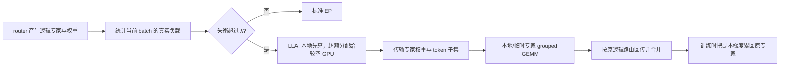

# LLEP：把过载专家的部分计算临时搬到空闲 GPU

**论文**：Xuan-Phi Nguyen 等，*Least-Loaded Expert Parallelism: Load Balancing An Imbalanced Mixture-of-Experts*，arXiv:2601.17111v1，2026-01-23。本文按 v1 原文阅读；论文报告的数字保留其负载构造、模型、设备与比较对象，不代表本库独立复现。

## 它解决的不是“路由器没有均衡训练好”

MoE 训练通常用辅助损失或路由偏置控制长期/批次级专家利用率，但一次推理或微调 batch 仍可能因为领域集中而让少数专家变热。专家并行（EP）把专家固定放在不同 GPU 上：每轮两次 all-to-all 将 token 送到专家，再把结果送回。一个热点专家上的 token 会聚到同一张 GPU，导致该 rank 的矩阵乘法和接收激活内存暴涨，其它 GPU 却空闲。

LLEP 的判断是：推理和后训练中不一定适合修改预训练路由行为来追求均匀；可以保留逻辑路由，只改变这一个 batch 的物理执行位置。原始门控仍然决定 token 选择哪个逻辑专家，系统为热点专家临时复制权重，让另一张 GPU 分担该专家的一部分 token。

## 算法如何把逻辑专家拆成临时执行份额

论文 §4 的 LLEP 先在 gate 之后统计每个专家的实际 token 数。若最大专家负载与平均负载之比低于阈值 `λ`，就走普通 EP，避免平衡时支付规划开销。否则，Least-Loaded Assignment（LLA）按负载从高到低遍历专家：原属 GPU 先处理本地份额，超过目标容量 `mα` 的 token 再溢出到当前较空闲的 GPU；被选中的 GPU 需要临时收到这个逻辑专家的权重。`m` 是每次分出去的最小 token 数，避免把 GEMM 切得过碎。

随后执行计划化的 dispatch → grouped GEMM → combine。每个接收 GPU 计算自己原生专家及外来专家的 token 子集，结果仍按原逻辑路由返回并合并。训练时，临时专家的权重梯度也要返回原专家并累加；因此“迁计算”不能只复制前向权重，还必须闭合反向传播。

## 它用流量换掉热点，但需要新的热路径工作

LLA 的目标不只是把 token 数均分：增加传输要有收益。论文的成本分析把每卡的 GEMM 效率、权重搬运、激活内存和 all-to-all 一起考虑。其规则倾向先让专家留在本地，只有预期的本地计算开销超过传输成本才切分；小于 `m` 的尾部份额可能宁愿留在原 GPU。`α`、`m`、`λ` 取决于专家规模、批次、设备拓扑和 kernel 启动/矩阵乘法效率，论文不提供可以直接跨系统复用的常量。

作者在 §5.1 的 8 张 H200 受控失衡实验中报告，极端构造负载（95% token 集中到一个专家）时，MoE 层最高约 6.11 倍于标准 EP；这是压力情形，不是日常线上增益。§5.2 的完整模型实验使用预训练 gpt-oss-20B/120B、Megatron-Math 样本（回复由 gpt-oss-120B 生成），论文报告全模型前向吞吐最高约 2.2 倍和 1.88 倍。端到端提升低于层级压力测试，也因为注意力等非 MoE 计算不随专家重排消失。

## 与训练侧 dropless 计算及历史复制的关系

LLEP 和 MegaBlocks 处理两种不同的不规则性。MegaBlocks 用 block-sparse 计算保留路由产生的动态稀疏形状，避免 token drop；但以块为单位执行仍需要边缘 padding。LLEP 则处理多个 rank 的负载分布，把热门专家的一部分计算搬到闲置设备。前者主要改变专家 MLP 如何吃到不等长 token 组，后者主要改变哪张卡计算哪一份专家负载；两者可互补，不能互相替代。

与按历史路由统计周期性复制专家的 EPLB 相比，LLEP 使用当前 gate 后的精确负载，能响应这一批的新热点；代价是规划、token 重分配和专家权重传输位于该批关键路径。论文 v1 使用标准 PyTorch/NCCL all-to-all，LLA 规划器用 Python 实现，并指出还需要低层 kernel 和通信/计算重叠来降低开销（§4、§5）。因此它证明的是动态迁移这条设计路线可行，不是已经解决了 planner latency、跨节点 weight exchange 或所有小 batch serving 情形。

## 阅读位置与证据边界

- [原文 v1](https://arxiv.org/html/2601.17111v1)：§3 负载与延迟/内存模型；§4 LLEP、参数约束与 Algorithm 2–4；§5.1 受控失衡，§5.2 全模型，§5.3 参数消融。
- 负载集中度与过载分析来自作者对给定模型/数据集的统计；6.11 倍层级增益来自构造失衡，不能外推为普通流量增益。
- 本文没有运行 LLEP 仓库、重算论文结果或验证其通用 NCCL 实现；“保持模型语义/精确计算”是论文对算法设计的说明，不是本次复现结论。
