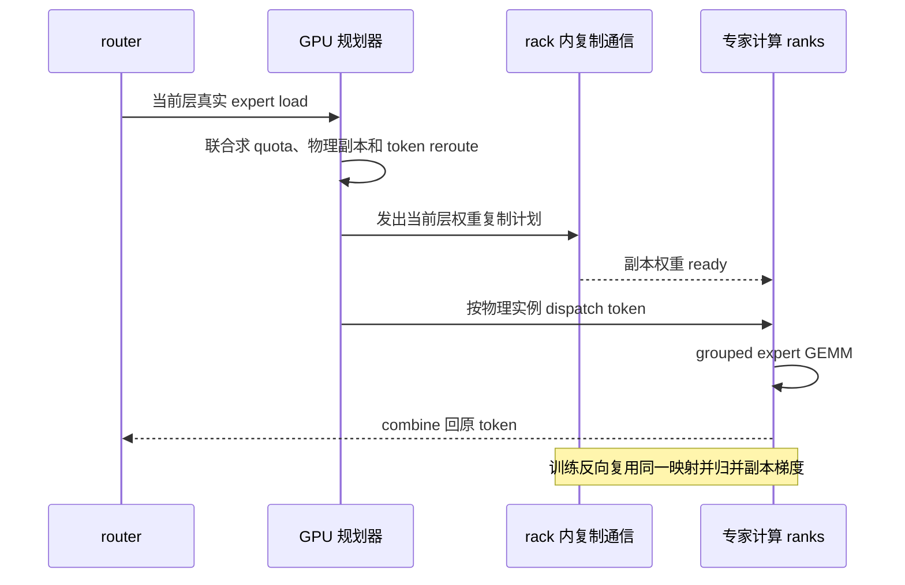

# UltraEP：精确负载下的逐层专家复制与重路由

**论文**：Xinming Wei 等，*UltraEP: Unleash MoE Training and Inference on Rack-Scale Nodes with Near-Optimal Load Balancing*，arXiv:2606.04101v3，2026-06-18。下文所说的性能均为论文报告结果，实验条件见 §8，不代表本库独立复现。

## 从“历史上哪个专家热”转向“这一层刚刚发生了什么”

周期性专家负载均衡器 EPLB 根据最近一段时间的路由历史调整专家位置或增加冗余副本。它把搬运和规划摊到多个 batch 上，但当 prompt 领域、层、microbatch 很快变化时，历史热点可能不再是当前热点。UltraEP 的方案更激进：每个 MoE 层完成 gating 后立即拿到实际 token 负载，求一个当前 microbatch 的物理专家布局与 token 分流计划。

它优化的目标是执行层面的 rank 负载、token all-to-all 与权重传输联合成本，不改变 router 的 top-k 选择。一个逻辑专家仍代表同一套权重，只是可在同一 rack-scale node 内建立临时物理副本，让多个 rank 计算不同 token 份额。论文限定模型并行 EP group 放在 rack-scale node 的 scale-up 互联域；跨 rack 扩展通过 DP/PP 做。这个硬件前提很重要：权重复制发生在关键路径上，靠高带宽、load/store 式 rack 内互联才有希望抵消代价。

## 计划器把复制和 token 分流作为同一个问题

UltraEP 为每个 rank 预留冗余 expert slot，但不移动主专家。规划器从当前 load matrix 求每个逻辑专家在各物理实例上的 quota：先找一个所有 rank 都可承受的负载阈值，再按热点专家和各 rank 的空余容量分配复制份额；只有副本能承接足够的 token 才创建。求得 quota 后再拆出每个源 rank 的 token 流向，优先让 token 留在本地可用配额中，以降低跨 rank 流量。

这比“先根据历史负载决定复制位置、再用轮询等方法路由”更一致：replication 决定哪些物理实例存在，reroute 决定 token 份额，两者共同约束重路由后的真实 rank 负载。作者在 GPU 上实现求解，避免把完整负载元数据从设备同步到 CPU；但精确负载只在 gating 后可见，所以 planner 与权重物化仍处在前向关键路径。

## 通信和内存布局也是算法的一部分

动态计划产生的是不规则的 expert-state transfer 图，不是每轮相同的规整 collective。UltraEP 把每个专家权重/梯度切成 tile，通过持久 kernel 从全局任务流取任务；热点专家需要广播到多个副本时，再用分块 relay tree 分摊 fan-out。论文将 planner、权重复制、token all-to-all、GEMM 的重叠显式写进目标函数，因为仅让 rank token 数相同，不保证传输耗时相同。

训练副本不保存 optimizer state。权重按层共享冗余缓冲，前向复制到当前 layer 的副本；反向先恢复前向副本对应的权重状态，再把副本梯度归并到主专家，然后才能复用跨层缓冲。它降低常驻副本状态，却施加了很紧的逐层权重物化时限，并要求为多个在途 microbatch 保留正确的 forward 计划。服务预填充没有反向传播，也没有 optimizer-state 同步；论文没有把 decode 阶段列作主要平衡目标，因为 decode 时注意力/权重内存访问会稀释专家 GEMM 不均衡对总体延迟的影响。

## 与 LLEP、EPLB 和 DeepEP 原语的边界

LLEP 同样在当前批次观察负载并把热门专家的 token 溢出到较空 rank；其论文重点是 LLA 在通用 EP 组上做容量受限的动态 token spill 与专家权重传输，原型使用 PyTorch/NCCL。UltraEP 面向 rack-scale 的大 EP：逐层 exact-load 求解、固定冗余槽、按 quota 联合 reroute，并针对 rack 内快速复制设计 GPU 规划与通信 kernel。两者都不要求修改模型 gate，但对硬件拓扑与热路径预算的假设不同。

DeepEP 在其固定版本中提供 `EPBuffer.lb_prefetch_weights` 和 `lb_reduce_grads`：前者把主专家权重推到调用方指定的冗余槽，后者将冗余副本的 FP32 梯度累加回主专家。API 要求每个 NVLink 域内所有 rank 参与、共享同一 `redundancy_mapping`，并由调用方提供复制计划、物理路由和专家 GEMM。因此 DeepEP 提供数据面原语，不等于它本身实现 UltraEP 的 quota planner 或 LLEP 的 least-loaded assignment。

## 论文报告了什么，以及不能据此推出什么

UltraEP v3 在公开云 rack-scale 集群评测：每 rack 64 GPU，训练使用 128 或 256 GPU，服务预填充放在单 rack；模型含 GLM4.5、Qwen3-235B、GLM4.7、DeepSeek-V3 等，实验使用 bf16（§8.1、Table 2）。论文报告训练与预填充的 rank imbalance 经均衡后大约在 1.01–1.04；预填充场景达到理想强制均衡吞吐的约 90%–97%，并在特定模型/数据负载下高于 SGLang 与 EPLB 基线（§8.2、Fig. 12）。这依赖 rack-scale scale-up 互联、模型并行配置和查询负载，不能解释为普通多机以太网集群的普遍增益，也不能外推到 decode、未测模型或不同流量组合。

原文：[v3 HTML](https://arxiv.org/html/2606.04101v3)，§3 负载变化，§4 系统与内存布局，§5 quota planner，§6 rack-scale 通信，§7 实现，§8.1–8.6 评测与生产训练。论文同时报告规划开销、链路行为、复制槽数和系统消融；本文重点保留能说明其硬件前提和边界的结果。
