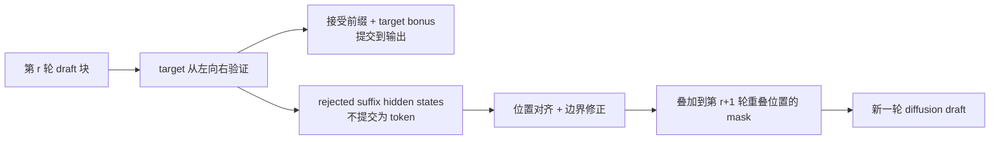

# DFlow：让被拒绝后缀的 verifier 表示跨轮流向草稿器

来源：Zhang et al., [*DFlow: Enabling Verifier Information Flow in Block Diffusion Speculative Decoding*](https://arxiv.org/html/2609.06498v1)，固定版本 arXiv v1（2026-09-06）。重点读 §3、§4.1–§4.3、§5.1–§5.3、§6，尤其 Figure 2–3 与 Tables 1–4。

## 问题：reject 决定 token 不提交，不代表其计算表示没有用

一个块扩散 draft 一次提议未来 $K$ 个 token；target verifier 再从左到右检查。若前 $a_r$ 个候选匹配，target 接受前缀，第一处不匹配的位置改为 target 产生的 bonus token $b^{(r)}$；其余 rejected suffix 候选不能输出。DFlash 在下一轮会把这段重叠未来位置重新初始化成 mask embedding，即使上一轮 target 已经在处理整块时算出了这些位置的 hidden states。[DFlow v1，§3，Eq. 1–3](https://arxiv.org/html/2609.06498v1)

这里有两个不同边界：**commit boundary** 决定哪些离散 token 成为 target 输出；**information boundary** 决定哪些计算结果可以留给下一轮草拟。DFlow 认为二者不必重合：reject 只否决候选 token 的提交资格，不自动说明 verifier 在该位置产生的上下文表示没有预测价值。

## 推理时到底复用什么？

DFlow 将 rejected suffix 对应的 target verifier hidden states 投影到 draft 表示空间，并传给下一轮中与之重叠的 unresolved positions。它不把 rejected token 当作 target 已确认上下文，也不把它们写进最终序列；真正提交的仍是接受前缀和第一处错误处的 target bonus token。若没有可重叠的拒绝后缀，或处于首轮没有历史 verifier 表示，就仍用标准 mask embedding。[§4.1–§4.2、Figure 2](https://arxiv.org/html/2609.06498v1)

实现还需对齐两种预测位置：自回归 target 在位置 $i$ 的 hidden state 预测 $i+1$ 的 token；mask drafter 在未来位置 $i$ 预测该位置自身的 token。DFlow 在 relaying 前 shift hidden states，使表示与目标 token 对应。由于被拒 suffix 的 verifier states 是在一个含 speculative token 的上下文下计算的，而下一轮上下文会用 target bonus token 替换分界位置，论文用一个轻量 MLP 根据 **rejected proposal 与 target correction 两个边界 token**预测 channel-wise scale $\beta_i$ 和 correction $\gamma_i$，再把修正后的 verifier state 加到新一轮 mask embedding 上。[§4.2，Eq. 4–5](https://arxiv.org/html/2609.06498v1)

target 在原验证 forward 中已产生这些表示，所以 DFlow **不再额外运行一次 target forward**；但这是“复用已有 verifier 计算”，不是没有额外状态：重叠 suffix hidden states 仍要在轮次间保存/投影。DFlow 没有把隐藏状态变成已验证输出，也没有修改 target verifier 的提交规则。

## self-conditioning 训练为什么要展开多轮

标准 DFlash 训练把每个 draft block 当独立样本，用 target hidden context 条件化，但每轮未来位置都重新 mask。这样训练时没有看到推理时的 rejected-suffix relay，训练/推理状态分布不同。DFlow 的 **Multi-Round Self-Conditioned Training** 展开连续 drafting → verifier → relay → next draft 轮次：第一轮仍学习普通 mask prediction，后续轮次用上一轮的 verifier representation 做 reject-conditioned prediction，所有轮共享 draft 参数并共同计算损失。[§4.3](https://arxiv.org/html/2609.06498v1)

训练 rollout 将 target 冻结，verifier states 和轮次转换不反传；预计算 target trajectory 用来对齐 draft proposal 的 exact-match 接受边界，避免采样/数值差异让训练轨迹锚点错位。论文默认在初始轮后展开 $k=2$ 个 reject-conditioned rounds。这不是普通“多轮去噪”训练；它模拟的是 spec-decoding verifier 后，哪些 target 表示会被保留给下一轮草拟。[§4.3，Appendix A.1](https://arxiv.org/html/2609.06498v1)

## 它和相邻块扩散方法改的是不同环节

| 方法 | target 信息怎样到 draft | 改动的主要环节 | 与 DFlow 的区别 |
| :-- | :-- | :-- | :-- |
| [DFlash](2602.06036-dflash.md) | 用已提交前缀的 target hidden states 经 projection 注入 draft KV | 建立块扩散 draft + AR verifier 基线 | 每轮对重叠未来位置重新 mask；不跨轮使用 rejected suffix 表示 |
| [DFlare](2606.02091-dflare.md) | 每个 draft layer 学习融合多层 target features | 加深/扩容 draft 并改条件融合 | 优化本轮 draft capacity，不以 rejected suffix 为跨轮输入 |
| [D-PACE](2605.18810-dpace.md) | 推理时不新增 verifier hidden state relay | 用 target 记录 token 的 draft confidence 代理接受率，动态加权训练位置 | D-PACE 改训练 loss 的位置权重；DFlow 改推理时 draft input 并用多轮训练模拟它 |
| [D-PAL](2610.28355-dpal.md) | 同样不进行 verifier-state 跨轮 relay | 用 target–draft 全分布重叠替代点质量 confidence，并拆开 position weight / local loss | 改的是接受感知训练目标，与 DFlow 的状态复用正交 |
| [H-Spec](2609.24197-hspec.md) | attention 原位读 target KV，并以末位 hidden state 初始化 Mamba | 压缩/复用 target context，避免独立 drafter-side KV 副本 | 复用 target 的已有 KV 与摘要状态；DFlow 特指 target 已算出的 rejected-suffix verifier hidden states 跨轮流动 |
| [DLite](2610.23787-dlite.md) | 直接使用 target hidden states 做上下文，不保留长历史 draft KV | 让 draft 历史 KV 无状态/变短 | DLite 的目标是 drafter-side history KV；DFlow 的重点是利用 verifier 在前轮 speculative context 中生成的拒绝后缀表示 |

**target 信息条件化有三层**：DFlash 的已提交前缀条件，DFlow 的拒绝后缀跨轮 relay，以及 H-Spec/DLite 对 target KV/history 存储的重构。它们分别改变 draft 可见的信息、跨轮表征是否复用、以及额外缓存放在哪里；“都用 target hidden states”不足以说明方法相同。

## 论文报告的证据与失效边界

论文从头训练五层 DFlash draft、block size 16，使用 80K ShareGPT 样本，在 8 张 A800 上评测 Qwen3-1.7B/4B/8B 的数学、代码和聊天任务。低并发下，作者报告 greedy 的平均 acceptance length 从 DFlash 的 3.56/3.71/3.66 增至 DFlow 的 3.93/4.20/4.15；消融中，保留多轮 mask 训练但关闭 relay 为 3.67，而同一 DFlow draft 启用 relay 为 3.93，支持主要增量来自 verifier information reuse。[§5.1–§5.3、Table 1、Table 3](https://arxiv.org/html/2609.06498v1)

作者还在 SGLang 并发负载中报告吞吐收益，并在 Figure 3 将 relay 的额外延迟分解为约 0.51 ms/1.2%（相对该 DFlash 实现）。这些数字只支持论文所用 Qwen3、A800、SGLang、block 设置、任务和并发范围；它们不证明该 state relay 在其它 target、KV layout、长 prompt 或低并发下仍同样轻量。[§5.2–§5.3，Table 2、Figure 3](https://arxiv.org/html/2609.06498v1)

训练与推理也有状态对齐要求：如果 training rollout 由 teacher-forcing token 决定 rejected suffix，而 inference 用模型自己的 draft，收集到的 verifier states 会来自不同路径。论文与 Domino 组合时报告，未做 online rollout transition 的 DFlow 反而使 acceptance length 从 4.02 掉到 2.22；加上在线轨迹对齐后为 4.50。这是该 Qwen3-1.7B、$T=0$ 设置下的结果，说明训练要模拟**proposal 与 rejection boundary 的实际分布**，而不是仅把未来 target states 喂给 draft。[§6，Table 4](https://arxiv.org/html/2609.06498v1)

**结论**：DFlow 的机制独立点是把“拒绝 token 不提交”与“拒绝位置表示可复用”分开。其 acceptance/throughput 是论文报告结果；输出 token 仍由原 target verifier 决定，DFlow 改的是后续 proposal 的条件状态。尚未回答的是 target family 迁移、错误边界表示如何积累、hidden-state buffer 的并发内存成本，以及长序列/不同 draft window 上 self-conditioning 的稳定性。
