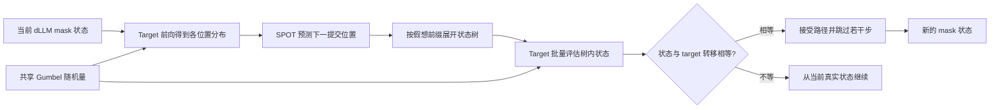

# SPOT：预测扩散语言模型下一步提交哪个位置

来源：Shlomi et al., [*On the SPOT: Enhancing Speculative Decoding for Diffusion Language Models via Commit-Order Prediction*](https://arxiv.org/html/2610.22543v2)，固定 arXiv v2（2026-10-26）。重点阅读 §3–§5、Appendix A–C，尤其 state-equality verifier 与 coupled-noise exactness 证明。性能数字为作者在指定 dLLM、数据和 block 配置中报告的结果。

## dLLM 草稿的瓶颈不只是猜词，还要猜提交顺序

自回归模型按位置顺序生成，投机草稿主要猜“后面是什么 token”；扩散语言模型一次更新多个 mask，但每轮通常只提交置信度最高的位置（或一组位置）。因此 dLLM 的未来不只是一条 token 序列，也是一条“先填哪里、再填哪里”的 commit trajectory。对每个 mask 位置而言，target 上一轮的输出分布已能较准确地提示 token；真正缺少的是：某个假想状态下，target 下一步会选哪个位置。SPOT 将 drafter 的任务改写为预测**提交位置顺序**。[§1、§3](https://arxiv.org/html/2610.22543v2)

## 机制：从旧分布预测位置，再以树覆盖多条可能路径

SPOT 的小型 Transformer drafter 只读 target 最近一次输出的 top 候选分布、位置统计量、已提交前缀和树深度，不读取 target hidden states、token embeddings 或文本。因此同一位置预测器可以跨 tokenizer 与 dLLM 架构迁移。训练数据来自 target 自己的 draft-free commit 轨迹：固定一次 target 前向得到的各 mask 分布，构造一系列假想已提交前缀，再监督下一个真实提交位置。推理时，模型按前缀条件递归预测位置并展开候选树。[§4.2、Appendix C](https://arxiv.org/html/2610.22543v2)

target 在一轮中对树内假想状态批量前向；若某条边的下一状态与 target 在该状态下的真实转移一致，就接受该边。确定性 (T=0) 时，target 转移唯一，状态相等检查自然复现 draft-free 轨迹。采样 (T>0) 时，若 drafter 与 target 各自独立采样，即使分布一致也会偶然选到不同 token/位置；SPOT 对同一绝对位置和词表 token 共享 Gumbel 随机量，使 target 的随机转移成为状态的确定函数。对任意固定噪声，草稿树接受路径与 draft-free 路径一致；对噪声取边缘后，仍保持原 target 轨迹分布。[§4.3、Appendix A](https://arxiv.org/html/2610.22543v2)

这把正确性与预测质量分开：drafter 决定树里是否提前包含 target 的未来状态；verifier 才决定可提交哪段路径。共享随机数是采样精确性的必要构造，不是普通“同温度采样”即可替代的实现细节。

T=0 时 target 转移确定；T>0 时共享 Gumbel 将随机转移耦合起来。树的覆盖率影响能跳过多少步，状态相等 verifier 才承担轨迹保持责任。

## SPOT-Sets：从预测单个位置扩展到预测一组提交

阈值解码每轮可同时提交所有置信度超过阈值的位置。SPOT-Sets 因而预测下一轮哪些位置越过阈值及对应 token，并把一个树节点从单次位置提交改为一整组 commit。作者还使用跨 block draft 和 draft refresh，让块边界附近的 target 前向顺便验证后续候选。它沿用“草稿预测未来状态、target 对树状态验收”的结构，但从序列化位置轨迹扩展到集合轨迹；它的 drafter 接收更多信息，参数量也大于 SPOT。[§4.4、Appendix H](https://arxiv.org/html/2610.22543v2)

## 放回 dLLM 投机谱系

| 方法 | 预测/验证对象 | 关键差别 |
|---|---|---|
| [Spiffy](2509.18085-spiffy.md) | dLLM 自己的未来 block state | 图式预测与精确状态接受，保持原分布 |
| [PV-Decoding](2026.findings-emnlp.2228-pv-decoding.md) | 已暂填 token 的置信度与分支 | 渐进验证换速度，明确是有损经验折衷 |
| **SPOT** | dLLM 下一次提交的位置/状态 | 学习 commit order，以 coupled-noise state equality 保持轨迹分布 |
| [Speculative Diffusion](2610.31819-speculative-diffusion.md) | diffusion drafter + AR target token | 联合调整去噪次数与接受宽松度，主动研究速度—分布偏移 |

这条发展线的核心分歧是：扩散模型的并行性要保留多少、target 状态要怎样定义、速度提升是否允许偏离基准轨迹。Spiffy 与 SPOT 试图对 dLLM 自身轨迹做严格投机；PV 选择接受经验性偏移；Speculative Diffusion 则显式把分布偏移当成可调预算。

## 作者证据与限制

在 SDAR-8B、block width 32 的主实验中，作者跨 GSM8K、MBPP、HumanEval、MATH500 报告 (T=0/1) 结果；例如 (T=0) 的 HumanEval，SPOT 在 D8/D20 配置报告约 3.35/2.74 倍 token throughput，(T=1) 约 3.20/2.57 倍，基线是同温度的 draft-free 解码。论文另外报告了 SDAR、LLaDA2.0-mini、LLaDA-8B 与 Dream-7B 上迁移，以及 SPOT-Sets 相对阈值解码的增益。[§5.1–§5.4、Table 2、Appendix F](https://arxiv.org/html/2610.22543v2)

局限也很具体：block 变宽后 target 验证开销上升；接受率低时可提前覆盖的路径有限；双向 attention 下的精确树打包仍未解决；(T\ge2) 时用 (T=0) 轨迹训练的排序器会输给考虑噪声的排序。故“预测提交顺序”是可迁移的机制假说，不是所有 dLLM 解码策略和温度下都占优的通用 decoder。[§6、Appendix F.7](https://arxiv.org/html/2610.22543v2)
