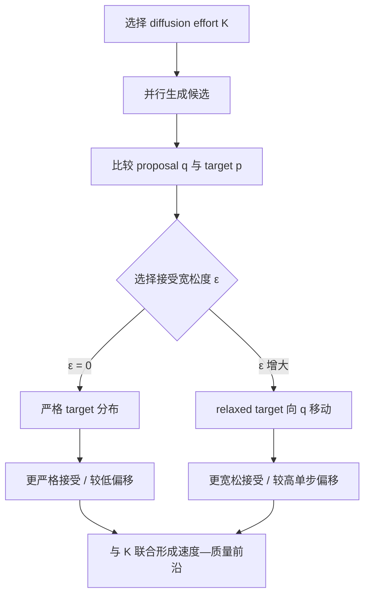

# Speculative Diffusion：联合调节扩散努力与接受宽松度

来源：Zorel et al., [*Speculative Diffusion is a Tale of Two Tradeoffs*](https://arxiv.org/html/2610.31819v1)，arXiv v1（2026-10-22）。重点阅读 §2–§4、Appendix A–D，特别区分单 token 总变差约束和多 token 轨迹分布。结果为论文报告，未在本库独立复现。

## 两个速度—质量旋钮过去常被分开调

扩散语言模型可以减少去噪轮数来提速，但生成质量可能下降；投机解码通常通过严格拒绝采样保留 target 分布，却因此受 drafter 与 target 的差异限制。本文把这两种折衷放在同一张图上：扩散 drafter 的 denoising effort 决定候选质量；verification leniency 决定 target 接受候选时可容忍多大分布偏移。只调一个旋钮，可能错过由另一个旋钮形成的速度—质量区域。[§1–§3](https://arxiv.org/html/2610.31819v1)

## 机制：把 verifier 与 drafter 沿 TV 距离作凸组合

设 target 分布为 (p)，扩散 drafter 的候选分布为 (q)，系统在一次接受决策前选择一个放宽后的分布 \(\tilde p\)。作者考虑：在 \(D_{TV}(\tilde p,p)\le\epsilon\) 的单步偏移预算内，最大化与 proposal 的重叠、从而最大化接受概率。其定理给出的最优解是线性插值：

```text
tilde_p = (1 - lambda) p + lambda q
lambda = epsilon / TV(p, q)
```

当 \(\lambda=0\) 时回到严格 target verifier；增大 \(\lambda\) 则把被验证分布向 drafter 移动。它解释了为什么“diffusion 低去噪 + verifier 宽松”可能互补：一个降低候选生成成本，一个用明确偏移预算提高候选被接受的概率。[§2–§3.2、Theorem 1](https://arxiv.org/html/2610.31819v1)

重要边界：定理约束的是给定前缀下的**下一 token 条件分布**。作者明确指出，单步 TV 界不能不加证明地扩展成整个多 token 序列分布的同等界；有限预算下的严格 target-equivalence 因而不能由此推出。它与 Cactus 等“观察候选 token 后再改变 verifier 分布”的方法也不同：本文的线性 relaxed target 在抽取候选前设定。[§2、Appendix A–B](https://arxiv.org/html/2610.31819v1)



这两只旋钮分别作用于提议成本和 verifier/proposal 重叠；TV 约束对应单步分布偏移，不应画成全序列质量误差的直接界。

## 与已有 diffusion-drafter 路线的关系

| 路线 | 主要变化 | 质量参照 |
|---|---|---|
| [DFlash](2602.06036-dflash.md)、[DFlare](2606.02091-dflare.md) | 以块扩散并行产生 AR 草稿 | target verifier；目标是严格保持 target |
| [DARTree](2608.13524-dartree.md)、[UBTree](2609.39972-ubtree.md) | 扩大候选路径覆盖与树验证 | target verifier；主要研究接受和成本 |
| [PoE-Bridge](2606.08048-poe-bridge.md) | 用 AR/DLM 的中间分布桥接候选质量 | AR 是质量参照，有限候选近似 |
| **Speculative Diffusion** | 联合改变 diffusion 去噪步数与 verifier 宽松度 | 显式绘制相对 target 的速度—质量前沿 |
| [SPOT](2610.22543-spot.md) | dLLM 自身预测 commit-order，再严格验证状态 | dLLM draft-free 轨迹 |

因此本论文并非“又一个 diffusion drafter”：它把严格无损从默认目标改为 Pareto 维度之一，并提出可优化的单步理论框架。它与 SPOT 的区别尤其重要：SPOT 主张通过构造 verifier 保持原轨迹；本文主动允许一定偏移以换取更快生成。

## 实验能说明什么

作者先用 Dream-7B→Qwen2.5-32B 与 DiffusionGemma-26B-A4B→Gemma4-31B 两个 model pair，考察 masked/uniform diffusion 的 Pareto 前沿；再在共享 Qwen3-8B verifier 下，对比 SDAR、Uno、DFlash 与 DSpark 等草稿器。结果显示，能做多步 refinement 的 SDAR，联合改变 denoising effort 与 leniency 后，其 speed–accuracy frontier 超过固定一步；专为一步草稿训练的 Uno/DFlash/DSpark 则主要在一步候选上调 leniency。作者同时指出，throughput 必须与完成任务延迟一起看，单独提高 token/s 可能来自生成了更多无用 token。[§4.1–§4.3、Figures 3–5](https://arxiv.org/html/2610.31819v1)

其理论 cost model 与实测不完全吻合也很有教学价值：模型把接受率简化为一个平均值，但 leniency 会改变哪些 token 被接受、后续 draft 的 prefix 分布也随之改变；EOS 提前结束还会缩短实际 draft block。本文最稳的贡献是把 diffusion effort 与 acceptance leniency 放进同一个实验前沿，而不是给出可通用的速度倍率。模型、温度、去噪步骤、块长、解码器和接受规则都会改变 Pareto 点；单步 TV 偏移也不等同多步任务准确率或安全风险。[§3.3、§4.2、Appendix F–G](https://arxiv.org/html/2610.31819v1)
