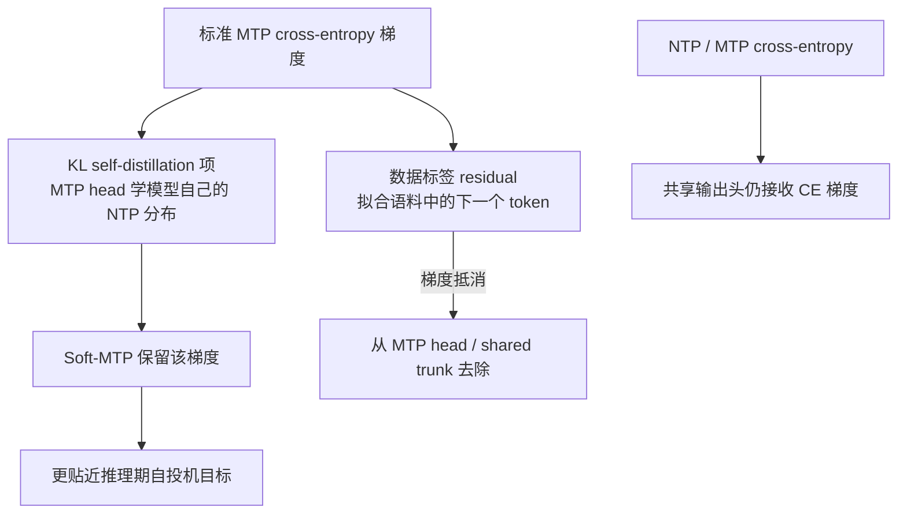

# Soft-MTP：让多 token 预测头学习“模型自己的未来分布”

来源：Teoh, [*Multi-Token Prediction Done Right*](https://arxiv.org/html/2610.38331v1)，arXiv v1（2026-10-28）。重点阅读 §3–§6、Appendix B，特别是梯度分解与 KL gradient–recovery trick。论文报告的模型为 167M–1.2B 级预训练模型；作者关于 frontier-scale 可用性的讨论属于外推，不是同规模实测。

## MTP 同时承担预训练目标和推测草稿器，目标可能不一致

Multi-Token Prediction（MTP）在普通 next-token prediction 外增加多个预测头，要求当前位置预测更远处真实文本 token。它可能改善模型训练中的远期监督，也可在推理时把后续位置当作 drafter。问题是，推测解码真正需要 MTP 头做的是预测**模型自身在对应位置会给出的分布**，而标准 MTP cross-entropy 却要求它预测数据集中的真实 token。两者相关，但不等价。[§1–§3](https://arxiv.org/html/2610.38331v1)

作者把标准 MTP 梯度精确拆成两项：一项是让 MTP 头贴近模型 next-token 分布的 KL self-distillation 信号；另一项是针对真实语料标签的 residual。论文认为 residual 的信噪比较低，却可能占据较大梯度范数并与 NTP/MTP 学习互相干扰，且问题随模型规模上升而更明显。[§4、§6.1](https://arxiv.org/html/2610.38331v1)

这张图反映的是训练梯度路由，不是额外增加一个模型头或独立教师；共享输出头仍沿普通 CE 更新。

## 机制：不显式生成词表 logits，也能恢复 KL 梯度

朴素做法是显式计算教师与学生的 KL，需要同时物化两套 vocabulary-sized logits，给显存和 fused cross-entropy kernel 带来负担。Soft-MTP 利用 NTP 与 MTP head 共享同一线性输出头：在 hidden-state 上通过 straight-through gradient routing 把普通 MTP cross-entropy 梯度与一个增强 NTP loss 的梯度组合，精确抵消上述 residual，只把所需 KL 梯度送入 MTP head 和共享 trunk。共享输出头本身仍接收 CE 梯度。[§5.1–§5.2、Eq. 4–7、Table 1](https://arxiv.org/html/2610.38331v1)

直观上，它不是又训练一个教师模型，也不把 logits 压成 top-k；而是复用标准预训练已经算出的两个 CE 梯度，在表示空间里重构所需的梯度方向。该技巧依赖线性输出头共享、对应的 hidden states 共置，以及通往 MTP hidden state 的反向路径；不能直接套到任意不同结构的 teacher/student 配对。[§5.1、Appendix B](https://arxiv.org/html/2610.38331v1)

## 放回多 token 预测与 drafter 训练谱系

MTP 的研究已从“增加未来 token 监督”发展为几种目的不同的目标：改善预训练表示/样本效率；让 MTP 头近似 target 自身的未来分布以服务自投机；或另行训练 EAGLE、DFlash、DSpark 一类 drafter。Soft-MTP 站在前两者交界处：它保留预训练的 MTP 架构，却把上游梯度目标转向 self-distillation。与 [AdaSPEC](2510.19779-adaspec.md)、[VSD](2602.05774-vsd.md)、[AAT](2609.24150-acceptance-aware-training.md) 和 [EDR](2610.10411-expected-decoding-rounds.md) 相比，它没有直接优化路径接受长度或验证轮数，而是在训练期修正 MTP 的梯度目标。[§3、§6–§7](https://arxiv.org/html/2610.38331v1)

## 作者证据与适用边界

作者在 167M–1.2B 参数模型规模上报告 Soft-MTP 相对标准 MTP 的 NTP/MTP loss、自投机、零样本和 math/code 微调结果；论文称其多数指标与昂贵的显式 KL-MTP 相当或更好，且实现额外开销很小。[§6、Tables 1–5](https://arxiv.org/html/2610.38331v1)

这些结果支持“标准 MTP 的硬标签梯度包含可剥离的自蒸馏信号”，但不能单凭小规模结果断言 frontier 模型训练必然免费获益。训练数据、MTP horizon/权重、头结构、并行策略会改变梯度贡献；论文也指出，近期某些大模型转向 post-training drafter，MTP 是否仍值得保留，取决于它对预训练质量的额外价值。该问题把 MTP 从单一推理加速组件重新放回预训练目标设计中。[§7](https://arxiv.org/html/2610.38331v1)
