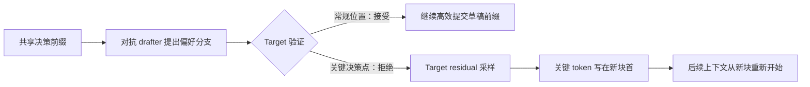

# Adversarial Speculative Reasoning：把草稿器变成“精度调度器”

来源：Luo et al., [*Adversarial Speculative Reasoning Improves Long Horizon Agents*](https://arxiv.org/html/2611.05345v1)，arXiv v1（2026-11-03）。重点阅读 §3–§5，尤其 §3.2–§3.4、§4.1–§4.4 与 §5.1–§5.3。它是近期把投机解码接入长程 Agent 推理的工作；报告中的效果是作者在指定模型和代码任务上观察到的结果。

## 从“多接受几个 token”转向“关键 token 在何处提交”

经典投机解码把 drafter 训练成尽量贴近 target，以延长一次验证能接受的前缀。本文提出另一种关注点：长程 Agent 的某些决策句会影响后续几十轮，如果这些 token 在一次较长的验证块靠后位置写入 KV cache，低精度计算的微小差异可能被后续上下文反复读取。于是研究问题变成：能否主动让关键决策落在一次 target 解码的起始位置，而把稳健、常规的 token 留在块内较后位置？[§1、§3.1–§3.4](https://arxiv.org/html/2611.05345v1)

作者区分理想数学 sampler 与真实推理 kernel：标准 rejection sampling 保持 target 的理论输出分布，但不同位置的数值扰动不一定相同；论文测量到，verification-written context 经历较多后续轮次后，某些 token 的 target log-prob 差异会增大。其假设是，关键决策在较高数值精度的位置编码，可能使之后的长程行为更稳定。这是针对有限精度实现的机制假设，不应改写成“严格无损采样本身改变了 target 的数学分布”。[§3.2–§3.4](https://arxiv.org/html/2611.05345v1)

## 机制：在分叉点训练 drafter 提出“不该被接受”的续写

作者先从真实 Agent 轨迹中找决策句，例如“运行测试”与只继续修改代码等不同动作。为避免把无关上下文差异当作偏好，他们从同一段决策前缀采样多个 target 续写，形成 fork pairs，再由偏好标注选择“优先”与“对抗”分支；整条任务留出以减少近重复轨迹泄漏。目标偏好必须可由局部续写识别：作者发现“是否做了 test/run 命令”等偏好可学，但“决策是否最终正确”在所测 draft 中接近随机，因此部署信号是行为启发式，不是一个能看见真实正确性的 verifier。[§4.2–§5.1](https://arxiv.org/html/2611.05345v1)

常规 draft 训练会让 drafter 学着提出更优分支；本文反向训练它，在已识别的关键位置更偏向提出劣势续写。target 因而会拒绝该 token，在当前验证块起点通过 target 的 residual sampler 自行采样，并从新块起点继续。这样，关键 token 被“挪到”精度更高的槽位；其它位置仍由普通草稿加速。drafter 只安排拒绝发生在哪里，最终 token 仍由标准 target verification 决定。[§4.1、§4.4](https://arxiv.org/html/2611.05345v1)

这与放宽验证的有损解码相反：方法不允许 drafter 覆盖 target，只利用草稿拒绝改变块边界。概念上的收益不是“让模型总选正确答案”，而是利用实现中的数值路径差异，调配有限精度的位置给哪些 token。论文的推论依赖实际 kernel、量化与 KV 写入差异；若精确算术或实现保证位置间无这类差异，机制所依赖的“精度槽位”便不再成立。

图的要点是 drafter 影响“target 何时重新采样”，而不是“target 采样什么分布”。如果实测提升依赖特定低精度计算路径，该控制链的效果也会依实现和负载变化。

## 与接受率优化的谱系关系

| Drafter 训练目标 | 代表工作 | drafter 被训练来做什么 |
|---|---|---|
| token/特征对齐 | EAGLE、DFlash | 接近 target 的逐 token 预测或隐藏表示 |
| 接受率与路径效用 | [VSD](2602.05774-vsd.md)、[AAT](2609.24150-acceptance-aware-training.md)、[EDR](2610.10411-expected-decoding-rounds.md) | 增加路径、窗口或全序列层面的有效接受 |
| 生成中自适应 | [Test-Time Speculation](2605.09329-test-time-speculation.md)、[TLT](2511.16665-tlt-adaptive-drafter.md) | 让 drafter 跟随当前轨迹或持续变化的 target |
| 位置与精度分配 | **Adversarial Speculative Reasoning** | 在关键决策点主动引发拒绝，使 target 在块首重采样 |

所以它不是“更好的接受率训练”，甚至可能牺牲这些位置的接受率。它把验收边界从纯吞吐控制变量，变成推理链中关键状态的数值写入调度器。

## 作者报告的结果与证据边界

实验固定 GLM-5.3-nvfp4+DFlash2 与 DeepSeek-V4.1-Flash+DSpark 两个约 750B target 系统，在 DeepSWE 和 NL2Repo-Bench 上对比 adversarial draft 与普通 draft。作者报告 DeepSWE 上 GLM 的 pass rate 为 67.6% 对 60.6%（差 7.0 个百分点，95% 区间 2.6–11.4）；DeepSeek 的 DeepSWE 差 4.0 点但区间跨零；NL2Repo-Bench 差 1.4 点（95% 区间 0.4–2.4）。三项均值为正，但两项达到显著性的结果来自不同 benchmark/target 组合。[§5.2](https://arxiv.org/html/2611.05345v1)

因此更准确的学习结论是：作者给出了一种可检验的 inference-position 干预，并在两个目标系统的长程代码任务上观察到正向结果；不能据此声称投机解码普遍提升推理准确率。任务数量有限、可学偏好主要是“是否测试”这类局部行为，且对抗 draft 的训练分布较专门。最关键的后续验证应隔离：效应究竟来自浮点非确定性、块位置本身、拒绝后重置上下文，还是 benchmark 决策点偏好；同时检查不同 batch-invariant kernel 和更广泛任务能否重现方向。[§3.4、§5](https://arxiv.org/html/2611.05345v1)
