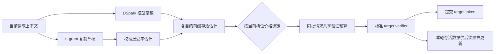

# Hybrid Spark：让内容为每个请求选择草稿器

来源：Ranjan 与 Venkitesh, [*Hybrid Spark: Adaptive Speculative Decoding That Lets the Content Choose the Drafter*](https://arxiv.org/html/2611.05611v1)，arXiv v1（2026-11-03）。重点阅读 §3–§5，尤其 §3 的动机、§4.2–§4.5 的调度与正确性、§5.1–§5.8 的 workload 对照及 Appendix H–P。以下性能数字均为作者报告。

## 为什么一条草稿路线不适合所有请求

模型草稿器（如 DSpark）能处理一般文本，但每步要运行神经网络；n-gram 草稿器则能在代码编辑、复述等高重复场景里，从 prompt 找到已有片段并低成本复制很长的后缀。两者优劣随内容变化：轻编辑通常适合复制，改动越大，神经草稿越稳。若部署始终使用同一个草稿器，另一类请求就浪费了可用机会；把请求拆成两套 GPU 池，又会遇到流量比例随时间波动的问题。[§3、Figure 1](https://arxiv.org/html/2611.05611v1)

困难在于两种草稿的“置信度”不可直接比较。模型草稿有逐 token 概率；n-gram 只告诉系统找到了匹配片段，不知道 target 会接受其中多少 token。简单地取更长的链会忽略同一批次中的其他请求：某个验证槽如果分给当前请求，可能挤掉别处更有价值的验证工作。

## 机制：先放到同一把尺，再按验证机会成本选链

Hybrid Spark 为 n-gram 候选构造轻量接受率估计器。它使用匹配长度、第二匹配的一致性和可复制长度等特征，用 target 回放数据拟合接受概率。模型草稿已有的置信度与 n-gram 的估计值都转成“前缀存活概率”：前面 token 全通过的概率是各位置条件接受率的累积乘积。估计器用于决策，不替代 target 验证。[§4.2](https://arxiv.org/html/2611.05611v1)

接着，系统给每个验证槽计算一个影子价格 λ：这个槽若分给本请求，等于放弃同批其他请求可获得的边际 goodput。对同一请求，系统比较 DSpark 链与 n-gram 链在该价格下的期望价值，选一条，再由 adaptive verification 将总预算分配给各请求。于是“选哪个 drafter”和“验证多少 token”成为一个联合决策，而非两个互不知情的阈值。[§4.3–§4.4、Algorithm 1](https://arxiv.org/html/2611.05611v1)

为了不让 CPU 参与逐步选择而造成 host-device 同步，所有与当前 token 内容相关的估值和链选择都在 GPU 上进行。host 只依据前两步的存活率为下一步设置总预算与槽位价格；这会使用稍旧的批次状态，但避免在每次解码决策时等待 CPU。[§4.1、Figure 3、§5.7](https://arxiv.org/html/2611.05611v1)

图中的概率估计负责调度，target verifier 负责最终提交；两者不能混为同一份概率保证。

需要分清**调度估计**和**分布保证**：估计器可能不准，影响的是选链和预算配置；最终仍由标准 target verifier 按实际 proposal 处理候选。不能把校准接受概率当成采样概率，也不能把估计精度本身当作无损证明。[§4.5、Appendix H](https://arxiv.org/html/2611.05611v1)

## 它在投机解码谱系中的位置

| 研究阶段 | 代表工作 | 解决的问题 |
|---|---|---|
| 候选怎么来 | Prompt Lookup、REST、SuffixDecoding；EAGLE、DFlash、[DSpark](2607.05147-dspark.md) | 分别从已有文本/轨迹检索，或由学习到的模型表示提出候选 |
| 同批验证怎样分配 | adaptive verification、[HeteroSpec](2026.acl-long.589-heterospec.md)、[ValuSpec](2610.31338-valuspec.md) | 有限 target 前向预算应给哪些候选位置或分支 |
| 不同候选来源怎样竞争 | **Hybrid Spark** | 在同一请求内让模型草稿与无模型复制链竞争，并共享验证预算 |

因此它不是新的 drafter 架构，也不是新的正确性 verifier；它把既有草稿器接入内容感知的运行时组合策略。它与 D-PACE、D-PAL 等训练期位置权重方法也不同：Hybrid Spark 改的是在线每个请求选哪条链，而不是如何训练 drafter。[§6](https://arxiv.org/html/2611.05611v1)

## 实验证据与边界

论文把 DSpark 与 GPU n-gram drafter 集成到 vLLM，在 H100 上评估五个 target、七类 workload 和多个 batch。作者报告：在五类代码编辑 workload 上，相比 DSpark，batch 4 的输出吞吐提高 1.10–1.62 倍，batch 128 提高 1.04–1.27 倍；一般聊天 workload 在 (T=0) 下约为 DSpark 的 0.97–1.01 倍。收益随输出复用输入的比例变化，重度编辑时边际收益明显收窄。[§5.1–§5.4、Figures 4–7](https://arxiv.org/html/2611.05611v1)

这些结果支持“混合候选来源可以共享预算”，但当前实证只实例化 DSpark+n-gram 这一对；对 datastore、历史 rollout 或三个以上 drafters 的扩展仍是作者提出的接口可能性。n-gram 接受率估计按模型拟合，迁移到不同 prompt 分布、超长上下文、更多模型无条件使用，尚未由这些实验保证。论文也明确显示：预算用两步前数据估计会带来小幅损失；(T=1) 结果只覆盖其所测 sampler 与配置。[§5.5–§5.8](https://arxiv.org/html/2611.05611v1)

**值得继续追问**：当候选器数量增加，公共价格能否仍然足够表达其机会成本？估计器面对非平稳代码/对话分布如何更新而不引入新的同步？策略是否能同时处理树结构草稿，而不只是二选一的线？这些问题决定 Hybrid Spark 能否从一对 drafter 的工程组合发展成通用的候选调度层。
