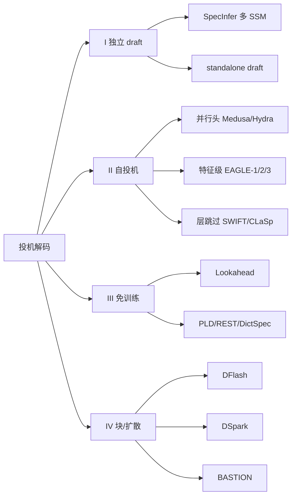

# 投机解码（Speculative Decoding）技术专题 · 深度调研

> 本专题沿“提议候选—target 验证—系统调度”解释投机解码，并比较传统自回归草稿、自投机、免训练方法和扩散交叉方法。论文与源码的固定版本、原文定位和证据范围见[来源清单](sources/MANIFEST.md)。
> **定位**：投机解码 = **用低成本草稿换 target 的并行验证**，在**输出分布可证等价（或明示有界风险）**的前提下降低解码 wall-clock；定义与保证边界见[验证专题](topics/verification-acceptance.md)。本条目管的是“**算法 + 验证 + 系统条件**”这一整条链，不把“草稿模型训练”单独抽出去。

**证据等级约定（单一主等级）**：

| 等级 | 含义 | 在结论中的用法 |
| :-- | :-- | :-- |
| `[精读原文]` | 固定论文版本并定位到支撑结论的正文；代码类须有 `仓库@commit:文件:行` | 每篇分册标出具体阅读范围；代码实现另标静态核验范围 |
| `[摘要级]` | 仅核验官方摘要/会议页/项目页，未通读正文 | 只用于“登记存在”，不进结论数字 |
| `[二手]` | 第三方解读、工程博客、周报 | 只作线索，不入对照表 |
| `[⚠️受限核验]` | 一手对象无法直接读取，只能由镜像或元数据辅助定位 | 仅用于说明来源限制，不独立支撑机制或实验结论 |

**规则**：每条只给**一个主等级**；混合来源取**最弱**等级并在括号里注明来源类型。`[摘要级]` **不许升格**为 `[精读原文]`。

扩散交叉阅读入口：[扩散语言模型与投机解码：草稿、验证和生成目标](topics/diffusion-drafters.md)。它把扩散模型作为生成器、AR 草稿器、扩散模型自投机对象及近似 AR 质量桥接分开比较。

## 研究路线图：草稿、验证、执行

三层回答的是不同问题，不能用单一“draft acceptance rate”覆盖整条链：草稿侧决定候选质量和生成成本；验证侧决定分布保证、接受路径与剩余概率；算子/服务侧决定这些候选最终是变快还是因额外状态、内存访问和调度而变慢。新整理的[草稿机制与训练](topics/draft-side-and-training.md)补上了原来埋在 legacy 的训练路线；树形正确性和遍历见[验证专题](topics/verification-acceptance.md)，GPU 算子与状态提交见扩展后的[吞吐与延迟专题](topics/systems-throughput-latency.md)。

---

## 深度阅读导航

本条目采用三层结构：本页建立路线与综合判断；`papers/` 提供代表论文精读；`topics/` 分别深入草稿、验证、扩散交叉和系统算子问题。完整固定版本与原文链接见[来源清单](sources/MANIFEST.md)。

### 逐篇精读入口（按研究环节）

| 想理解的问题 | 推荐阅读 |
|---|---|
| 草稿来源与结构怎样演进？ | 先读 [Medusa](papers/2401.10774-medusa.md) 的并行头与 [EAGLE 系列](papers/2401.15077-eagle-series.md) 的特征级自回归；再看 [Component-Aware](papers/2605.01106-component-aware-self-spec.md) 如何把 hybrid 子网用作 drafter。总路线见[算法家族谱系](topics/algorithm-families.md)与[草稿侧专题](topics/draft-side-and-training.md)。 |
| 草稿怎样训练，优化什么？ | 先对照 [D-PACE](papers/2605.18810-dpace.md) 的块内动态位置权重、[D-PAL](papers/2610.28355-dpal.md) 的全分布接受信号与[长 CoT 位置诊断](papers/2610.30644-long-position-acceptance.md)的跨生成位置测量；再读 [AdaSPEC](papers/2510.19779-adaspec.md) 的选择性蒸馏、[Attention Drift](papers/2605.09992-attention-drift.md) 的表征归一化、[VSD](papers/2602.05774-vsd.md) 的路径目标、[Acceptance-Aware Training](papers/2609.24150-acceptance-aware-training.md) 的窗口接受长度、[EDR](papers/2610.10411-expected-decoding-rounds.md) 的全序列轮数，以及 [TTS](papers/2605.09329-test-time-speculation.md) 的单轨迹在线适应和 [TLT](papers/2511.16665-tlt-adaptive-drafter.md) 的 RL rollout 内更新。 |
| 树形验证如何选树、遍历并保证正确？ | 从 [SpecInfer](papers/2305.09781-specinfer.md) 看树 mask 与共享前缀；读 [Sequoia](papers/2402.12374-sequoia.md) 看预算内树形与硬件映射；用 [Traversal Verification](papers/2505.12398-traversal-verification.md) 比较叶到根遍历；再对照 [HSD](papers/2601.05724-hsd.md)、[RheoSampling](papers/2609.21827-rheosampling.md) 与有损的 [Approximate SD](papers/2608.03447-approximate-sd.md)。 |
| target 的算子与状态怎样决定真实成本？ | [SpecLA](papers/2607.16673-specla.md) 展示线性注意力状态上的链/树验证与 accepted-state 恢复；再读固定版本 [vLLM](papers/vllm-implementation.md)、[SGLang](papers/sglang-implementation.md) 代码路径，并进入[吞吐、延迟与算子专题](topics/systems-throughput-latency.md)。 |
| 扩散、块草稿与 AR target 如何组合？ | [DFlash](papers/2602.06036-dflash.md) → [DFlare](papers/2606.02091-dflare.md) 看条件化与容量；[DDTree](papers/2604.12989-ddtree.md) → [DARTree](papers/2608.13524-dartree.md) → [PRESTO](papers/2607.22634-presto.md) 看位置边际候选怎样校正成树；[DFlow](papers/2609.06498-dflow.md) 复用 rejected-suffix verifier states；[DSpark](papers/2607.05147-dspark.md) 用轻量顺序头恢复块内依赖并调度验证；再与 dLLM 自投机 [Spiffy](papers/2509.18085-spiffy.md)、有限预算质量桥接 [PoE-Bridge](papers/2606.08048-poe-bridge.md) 对读。综合比较见[扩散交叉专题](topics/diffusion-drafters.md)。 |

### 横切专题（`topics/`）

| 专题 | 回答什么 |
| :-- | :-- |
| [algorithm-families.md](topics/algorithm-families.md) | 草稿来源家族与选型轴；草稿训练深读见 draft-side 专题 |
| [draft-side-and-training.md](topics/draft-side-and-training.md) | drafter 的来源、表示、训练信号与在线更新时机 |
| [verification-acceptance.md](topics/verification-acceptance.md) | 接受规则、概率回补、严格无损与近似边界 |
| [systems-throughput-latency.md](topics/systems-throughput-latency.md) | 负载相图与吞吐/延迟；补树 mask、state/KV commit、GPU kernel 与 runtime 调度如何共同决定真实成本 |
| [diffusion-drafters.md](topics/diffusion-drafters.md) | 扩散作为 AR 草稿、dLLM 自投机及质量桥接 |
| [heterogeneous-budget-allocation.md](topics/heterogeneous-budget-allocation.md) | 对比位置容量（HCSpec）、上下文级策略（HeteroSpec）与候选筛枝（ValuSpec），区分决策信号与正确性责任 |

## 0. 一页结论

1. **投机解码的收益不是“算法属性”，而是“算法 × 负载 × 硬件”的联合属性**。EAGLE 在 SGLang batch=24 就跌破 1.0×（0.93×），EAGLE-3 在 batch=64 仍有 1.38×；同一族、不同版本，拐点不同。**EAGLE-4 把这条从“族属性”收窄为“配置属性”**：它用按实测成本自调的树，在四卡 B300 上并发 64 仍有 1.39×，但**同一实现默认配置在单卡并发 64 是 0.73×、四卡默认配置并发 256 是 0.37×**——只有换上官方 high-load recipe 才在大并发不被普通解码反超（见 [EAGLE-4 分册](papers/eagle4-one-flexible-drafter.md) §4）。`[精读原文]`
2. **“无损”须按保证与算法形式区分**：严格分布保持与贪心等价需要各自证明；逐 token / 序列级是验证形式，不能另当正确性等级；typical acceptance 的经验质量也不能直接升级为分布偏移有界。新近 SecureSD 还测到：对有损 verifier，jailbreak/prompt-injection 指标可能比通用 utility 更早退化；这不推翻严格无损方法的等价证明。详见 [验证专题 §6](topics/verification-acceptance.md#6-无损需要区分保证与经验)与[SecureSD 精读](papers/2610.08678-secure-sd.md)。`[精读原文]`
3. **T>0 的动态树必须分析候选选择条件**：不能从贪心 benchmark 推出所有采样配置的收益。对按 `q` 排序/剪枝的随机候选，需核对存活条件和实际提议分布；RheoSampling 给出一种特定构造。未核版本的默认配置不在此断言。`[精读原文]`
4. **top-K 改变的是接受率，不是无偏性**：单链拒绝采样的 α* = Σ min(p,q) = 1 − TV；top-K 截断只要验证端用同一分布、残差用完整 p，输出仍严格等于 p。把“top-K 有偏”当结论是错的。`[精读原文]`
5. **草稿来源与训练目标是两条正交轴，扩散也有不同角色**：独立 draft、自投机、免训练、diffusion-to-AR draft 与 dLLM self-speculation 的提案机制不同；VSD、AAT、EDR 则分别优化路径接受、窗口接受长度与全序列验证轮数。用[草稿侧专题](topics/draft-side-and-training.md)看训练粒度，用[扩散交叉专题](topics/diffusion-drafters.md)分辨不同 target 和正确性保证。`[精读原文]`
6. **高 batch 的结论要加第三维：序列长度**。短序列 + 大 batch 亏（SpecInfer/Medusa/vLLM 口径一致）；长序列 + 大 batch 可能赚（MagicDec：S≥4000 时加速随 batch 上升，最高 2.51×）。`[精读原文]`
7. **指标必须成对**：`draft_acceptance_rate`（分母=提议草稿数）与 `mean_acceptance_length`（分母=验证步数，含 bonus）会反向移动；只报一个会得出相反结论。`[精读原文（vLLM 代码）]`
8. **工程落地已经分叉成两种语义**：vLLM 用 `draft_sample_method ∈ {greedy, probabilistic}`；SGLang 用 `speculative_use_rejection_sampling` + `assert topk == 1`。两者都能把真实 `draft_probs` 传给验证，但适用形状不同。`[精读原文（代码）]`
9. **SGLang 的采样验证有拓扑限制**：固定版本中，`draft_probs` + 拒绝采样只支持 **topk=1**；tree topk>1 走 target-only kernel。issue 页面没有关联 PR/commit，因此不能从 issue 状态推断具体代码变更来源。`[精读原文（代码）]`
10. **新工作改变的是不同层，不是同一个“加速算法”**：Sequoia/Traversal 改树构造与验证遍历；VSD/AAT/EDR 改 draft 训练目标；Approximate SD 明确用预算换 greedy 轨迹偏离；SpecLA 将树验证延伸到 recurrent state 与 GPU kernel。性能比较需分别读概率保证、接受长度、算子耗时和端到端负载结果。扩散交叉见[综合专题](topics/diffusion-drafters.md)。
11. **证据边界**：本专题没有独立复现实验；性能数字均为论文或官方报告值，代码结论绑定所列固定 commit。

---

## 1. 定义与判据

### 1.1 操作性定义

**投机解码**：给定 target 自回归模型 `p` 与一个更便宜的提议机制 `q`，先并行产生若干候选 token（链/树/块/检索结果），再由 target **一次前向**并行验证，按某个接受规则决定输出；当接受规则满足“输出边缘分布 = p”时称**无损**。

三个必要元素：

| 元素 | 作用 | 缺了会怎样 |
| :-- | :-- | :-- |
| **提议机制 q** | 产生候选，决定 `T_draft/T_target` | 没有 q 就退化为普通解码 |
| **并行验证** | 一次前向验证多个候选 | 退化为逐 token 解码，无加速 |
| **接受规则** | 保证分布/质量，决定接受率 | 无规则 = 直接信草稿，有偏 |

### 1.2 纳入 / 排除

| 类别 | 是否纳入 | 理由 |
| :-- | :-- | :-- |
| 经典 draft-then-verify（Leviathan/Chen） | ✅ | 范式源头 |
| 自投机（Medusa / EAGLE / MTP / 层跳过） | ✅ | 当前工程实现代表 |
| 免训练（Lookahead / PLD / REST / 字典） | ✅ | 独立一族，端侧/低资源重要 |
| 树验证系统（SpecInfer / Sequoia） | ✅ | 验证侧的基础设施 |
| 扩散、块草稿与投机解码交叉（DFlash / DFlare / DDTree / DARTree / PRESTO / DFlow / DSpark / Spiffy / PoE-Bridge） | ✅ | 区分块并行草稿、半自回归修正、跨轮 verifier-state relay、dLLM self-speculation 和有限预算质量桥接；机制路线见[扩散交叉专题](topics/diffusion-drafters.md)与[草稿侧专题](topics/draft-side-and-training.md)。独立扩散生成机制见 [LLM/DiffusionLM](../../LLM/DiffusionLM/report.md) |
| 纯量化 / 纯剪枝 / 纯 KV eviction | ❌ | 不产生“候选-验证”结构；归 `Infra/QuantizationEdge` |
| 纯 batch 调度 / continuous batching | ❌ | 系统优化但不含投机；归 `Infra/TrainingInfra` 或框架条目 |
| 扩散语言模型（非投机范式） | ❌ | 独立生成范式不是本条目主体；训练目标与去噪机制见 [LLM/DiffusionLM](../../LLM/DiffusionLM/report.md) |

### 1.3 无损性三档（引用时必须声明）

| 档 | 定义 | 代表 | 可否写“严格无损” |
| :-- | :-- | :-- | :-- |
| **严格分布等价** | 对任意序列，输出概率 = p(Seq) | 经典单链；静态树；HSD；RheoSampling（Theorem 1）；Traversal Verification | ✅ |
| **序列级等价** | 以整条序列概率判接受（而非逐 token） | Traversal Verification 的视角 | ✅（在其定义域） |
| **有界风险** | 接受放宽到“分布偏移受控” | ARC-Decode（JS 上界，ICML 2026 会议页 `[摘要级]`）；Medusa typical acceptance（[papers/2401.10774-medusa.md](papers/2401.10774-medusa.md) §2.3）；CDSL（NAACL 2025，素材层） | ❌ 只能写“质量近乎不变” |

> **反例**：把 ARC-Decode 的“相对 EAGLE-3 最高 1.6×”（ICML 2026 会议页 `[摘要级]`）与 RheoSampling 的“相对自回归 2.93×”（[papers/2609.21827-rheosampling.md](papers/2609.21827-rheosampling.md) §4）并列，是**量纲 + 基准 + 保证等级**三重错配。

HeteroSpec 的 ACL 正文声明继承 EAGLE-3 verifier 并保留严格接受条件，但没有另给 HSD 式序列级分布证明；本表不把该声明列作独立理论证明。证据边界与读法见[异质预算专题](topics/heterogeneous-budget-allocation.md)。

### 1.4 指标口径（工程硬要求）

| 指标 | 定义 | 分母 |
| :-- | :-- | :-- |
| `draft_acceptance_rate` | 被接受草稿 / 提议草稿 | **提议 token 数** |
| `mean_acceptance_length` | 1 + 被接受草稿 / 验证步数 | **验证步数**（含 bonus token） |
| `per_position_acceptance` | 逐位置接受率 | 验证步数 |
| `num_draft_tokens` | 总提议数 | **已扣除结构化约束作废的草稿** |

**必须成对报告**，并同时声明：`(batch, T, 序列长度, 硬件, 树参数, 是否结构化约束)`。

---

## 2. 谱系

### 2.1 四大家族

| 族 | 草稿来源 | 额外权重 | 训练 | 典型条件数字 |
| :-- | :-- | :-- | :-- | :-- |
| I 独立 draft | 另一个小模型 | 一个完整模型 | 预训练 | 1.5–2.8×（SpecInfer 分布式） |
| II 自投机 | target 的头/特征/层 | ~7% 或 <1B | 训头/联合 | 2.3–6.5×（EAGLE/Medusa，带条件） |
| III 免训练 | 轨迹/检索/字典 | **无** | **免训练** | 1.5–4×（Lookahead，算力富余） |
| IV 块式并行草稿 | 块扩散或半自回归并行 backbone | 一个 draft；有些方法附轻量顺序头或跨轮状态 | 需训练 | 不单列速度排名；draft latency、接受路径和验证预算须分开看 |

详细谱系与选型判据见 [topics/algorithm-families.md](topics/algorithm-families.md)。

### 2.2 时间线（2023 → 2026H2）

| 阶段 | 主线 | 代表 | 阅读依据 |
| :-- | :-- | :-- | :-- |
| 2023 | 经典 draft-then-verify | Leviathan / Chen；SpecInfer | [SpecInfer 分册](papers/2305.09781-specinfer.md) |
| 2024 H1 | 并行头/树验证 | Medusa；Lookahead | [Medusa](papers/2401.10774-medusa.md)、[Lookahead](papers/2402.02057-lookahead.md) |
| 2024 H2 | 特征级自投机 + 动态树 | EAGLE-1 / EAGLE-2 | [EAGLE 分册](papers/2401.15077-eagle-series.md) |
| 2025 | 训练目标 + 数据 scaling | EAGLE-3 | 同上 |
| 2026 H1 | 块扩散 draft、树验证、dLLM 自投机与质量桥接；块内训练目标和长序列在线适应 | DFlash / DFlare / DDTree / PRESTO / Spiffy / PoE-Bridge；D-PACE / Test-Time Speculation | [扩散交叉综合](topics/diffusion-drafters.md)、[D-PACE](papers/2605.18810-dpace.md)、[TTS](papers/2605.09329-test-time-speculation.md) |
| 2026 H2 | T>0 正确性、安全边界、跨轮状态复用与负载感知 draft/verify | RheoSampling；SecureSD；SpecStream；DFlow；DSpark | [RheoSampling](papers/2609.21827-rheosampling.md)、[SecureSD](papers/2610.08678-secure-sd.md)、[SpecStream](papers/2609.33184-specstream.md)、[DFlow](papers/2609.06498-dflow.md)、[DSpark](papers/2607.05147-dspark.md) |
| 2026 H2 | 扩散草稿的分支校正；Agent 场景复用 target 上下文；异质位置/上下文预算 | DARTree；DLite；HCSpec；HeteroSpec | [DARTree](papers/2608.13524-dartree.md)、[DLite](papers/2610.23787-dlite.md)、[异质预算专题](topics/heterogeneous-budget-allocation.md) |
| 2026 H2 | 草稿预算自适应（按硬件与 batch 实测成本调树） | EAGLE-4 | [EAGLE-4 分册](papers/eagle4-one-flexible-drafter.md) |
| 2026 | 生产框架落地 | vLLM / SGLang | [vLLM](papers/vllm-implementation.md)、[SGLang](papers/sglang-implementation.md) |

### 2.3 五根可判定的轴

| 轴 | 取值 | 判定方式 |
| :-- | :-- | :-- |
| A 草稿来源 | 独立 / target 自身 / 检索 / 块 | 看是否需要额外权重 |
| B 训练 | 免训练 / 训头 / 训独立模型 | 看训练管线 |
| C 拓扑 | 链 / 静态树 / 动态树 / 块 | 看验证 mask |
| D 接受率上限 | 由 p 与 q 的对齐度决定 | 同条件比 τ 或 acceptance rate |
| E 负载行为 | batch↑ 升/降/反转 | 看 batch×序列扫描 |

> 本节依据 [DARTree](papers/2608.13524-dartree.md)、[SpecStream](papers/2609.33184-specstream.md) 与 [DLite](papers/2610.23787-dlite.md) 的固定版本原文。

### 2.4 投机解码方向的新近工作

投机解码的进展不只是“更高接受率”。这些工作分别改变不同层：

| 工作 | 它改变什么 | 读它时先问什么 |
| :-- | :-- | :-- |
| [DARTree](papers/2608.13524-dartree.md)（8 月） | 对扩散草稿沿多条候选分支分别做因果校正，并把建树与全局 top-B 剪枝分离 | 树验证预算与候选宽度固定时，批量建树是否在目标模型/硬件上减少真实 draft wall-clock？ |
| [SpecStream](papers/2609.33184-specstream.md)（9 月） | 按 target commit 边界 offload 历史 KV、流式验证、共享 KV 读取，并在传输等待时共卡运行 draft | PCIe 数据搬运能否被 overlap 隐藏到足以补偿每轮全历史传输？它明确显示长输入仍慢于全驻 GPU。 |
| [Adaptive DHiSparse](papers/2610.13708-adaptive-dhisparse.md)（10 月） | 将稀疏 attention 选中的 KV 行放入负载自适应层级，并让一轮多 query 验证共享缺失行搬运 | 它只适用于有 sparse KV selector 的 target；高并发下 staging 可能减少可接纳 session，使单请求变快但总吞吐不增。 |
| [DLite](papers/2610.23787-dlite.md)（10 月） | 把 target 多层 hidden states 当作紧凑上下文，草稿器仅做局部预测，不保存 draft 历史 KV | 免去的是 draft KV 和重复历史建模；target KV 仍在，收益目前由 Qwen3-4B/8B 证据支撑。 |
| [HSD](papers/2601.05724-hsd.md)（3 月） | 在可访问树分支间平衡概率过剩/不足，做严格分布保持的序列级验证 | EAGLE-3 等概率槽位实验不能单独证明 HSD 提升了接受率；其吞吐结果也受 verifier 实现路径影响。 |
| [Delayed Tree Expansion](papers/2602.16994-delayed-tree.md)（2 月） | 先走 trunk，再由 selector 决定分支深度、宽度和数量 | 三模型平均吞吐略高于 Traversal，但 Llama 子项回退；selector 依赖离线轨迹与目标硬件延迟测量。 |
| [CaDDTree](papers/2606.01813-caddtree.md)（6 月） | 将扩散草稿树目标从最大接受长度改为每轮时间归一化收益，按边际验证成本选节点预算 | 停止保证依赖单调凸验证成本；当前主证据仅覆盖 Qwen3-4B/8B + DFlash 与 8×A800。 |
| [TLAR](papers/2610.07350-tlar.md)（10 月） | 检索当前生成轨迹，以此前 target 验证收益调节检索频率与宽度 | B200 上长代码输出有吞吐收益，512-token 短输出略亏；轨迹来源的价值随模型与任务而变。 |
| [Sequoia](papers/2402.12374-sequoia.md) / [Traversal Verification](papers/2505.12398-traversal-verification.md) | 分别改变**候选树拓扑/硬件预算**与**树路径遍历顺序** | Sequoia 的树形最优性依赖位置接受率与拒绝概率假设；Traversal 的严格等价按特定自回归树/残差算法成立，二者不应被概括成同一个 tree verifier。 |
| [Approximate SD](papers/2608.03447-approximate-sd.md) | 在 greedy 验证中用 regret 门槛、块内上限和请求级预算复用部分 mismatch 后缀 | 是显式近似而非严格无损；request regret 预算不等于语义风险上界。 |
| [D-PACE](papers/2605.18810-dpace.md) / [D-PAL](papers/2610.28355-dpal.md) | 在块式并行 drafter 中，从固定位置衰减转向动态接受长度权重；D-PAL 进一步以完整 target–draft overlap 取代单个记录 token 的置信代理，并比较局部分布损失 | D-PACE 的 confidence 是点质量代理；D-PAL 需 target 全分布，且证据以 DFlash 固定块为主，不能直接外推到动态树或任意 drafter。 |
| [长 CoT 位置诊断](papers/2610.30644-long-position-acceptance.md) | 用未在 target 输出上训练的独立 drafts 测量长推理中的跨生成位置接受轨迹，并分离 sampling 下 argmax agreement 与真实分布接受概率 | 报告范围内 sampling 的 \(\alpha\) 与 greedy 的 argmax 前缀一致率均未下降；结论限于一个数学域、单 target 家族与有限有效长度，不否定 D-PACE / D-PAL 的 block 内位置权重。 |
| [Test-Time Speculation](papers/2605.09329-test-time-speculation.md) | 在每条生成轨迹内复用 target 验证 canvas 做在线蒸馏，修复长输出时离线训练前缀与当前 target 分布的失配 | acceptance length 上升不等于 free speedup；反向传播、更新频率和 CUDA stream contention 决定端到端收益。 |
| [DSpark](papers/2607.05147-dspark.md) | 用并行骨干加轻量顺序头修复块内依赖，再以校准前缀生存概率与 engine SPS 曲线联合分配 batch 验证前缀 | offline accepted-length 结果与 live-load scheduler 结果是两类证据；早停最优性依赖吞吐目标单峰，不能简化成置信阈值。 |
| [DFlow](papers/2609.06498-dflow.md) | 将本轮未提交的 verifier hidden states 修正后 relay 到下一轮重叠 draft positions，并用多轮 self-conditioning 训练 | rejected token 仍不成为已确认上下文；收益来自表示复用，仍要保存/投影状态，且 training rollout 必须对齐实际拒绝边界。 |
| [VSD](papers/2602.05774-vsd.md)、[AAT](papers/2609.24150-acceptance-aware-training.md)、[EDR](papers/2610.10411-expected-decoding-rounds.md) | 将训练目标从逐 token 匹配扩展到 path acceptance、window accepted length 与 whole-sequence round count | 目标粒度不同，目前没有同一 target/drafter/预算下的控制比较；接受长度/round count不等同 wall-clock。 |
| [SpecLA](papers/2607.16673-specla.md) | 为线性注意力 target 的树验证设计 state-aware kernels 与 accepted-state 恢复 | 论文级 GDN/H100 机制与结果；不是当前 vLLM/SGLang 主线内核已具备该实现的证据，算子层见[系统专题](topics/systems-throughput-latency.md)。 |

我的阅读判断：近期工作已将投机解码的研究对象分成**草稿来源/训练目标、树形候选与 verifier、运行时状态与 GPU 算子**几层。不能把 DARTree/DLite 的 `τ` 或 AR-relative speedup 与 SpecStream / Adaptive DHiSparse 的并发服务 throughput 横向排名，也不能用 acceptance rate 替代算子耗时。现在专题的阅读路线按这三层组织，扩散交叉保留为生成目标的特例。

---

## 3. 机制（把四族串起来）

### 3.1 单链：draft-then-verify

- 从 `q` 逐 token 采样；以 `min(1, p/q)` 接受；拒绝后从 `norm(max(0, p−q))` 重采。
- 证明见 [topics/verification-acceptance.md](topics/verification-acceptance.md) §2；结论：输出严格等于 `p`。
- 工程前提：采样与验证必须用**同一个 q**；截断（top-K/top-128）必须两端一致。

### 3.2 自投机：并行头 vs 特征自回归

| 维度 | Medusa（并行头） | EAGLE（特征自回归） |
| :-- | :-- | :-- |
| 草稿来源 | target 最后隐藏态 + K 个头 | target 第二层顶层特征 + 单层 decoder |
| 前缀依赖 | ❌ 头之间独立 | ✅ 有 |
| 接受率（同条件参考） | ~0.6 | ~0.8 |
| 训练 | 训头（backbone 可冻结） | 训草稿头（70B 约 0.99B 参数） |
| 树 | 笛卡尔积/搜索树 | 静态→动态树 |
| 典型加速（带条件） | 2.3–2.8×（batch=1） | 3.0–6.5×（五任务） |

### 3.3 树验证：覆盖率 vs 成本

- SpecInfer 的 tree mask + 树形 KV 是公共祖先；EAGLE/Medusa 的树验证复用了同一抽象。
- 树宽不是越大越好：SpecInfer 在 **BS≥4** 时 2–3 最优；EAGLE-2 的动态树按 value 选点；CAST（`[二手]`）进一步把 GPU/batch 纳入成本。
- 树验证的收益来自“一次前向验证多分支”，成本是“验证 token 数 × 每 token 成本”。
- [Delayed Tree Expansion](papers/2602.16994-delayed-tree.md) 将分叉点延后并按硬件/模型代价选择；[CaDDTree](papers/2606.01813-caddtree.md) 则直接把每轮验证成本纳入树预算。前者改变**分支何时出现**，后者改变**每轮扩多少节点**；机制与 DARTree 的候选校正不同。

### 3.4 免训练：用已有轨迹

- Lookahead：Jacobi 轨迹 + 2D 窗口（W/N/G）+ n-gram 池；贪心草稿 = one-hot，验证仍无损。
- PLD/REST/DictSpec：prompt/语料/字典匹配；收益与重复度/tokenizer fertility 强相关。
- 边界：命中率决定上限；需要剩余算力。

### 3.5 T>0：one-hot 困境与修复

- 动态树按 `q` 排序建树；T>0 时接受取决于 `p/q` 比值，`q` 不再预测接受 → 树塌缩。
- 直接“改成采样”会破坏无损性（存活依赖取值）。
- RheoSampling：前 m 个确定性 + 第 m+1 个残差采样；采样 token 用 proxy 参与排序/剪枝、用真实 `q̃` 验证；OT 重分配残差。
- 修复的代价：每步多一次采样 + OT 验证；默认值必须按具体版本核对，线上 T>0 应同时核正确性和效率。

### 3.6 系统调度：从静态到自适应

- 静态 `num_speculative_tokens` 无法覆盖负载区间（vLLM 文档口径）。
- 方向：按 (request, position) 置信度分配验证预算（vLLM adaptive verification）；按上下文裁剪 draft（`draft_context_window`，本 commit 未检出）；变长验证 + ragged verify（SGLang DSpark）。
- 这些是“算法→wall-clock”的关键，见 [topics/systems-throughput-latency.md](topics/systems-throughput-latency.md)。

### 3.7 三次“系统化”转折

把 2023–2026 的变化按“解决了什么系统问题”重排，比按年份更清楚：

| 转折 | 之前的问题 | 解法 | 代价 | 代表 |
| :-- | :-- | :-- | :-- | :-- |
| **① 从“一个 draft”到“一棵树”**（2023–24） | 单链草稿一错全废，覆盖率低 | token tree + 树形 KV + topology-aware mask | 验证 token 数上升；实现复杂度上升 | SpecInfer |
| **② 从“独立模型”到“自投机”**（2024–25） | 独立 draft 难获取、难对齐、双模型服务贵 | target 特征/头/层跳过做草稿 | 要训草稿头；换 target 要重训 | Medusa / EAGLE |
| **③ 从“静态配置”到“按负载/按温度自适应”**（2025–26） | 一个 `num_speculative_tokens` 适配不了所有 batch/T | 动态树、adaptive verification、变长验证、T>0 解耦 | 系统复杂度上升；默认配置未必开启 | EAGLE-2/3、RheoSampling、vLLM/SGLang |

**读法**：三次转折都不是“算法更准”，而是“**把某个系统约束显式化**”——① 把覆盖率显式化，② 把 draft 获取成本显式化，③ 把负载/温度显式化。这也是为什么同一算法在不同系统里表现差异巨大。

### 3.8 一个请求从进入到返回的投机路径（跨系统抽象；vLLM `llm_base_proposer.py:511` / SGLang `eagle_worker_v2.py:671`）

| 步 | 做什么 | vLLM 对应 | SGLang 对应 |
| --: | :-- | :-- | :-- |
| 1 | 判定是否开投机、开哪种 | `speculative_config` | `get_spec()` |
| 2 | draft 采样 | `_sample_draft_tokens` | `draft_forward` |
| 3 | 组装验证输入 | `propose` + `draft_probs` 装配 | `build_eagle_verify_input` |
| 4 | 并行验证 | `rejection_sample` | `eagle_sample` |
| 5 | 接受/拒绝、写回 KV | `_rejection_*` kernel | `verify_tree_greedy_func` / sampling kernel |
| 6 | 记录指标 | `metrics.py` | 调度侧统计 |

这张表是 [vLLM 分册](papers/vllm-implementation.md) 与 [SGLang 分册](papers/sglang-implementation.md) 的“共同骨架”；两者的差异在第 2/4 步的语义（greedy vs probabilistic、topk=1 vs tree）。

---

## 4. 跨系统对比总表（带条件）

> **读法**：每一行的数字只在“条件”列成立；跨行不可直接排序。空值表示表中未列出可比较数字，不表示“没有”。

| 系统 | 年份/出处 | 族 | 草稿来源 | 训练 | 拓扑 | 报告加速比 | 条件 | 证据 |
| :-- | :-- | :-- | :-- | :-- | :-- | :-- | :-- | :-- |
| Leviathan / Chen | 2023 | I | 独立小模型 | 预训练 | 链 | 2–3× | T5-XXL、同族 draft | 背景（未设分册） |
| **SpecInfer** | 2023–24 | I | 多 SSM | 用现成 | 树 | 分布式 1.5–2.8×；offloading 2.6–3.5× | 单机/多机；A10 24GB | [分册](papers/2305.09781-specinfer.md) |
| **Medusa** | 2024 | II | 并行头 | 训头 | 树 | Medusa-1 >2.2×；Medusa-2 2.3–2.8× | Vicuna-7B/13B、batch=1 | [分册](papers/2401.10774-medusa.md) |
| **Lookahead** | 2024 | III | Jacobi 轨迹 | 免训练 | n-gram | 1.5–2.3×；MT-Bench 7B 1.8×；8 卡 4× | A100/3090、代码任务 | [分册](papers/2402.02057-lookahead.md) |
| **EAGLE-1** | 2024 | II | 特征自回归 | 训头 | 静态树 | LLaMA2-70B 2.7–3.5× | T=0、batch=1 | [分册](papers/2401.15077-eagle-series.md) |
| **EAGLE-2** | 2024 | II | 特征自回归 | 训头 | 动态树 | 3.05–4.26× | T=0、三系列模型、六任务 | 同上 |
| **EAGLE-3** | 2025 | II | 多层特征 + 直接 token | 训头（8× 数据） | 动态树 | 3.0–6.5× | 五任务、chat+reasoning | 同上 |
| **EAGLE-3 @ SGLang** | 2025 | II | 同上 | — | 链（链长 3，不用树） | 1.38× 吞吐（batch=64）；2.36× 吞吐（batch=1） | 1×H100、LLaMA3.1-8B、MT-Bench | 同上（Table 3/4） |
| **MagicDec** | 2024–25 | I/自投机 | 稀疏 KV 自投机 | 免训练 | 链 | 最高 2.51× | 长上下文、batch 32–256、8×H100 | [分册](papers/2408.11049-magicdec.md) |
| **RheoSampling** | 2026 | II+验证 | EAGLE-3 官方 draft | 不重训 | 动态树 | τ 5.04→5.25；加速 2.84→2.93× | T=1.0、单 A6000、树 60/8 | [分册](papers/2609.21827-rheosampling.md) |
| **DARTree** | 2026 | IV+校正 | DFlash/扩散块 + Domino correction | 不重训 | 路径校正树 | GSM8K 9.73×；τ=12.97 | Qwen3-4B、T=0、batch=1、RTX 6000 Ada、B=64 | [分册](papers/2608.13524-dartree.md) |
| **DLite** | 2026 | II/IV 交叉 | target hidden-state + 局部块草稿 | 两段蒸馏 | 块 + 顺序头 | SWE-Bench 2.74×；τ=3.19 | Qwen3-8B、H800、K=7、相对本地 AR | [分册](papers/2610.23787-dlite.md) |
| **SpecStream** | 2026 | serving 系统 | Draft 与 Target 共卡 | 使用现成模型 | 流式多-query 验证 | vs TriForce 1.41×/1.32×；vs SD+Offload 1.44×/1.62× | 2×A800 PCIe、8 并发汇总；长输入仍逊于 GPU-resident SGLang | [分册](papers/2609.33184-specstream.md) |
| **HSD** | 2026 | verifier | 现有 draft | 不改 draft | 分层序列验证 | 32.52 / 27.48 / 12.33 tokens/s | Qwen2.5-72B/0.5B、1×H20、T=1；GSM8K/HumanEval/CNN-DM；相对 tokenwise +3.3–4.4% | [分册](papers/2601.05724-hsd.md) |
| **Delayed Tree Expansion** | 2026 | tree 拓扑 | 独立 i.i.d. draft | selector 需训练 | trunk 后动态分支 | 平均 16.69 vs 15.89 tokens/s | 三模型、五数据集、八采样设置；2×A100；Llama 子项回退 | [分册](papers/2602.16994-delayed-tree.md) |
| **CaDDTree** | 2026 | 成本感知树预算 | DFlash 块草稿 | 不新增训练 | 每轮按成本选树大小 | 不报单一加速倍数；多数配置贴近/优于 DDTree 网格 oracle | Qwen3-4B/8B、8×A800；PyTorch tree attention 与快速 AR/DFlash kernel 条件不同 | [分册](papers/2606.01813-caddtree.md) |
| **TLAR** | 2026 | 检索式候选来源 | 当前生成历史 + SmallDraft | 免训练控制器 | 匹配后缀并入 target 验证树 | Qwen B=1/32 +8.3%/+7.6%；Mistral +4.1%/+3.5% | 单张 B200、1024 输出 token、代码任务；Qwen 512-token 输出略慢 | [分册](papers/2610.07350-tlar.md) |
| **vLLM** | 2026 | 框架 | EAGLE/MTP/DFlash/standalone | 取决 draft | 链/树 | 本分册不报 | commit 2b85d9cb | [分册](papers/vllm-implementation.md) |
| **SGLang** | 2026 | 框架 | EAGLE/MTP/DFlash | 取决 draft | 链（topk=1）/树 | 本分册不报 | commit 2a08e261 | [分册](papers/sglang-implementation.md) |

### 4.1 三条跨表禁令

1. **禁止跨硬件**：H100 / A100 / L40 / RTX 3090 / TPU v5p 的同一算法不可直接比。
2. **禁止跨量纲**：µJ/token（能效）与 tokens/s（吞吐）不是同一量纲；SMoLPU 一类专用硅的数字不能与算法论文排榜。
3. **禁止把“上限”当“通用值”**：EAGLE-3 的 6.5× 是摘要上限；2.36× 是 SGLang batch=1 的吞吐；1.38× 是 batch=64 的吞吐。三个数字各有条件。

### 4.2 条件数字速查（按“条件”索引，不按“谁更大”）

| 条件 | 数字 | 出处 |
| :-- | :-- | :-- |
| LLaMA2-Chat 70B、T=0、MT-Bench | EAGLE 2.7–3.5×；EAGLE-2 3.51× | EAGLE / EAGLE-2 |
| LLaMA3-Instruct 8B、T=0、MT-Bench | EAGLE-2 3.46×，τ 4.53 | EAGLE-2 |
| Vicuna-7B、batch=1 | Medusa-1 >2.2×；Medusa-2 2.3–2.8× | Medusa |
| LLaMA-2-7B、MT-Bench、A100、FlashAttention | Lookahead 1.8× | Lookahead |
| 8 卡、ClassEval、强扩展 | Lookahead 4× | Lookahead |
| LLaMA-65B/OPT-30B、单机/多机 | SpecInfer 1.5–2.8× | SpecInfer |
| OPT-13B/30B、单 A10 24GB、vs FlexGen | SpecInfer 2.6–3.5× | SpecInfer |
| LLaMA-3.1-8B、长上下文、batch 32–256、8×H100 | MagicDec 2.51× | MagicDec |
| LLaMA-3.1-8B、S≥4000 | 加速随 batch 上升 | MagicDec |
| LLaMA-3.1-8B、S<4000 | 加速随 batch 下降 | MagicDec |
| 1×H100、LLaMA3.1-8B、MT-Bench、链长 3 | EAGLE b=24 0.93×；EAGLE-3 b=64 1.38× | EAGLE-3 Table 3 |
| 1×H100、batch=1、MT-Bench | 158.34 → 373.25 tokens/s（2.36×） | EAGLE-3 Table 4 |
| T=1.0、单 A6000、树 60/8 | RheoSampling τ 5.04→5.25；2.84→2.93× | RheoSampling |
| T=1.0、Vicuna-13B | Rheo τ 5.75→5.89；3.37→3.43× | RheoSampling |
| Qwen3-4B、T=0、batch=1、RTX 6000 Ada、GSM8K | DARTree τ=12.97；9.73× vs local AR | DARTree Table 1 |
| Qwen3-8B、T=0、H800、K=7、SWE-Bench | DLite τ=3.19；2.74× vs local AR；DSpark 1.60× | DLite Table 3 |
| Qwen3/InternLM2.5、2×A800 PCIe、8 并发、CPU KV offload | SpecStream vs TriForce 1.41×/1.32×；vs SD+Offload 1.44×/1.62× | SpecStream §5.2.2 |

> 这张表只用于“查条件”，**不能横向排序**。例如 2.51×（MagicDec，长上下文大 batch）与 6.5×（EAGLE-3，五任务上限）不是同一坐标。

---

## 5. 条件化结果读法

### 5.1 温度：T=0 与 T>0 是两条曲线

| 温度 | 动态树行为 | 接受率 | 引用注意 |
| :-- | :-- | :-- | :-- |
| T=0 | 按 q 排序 ≈ 接受顺序 | 高 | EAGLE-2/3 的主表多在此 |
| T>0 | 树塌缩为 one-hot | 显著下降 | 不能把 T=0 数字外推 |
| T→0 | 采样退化为 top token | 上升 | RheoSampling 的收益区间收窄 |

### 5.2 batch：先升后降，拐点随版本移动

- EAGLE：batch=2 1.40× → batch=24 **0.93×** → batch=64 0.99×。
- EAGLE-3：batch=2 1.81× → batch=24 1.39× → batch=64 1.38×。
- SpecInfer：batch 越大，相对收益越小；BS≥4 树宽 2–3。
- Medusa：模拟显示 batch>32 加速可能转负。
- MagicDec：长序列（S≥4000）时加速随 batch 上升；短序列相反。

### 5.3 序列长度与硬件

| 变量 | 影响 | 证据 |
| :-- | :-- | :-- |
| 序列长度 | 短序列 compute-bound；长序列 KV-bound | MagicDec §3 |
| GPU 的 FLOPS/带宽比 | H100 > A100 > L40 | MagicDec Table 1 |
| GQA vs 非 GQA | GQA 临界序列更长 | MagicDec §3 |
| 多卡 | TP/PP 基线可能 0.75–0.82×；LP 强扩展 4× | Lookahead §5 |

### 5.4 指标：两个分母

- `draft_acceptance_rate` 分母是提议 token；`mean_acceptance_length` 分母是验证步。
- 加深树通常降低前者、提高后者；只报一个会得出相反结论。
- 结构化输出会扣除作废草稿，分母变小。

---

## 6. 失效边界综述

### 6.1 算法边界

1. **T>0 动态树塌缩**（EAGLE-2/3；RheoSampling 给出特定构造，是否启用需查具体配置）。
2. **top-K 的接受率上限**：即使 q=p，纯 top-K 也到不了 100%（缺随机 token）。
3. **草稿质量上限**：独立 draft 的容量差（100–1000×）；Medusa 头无前缀依赖；EAGLE-1/2 的特征约束限制数据 scaling。
4. **有界风险不是无损**：Medusa typical acceptance、ARC-Decode、CDSL。
5. **宽松验证的任务风险不只看准确率**：SecureSD 在所测设置中发现 jailbreak 和 prompt-injection PRR 早于 HumanEval/GSM8K 退化；详见 [SecureSD 精读](papers/2610.08678-secure-sd.md)。
5. **树参数不可移植**：EAGLE-2 的 60/6 与 RheoSampling 的 60/8 不可混用。

### 6.2 系统边界

1. **高 batch + 短序列**：验证成本主导，可能负收益。
2. **长序列显存墙**：KV 随 batch×序列增长；batch 上不去。
3. **draft 上下文失配**：超出训练长度后接受率崩塌；`draft_context_window` 在此处引用的 vLLM 固定快照中尚未实现。
4. **静态配置盲区**：不存在适配所有并发度的 `num_speculative_tokens`。
5. **硬件映射**：GPU 与 TPU 的收益不可互推。
6. **量纲混用**：µJ/token 与 tokens/s 不可排榜。

### 6.3 证据边界

1. **未独立复现**：所有论文分册数字均为论文/官方报告值；RheoSampling 无公开代码。
2. **扩散交叉证据分层**：DSpark、DFlow、D-PACE、D-PAL 等已有固定原文精读；BASTION 等未单独深读的外围工作仍只用于谱系定位，不承担数字或机制结论。
3. **拓展阅读材料不替代证据**：涉及机制和实验结论时，应回到论文分册及其固定版本。
4. **代码行为绑定 commit**：vLLM `2b85d9cb`、SGLang `2a08e261`；换版本需重核。

### 6.4 失效边界矩阵（按场景查；依据 [RheoSampling](papers/2609.21827-rheosampling.md) §6、[MagicDec](papers/2408.11049-magicdec.md) §6、[topic 3](topics/systems-throughput-latency.md) §8）

| 场景 | 最可能踩的坑 | 先查哪篇 |
| :-- | :-- | :-- |
| 线上 T=1.0 开 EAGLE-3 | 动态树 one-hot 塌缩，接受率低于离线测 | [RheoSampling](papers/2609.21827-rheosampling.md)、[topic 2](topics/verification-acceptance.md) |
| batch 从 1 扩到 64 | 收益从 1.81× 掉到 1.38×，甚至更低 | [topic 3](topics/systems-throughput-latency.md)、[EAGLE 分册](papers/2401.15077-eagle-series.md) §4.4 |
| 长上下文 + 大 batch | 用短序列结论会误判；KV 才是主瓶颈 | [MagicDec](papers/2408.11049-magicdec.md) |
| 端侧 / 单卡小显存 | 内存带宽与权重搬运优先于接受率 | [topic 3](topics/systems-throughput-latency.md) §7、端侧硬件拓展阅读 |
| 结构化输出（JSON/SQL） | acceptance rate 分母被扣除，跨实验不可比 | [topic 2](topics/verification-acceptance.md) §7 |
| 缺少 draft_probs | vLLM 整批回退 legacy；SGLang 直接报错 | [vLLM](papers/vllm-implementation.md) §5、[SGLang](papers/sglang-implementation.md) §5 |
| 换 target 模型 | 草稿头/独立 draft 都要重训或重新适配 | [topic 1](topics/algorithm-families.md) §4 |
| 想宣称“无损” | 误把 typical acceptance / ARC 当严格无损 | [topic 2](topics/verification-acceptance.md) §6 |

---

## 7. 与相邻条目的边界

### 7.1 `OpenSource/vllm`

- **vLLM 条目**回答“vLLM 这个系统整体怎么工作”（调度、PagedAttention、分布式）。
- **本条目**只取“投机解码在 vLLM 里怎么落地”这一条路径（`draft_sample_method`、`rejection_sample_method`、`draft_probs` 生命周期）。
- 交叉点：[papers/vllm-implementation.md](papers/vllm-implementation.md) 是本条目对 vLLM 的**单点核验**，不替代 vLLM 条目。

> 任务书写的是 `Infra/vllm`；本仓库实际路径是 `OpenSource/vllm`（同一对象，按实际路径引用）。

### 7.2 `OpenSource/sglang`

- **SGLang 条目**回答“SGLang 的调度/前缀缓存/结构化解码”。
- **本条目**只取 EAGLE 草稿路径与 `speculative_use_rejection_sampling` 这一条；历史 issue #10308 的处置写在本条目 [SGLang 分册](papers/sglang-implementation.md) §6。
- 交叉点：SGLang 的 EAGLE-3 吞吐（batch=64 1.38×、batch=1 2.36×）属于**本条目**的系统条件证据，不重复进 SGLang 条目的架构叙述。

### 7.3 `Infra/QuantizationEdge`

- 量化/边缘部署回答“权重/激活怎么压”。
- 投机解码回答“怎么用草稿换并行验证”。
- 交叉点：QSpec（量化 + 投机）一类工作属于“两者交叉”，本条目只在谱系里提，不展开量化细节。

### 7.4 `Infra/TrainingInfra`

- 训练基础设施回答“怎么训 target / 怎么做 RL rollout”。
- 本条目只在“drafter 训练时机”“RL 长尾（TLT）”处交叉；不展开训练系统。
- 交叉点：EAGLE-3 的 8× 数据、Medusa 的头训练、SpecInfer 的 SSM 预训练都属于“训练成本”，本条目只给成本数字，不给训练配方。

### 7.5 `LLM/*` 与 `Models/*`

- 模型条目回答“这个模型是什么/能力如何”。
- 本条目回答“怎么加速任意自回归模型”；不绑定具体模型家族。
- 交叉点：EAGLE 的实验覆盖 Vicuna/LLaMA/Mixtral，但结论是“方法”的，不是“模型”的。

---

## 8. 固定版本源码中的采样概率与拒绝验证

### 8.1 EAGLE 官方代码对 top-K 下 draft 概率的处理

**结论**：在 `SafeAILab/EAGLE` @ **`cb7e0841fe0c206c6ed74a197ad5e2a1f13f5a2b`**（2026-02-20，commit patch 的 `Date:` 头）中：

- 官方 **tree / EA 评估路径**把草稿概率按 **1.0** 处理：`eagle/model/utils.py:398` 为 `qx = 1.0`，`:399` 为 `acp = px / qx`；即接受概率退化为 `p(x)`，草稿分布被当作 one-hot。
- 调用点：`eagle/model/ea_model.py:270`、`:452`；`eagle/evaluation/gen_ea_alpha_llama2chat.py:87`、`gen_ea_alpha_vicuna.py:93`。
- **边界（不夸大）**：同仓库另有 HF 风格实现 `eagle/modeling_eagle.py`，其 `evaluate_posterior` 在 `:1427` 使用 `qx = cart_candidates_prob[batch, j, i]`，即**保留真实草稿概率**。因此“置 1”是**官方 tree/EA 评估路径**的事实，**不是仓库内所有路径**的共性。
- **影响**：这为“T>0 下按 q 建树 + one-hot 验证导致接受率下降”提供了实现层证据；也说明“无损≠高效”——one-hot 提议仍可无损，其接受率为 p(候选)，是否更低须按实际分布比较。

**证据等级**：`[精读原文]`（代码级，仓库 @ commit + 文件:行）。

### 8.2 SGLang 固定版本中的 topk=1 拒绝采样

在 `sgl-project/sglang` 固定提交 `2a08e261`（2026-10-16）中：
- `eagle_worker_v2.py:178–180`：开启 `speculative_use_rejection_sampling` 时 `assert self.topk == 1`；
- `eagle_worker_v2.py:727–733`：非 greedy 且开启拒绝采样 → 构造 `draft_probs`；
- `eagle_info.py:35`/`:162`：`EagleVerifyInput` / `EagleDraftInput` 均有 `draft_probs` 字段；
- `eagle_utils.py:947`：选 `chain_speculative_sampling_triton`；
- `eagle_utils.py:1000–1013`：`draft_probs` 缺失/词表不匹配 → **硬报错**；
- `eagle_utils.py:1032–1038`：`uniform_samples`（1032–1033）、`target_probs`（1034）、`draft_probs`（1035）一起传入 kernel；
- `eagle_utils.py:951–959`：`use_rejection_sampling=False` 时走 `tree_speculative_sampling_target_only`（tree topk>1 的 target-only 依据）。
**解释边界**：该实现说明指定 commit、指定 tree/EA 评估路径中的概率处理方式；同一仓库另有 HF 风格路径保留真实草稿概率。因此不能把一条调用路径概括成整个仓库的统一行为。

对于 SGLang，固定提交能够证明 topk=1 拒绝采样的能力和输入约束；issue 页面没有关联 PR/commit，因此不能把现有代码路径归因于该 issue 的某个具体变更。

---

## 9. 阅读范围与证据状态

性能数字均为论文或官方报告值，本专题没有独立性能复现；阅读加速结论时须同时看硬件、batch、温度、模型、序列长度和树参数。固定版本与原文定位见 [来源清单](sources/MANIFEST.md)。扩散交叉方向的机制比较见[综合分析](topics/diffusion-drafters.md)。

## 10. 引用时的边界

- 引用加速比：必须带 `(batch, T, 序列长度, 硬件, 树参数)`。
- 引用“无损”：说明是严格分布等价、序列级保证，还是有界风险（定义见 [验证专题 §6](topics/verification-acceptance.md#6-无损需要区分保证与经验)）。
- 引用 EAGLE-3：6.5× 是论文上限，1.38× 是 batch=64 的吞吐，2.36× 是 batch=1 的吞吐。
- 引用 RheoSampling：2.93× 是相对自回归，不是相对 EAGLE-3。
- 引用 SecureSD：PRR 是 draft-to-target 指标差距的归一化保留率；`ΔPRR` 不是攻击成功率百分点。
- 引用 DARTree：9.73× 是 Qwen3-4B/T=0/GSM8K/batch=1/RTX 6000 Ada 的结果，不是 7 任务平均。
- 引用 DLite：2.74× 是 Qwen3-8B/SWE-Bench/H800/K=7 相对作者本地 AR；不是跨家族速度承诺。仓库 benchmark 不核对输出 token ID。
- 引用 SpecStream：分别说明 TriForce 与 SD+Offload 的比较；offload 释放显存、提升并发的同时仍承担每轮 PCIe 历史传输。

### 10.1 术语对照

| 中文 | 英文/缩写 | 一句话解释 |
| :-- | :-- | :-- |
| 投机解码 | speculative decoding (SD) | 草稿 + 并行验证的加速范式 |
| 草稿模型 | draft model / drafter | 产生候选的便宜模型 |
| 目标模型 | target model / verifier | 做最终验证的大模型 |
| 接受率 | acceptance rate | 被接受草稿 / 提议草稿 |
| 平均接受长度 | mean acceptance length (τ) | 每验证步平均产出 token 数 |
| 拒绝采样 | rejection sampling | `min(1,p/q)` 接受 + 残差重采 |
| 典型接受 | typical acceptance | Medusa 的阈值接受（有损） |
| 动态草稿树 | dynamic draft tree | 按上下文/置信度建树 |
| 树注意 | tree attention | 一次前向验证整棵树 |
| 前缀依赖 | prefix dependency | 草稿是否依赖前一个草稿 token |
| 有界风险 | risk-bounded | 分布偏移受控但非严格等价（见 [验证专题 §6](topics/verification-acceptance.md#6-无损需要区分保证与经验)） |
| 稀疏 KV | sparse KV | 只保留部分 KV 做 draft |
| 临界序列长度 | critical/inflection sequence length | 投机收益随 batch 反转的分界 |
| 逐位置接受率 | per-position acceptance rate | 第 j 个草稿位置的历史接受率 |

---

## 附录 A：相关拓展阅读

以下 legacy 文档是探索性补充材料，不单独支撑正文中的事实或实验判断；引用结论时以论文分册、固定版本源码和官方来源为准。

| 拓展阅读 | 主题 | 与本报告主线的关系 |
| :-- | :-- | :-- |
| [`speculative-classical-and-self.md`](legacy/speculative-classical-and-self.md) | 经典与自投机 | 与第 2–3 章的算法谱系相邻 |
| [`speculative-eagle-series.md`](legacy/speculative-eagle-series.md) | EAGLE 系列补充材料 | 论文编号和机制以 [EAGLE 精读](papers/2401.15077-eagle-series.md)为准 |
| [`speculative-stochastic-verification.md`](legacy/speculative-stochastic-verification.md) | 随机采样验证 | 与[验证专题](topics/verification-acceptance.md)相邻 |
| [`speculative-block-diffusion.md`](legacy/speculative-block-diffusion.md) | 块扩散和检索式草稿 | 与谱系 IV 相邻 |
| [`speculative-cascade-heterogeneous.md`](legacy/speculative-cascade-heterogeneous.md) | 级联与异构草稿 | 补充系统条件 |
| [`speculative-draft-training-2026.md`](legacy/speculative-draft-training-2026.md) | 草稿模型训练旧稿 | 旧版梳理；学习入口见[草稿侧与训练专题](topics/draft-side-and-training.md) |
| [`speculative-training-optimization.md`](legacy/speculative-training-optimization.md) | 草稿训练优化旧稿 | 有待核验/重复材料不再作主线依据；使用新的 draft-side topic 与 `papers/` 精读 |
| [`speculative-edge-cloud-hardware.md`](legacy/speculative-edge-cloud-hardware.md) | 端侧与硬件 | 补充部署条件 |
| [`speculative-domain-language.md`](legacy/speculative-domain-language.md) | 领域与语种 | 补充检索式或结构化输出场景 |
| [`speculative-multimodal.md`](legacy/speculative-multimodal.md) | 多模态投机 | 与当前自回归语言模型主线相邻 |
| [`speculative-systems-and-frameworks.md`](legacy/speculative-systems-and-frameworks.md) | 系统与框架 | 与 vLLM、SGLang 分册和吞吐专题相邻 |

---

## 来源与固定版本

论文、技术报告和官方材料的实际阅读版本、章节表图定位与来源类型统一见[原文清单](sources/MANIFEST.md)；选入和暂不精读的边界见[选文说明](sources/CANDIDATES.md)。代码行为仅限报告及实现分册中明确列出的固定 commit 与文件范围；未列出的 attention backend/kernel 不视为已经源码核验。
