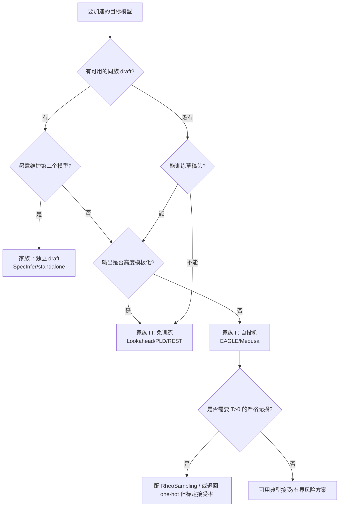

# 横切专题①：投机解码的算法家族谱系

> **定位**：把本条目 `papers/` 里的 8 篇按「**草稿从哪来**」而不是「按年份」重新排一次，给出四条家族、五根可判定的轴，以及“什么条件下选哪族”的判据。
> **证据等级**：族级结论标 `[精读原文]`（有对应分册）；未设分册的 2026 块扩散工作只作谱系定位，数字不入表。
> **配套分册**：[EAGLE 系列](../papers/2401.15077-eagle-series.md)、[Medusa](../papers/2401.10774-medusa.md)、[Lookahead](../papers/2402.02057-lookahead.md)、[SpecInfer](../papers/2305.09781-specinfer.md)、[MagicDec](../papers/2408.11049-magicdec.md)、[RheoSampling](../papers/2609.21827-rheosampling.md)、[vLLM](../papers/vllm-implementation.md)、[SGLang](../papers/sglang-implementation.md)。

---

## 1. 为什么按“草稿来源”分族

按年份排会得到一条“2023 独立 draft → 2024 自投机 → 2025 动态树 → 2026 块扩散”的直线，但它解释不了三个事实：

1. **2023 的独立 draft 并没有消失**：SpecInfer 用多个 SSM 建树，2026 的 vLLM 仍支持 standalone draft 模型。
2. **“免训练”与“训练”不是代际关系**：Lookahead（2024）与 EAGLE（2024）同年，前者免训练、后者要训；今天两者仍并存。
3. **同一族内部的差异可能大于跨族差异**：EAGLE-1 与 EAGLE-3 都是“自投机”，但一个被特征约束锁死、一个能继续吃数据。

因此本专题用**草稿来源**分族，再用五根轴做可判定比较：

| 轴 | 取值 | 为什么可判定 |
| :-- | :-- | :-- |
| A. 草稿来源 | 独立模型 / target 自身 / 检索或轨迹 / 块扩散 | 看“draft 是否需要额外权重”即可判定 |
| B. 是否训练 | 免训练 / 训头 / 训独立模型 | 看训练管线是否存在 |
| C. 草稿拓扑 | 链 / 静态树 / 动态树 / 块 | 看验证时 mask 的形状 |
| D. 接受率上限 | 由 draft 与 target 的对齐度决定 | 同条件下比 τ 或 acceptance rate |
| E. 负载行为 | batch↑ 时收益升/降/反转 | 看 batch 扫描曲线 |

这里的“家族”只回答候选从哪里来，**不等于完整的 draft-side 分类**：同是自投机，可能采用不同表示、蒸馏/接受目标、链深和训练时机；同一训练目标也能用于不同提案来源。要读 AdaSPEC、Attention Drift、VSD、AAT、EDR、在线 Adaptive Drafter 等如何改变“训练什么、什么样的 draft 会被接受”，请接着看[草稿机制与训练专题](draft-side-and-training.md)。

---

## 2. 四大家族

### 2.1 家族 I：独立 draft 模型（external draft）

**代表**：Leviathan et al. 2023、Chen et al. 2023、SpecInfer 的 SSM。

- **机制**：单独训一个同 tokenizer 的小模型，逐 token 出草稿，target 并行验证。
- **优点**：草稿与 target 解耦，target 不改；可以用蒸馏/量化/剪枝的现成小模型。
- **缺点**：容量差是硬约束（SSM 可比 LLM 小 **100–1000×**，SpecInfer §1）；需要第二个模型的显存与服务复杂度；7B 以下常常“没有更小的同族模型”（EAGLE §1）。
- **2026 状态**：仍是 vLLM/SGLang 的 supported 路径（standalone draft），默认选择须按目标框架和负载核对；SpecInfer 的“多 SSM 建树”演化成通用树验证。
- **典型数字（带条件）**：SpecInfer 单机多卡 **1.5–2.5×**、多机 **2.4–2.8×**、offloading **2.6–3.5×**（相对各自基线）。

### 2.2 家族 II：自投机（self-speculative）

**代表**：Medusa（并行头）、Hydra（顺序头）、EAGLE-1/2/3（特征级自回归）、MTP/LayerSkip/SWIFT/CLaSp（层跳过）。

- **机制**：不引入第二个完整模型；用 target 的隐藏态、额外头、或跳层前向生成草稿。
- **子型**：
  - **并行头**（Medusa）：K 个头独立预测 t+k，无前缀依赖；
  - **特征级自回归**（EAGLE）：草稿头在 target 特征上自回归，有前缀依赖；
  - **层跳过**（SWIFT/CLaSp/LayerSkip）：用 target 自身的前几层/跳层做草稿，免训练或轻训练。
- **优点**：不需要独立 draft；与 target 对齐好；EAGLE 的接受率可达 ~0.8（Medusa ~0.6）。
- **缺点**：要训（EAGLE 的 70B 草稿头可训练参数 **0.99B**、1–2 天 4×A100）；换 target 要重训；采样模式下须核候选选择与验证分布。
- **典型数字（带条件）**：Medusa-1 **>2.2×**、Medusa-2 **2.3–2.8×**（Vicuna-7B、batch=1）；EAGLE-2 **3.05–4.26×**（T=0）；EAGLE-3 **3.0–6.5×**（五任务，带条件）。

### 2.3 家族 III：免训练 / 检索 / 轨迹（training-free）

**代表**：Lookahead（Jacobi 轨迹 + n-gram 池）、PLD（prompt lookup）、REST（语料检索）、DictSpec（字典）。

- **机制**：草稿来自“已有文本/轨迹”的匹配，不训练任何参数。
- **优点**：零训练、零额外权重；实现可 plug-and-play；对重复/模板文本（代码、JSON、引用）特别有效。
- **缺点**：接受率受命中率限制；高熵/开放对话收益小；Lookahead 还需要“剩余算力”，高 batch 会变慢。
- **典型数字（带条件）**：Lookahead 跨数据集 **1.5–2.3×**、MT-Bench 7B **1.8×**、8 卡 ClassEval **4×**、RTX 3090 仅 **~30%**。

### 2.4 家族 IV：块 / 扩散草稿（block / diffusion draft）

**代表**： [DFlash](../papers/2602.06036-dflash.md) / [DFlare](../papers/2606.02091-dflare.md) 的块扩散草稿，[DDTree](../papers/2604.12989-ddtree.md) / [DARTree](../papers/2608.13524-dartree.md) / [PRESTO](../papers/2607.22634-presto.md) 的候选树，以及 [DSpark](../papers/2607.05147-dspark.md) 的半自回归块草稿与负载感知验证。

- **机制**：并行 backbone 一次产生多个未来位置的分布；后续工作分别通过更强的 target 条件化、轻量块内因果校正、候选树排序或跨轮 verifier 状态复用来补足独立位置建模的短板。
- **优点**：把一部分串行草拟改成并行前向，能在合适的 target、任务和负载下提出较长候选块。
- **缺点**：并行位置分布不等于条件化 token 序列；后缀易受早期拒绝影响，树验证会增加 target 计算，动态预算的收益取决于接受概率和硬件成本。
- **阅读入口**：扩散与投机解码交叉见[综合专题](diffusion-drafters.md)；草稿生成、训练与状态复用见[草稿侧专题](draft-side-and-training.md)；跨轮运行时开销见[系统专题](systems-throughput-latency.md)。

---

## 3. 家族对照表（带条件）

| 维度 | I 独立 draft | II 自投机 | III 免训练 | IV 块/扩散 |
| :-- | :-- | :-- | :-- | :-- |
| 草稿来源 | 另一个模型 | target 的头/特征/层 | 轨迹/检索/字典 | 块扩散网络 |
| 额外权重 | 一个完整小模型 | 草稿头（~7% 或 <1B） | **无** | 一个块扩散 draft |
| 是否训练 | 预训练 draft | 训头/联合训 | **免训练** | 需训练 |
| 草稿拓扑 | 链/树（可扩展） | 链→静态树→动态树 | 链/不相交 n-gram | 块/树状块 |
| 接受率 | 受容量差限制 | 高（EAGLE ~0.8） | 受命中率限制 | 中高（块内联合分布是瓶颈） |
| batch 行为 | 收益随 batch 下降 | 先升后降（EAGLE 在 24 跌破 1.0×） | 依赖剩余算力，高 batch 变慢 | 与验证预算强耦合 |
| 典型条件数字 | 1.5–2.8×（分布式） | 2.3–6.5×（T=0/带条件） | 1.5–4×（算力富余） | 本条目未设分册，不入表 |
| 代表分册 | [SpecInfer](../papers/2305.09781-specinfer.md) | [EAGLE](../papers/2401.15077-eagle-series.md) / [Medusa](../papers/2401.10774-medusa.md) | [Lookahead](../papers/2402.02057-lookahead.md) | —（见 §5 说明） |

> **读法**：这张表不是“谁更好”的排行榜；每一行的数字都来自不同模型、不同硬件、不同温度。正确的用法是：**先按场景排除不可行的族，再在同族内比条件数字**。

---

## 4. 选型判据（决策树）

**判据说明**：

1. **先看“有没有 draft”**：没有同族小模型时，家族 I 直接出局；这时要么训头（II），要么免训练（III）。
2. **再看“输出是否模板化”**：代码/JSON/引用类文本的 n-gram 命中率高，家族 III 的单位成本最低；开放对话则家族 II 更稳。
3. **最后看“是否要求严格无损”**：T>0 下家族 II 的动态树会塌缩；要严格无损须证明实际提议与恢复规则匹配；RheoSampling 是一种构造，正确处理的确定性提议也可保持目标分布。
4. **块/扩散（IV）** 不是独立选项，而是“草稿生成器”的替换：它可以与树验证、动态预算组合，选型时应把它看成 II/III 的并行化升级，而不是第五族。

---

## 5. 家族 IV 的阅读边界

- 本专题已将代表性块草稿、树构造、半自回归校正和扩散模型自投机分开精读；不把所有并行模型都当作同一机制。
- DFlash、DFlare、DDTree、DARTree、PRESTO、DSpark、DFlow 等论文分别改变候选并行化、位置条件化、树排序、验证预算或跨轮状态复用；具体关系见[扩散交叉专题](diffusion-drafters.md)与[草稿侧专题](draft-side-and-training.md)。
- BASTION 等未设独立精读的工作仍只作谱系线索，是否入库取决于能否补上新的机制比较，而非发布数量。

---

## 6. 跨族的三个常见误判

| 误判 | 为什么错 | 正确说法 |
| :-- | :-- | :-- |
| “自投机一定比独立 draft 快” | EAGLE 的 70B 草稿头可训练参数 0.99B、训练 1–2 天；独立 draft 在 offloading 场景仍有 2.6–3.5× | 取决于 target 大小、部署形态、是否愿意训练 |
| “免训练一定更便宜” | Lookahead 需要剩余 FLOPs；RTX 3090 只有 ~30%，高 batch 会变慢 | 免训练省的是“训练+权重”，不是“算力” |
| “块扩散会取代自回归草稿” | 块内联合分布难建模，BASTION 还要用树搜索补；且证据多为预印本 | 目前是并行化补充，不是替代 |

---

## 7. 失效边界（族级）

1. **家族 I**：容量差是硬约束；第二个模型的显存/服务复杂度；7B 以下无合适 draft。
2. **家族 II**：T>0 动态树塌缩；换 target 要重训；高 batch 下验证成本反超（EAGLE 在 batch=24 跌破 1.0×）。
3. **家族 III**：命中率决定上限；需要剩余算力；高熵文本收益小。
4. **家族 IV**：块内联合分布建模难；验证预算与草稿预算耦合；证据等级偏低。
5. **跨族**：任何族的加速比都不能跨硬件/跨温度/跨 batch 直接比较——这是 [topics/systems-throughput-latency.md](systems-throughput-latency.md) 的主题。

---

## 8. 本专题与 `papers/` 的对应

| 家族 | 分册 | 读它回答什么 |
| :-- | :-- | :-- |
| I | [SpecInfer](../papers/2305.09781-specinfer.md) | 多 SSM 如何建树、树验证如何做到无损 |
| II | [EAGLE](../papers/2401.15077-eagle-series.md) | 特征级自回归三代演进、动态树、TTT |
| II | [Medusa](../papers/2401.10774-medusa.md) | 并行头 + typical acceptance 的有损边界 |
| III | [Lookahead](../papers/2402.02057-lookahead.md) | 免训练、one-hot 草稿、算力换步数 |
| II/III 交叉 | [RheoSampling](../papers/2609.21827-rheosampling.md) | T>0 下动态树的无损修复 |
| 系统条件 | [MagicDec](../papers/2408.11049-magicdec.md) | batch×序列长度×硬件的相图 |
| 工程落地 | [vLLM](../papers/vllm-implementation.md) / [SGLang](../papers/sglang-implementation.md) | 生产框架怎么区分 greedy/probabilistic |

---

## 来源与证据等级

- 族级机制与数字：均来自本条目 `papers/` 分册的 `[精读原文]`；具体条件见各分册 §4/§5。
- 家族 IV：代表性论文的机制综合见 `topics/diffusion-drafters.md`；各篇分册给出固定版本与原文定位，未阅读的外围工作不承担专题结论。
- 代码事实：vLLM `2b85d9cb`、SGLang `2a08e261`，见对应分册的 `文件:行`。
