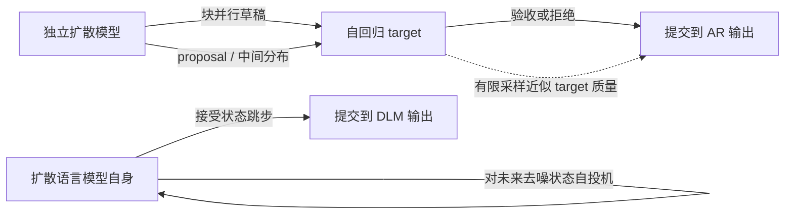

# 扩散语言模型与投机解码：草稿、验证和生成目标

> **读前先分清研究对象**：扩散语言模型可以直接生成文本，也可以给自回归模型提出待验证草稿；还可以给自己提出后续去噪状态。三种角色的 target、正确性保证与速度基线不同。本篇把库内 [投机解码专题](../report.md) 和 [扩散语言模型专题](../../../LLM/DiffusionLM/report.md) 接起来，分析这些交叉线索怎样共享机制、又在哪里分开。

## 一张图：谁在生成，谁在验收

上面第一条是 **DFlash 家族**：diffusion 只负责提议，强 AR 模型决定最终输出。第二条包括 **Spiffy** 和 **PV-Decoding**：同一个 dLLM 生成候选状态或暂填 token，再由它自己验证；两者的验证规则与正确性主张不同。最后的虚线是 **PoE-Bridge**：DLM 提供并行候选，AR 分布通过中间桥接和有限重要性采样提高候选质量；论文没有承诺有限预算下严格保持 AR target 分布。

“用了扩散”本身无法回答系统究竟快多少、生成的又是谁的分布。读每篇论文先找四件事：目标分布、候选从哪来、target 如何验收、计时把哪些阶段算进去。

## 三种扩散角色的边界

| 角色 | 代表工作 | 候选产生方式 | 最终质量由谁定义 | 正确性或质量主张 |
|---|---|---|---|---|
| **独立块 draft，AR target** | DFlash、DFlare、DSpark、DSpine、DDTree、DARTree、PRESTO、UBTree、DFlow | 块式并行 draft 提出未来 token；可恢复块内前缀依赖、保留多路径树，或把前轮 verifier 表示送入下轮 draft | AR target | 由 target 验证的算法可保持 target 分布；提议质量、候选覆盖和状态处理影响接受率与成本 |
| **dLLM 自投机 / 验证门控** | [Spiffy](../papers/2509.18085-spiffy.md)、[PV-Decoding](../papers/2026.findings-emnlp.2228-pv-decoding.md)；PRESTO 也拓展到 hybrid/self-speculative 设置 | Spiffy 对未来去噪 state 建图并精确匹配；PV 按置信度暂填 token，再用 argmax 一致性和阈值筛选 | 原始 dLLM | Spiffy 证明其接受规则保持原 dLLM 分布；PV 明确不保持 trajectory/distribution，只报告经验精度—前向轮数折衷 |
| **DLM proposal，AR 质量桥接** | PoE-Bridge | DLM 并行采样，经 DLM/AR product-of-experts 中间分布和采样校正 | AR 是质量参照 | 有限候选数时不严格无损，报告 accuracy 与吞吐的折衷 |
| **独立扩散生成器** | LLaDA、Block Diffusion、SDAR、CARD、LLaDA 2.x | 迭代去噪、块级并行或 token editing | 扩散模型自身 | 论文比较该生成器的质量、长度与延迟；没有 AR target verifier 就不构成 target-preserving speculative decoding |

最后一行是 [扩散语言模型报告](../../../LLM/DiffusionLM/report.md) 的主体。它问“模型本身怎样学会去噪、怎样并行生成或修订”；前三行问“草稿能否被另一个明确的分布接受”。论文可能兼有多种机制，分类应按具体实验路径而定，不能只看模型名字。

## 为什么块扩散适合做 AR 草稿

自回归 draft 逐个产生 \(k\) 个 token，延迟大致随 draft 长度累积。块扩散 draft 让多个未来位置共享一次并行前向；它可以把节省下来的串行步骤用于更深的 draft 网络或更大的候选块。此时评价目标不是要求小模型自己写出完整、可直接交付的回答，而是让 AR target 经常接受草稿前缀。

DFlash 让这一设计第一次形成清楚的机制闭环：target prefill 同时提供隐藏状态，draft 通过逐层 KV 注入读取这些表示，再用 block diffusion 生成候选；target 检查草稿并决定提交位置。[DFlash 精读](../papers/2602.06036-dflash.md) 的消融显示，仅把小扩散模型放在旁边“从头猜”会明显削弱效果。**扩散的并行性解决候选延迟，target 特征对齐解决候选质量**，二者缺一都会压低收益。

DFlare 把这个约束继续往容量方向推进：每层 draft 不再共享一个融合好的 target 特征，而是学习从多层 target hidden states 取信息的权重，同时扩大 draft 深度和训练数据。[DFlare 精读](../papers/2606.02091-dflare.md) 支持“扩大 draft 容量可以继续提高接受长度”的作者报告结果；代价是较大的 draft 和训练语料。训练成本是否值得，取决于之后能服务多少请求以及是否能部署同一 target/draft 配对。

DFlow 改变的不是每一层怎样融合 target 特征，而是**跨轮哪些 target 计算结果还能被 draft 使用**。DFlash 在一轮结束后只把已接受前缀和 target bonus token 提交；DFlow 保持这一 commit 规则不变，却把 target 在 rejected suffix 位置已经算出的 hidden states 投影并对齐到下一轮重叠位置，作为新 mask embedding 的辅助条件。拒绝 token 仍不会成为输出，也不进入已提交 target context；留下的是这些位置的 verifier 表示。由于它们来自 speculative context，DFlow 还利用第一处拒绝处的 target correction 与 draft proposal 调制这些表示，并通过 multi-round self-conditioned training 模拟这一状态转移。[DFlow 精读](../papers/2609.06498-dflow.md)

这条机制与相邻工作分属不同轴：DFlare 改每个 draft layer 的多层特征融合和容量；D-PACE/D-PAL 改训练时的位置权重/接受代理；H-Spec 和 DLite 改 target KV/history 怎样存储或复用。DFlow 的主张是**不额外运行 target forward，复用原验证中产生的 rejected-suffix states**，不等于 rejected tokens 被接受、不等于 target KV 无成本，也不直接改变 target 的验收规则。[DFlow v1，§3–§4.3](https://arxiv.org/html/2609.06498v1)

与 DFlow 的跨轮表示 relay 不同，[DSpark](../papers/2607.05147-dspark.md) 在**同一 block 内**采用并行 backbone 加轻量 Markov/RNN 头，使后续 draft token 能依赖已经采样的前缀；其 confidence head 与硬件 scheduler 再为当前 batch 中各请求选不同验证前缀。DSpark 同时动 draft 和 verifier-work scheduling，但最终仍由标准 target rejection sampling 决定输出；它的 live-load 结果不能只归因于 sequential head，也不是 HeteroSpec 的候选熵分层策略。[DSpark v1，§3.1–§3.2](https://arxiv.org/html/2607.05147v1)

草稿结构之外，训练目标也在演进：DFlash 的固定位置衰减之后，[D-PACE](../papers/2605.18810-dpace.md) 按当前接受长度代理动态分配各位置权重；[D-PAL](../papers/2610.28355-dpal.md) 再把单个 target token 的置信代理换成 target–draft 全分布重叠，并区分“哪些位置重要”和“每个位置怎样拟合”。这条线的主要证据仍来自 DFlash 块草稿；训练目标分析见[草稿与训练专题](draft-side-and-training.md)。

因此，不能从“一个扩散 forward 能预测 16 个位置”推导“每轮就能接受 16 个 token”。位置预测是多个边际分布；AR 验收依赖逐步增长的真实前缀。下一步研究集中在怎么利用候选空间，又不让扩散的并行草稿脱离因果路径。

## 树搜索从“候选覆盖”走到“路径条件”

单条草稿每个位置只走一个候选；早期 token 错了，后面整块大多浪费。把每个位置的 top-k 接成树能保留多条替代前缀，但树也会增加 target 验证 token 数和 attention 成本。node budget 是在“更多候选覆盖”与“更多验证计算”之间分配。

| 方法 | 它改善的环节 | 如何给候选路径排序 | 要留意的边界 |
|---|---|---|---|
| DFlash | 单块并行草稿的延迟与容量 | 一条 draft trajectory | 接受收益随 task、target、batch 改变 |
| [DSpine](../papers/2609.36173-dspine.md) | 逐层向后继注入相邻前驱预测，并对已选前驱做 last-write refinement | Transition cache 并行预计算 top-$K$ 相邻候选对，再从左到右选一条路径 | 单路径；$T=1$ 必须以 transition-cache 的实际 proposal 概率做拒绝回补 |
| [UBTree](../papers/2609.39972-ubtree.md) | 以并行 bigram selector 让 top-$K$ 并行候选具备相邻依赖，再保留多条 target 可验证分支 | 用 target embedding codebook 估计相邻候选转移，再按预算建树；以高温轨迹和重归一化 KL 学多条 plausible branches | 树预算与训练温度需配置搜索；极高并发 compute-bound 时树计算会吃掉并行收益 |
| DFlow | 复用前轮验证时算出的 rejected-suffix 表示 | 将对齐、边界调制后的 verifier hidden states 送回下一轮重叠 mask 位置 | 复用的是连续表示；离散 rejected token 仍未提交 |
| DDTree | 不浪费同次前向的其他位置候选 | 各位置边际概率的乘积，按 surrogate mass best-first 建树 | 候选概率不含真实已选前缀；“surrogate 最优”不是 target 接受率全局最优 |
| DARTree | 给树中每个候选分支恢复因果校正 | correction head 按 branch prefix 给条件分数；同一深度并行校正，随后全局剪枝 | 复用 Domino correction head，新增校正也占计算；target 验证节点数仍需选 |
| PRESTO | 让 diffusion 树分数贴合 AR 的前缀验证 | 边际 draft log-score 加轻量 prefix-conditioned n-gram signal，再优先扩展高潜力路径 | n-gram 是 proxy，不是精确 target 条件概率；搜索预算和树 attention 仍花时间 |

DDTree 把一次 diffusion 前向所生成的每个位置分布都用来探索可能前缀。其树按 draft-induced surrogate 的期望接受长度构造；证明对这个 surrogate 最优，并不表示未知的 target 接受概率也最优。[DDTree 精读](../papers/2604.12989-ddtree.md)

DARTree 指出这正是边际候选的结构性缺口：扩散位置的 confidence 不会随候选路径的前缀变化。它把 correction head 从单链扩展到树上的每条 branch，再按深度批量计算，最后剪成 target 的验证预算。[DARTree 精读](../papers/2608.13524-dartree.md) 把另一个系统约束显露出来：逐节点调用 correction head 与 heap 排序相互依赖，可能把并行草稿变回串行树构造；先批量形成更宽 supertree 再剪枝，是专门针对这段调度开销的设计。

这条发展路线可以再分成**单路径条件化**与**多路径覆盖**。[DSpine](../papers/2609.36173-dspine.md) 在 backbone 每一层把相邻前驱的预测特征门控写入后继，再用 selected predecessor 做 last-write refinement 与 transition-cache 解码；它继续选一条前缀，但让条件信息更早进入后继计算。[UBTree](../papers/2609.39972-ubtree.md) 则不把候选压成单条路径：Unigram proposer 为每个位置提供 top-$K$ 备选，Bigram selector 并行打分相邻边，再用 DARTree 式预算搜索形成多路径树。DSpine 主要提高一条并行链的因果一致性，UBTree 主要提高高熵场景的可验证候选覆盖。

两者都利用相邻 token 依赖，但输出预算不同。DSpine 的 top-$K$ 仅支持它的逐前缀选择，正确性依赖每步实际 transition-cache proposal distribution 的 rejection correction；UBTree 用树承载候选，target tree verifier 才负责保持 target 输出分布。UBTree 的树native训练希望 selector 学会保留 target 的替代续写，而非只强化一条高概率路径；代价是 verifier 节点数增加，以及按模型/负载调树预算。论文结果表格中的 Qwen3/H200 学术设置、SGLang 生产设置和长上下文 replay 应分开理解。[两篇精读](../papers/2609.36173-dspine.md) · [UBTree 原文定位](../papers/2609.39972-ubtree.md)

PRESTO 的思路更轻：用廉价 prefix-conditioned score 校准边际概率，再树搜索。它不把 n-gram 分数说成 target 分布，也不替代 verifier；分数用于排列“哪个路径更值得验证”。[PRESTO 精读](../papers/2607.22634-presto.md) 同时测试独立 diffusion drafter 与 self-speculative dLLM，并报告树预算变大到一定程度后 verifier 的计算会侵蚀吞吐。

树方法的共同问题不是无限扩宽，而是**预测有效验收机会的单位计算成本**。不同模型、任务、并发度、温度或 GPU 上，最佳节点数可能不同。接受长度增大只是中间信号；若 draft 构造或 target tree forward 同时变贵，token/s 未必提升。

## self-speculation：扩散模型也能跳过自己的去噪步骤

对 standalone dLLM，传统 one-step-per-iteration 解码会反复调用同一个大模型。Spiffy 把下一步 block state 当作 proposal：从当前 target 分布构造若干未来去噪状态，按 dLLM 的 blockwise、bidirectional 结构形成有向 draft graph，再通过 attention mask 并行验证。图允许一个未来状态由多个路径到达，表达能力不同于 AR verifier 使用的单根 token tree。

在接受条件下，Spiffy 直接复用已算出的子状态分布并跳过中间调用；若候选不等于 target 真实产生的下一状态，则仍按原去噪过程继续。作者给出保持原 dLLM 输出分布的证明。[Spiffy 精读](../papers/2509.18085-spiffy.md)

[PV-Decoding](../papers/2026.findings-emnlp.2228-pv-decoding.md) 也加速同一个 dLLM，但它不预测 Spiffy 式的未来去噪状态图：它把中等置信度 token 暂时填进当前 block，再用下一次模型前向按 argmax 一致与置信阈值核验。单分支、双分支和子集 DAG 三种策略逐级增加验证条件；decode gating 规定若上一轮暂填未全部通过，就暂停提交新的直接解码 token。它借用了 Spiffy 的 subset-DAG 结构，不继承 Spiffy 的状态匹配规则或分布保持证明。论文明确说明 PV-Decoding 是确定性的，但既不保留基线解码轨迹，也不保留原模型输出分布（§4.1、§4.3、Algorithms 1–2）。

这也解释了为什么“模型自己验证自己”不足以称作无损。PV 暂填候选已经改变其它位置的双向条件上下文；检查失败会重新 mask 某些候选，但不会按残差概率回补，也没有证明通过门控后输出仍与 confidence decoder 相同。作者报告的精度接近与 MFP 减少是基准经验结果，而不是分布等价保证。它与 LLaDA 2.1/2.2 的 token editing 也不同：PV 在推理时验证现有 masked block 的暂填 token，不训练 insertion/deletion 编辑策略。

这里的“无损”指**相对于该 dLLM 原始采样过程**，不表示生成质量已经追平 AR，也不表示 graph mask、离线校准和多分支前向没有内存/计算开销。离线校准依赖生成轨迹中实际出现的解遮蔽模式；换模型、解码策略或任务，现有图的覆盖情况值得单独观察。

PoE-Bridge 则连接两种模型分布：DLM 批量生成 proposals，AR 作为更高质量的参照，通过 product-of-experts 中间分布把两者的差距拆为拒绝采样与重要性重采样两步。[PoE-Bridge 精读](../papers/2606.08048-poe-bridge.md) 作者报告在数学与代码任务上用有限候选让输出质量靠近 AR，同时提升吞吐；论文明确指出有限重要性采样预算下**并非严格无损**。它研究的是质量—吞吐折衷，不应与 DFlash/Spiffy 的 exact distribution-preserving speedup 并列成一种保证。

## “无损”究竟对谁、相对什么

| 工作线 | 被保留的分布 | 验收判据 | 可以怎么描述 |
|---|---|---|---|
| DFlash / DFlare / DDTree / DARTree / PRESTO | AR target | target 样本匹配或论文相应的 exact speculative verification | 若按其验证规则运行，可保留 target 分布；diffusion proposal 影响效率，不替 target 下结论 |
| Spiffy | standalone dLLM 原始去噪过程 | 接受候选 state 必须与 target 的真实下一 state 相同 | 保持原 dLLM 的输出分布；不自动说明它与 AR 的质量差距 |
| PoE-Bridge | AR 是校正参照 | product-of-experts bridge + 有限拒绝/重要性采样 | 在给定预算下近似 AR 质量；有限候选时不严格无损 |
| LLaDA / SDAR / CARD 等独立生成 | 模型自己的分布 | 模型原生解码规则 | 直接评估该模型的质量和速度，不属于“经 AR 验证后无损加速” |

注意，“target 与草稿逐位置 logit 相同”“大部分草稿被接受”“benchmark accuracy 接近”都不是同一证明。精确 target-preserving 需要明确 target 分布、proposal probability、拒绝时的残差处理或状态匹配证明。对 PoE-Bridge 这类有限候选近似方案，应同时给出任务、accuracy、吞吐和候选预算。

## 结果应该怎样读

| 论文报告的例子 | 论文条件 | 它说明什么 | 不能推出什么 |
|---|---|---|---|
| DFlash 在 LLaMA-3.1-8B 的 SGLang serving 对照里，GSM8K 加速随并发 1→32 从 2.4× 降到 1.6× | 单张 B200、block size 10、Spec-v1；其 EAGLE-3 对照使用同训练数据、多个树大小 | 单条低并发结果会高估多请求时相对 AR 的收益 | 不能直接概括到其它 target、后端、block size 或 SGLang 新调度版本 |
| DFlare 报告六基准平均：Qwen3-4B 5.52×、Qwen3-8B 5.46×、GPT-OSS-20B 3.91× | 7-layer draft、block size 16、约 2.4M 训练样本；另有不同模型、解码和算力配置 | draft 的条件质量和容量仍是主导变量；扩大 draft 带来稳定提升，也增加一次性训练成本 | 不与其它论文的 headline 数值直接排名 |
| DFlow 在 Qwen3-8B / GSM8K / concurrency 32 下报告 1.35×，DFlash 同表为 1.16× | 单节点 8×A800；5-layer draft、block size 16、80K ShareGPT；服务表用 SGLang | 跨轮 verifier-state relay 提高接受长度后，可在该并发设置转化为 throughput | 仅是作者配置；不外推到其它 target、硬件、prompt length 或 draft window |
| DDTree 在 Qwen3-4B、T=0、AIME24 报告 7.27×，DFlash 同表为 5.56× | 8 张 H200；对每个模型/任务/温度从七种节点预算选最佳值 | 树候选可利用单次 draft pass 中不同位置的备选 token | 不能把 per-case 最佳预算视作线上固定预算表现 |
| DARTree 在 Qwen3-4B、T=0、GSM8K 报告 9.73×，7 任务平均 6.99× | batch 1、RTX 6000 Ada、最多 2048 输出 token、预算 B=64 | 路径校正和深度批处理能提高候选树质量并降低建树串行 | 9.73× 不是跨任务平均，也不是多并发 serving 结果 |
| PRESTO 在其 Qwen3-4B/8B DFlash 设置中，表列平均加速从 4.8–4.9× 提到约 7.3× | B200、batch 1、T=0/1、最大 2048 token、为 DFlash 搜树预算 | prefix-conditioned 路径排序可提高 diffusion draft 树的验收 | 不能将 best-tree 配置当作在线服务默认值；每轮验证成本仍需计入 |
| PoE-Bridge 在 MATH 报告约 95% 的 AR accuracy 与约 95 token/s | Dream-7B proposal + Qwen2.5-Math-7B target、A100 80GB、batch 1、K=4、窗口 V=32 | bridge 能让有限并行候选靠近 AR 质量而增加吞吐 | 论文承认有限采样下不严格无损，也未测试多请求服务 |

以上都是论文原文报告的结果，条件列说明证据适用范围。体系间的数字不能仅因都写“speedup”就横向排列；baseline、硬件、batch、输出长度、温度、计时范围和搜索预算都影响比值。

## 阅读顺序

1. 先读本专题的[投机解码验证边界](verification-acceptance.md)，再读 [DFlash](../papers/2602.06036-dflash.md)：建立 block diffusion drafter + AR verifier 的主线。
2. 接着读 [DFlow](../papers/2609.06498-dflow.md)，看 target 已算出的 rejected-suffix 表示如何跨轮复用而不提交 rejected token。
3. 读 [DFlare](../papers/2606.02091-dflare.md)，看 target hidden state 融合如何扩 draft 容量及其训练代价。
4. 读 [DSpine](../papers/2609.36173-dspine.md) 了解前驱特征如何沿并行骨干的深度流动；再读 [DDTree](../papers/2604.12989-ddtree.md) → [DARTree](../papers/2608.13524-dartree.md) → [PRESTO](../papers/2607.22634-presto.md) → [UBTree](../papers/2609.39972-ubtree.md)，比较边际候选覆盖、路径校正、prefix score 和 bigram tree-native 训练。
5. 并读 [Spiffy](../papers/2509.18085-spiffy.md) 和 [PV-Decoding](../papers/2026.findings-emnlp.2228-pv-decoding.md)：前者用精确 state-match 保持 standalone dLLM 分布；后者用置信度和分支条件减少前向轮数，但接受经验质量变化。
6. 最后读 [PoE-Bridge](../papers/2606.08048-poe-bridge.md)，比较精确目标分布保持和有限预算下的 AR 质量逼近。
7. 回到 [扩散语言模型总览](../../../LLM/DiffusionLM/report.md)，区分 native denoising 的训练/长度/编辑问题，与把 diffusion 放入 proposal/verification pipeline 后的新问题。

## 开放问题

- DFlash 训练好的 block drafter 能否跨任务、上下文长度、target 版本或 tokenizer 稳定迁移？哪个变化必须重新训练？
- DFlare 增加模型容量后，draft inference 能耗和训练摊销何时抵得过吞吐收益？多请求 serving 中的 Pareto 点怎样随并发变化？
- DDTree 的 factorized prefix surrogate、DARTree 的 learned correction head、PRESTO 的 n-gram prefix signal，在哪些置信度与任务类型下最能预测真实验收？
- tree budget 是按接受长度、target attention cost 还是端到端吞吐选择？能否在线适应请求和 batch，而不为搜索新预算增加过多延迟？
- Spiffy 的校准 graph 能否跨分布或动态 unmasking 策略泛化？哪些 graph 更新能在运行时保留分布证明？
- PV-Decoding 的置信阈值怎样随模型校准、任务和 block 内依赖变化？专用树形分支 kernel 能否在同一硬件预算下让多分支策略兑现其 MFP 节省？
- PoE-Bridge 当候选数增加时的质量收益与显存/时延曲线，如何扩展到不同 tokenizer、多请求和超出 batch 1 的服务？
- 三种速度结果能否在固定 target、输入/输出长度、温度、batch、硬件、质量标准和尾延迟分母下对照？当前论文设置不足以据此给出统一优胜者。

本综合分析没有独立运行模型、代码或 benchmark；所有数字按论文报告结果引用。原文版本、实验定位见各篇精读链接。
