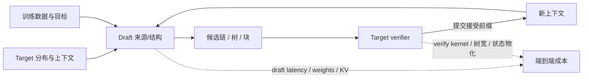

# 横切专题：草稿从哪里来，怎样训练到会被接受

> 本页从 draft side 把已有论文连成学习路线，重点解释 proposal 的来源、训练信号和运行时成本如何彼此制约。它不重复[算法家族谱系](algorithm-families.md)的分类表；接受规则和输出分布保证见[验证专题](verification-acceptance.md)，真实硬件吞吐与 batch/序列长度效应见[系统专题](systems-throughput-latency.md)。

## 从“产生草稿”到“减少 target 轮次”

草稿器的工作并不是泛泛地“模仿大模型”：它要以足够低的成本提出一串候选，让昂贵的 target 一次并行验证，并使通过的前缀足够长。这个链条同时有两个约束：候选质量决定接受/拒绝；生成候选本身的 latency、显存和状态管理决定节省的 verification round 是否转化成 wall-clock 收益。

训练目标决定 drafter 倾向于提出什么，推理架构决定这些候选要花多少算力产生；target verifier 才最终决定输出保证。**训练 loss 高、接受率高、解码轮次少和实际时延低是相关但不同的量**，不能用其中一个替代其余三个。

## Drafter 的来源决定额外状态放在哪里

### 独立的小模型：草稿质量与草稿速度要同时选

经典 draft-then-verify 用额外小模型逐 token 提议。它能使用灵活的架构与训练数据，和 target 训练过程解耦；代价是多一套权重、KV cache、排队和调用。已有系统研究指出 draft 模型的语言建模能力或参数量不能单独预测投机收益，proposal latency 与目标模型/任务的条件分布也很关键。[SpecInfer 精读](../papers/2305.09781-specinfer.md) 展示多个轻型 SSM 作为 draft 并建树验证；对独立 draft 的选择与硬件成本，可补读 [Decoding Speculative Decoding](https://arxiv.org/abs/2402.01528v4)。

### Target 自投机：减少独立模型，但要处理中间表征和额外计算

[Medusa](../papers/2401.10774-medusa.md) 在 target 表征上接并行预测头；[EAGLE 系列](../papers/2401.15077-eagle-series.md)让 drafter 在 target 隐藏特征上自回归，并用 TTT 更接近推理期输入；[LayerSkip](https://arxiv.org/abs/2404.16710v2) 用 layer dropout 和 early-exit loss，使前层草稿可由后层验证。这几种方法不需完整的第二个模型，但多头、草稿层和 target verification 仍占用计算；“共享权重”不等于免费。

当 target 本身是 hybrid 架构，草稿也不一定要来自最前层或额外头。[Component-Aware Self-Speculation](../papers/2605.01106-component-aware-self-spec.md) 抽取 SSM/linear-attention 子图形成内部 draft。作者在平行 Falcon-H1 和串行 Qwen3.5 上报告的接受率差距很大：并行组件可形成相对完整子路径，串行交错组件移除 attention 后会破坏原有信息流。它告诉我们应检查**架构组合是否构成可用 drafter**，而非只看模型里是否有某类层。

另一条结构轴是 target 上下文如何注入并存储。[H-Spec](../papers/2609.24197-hspec.md) 发现，DFlash 将每个前缀位置的 target hidden state 投影为独立 drafter KV，随上下文和并发增加缓存/写入成本；仅原位读取 target KV 又会丢失末位 hidden state 提供的全局摘要，后续草稿位置更难保持目标条件。H-Spec 用最后位置 hidden state 初始化 Mamba state、并让 attention 原位复用 target KV，形成“压缩全局摘要 + 逐位置检索”双路上下文；其代价是 Mamba/attention 混合骨干与 target KV 形状对齐约束。它与 DLite 的“无历史 drafter KV”相关但不同：DLite 主打把 target hidden states 直接送入不保留长历史的草稿器，H-Spec 则针对独立 KV 投影副本做原位复用和摘要补偿。

### 检索与轨迹：训练权重少，依赖重复结构

Lookahead 使用 Jacobi 轨迹与 n-gram 池，prompt lookup 或语料检索则从已有文本找候选；TLAR 把当前生成轨迹本身变成可查询的 draft 来源。[Lookahead](../papers/2402.02057-lookahead.md) 和 [TLAR](../papers/2610.07350-tlar.md) 分别适合建立免训练/历史复用的直觉。它们省掉或减少额外 draft 训练，但命中率取决于 prompt、任务模板和输出历史的重复度；不能把免训练理解成免计算。

### 并行头、MTP 与块式草稿：先弄清楚“并行”的边界

Medusa 头、EAGLE feature drafter、target 预训练中的 multi-token prediction（MTP）、masked diffusion 块 drafter都可一次产生多个候选，但它们并非同一种机制。MTP 作为**预训练辅助目标**不等同于部署时的 speculative drafter；被拿来推理时还需明确候选如何条件化、如何与 target verification 配合。DFlash/DFlare 等块式方法将串行 proposal 换成多位置预测，节省 draft latency，却要面对块内 token 依赖和树排序问题；细读见[扩散交叉专题](diffusion-drafters.md)。

[DSpark](../papers/2607.05147-dspark.md) 是对块内独立预测的另一种修补：平行 backbone 一次生成 logits，再用轻量 Markov/RNN head 顺序加入已采样前缀的转移信息。它没有把整个 drafter 退回全自回归；额外的顺序模块要足够轻，才不会抵消块级并行收益。DSpark 的 confidence-scheduled verification 还使用校准的 prefix survival 与 engine 吞吐曲线分配 batch 验证长度，因此应把 draft architecture 和 runtime scheduler 分别分析。[§3.1–§3.2](https://arxiv.org/html/2607.05147v1)

[DSpine](../papers/2609.36173-dspine.md) 将前驱预测更早地传入后继：每层都将相邻前驱特征注入 successor，使条件信息沿 backbone 深度形成；最后用已选前驱的 embedding 重写 successor 状态，并通过 transition cache 预先算相邻 top-$K$ 候选对。它依旧选择单条链，和 DSpark 的“backbone 后追加轻量顺序修正”位置不同。 [UBTree](../papers/2609.39972-ubtree.md) 则不只提高一条链的连贯性，而是并行生成多位置候选、评分相邻 bigram 边并把多条路径放进 target 可验证树；tree-native 高温 KL 训练让 selector 学到非贪心替代路径。DSpine 的主要增量是**同一条并行链怎样更早条件化**，UBTree 的主要增量是**预算树怎样保留多条有 target 概率质量的路径**。

#### 块草稿怎样使用 target 上下文：额外 KV 与原位复用

块式 drafter 常把 target 多个输入位置的 hidden states 投影为一套独立 drafter KV，以便每个草稿位置读取前缀。它改善 target 条件化，却要为每个请求多存一份长度随 prompt 增长的缓存，并额外写入 KV。[H-Spec](../papers/2609.24197-hspec.md) 先验证“直接读取 target 已有 KV”这一简单方案，发现早期草稿位置相对接近 DFlash，后续位置接受度下降；作者据此把 target 上下文拆成互补两种信息：末位 hidden state 的压缩全局摘要与逐位置 target KV。H-Spec 用前者初始化 Mamba state，用后者让 drafter attention 原位读取，不创建独立 drafter-side KV。

这个结构与 [DLite](../papers/2610.23787-dlite.md) 的“无历史 draft KV”都针对草稿侧缓存，但不是同一个设计：DLite 从选定 target hidden states 获取上下文并以块内顺序头补回依赖；H-Spec 专门将 target KV 原位复用给 attention，再用末位 hidden state 初始化 Mamba 的块级状态。H-Spec 仍保留 target KV、Mamba state 和额外 drafter 计算；其目标维度/attention KV 形状还需与 target 对齐，因此“无 drafter KV”不等于“无额外状态或无成本”。论文报告的并发吞吐优势出现在特定 target、A100、vLLM serving 与负载条件下；短序列/低并发时混合骨干更深，未必更快。[H-Spec v1，§3–§5](https://arxiv.org/html/2609.24197v1)

草稿模型内部也可以按位置分配不同容量。[HCSpec](../papers/2026.acl-long.353-hcspec.md) 依据 expected future acceptance length（从该位置起未来连续接受长度的期望）观察前段位置的边际效用更高，于是让双层、双路 MH 负责前段，让轻量单层 ML 接续后段。它不改变 EAGLE-2 的验证器，而是在 drafter 内部改变“哪些位置值得更强计算”。这与 D-PACE / D-PAL 的位置加权 loss 相邻但不同：HCSpec 在推理架构上分配容量，后两者在训练目标中分配梯度权重。[HCSpec §3.1–§3.3](https://aclanthology.org/2026.acl-long.353.pdf)

## 训练信号的变化：从 token 模仿到接受目标

草稿训练遇到的核心错位是：训练常用 target 生成的 token/hidden states 作 teacher-forcing 输入，推理时 draft 则递归吃自己的输出。草稿深度增加后，表示分布可能偏离；同时，即使每个位置的 target KL 都不大，连续通过多步的概率仍会随前缀接受事件连乘下降。

| 训练问题 | 代表研究 | 优化对象与适用范围 |
|---|---|---|
| 一般分布对齐 | CE/KL distillation、EAGLE 系列 | 用 target token/hidden features 教 draft；是常见基线和底座，但在容量受限、跨步分布变化时只是接受率代理 |
| 选哪些 token 来蒸馏 | AdaSPEC（NeurIPS 2025） | 构造 reference model，按 target–draft 相对 KL gap 筛选训练 token；它是 token 选择策略，不是推理期 acceptance verifier。论文在小/中模型与五类任务报告最高 15% 接受率增益，但不能当作跨规模规律。[原文](https://arxiv.org/abs/2510.19779v1) |
| 修复训练/推理输入不一致 | GRIFFIN、EAGLE-3 TTT | GRIFFIN 用 token-alignable training/draft 处理错位；TTT 在训练中模拟 draft rollout。见 [GRIFFIN v3](https://arxiv.org/abs/2502.11018v3) 与 [EAGLE 分册](../papers/2401.15077-eagle-series.md) |
| 修复递归表示漂移 | Attention Drift | 论文在 EAGLE-3 drafter 与 MTP head 观察到注意力随草稿链从 target 表征/sink 移向近期自生成 token，并测试 post-norm 与逐 hidden-state RMSNorm。它是对特定 drafter 结构的分析，不证明所有 proposal source 都有同样漂移。[原文](https://arxiv.org/abs/2605.09992v1) |
| 跨轮复用 verifier 表示 | [DFlow](../papers/2609.06498-dflow.md) | 推理时把 rejected suffix 的 target hidden states relay 到下轮重叠位置；multi-round self-conditioning 训练模拟这一状态变化。它改的是 draft 输入状态，不是 D-PACE / D-PAL 那类训练位置权重。 |
| 让位置权重随接受瓶颈变化 | [D-PACE](../papers/2605.18810-dpace.md) → [D-PAL](../papers/2610.28355-dpal.md) | D-PACE 用 target 记录 token 的 draft confidence 近似每位置接受率，再由前缀接受长度代理导出动态 CE 权重；D-PAL 把接受信号替换成完整 target–draft overlap，并将位置权重与局部分布损失拆开。它们主要研究固定块式 DFlash drafter，不能直接等同动态树或全序列轮次目标。 |
| 直接优化一条路径的接受有效性 | [VSD](../papers/2602.05774-vsd.md) | 对 latent draft path 的整体接受概率作变分目标，同时保留 target path prior；用 EM 估计可接受路径，不是只拟合单条 greedy trajectory |
| 直接优化固定窗口的接受长度 | [Acceptance-Aware Training](../papers/2609.24150-acceptance-aware-training.md) | greedy 用 EAL；sampling 用 WTV，二者都把“前面拒绝会让后缀作废”写入窗口目标，但它们对应不同的验证模式 |
| 直接优化整段输出的验证轮数 | [EDR](../papers/2610.10411-expected-decoding-rounds.md) | 用 Markov reward process 与 anchor occupancy 建 expected decoding rounds；更全局，但当前论文固定 block size，exact round count 不等同硬件 wall-clock |

读这些“位置”目标时，要和**生成到长 CoT 的跨位置退化**分开。[长 CoT 诊断](../papers/2610.30644-long-position-acceptance.md)在未用 target 输出训练的独立 draft 上，报告其有效范围内 greedy argmax 前缀一致率和 sampling 的真实分布接受概率都没有下降；但它并不否定 D-PACE / D-PAL 对**同一 draft block 内位置**的差异化权重。该诊断还说明 sampling 下 argmax 一致率可能下降而真实分布接受概率近乎不变，比较长序列结果时须确认统计的是哪一种指标。

这张表展示的是目标粒度，不是新方法排行榜：**token 分布 → token 选择/输入对齐 → path/window 接受 → 全序列 round 数**。越靠后越接近推理效用，但也更依赖 rollout、target 概率、位置访问统计和训练算力。AAT、VSD、EDR 目前没有在完全一致的 drafter、数据、树预算和硬件下做横向控制比较。

## Drafter 什么时候更新，是另一条研究轴

离线训练之外，还有**在单次长生成里适应**和**在训练 rollout 过程中适应**两种不同问题。[Test-Time Speculation](../papers/2605.09329-test-time-speculation.md) 在每轮 draft–verify 后，用 target 已算出的 canvas 分布对当前 draft 做一次带正则的 on-policy 蒸馏更新，目标是补偿同一条长轨迹上的训练–推理前缀分布失配。监督信号无需额外 target forward，但 backward、optimizer 和同步都要占用系统资源；作者以 update stride 和 CUDA stream overlap 调整接受长度与吞吐的折衷。

在 reasoning RL 中 target policy 会持续变化，问题转成旧 draft 如何跟上更新中的 policy。TLT / Adaptive Drafter 在 target rollout 的长尾空档里用可抢占 GPU 资源更新轻量 drafter，并由 rollout engine 按 batch 状态选择 speculative strategy；作者报告的是完整 RL training throughput，不是单独一个 drafter 的 decode benchmark。[TLT arXiv v3](https://arxiv.org/abs/2511.16665v3) 与 [官方 IBM 页面](https://research.ibm.com/publications/taming-the-long-tail-efficient-reasoning-rl-training-with-adaptive-drafter)

两者不能合并成“在线更新”一类性能结论：TTS 是每条生成轨迹内跟随 target；TLT 是 RL 训练进程内跟随正在变化的 policy 和 rollout 负载。

SpecForge 则优化的是 EAGLE drafter 的训练/部署工程：target–draft 解耦、并行训练与 serving 集成加快训练流程。[SpecForge](https://arxiv.org/abs/2603.18567) 不能与 AdaSPEC、VSD 这类“改训练信号”的论文并作同一类 objective，也不能把训练加速倍率当作 inference speedup。

## 怎么比较这些研究，不把代理指标当最终收益

| 量 | 能回答什么 | 仍缺什么 |
|---|---|---|
| token acceptance / mean accepted length | draft 与 verifier 在给定位置/窗口的吻合程度 | draft forward 与 tree construction 花了多少时间 |
| path acceptance / expected rounds | 一条候选路径或完整输出需多少 target round | 不同 round 的 GPU kernel 成本是否相等 |
| loss/KL/perplexity | token 分布或表征接近程度 | 接近是否转化为更长接受前缀 |
| wall-clock / goodput / RL rollout throughput | 在明确系统、负载和硬件下最终省时多少 | 是否迁移到其他 batch、硬件、temperature 或 target |

因此阅读结果时至少确认模型配对、训练预算、temperature/采样截断、draft window/tree budget、硬件与服务路径。不同论文的“接受长度提升”“speedup ratio”“training throughput”不在同一量纲，不拼成总排名。[指标与负载条件](systems-throughput-latency.md)

## 推荐阅读顺序与研究缺口

1. 从 [Medusa](../papers/2401.10774-medusa.md) 与 [EAGLE](../papers/2401.15077-eagle-series.md) 对比并行头和 feature-level 自回归草稿。
2. 对读 [DFlash](../papers/2602.06036-dflash.md) 与 [DFlow](../papers/2609.06498-dflow.md)，比较每轮 target feature 条件与 rejected-suffix verifier state relay；token commit 边界不等于信息可用边界。
3. 读 LayerSkip、[Component-Aware](../papers/2605.01106-component-aware-self-spec.md)、[DLite](../papers/2610.23787-dlite.md)、[H-Spec](../papers/2609.24197-hspec.md) 和 [HCSpec](../papers/2026.acl-long.353-hcspec.md)，比较 target 内部状态、draft 历史 KV 复用与位置容量分工；再对读 [DSpine](../papers/2609.36173-dspine.md) 和 [UBTree](../papers/2609.39972-ubtree.md)，比较层内相邻条件化与多路径 tree-native drafting。
4. 从 AdaSPEC 与 Attention Drift 观察“选择 token”与“稳定表示”两种不同干预。
5. 对读 [D-PACE](../papers/2605.18810-dpace.md) 和 [D-PAL](../papers/2610.28355-dpal.md)，看动态位置 credit assignment 怎样从点质量置信代理扩展到完整分布重叠；再读[长 CoT 位置诊断](../papers/2610.30644-long-position-acceptance.md)，分清 block 内位置与生成长度位置；最后依次读 [VSD](../papers/2602.05774-vsd.md)、[AAT](../papers/2609.24150-acceptance-aware-training.md)、[EDR](../papers/2610.10411-expected-decoding-rounds.md)，区分路径、窗口和全局轮次目标。
6. 对读 [TTS](../papers/2605.09329-test-time-speculation.md) 与 [TLT](../papers/2511.16665-tlt-adaptive-drafter.md)，分清单条长输出的在线适应和 RL rollout 内的持续更新；最后看 SpecForge 怎样把 drafter 训练接到服务系统。

跨 drafter 位置、上下文复杂度与候选分支三层预算分配的综合比较见[异质预算专题](heterogeneous-budget-allocation.md)：其中 HeteroSpec 是运行时验证/树预算控制，不是训练 drafter 的新 loss。

当前最值得补的对照实验不是再横向列模型，而是：同一 target 与数据上比较 CE/KL、VSD、AAT、EDR 的 draft loss 与实际 round/latency；在同一 hybrid target 上比较 component draft 与 layer skip；在真实 RL rollout 中区分在线 drafter 的 GPU 训练成本和 rollout 节省。验证机制与专用 kernel 另沿[验证](verification-acceptance.md)、[系统](systems-throughput-latency.md)两条专题继续，避免把 draft-side 内容扩成 GPU kernel 名录。
