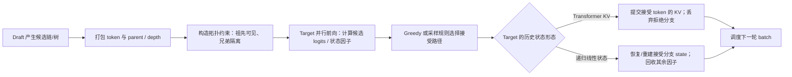

# 横切专题③：系统实现与吞吐—延迟权衡

> **定位**：把“为什么同一个算法在 batch=1 快 3×、在 batch=64 只快 1.38×、在 batch=256 可能变慢”拆成可判定的成本模型与负载相图。
> **证据等级**：系统数字均来自本条目分册的 `[精读原文]` 或论文官方表格；未设分册的工程博客数字标 `[二手]`。
> **配套分册**：[EAGLE](../papers/2401.15077-eagle-series.md)、[Medusa](../papers/2401.10774-medusa.md)、[SpecInfer](../papers/2305.09781-specinfer.md)、[MagicDec](../papers/2408.11049-magicdec.md)、[Lookahead](../papers/2402.02057-lookahead.md)、[vLLM](../papers/vllm-implementation.md)、[SGLang](../papers/sglang-implementation.md)。

---

## 1. 成本模型：加速比不是一个数

投机解码一步的期望产出（Leviathan 公式）：

`Ω(γ, α) = (1 − α^(γ+1)) / (1 − α)`

其中 `γ` 是投机 token 数、`α` 是单 token 接受率。端到端加速比近似：

`Speedup ≈ Ω(γ, α) / (1 + T_draft/T_target + T_verify(γ)/T_target)`

三个比值决定一切：

| 比值 | 由什么决定 | 何时有利 |
| :-- | :-- | :-- |
| `Ω(γ, α)` | 草稿质量（α）与草稿长度（γ） | 草稿与 target 对齐、任务模板化 |
| `T_draft/T_target` | draft 模型大小、KV 预算、是否并行 | draft 比 target 小很多 / 只读稀疏 KV |
| `T_verify(γ)/T_target` | batch、序列长度、硬件 FLOPS/带宽比 | 验证与解码共享 KV 加载（长序列） |

**推论**：同一算法在不同 `(batch, 序列长度, 硬件)` 下可以有**相反**的结论；任何“加速比 X×”都必须带这三个坐标。

---

## 2. 三种负载区间

### 2.1 memory-bound：batch=1 / 小 batch

- GPU 算力大量闲置，主要成本是把权重从 HBM 搬到 cache；多验证几个 token 的边际算力成本接近 0。
- 投机解码的“黄金区间”：EAGLE-3 在 SGLang batch=2 时吞吐 **1.81×**；Lookahead 在 A100 上 >50%、RTX 3090 只有 ~30%（后者算力上限低）。
- 失效：草稿太慢（`T_draft/T_target` 高）时，收益被 draft 吃掉。

### 2.2 compute-bound：大 batch / 短序列

- 线性层被 batch 喂饱，验证 token 与真实 token 争同一份算力；每个被拒 token 都是浪费。
- SpecInfer：batch 增大 → 相对收益下降；树宽在 **BS≥4** 时 2–3 最优（更宽反而慢）。
- Medusa：roofline 模拟显示 **batch>32** 后加速下降、甚至为负。
- vLLM 文档口径：batch=256 时“每个被拒 token 都是浪费的算力，够多时吞吐下降”。

### 2.3 KV-bandwidth-bound：长序列 + 大 batch

- KV cache 随 batch×序列线性增长，加载 KV 成为主瓶颈；验证与解码共享同一份 KV 加载，`T_verify/T_target` 趋近 1。
- MagicDec：序列长 **≥4000** 时，加速随 batch **上升**；**<4000** 时随 batch **下降**。临界长度 `S_inflection` 随模型（GQA 更高）与硬件（H100 更低）移动。
- 这是“大 batch 不适合投机”结论的反例区间；但它的前提是**长上下文**。

---

## 3. batch 曲线：同一算法在 2→64 上不是直线

EAGLE-3 论文 Table 3（SGLang、1×H100、LLaMA-3.1-8B、MT-Bench、链长 3、不用树）：

| batch | 2 | 4 | 8 | 16 | 24 | 32 | 48 | 56 | 64 |
| :-- | --: | --: | --: | --: | --: | --: | --: | --: | --: |
| EAGLE | 1.40× | 1.38× | 1.23× | 1.02× | **0.93×** | 0.94× | 0.88× | 0.99× | 0.99× |
| EAGLE-3 | 1.81× | 1.82× | 1.62× | 1.48× | 1.39× | 1.32× | 1.38× | 1.34× | 1.38× |

三条读法：

1. **EAGLE 在 batch=24 跌破 1.0×**：不是偶发，而是“验证成本 > 省下的解码步”的结构性结果。
2. **EAGLE-3 把曲线整体抬高，但形状仍递减**：2→4 最高，16 之后稳定在 1.3–1.4×。
3. **batch=1 的吞吐**：无投机 158.34 → EAGLE-2 244.10 → EAGLE-3 373.25 tokens/s（约 **2.36×**）；这是**吞吐**，不是单请求延迟。

---

## 4. 硬件：换卡会改变结论

| 硬件/条件 | 观察 | 来源 |
| :-- | :-- | :-- |
| A100 vs RTX 3090（Lookahead） | A100 >50%、3090 ~30% | Lookahead §5 |
| H100 vs A100 vs L40（MagicDec） | 同设置 H100 加速最高；L40 最低 | MagicDec §5 |
| 8×A100 8-way TP（MagicDec） | 长序列大 batch 下 2.51× | MagicDec §5 |
| 8 卡强扩展（Lookahead LP） | ClassEval 4×；TP/PP 基线反而 0.75–0.82× | Lookahead §5 |
| TPU v5p + DFlash | 平均 3.13×、峰值近 6×（官方工程博客） | `[二手]`，本条目未设分册 |

**规则**：跨硬件不可直接比。同一算法在 GPU 与 TPU 上的收益来自不同工程路径（paged attention vs 双缓存），不是“算法更强”。

---

## 5. 系统杠杆：从静态配置到在线自适应

| 杠杆 | 做法 | 代表 | 解决什么 |
| :-- | :-- | :-- | :-- |
| **静态 `num_speculative_tokens`** | 按部署手动调 | 早期 vLLM/SGLang | 简单，但无法覆盖整个负载区间 |
| **按 batch 调树宽/深度** | 小 batch 宽树、大 batch 窄树 | SpecInfer（BS≥4 用 2–3） | 验证成本与覆盖率的平衡 |
| **按上下文分层选树配置** | cumulative path Top-K entropy 经浅 CART 分层，选择 draft depth / Top-N / JIT graph | [HeteroSpec](../papers/2026.acl-long.589-heterospec.md) | 按 EAGLE-3 轨迹分配上下文策略；不是验证器证明，跨 drafter 迁移待验证 |
| **按负载调验证预算** | 逐 (request, position) 置信度打分，跨请求竞争 | vLLM adaptive verification | 一套配置覆盖整个负载区间 |
| **按上下文裁剪 draft** | `draft_context_window` 限制 draft 只看最近 N 个 token | vLLM PR #61261（本 commit 未检出） | 解决“超出训练长度后接受率崩塌” |
| **按负载全局分配请求前缀** | 校准 prefix survival 与实测 `SPS(B)` 联合选 batch 中每请求的 verify length，并在吞吐收益转负时早停 | [DSpark](../papers/2607.05147-dspark.md) | 将置信度映射到系统吞吐；早停最优性依赖目标单峰，不能简化成静态置信阈值 |
| **成本感知建树** | 把 GPU 型号、batch 纳入效用最大化 | CAST（ICLR 2026，`[二手]`） | EAGLE-2 在 batch=8 的 CNN/DM 上 0.84× 的反例 |

---

## 算子与状态：树验证怎样变成一次 target 工作

树形 speculative decoding 不只是“把更多候选并行算”。target 必须能让每个候选只读取**已提交前缀和它自己的祖先**，同时避免兄弟分支互相泄漏；验收后还要只保存被接受路径的 cache/state。下面是通用执行抽象，不是某个框架的逐函数调用图。

| 层 | 算子/数据问题 | 关键设计取舍 | 现有证据应怎样读 |
|---|---|---|---|
| **候选打包** | 将多请求的候选树展成节点数组，并保留 parent、depth、request 等索引 | 规则张量便于批处理；ragged forest 更省空槽，却让地址、mask 和图捕获更复杂 | [SpecInfer](../papers/2305.09781-specinfer.md) 解释树生成与 flatten；框架代码分别见 vLLM/SGLang 分册 |
| **Topology mask / target forward** | 为每个树节点构造可见前缀；节点只读共同已提交前缀和该节点祖先 | 树 mask 可在一次 target forward 中评分多条路径；节点越多通常意味着更多 target 行、mask 元数据和验证工作 | [SpecInfer](../papers/2305.09781-specinfer.md) 是 KV-cache target 的树验证基础；[Sequoia](../papers/2402.12374-sequoia.md) 将最优树形与硬件预算联系起来 |
| **接受与修正** | 根据各节点 target logits，按目标是 greedy 还是 sampling 选择接受路径并在拒绝处修正 | 算法层的分布保持规则，与 kernel 是否支持相同拓扑是两件事；“树 mask 正确”不自动证明接受采样无损 | 数学条件见[验证专题](verification-acceptance.md)；SGLang 固定代码只对 topk=1 路径使用真实 draft `q` 的拒绝采样，树 topk>1 走另一条 target-only kernel（见[SGLang 分册](../papers/sglang-implementation.md)） |
| **KV/state commit** | 验收后只保留接受路径，回收其它候选状态 | Transformer KV 可截断拒绝后缀；递归线性状态不是按 token 索引的后缀，不能用同一截断操作 | [SpecLA](../papers/2607.16673-specla.md) 比较全状态快照、token replay 与 factor buffer，并提出把接受因子更新延迟融合到下一次验证 |
| **kernel/调度** | 将 mask、target 层、状态读取、采样、commit 映射到设备并发和 CUDA Graph | 常规 attention kernel 的连续访存优势可能被树形依赖、ragged shape、短序列固定开销抵消；树宽需要受实测 kernel 成本约束 | 系统曲线见本专题；Bole 的公开摘要提出 hybrid-attention tree kernel，但其细节在本库暂不作为精读结论，见下方来源边界 |

### 不要把“树注意力”当成一个 kernel 名称

树验证至少跨三个层次：

1. **拓扑语义**：要算哪些候选，哪些祖先可见、哪些兄弟必须隔离；这是 mask / state-flow 的定义。
2. **张量计算**：target 如何对这些节点做投影、attention 或线性状态递推；它可以是 dense tree mask、tree-aware kernel、serial replay 或分解后的并行链。
3. **生命周期**：每轮的 logits 和 K/V/state 因子如何采样、提交或释放；正确性约束与临时内存峰值都在这里落地。

因此论文报告“树候选一次前向验证”，并不代表验证成本与链式草稿相同：目标模型要处理更多候选行，树 mask 与状态因子也会改变 kernel 的访存和中间张量。反过来，某个实现采用 target-only 或 greedy verifier，也不能单凭名字判断它是否满足概率采样的分布等价；须回到接受规则。

### Transformer KV 与 recurrent state：commit 的两种语义

Transformer 路线可把树节点 KV 视作临时扩展：共同前缀复用，验收后保留选中路径，拒绝分支作为 cache 后缀回收。SGLang 的固定实现核验也显示，树节点构造、greedy tree verification、链式拒绝采样是不同函数路径；其中采样拒绝路径硬限制 topk=1，不能把框架的所有树路径统称为“使用 `p/q` 无损拒绝采样”。

线性注意力/混合模型则以递归状态压缩过去。若每个树节点保存完整 state，瞬时内存随节点数增长；若验收后重放已接受 token，又会重复执行 target。SpecLA 的 GDN 研究通过 state-resident serial、tree-masked parallel 和 chain-decomposed hybrid 三种验证形状，配合 accepted-factor buffer 和 delayed state update，专门处理“分支预测—只提交一条路径”的状态生命周期。论文数字只针对其 GDN-1.3B/H100 设置，不能外推成所有 recurrent attention kernel 的性能结论。[SpecLA §§4–5、8](../papers/2607.16673-specla.md)

另一个需要单独关注的方向是 **hybrid-attention tree verification**。[Bole 的公开 arXiv 摘要](https://arxiv.org/abs/2608.01651v1)将问题定位为：full-attention 与 recurrent linear-attention 混合的 target，如何降低树验证和状态管理的成本。v1 页面/稿件含有“HPCA 2027 submission / Confidential Draft / Do NOT Distribute”水印；虽然 arXiv 页面标注 CC BY-NC-SA，现阶段这里只保留摘要级问题定位，不据此复述内部 kernel 细节或图表。论文链接到 SGLang `release/v0.5.12`；在固定 commit `5a15cde858ea09b77116212a39356f2fc51b8584` 的 `python/sglang/srt/speculative/` 与测试目录中未找到可辨认的 Bole 专属实现路径，因此不把摘要中的能力描述写成已由源码确认的生产行为。

### 生产框架快照告诉我们什么、又没有告诉我们什么

| 固定源码证据 | 可支持的判断 | 证据边界 |
|---|---|---|
| [vLLM @ `2b85d9c`](../papers/vllm-implementation.md)：`llm_base_proposer.py`、`rejection_sampler.py`、`gpu_model_runner.py` 等 | 草稿概率如何装配、拒绝采样怎样分 greedy/probabilistic、指标如何统计 | 分册明确只审 5 个投机相关文件；attention backend、树形 mask kernel、完整 CUDA Graph 调度没有逐模块审读 |
| [SGLang @ `2a08e26`](../papers/sglang-implementation.md)：`eagle_worker_v2.py`、`eagle_utils.py`、`eagle_info.py` | 候选树构造与 `eagle_sample` 分支；topk=1 chain rejection 与 topk>1 target-only 路径的区别 | 分册明确未展开 attention backend/CUDA Graph 细节；不能从 `verify_tree_*` 函数名推断硬件 kernel 的吞吐或访存行为 |
| SpecInfer / Sequoia / SpecLA 论文 | 拓扑 mask、硬件树预算、recurrent state parallelization 的算法/论文级机制 | 论文或官方摘要里的 kernel 方案不等于当前 vLLM/SGLang 主线已有同样实现；每个源码结论需要另钉 commit |

这一区分很重要：**论文层**解释目标算子应怎样利用树结构，**源码层**说明特定框架版本实际走了哪些 proposer/verifier/kernel 路径，**运行层**才回答特定 GPU、batch 和序列长度下是否更快。本专题目前有论文级 stateful kernel 精读和两个框架的静态路径核验，但没有进行 GPU benchmark，也没有对两套框架的完整 attention backend/CUDA Graph 层做共同版本的算子对照。

### 稀疏 KV 层级：验证中的多个 query 怎样共享历史读取

[Adaptive DHiSparse 精读](../papers/2610.13708-adaptive-dhisparse.md)将投机验证接到稀疏注意力的分层 KV 存储。模型 indexer 先为每个 query 选出有序历史位置；resident/host resolver 决定这些行当前存在哪里。多 query 验证时，系统合并同一请求的缺失行并只从 host 取一次，但每个 query 仍使用各自选择顺序与因果 mask。被拒绝的临时分支不提交，只有 target 接受的 prefix 进入持久历史。

这与 [SpecStream](../papers/2609.33184-specstream.md) 是两种 offload 机制：SpecStream 流式搬运 full-attention 历史，并用搬运期间 GPU 空档并发起草；Adaptive DHiSparse 只恢复 sparse indexer 选中的 KV 行，并随 HBM 负载保留或回收 optional history。它与 [H-Spec](../papers/2609.24197-hspec.md) 的靶点也不同：H-Spec 去掉块 drafter 自己的一份 KV 副本，DHiSparse 管 target 历史行的 GPU/host residency。三者都谈 KV，但分别优化传输、草稿缓存和稀疏历史驻留，不能合并成“KV offload”。

该论文还展示系统交互的反例：在 100K GLM-5.3、并发 128 时，投机提高每 GPU 输出；到并发 256，因 draft 与验证 staging 占用使可接纳 session 减少，论文报告总输出与非投机 adaptive 方案几乎相同、TTFT 更高。也就是说，投机减少每个活跃请求的解码轮次，未必在 admission 已受限时提高服务总吞吐。[Adaptive DHiSparse v1，§3–§5](../papers/2610.13708-adaptive-dhisparse.md)

---

## 6. 延迟 vs 吞吐：不要混着报

| 指标 | 定义 | 投机解码的影响 |
| :-- | :-- | :-- |
| **单请求延迟** | 一个请求从开始到结束的 wall-clock | batch=1 时通常下降；高 batch 时可能上升 |
| **吞吐** | 单位时间产出的 token 数 | batch=1 时可能下降（验证开销）；高 batch 时可能上升（KV 带宽区间） |
| **每 token 延迟** | 总时间 / 输出 token 数 | SpecInfer offloading 用它做指标（2.6–3.5×） |
| **接受长度 τ** | 每验证步平均 token 数 | 只反映草稿质量，不反映墙钟 |
| **acceptance rate** | 被接受草稿 / 提议草稿 | 与 τ 分母不同，会反向移动 |

**报告纪律**：至少给 `(吞吐|延迟, batch, T, 序列长度, 硬件, 树参数)` 六元组；只给“最高 X×”无法判断是否适用于你的负载。

---

## 7. 负载相图（把结论落到可操作的格子）

| 区间 | 典型 batch / 序列 | 是否开投机 | 建议配置 |
| :-- | :-- | :-- | :-- |
| 低延迟单请求 | batch=1、短-中序列 | **开** | EAGLE-3 / Medusa-2；树宽 60、深度 6–8；T=0 优先 |
| 高吞吐短序列 | batch≥32、序列<4000 | **谨慎** | 窄树（2–3）、短 γ；或不开；用 adaptive verification |
| 高吞吐长序列 | batch 32–256、序列≥4000 | **开** | 稀疏 KV 自投机（MagicDec 类）；draft KV 预算 512–2049 |
| 端侧/单卡 | 小显存、batch=1 | 视内存而定 | 免训练（Lookahead/PLD）或层跳过；先算内存带宽预算 |
| RL 训练 rollout | 长尾、target 演化 | 开（有条件） | 在线 drafter（TLT 类）；空闲 GPU 训练 |
| 结构化输出 | JSON/SQL/语法约束 | 开但需重标定 | 语法感知草稿；`num_draft_tokens` 扣除后重算 acceptance rate |

---

## 8. 失效边界（系统级）

1. **静态配置无法覆盖负载区间**：交叉点随负载与接受率移动；固定 `num_speculative_tokens` 必然在某些 batch 上亏。
2. **高 batch + 短序列**：验证成本主导，可能负收益（SpecInfer、Medusa、vLLM 文档口径一致）。
3. **长序列的显存墙**：KV 随 batch×序列增长；batch 上不去，投机的并行度也无从谈起。
4. **draft 上下文失配**：drafter 超出训练长度后接受率崩塌；需要 `draft_context_window` 一类显式参数（本 commit 未检出，说明尚未普遍可用）。
5. **硬件映射**：GPU 与 TPU 的收益不可互推；同一算法在不同卡上可能是不同工程路径。
6. **量纲混用**：µJ/token（能效）与 tokens/s（吞吐）不是同一量纲；SMoLPU 一类专用硅的数字不能与算法论文排榜。
7. **指标只报一个**：acceptance rate 与 τ 反向移动；只报一个会得出相反结论。
8. **T 未声明**：T=0 的 batch 曲线不能外推到 T>0；动态树在 T>0 下会额外损失接受率。

---

## 9. 上线前的测量清单

| # | 要测什么 | 怎么测 |
| --: | :-- | :-- |
| 1 | 负载分布 | batch、输入/输出长度、并发；至少覆盖 P50/P99 |
| 2 | 三个区间 | batch=1、目标 batch、超目标 batch 各一组 |
| 3 | 两个指标 | acceptance rate + mean acceptance length 成对 |
| 4 | 墙钟 | 端到端延迟与吞吐分开报；不要用 τ 代替 |
| 5 | 温度 | T=0 与线上 T 各一组；动态树在 T>0 要重标定 |
| 6 | 约束 | 有无结构化输出各一组；分母会变 |
| 7 | 硬件 | 至少目标卡型；跨卡不互推 |
| 8 | 回退 | draft_probs 缺失、树参数越界、上下文超长时的行为 |

---

## 10. 一页纸总结

- 加速比 = `Ω(γ,α) / (1 + T_D/T_T + T_V/T_T)`；三个比值随负载移动。
- 三个区间：memory-bound（batch=1，最赚）、compute-bound（大 batch 短序列，可能亏）、KV-bound（长序列大 batch，可能反转）。
- EAGLE 在 SGLang batch=24 跌破 1.0×、EAGLE-3 在 batch=64 仍 1.38×——**拐点随算法版本移动**。
- 硬件换卡会改变结论；GPU 与 TPU 不可互推。
- 静态配置必然有盲区；方向是“按请求/位置/上下文自适应”，但 `draft_context_window` 在本轮 vLLM 快照尚未合入。
- 指标必须成对、条件必须六元组；否则“最高 X×”没有工程意义。

---

## 来源

- 成本模型与 batch 曲线：EAGLE-3 arXiv:2503.01840v3 Table 3/4（SGLang 团队）；MagicDec arXiv:2408.11049v5 §3–§5；SpecInfer arXiv:2305.09781v4 §6.6；Lookahead arXiv:2402.02057v1 §5。
- 框架行为：vLLM @ `2b85d9cb`（`speculative.py:533/604`、`llm_base_proposer.py:257–261`）；SGLang @ `2a08e261`（`eagle_worker_v2.py:178–180`、`eagle_utils.py:947–1044`）。
- 二手来源：CAST（ICLR 2026 解读页）、TPU v5p + DFlash（Google 工程博客）、SMoLPU（KAIST Pure，`[⚠️受限核验]`）。
