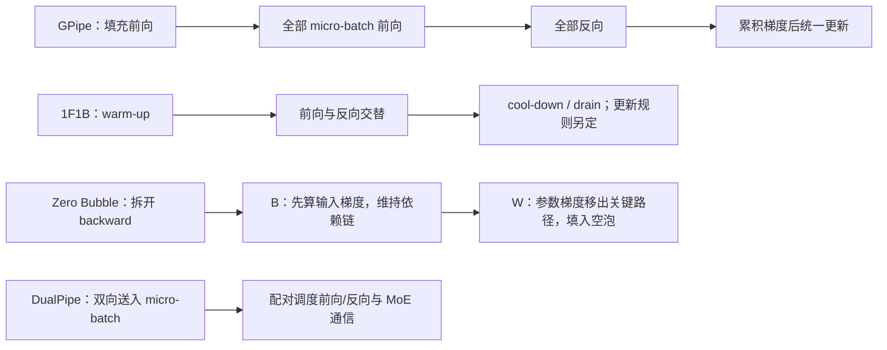
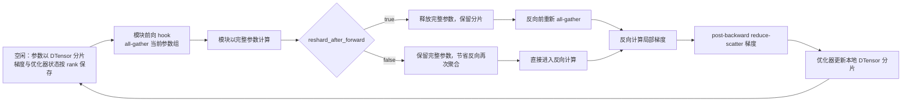

# 大模型训练基础设施与分布式训练研究报告

> **范围与证据边界**：本文从训练状态内存出发，解释数据并行、ZeRO/FSDP、张量与流水线并行、分级内存和注意力 IO，并用 PyTorch `v2.14.0` 固定源码追踪 FSDP2/DTensor 的参数分片与通信生命周期。MoE 专家并行（尤其 token dispatch、all-to-all 与负载均衡）、现代低精度训练配方及训练栈横向性能比较不在本报告覆盖范围；没有运行多机训练或复现论文性能。

## 1. 概述

训练系统先要回答四个问题：哪些状态占内存，哪些状态能分片，哪些计算或通信进入关键路径，以及中断后能否恢复相同的训练过程。框架名称本身不能回答这些问题；ZeRO、FSDP 与 PyTorch DCP 的论文和文档分别展示了状态切分、执行时聚合与恢复契约。[ZeRO §3–§7](https://arxiv.org/html/1910.02054v3) · [FSDP §3–§4](https://arxiv.org/html/2304.11277v2) · [PyTorch Distributed Checkpoint](https://docs.pytorch.org/docs/2.14/distributed.checkpoint.html)

本报告的结论是：

- 普通数据并行复制训练状态；ZeRO/FSDP 通过状态分片降低冗余，但执行期间仍可能有参数聚合、通信缓冲和激活峰值。
- 张量并行把一次层内计算分给设备，流水线并行把不同层交给不同阶段，两者的通信位置和调度代价不同。
- 激活重计算、CPU/NVMe offload 与优化器状态分片解决不同内存项，不能将它们都称为“压缩模型”。
- FP16/BF16 或 FP8 描述部分计算/存储精度，不代表所有权重、梯度和优化器状态都采用该精度。
- 训练吞吐应在模型、token 预算、序列长度、硬件与收敛质量对齐后比较；没有这些条件的“快多少”“省多少”不进入结论。

机制依据见 [ZeRO §3–§7](https://arxiv.org/html/1910.02054v3)、[Megatron-LM §3](https://arxiv.org/html/1909.08053v4) 和 [ZeRO-Infinity §3–§4](https://arxiv.org/html/2104.07857v1)。

### 1.1 先建立可复核的内存账

考虑参数量为 \(P\)、所有参数可训练、采用常规 Adam 的简化模型。GB 使用十进制，\(P=7\times10^9\)。下表不含激活、通信、临时算子工作区和内存碎片。

| 状态 | 全 FP32 假设 | 一种 FP16 混合精度假设 |
|---|---:|---:|
| 用于计算的参数 | 4P 字节 = 28 GB | 2P 字节 = 14 GB |
| 梯度 | 4P = 28 GB | 2P = 14 GB |
| FP32 主权重 | 已计入参数 | 4P = 28 GB |
| Adam 一阶矩与二阶矩 | 8P = 56 GB | 8P = 56 GB |
| 合计 | 16P = 112 GB | 16P = 112 GB |

右列对应 [ZeRO §3.1](https://arxiv.org/html/1910.02054v3#S3) 的一种混合精度状态模型。实际系统可能采用 FP32 梯度、不同 master-weight 策略、分片或低精度优化器，因此不是任意 BF16/FP16 配置的通用账本。

不能给激活统一加“20–40GB”：它依赖层数、hidden size、序列长度、micro-batch、注意力实现、保存张量和重计算方式。固定参数量不能唯一决定激活峰值。

LoRA/量化微调、冻结部分层与全参数预训练的可训练状态不同；不能把其容量结论混用。模型参数过大时通常需要分布式或 offload，但“所有大模型训练都完全不能单机进行”也是过强表述。

## 2. 发展时间线

| 原文首次提交 | 工作 | 可核实的贡献 | 本报告依据 |
|---|---|---|---|
| 2019-09 | Megatron-LM | Transformer 层内张量并行 | [1909.08053v4](https://arxiv.org/abs/1909.08053v4) |
| 2019-10 | ZeRO | 分阶段消除 DP 模型状态冗余 | [1910.02054v3](https://arxiv.org/abs/1910.02054v3) |
| 2021-04 | ZeRO-Infinity | 将分片、CPU/NVMe 分级内存与带宽调度结合 | [2104.07857v1](https://arxiv.org/abs/2104.07857v1) |
| 2022-05 | FlashAttention | 通过 IO-aware tiling 降低精确注意力的 HBM 访问 | [2205.14135v2](https://arxiv.org/abs/2205.14135v2) |

这是机制演进节点，不是某个框架的当前版本表。ZeRO-Infinity 的论文于 2021 年出现，不应写成 2023 年首次提出。

## 3. 核心框架对比

框架名称和并行技术不是一一对应；一个训练栈可以组合多种技术。应按目标版本核对具体能力，而不是为“DeepSpeed / FSDP / FairScale”填写没有统一测量条件的百分比与星级榜。

| 路线 | 主要解决对象 | 通信或调度代价 | 核验入口 |
|---|---|---|---|
| ZeRO / DeepSpeed | DP 进程间重复的优化器、梯度和参数状态 | 状态聚合、分片通信，以及可选 offload | ZeRO §5–§7 |
| PyTorch FSDP1 / FSDP2 | 将分片状态留在 rank，按执行单元临时聚合参数 | all-gather / reduce-scatter、通信组粒度、reshard 与预取 | [FSDP 原论文 §3–§4](https://arxiv.org/html/2304.11277v2)、[FSDP2 v2.14 源码](https://github.com/pytorch/pytorch/tree/v2.14.0/torch/distributed/fsdp/_fully_shard) |
| Megatron 风格 TP | 一次层内矩阵运算与注意力的切分 | 层内高频 collective | Megatron-LM §3 |
| 流水线并行 | 各阶段持有不同层 | 阶段间激活/梯度传输、流水线空泡 | 与 TP 正交，可组合 |
| 分级内存 offload | 将部分训练状态放入 CPU/NVMe | 数据移动与计算重叠、主机内存和存储带宽 | ZeRO-Infinity §3–§4 |

在 FSDP 中，参数的 all-gather 时点、forward 后是否重新分片、backward 预取和分片状态字典策略均影响内存与通信。不能把“参数分到 N 张卡”直接等同于峰值总内存严格变为 1/N。下面用固定版本 FSDP2 源码把这些策略接到实际模块执行流程。

## 4. 并行策略详解

### 4.1 数据并行：分数据，还是也分状态

普通 DP 每个 rank 持有同一模型的副本，处理不同样本，通过梯度同步实现一次全局更新。梯度累积可降低单次 micro-batch 的激活压力，但增加有效 batch 不会减少常驻参数或 Adam 状态。

若数据并行度为 \(D\)，各 rank 的 micro-batch 为 \(m\)，每次更新累积 \(A\) 次，则在无丢弃/不均匀样本的简化条件下，全局样本 batch 为 \(DmA\)。长短样本混合时还需报告真实 token 数与 padding，不能仅用样本 batch 对齐训练预算。

### 4.2 ZeRO 的三个状态阶段

以 §1.1 右列的混合精度假设计，\(D\) 为 DP 组大小：

| 阶段 | 分片对象 | 每 rank 的简化常驻模型状态 |
|---|---|---|
| 普通 DP | 无 | \(16P\) |
| Stage 1 | FP32 主权重与 Adam 状态 | \(4P+12P/D\) |
| Stage 2 | 再分片梯度 | \(2P+14P/D\) |
| Stage 3 | 再分片计算参数 | \(16P/D\) |

这些公式描述模型状态分片后的容量，不包含执行中重建的参数、激活与 workspace。[ZeRO Figure 1、§5](https://arxiv.org/html/1910.02054v3#S5)

Stage 3 的显存收益需要用额外的数据移动换取。应读通信分析和执行时调度，不能用“95% reduction”与 FSDP 的另一个无条件百分比直接比较。[ZeRO §7](https://arxiv.org/html/1910.02054v3#S7)

### 4.3 张量并行：把切分放在非线性之前或之后

Megatron-LM 研究如何切分 Transformer 的 MLP 与多头注意力，使局部矩阵乘尽量独立，并在必要位置做归约。以 MLP 的两个线性层为例，前一层按输出维切分后，各 rank 可局部执行非线性；后一层采用互补切分并聚合结果。切分方向决定哪里需要通信。[Megatron-LM §3、Figure 3](https://arxiv.org/html/1909.08053v4#S3)

代价是一次训练 step 内反复发生层内通信；慢互连、小矩阵或过高 TP 度可能使通信主导。论文证明了特定硬件与模型上的扩展，不证明“增加 TP 必然提速”。

### 4.4 流水线并行：吞吐、空泡与状态一致性

流水线并行把连续层分给不同设备；一个 micro-batch 必须先经过前一阶段，下一阶段才能计算，因此只有一个 micro-batch 时其余阶段都要等待。把大 batch 切成多个 micro-batch，才能让不同阶段同时工作。流水线的“空泡”就是尚未填满或即将排空时的空闲计算槽；减小空泡、保存激活和维持同步更新是互相牵制的三个目标。

图只展示调度思路，不表示精确时间线。阅读流水线论文时还要分开两条轴：一条是 **F/B/W 工作怎样排**，另一条是 **权重何时更新、各 micro-batch 使用哪个权重版本**。同名 1F1B 可能属于不同更新语义。

#### 同步 flush 与异步 1F1B 不等于同一种更新

[GPipe](https://arxiv.org/html/1811.06965v5) 将 batch 切成 micro-batch，先流水执行前向，再完成反向，累积梯度后统一更新参数。这样的 flush 让所有 micro-batch 在同一权重版本上完成前向/反向，更新语义清楚；代价是所有前向激活要等到各自反向才释放。论文用 rematerialization 只保留分区边界激活、反向时重算分区内部前向，以计算换显存；增加 micro-batch 可以摊薄边缘空泡，却不能消除激活生命周期或重算代价。[GPipe v5，§2.2–2.3、Figure 2](https://arxiv.org/html/1811.06965v5)

**1F1B 首先是任务顺序，不是同步语义。** 异步 [PipeDream](https://arxiv.org/html/1806.03377v1) 在 warm-up 后每个 stage 交替处理不同 micro-batch 的前向和反向。`weight stashing` 保证某一个 micro-batch 在同一 stage 的前向与反向使用同一版本；但原始 PipeDream 不保证同一个 micro-batch 穿过所有 stage 时拿到同一全局版本。论文的 `vertical sync` 才把版本号沿前向传递，使跨 stage 的权重版本一致；这会增加同步/元数据负担。即使 stash 正确，异步更新仍让梯度相对最新参数滞后。[PipeDream v1，§3.3–3.5](https://arxiv.org/html/1806.03377v1)

[PipeDream-2BW](https://arxiv.org/html/2006.09503v3) 针对大模型保留异步调度的利用率，同时用双缓冲权重和梯度合并把更新延迟限制在一个 minibatch 的量级；双份权重减轻原始 PipeDream 随 pipeline depth 增长而保留多版本的显存负担。它还提供 PipeDream-Flush：继续采用 1F1B，但周期性排空流水线后再更新，换取单一权重版本与更低的激活存储，代价是 flush 期间的空泡。论文对 GPT/BERT 的收敛与吞吐比较属于其 V100、模型、batch 和并行配置；不应把 2BW 的更新语义说成完全等同于每一步同步 SGD。[PipeDream-2BW v3，§3.1–3.2、§5.1–5.3](https://arxiv.org/html/2006.09503v3)

| 调度 | 权重/更新语义 | 激活与空泡取舍 | 要留意的边界 |
|---|---|---|---|
| GPipe | 反向完成后统一更新，单一权重版本 | 微批越多边缘空泡越小，但需要跨越整个前向阶段存活的激活；可用重算换内存 | 增大 micro-batch 数会改变运行内存与工作粒度 |
| 同步 1F1B / PipeDream-Flush | 逐 micro-batch 前向/反向交替，但在 flush 后才更新 | 只保留流水线中仍在飞行的激活；仍有 fill/drain 空泡 | flush 长度和 micro-batch 数决定停顿 |
| 异步 PipeDream | weight stashing 对齐同一 stage 的前后向；跨 stage 一致需 vertical sync | 稳态可减少停顿；需要保留多个权重版本 | 梯度陈旧度和 stage 间版本一致性是算法语义问题 |
| PipeDream-2BW | 双缓冲权重、梯度合并；接受固定一步延迟 | 只保留两份权重版本，更新与流水并行 | 仍需双份权重缓冲，且与每步同步 SGD 的更新序列不同 |

所以评估一种“无空泡”调度时，先问它是异步而容许陈旧梯度，还是同步拆分反向计算；两者减少空泡的方式和收敛风险不同。

这一取舍在近期工作中仍被重新检验。2026 年的 [One-Step Gradient Delay](https://arxiv.org/html/2606.30634v1) 沿用 PipeDream-2BW 的固定一步延迟，发现延迟造成的质量损失对优化器敏感：论文在其 135M/360M 受控对照中观察到 Muon 比默认 AdamW 更能耐受陈旧梯度，再以 10B MoE、200B FineWeb-Edu tokens、4M token global batch 的设置扩展验证；Muon 加 update-level Error Feedback 后，作者报告的最终验证损失与同步基线同为 1.906。该结果说明固定延迟和优化器更新方式共同影响质量边界。作者仍将 trillion-token 扩展、延迟鲁棒性机理和批大小选择列为开放问题；论文结果只支持其模型、数据和训练配置。[§2、§5.2、§8](https://arxiv.org/html/2606.30634v1)

#### 交错、Zero Bubble 与受控激活生命周期

Megatron 的**交错 1F1B**让每个物理设备持有多个非连续 virtual stages，并在它们间交替处理 micro-batch。虚拟 stage 数可缩短各设备之间的填充/排空路径；Megatron 的分析中，理想化 bubble fraction 随每设备虚拟 stage 数约按反比下降，额外 stage 间通信则按虚拟 stage 数增加，micro-batch 数还需满足其调度约束。其论文报告总体内存足迹与既有方法相近；后续 schedule 分析显示 activation peak 会随虚拟分段、warm-up 和 micro-batch 配置变化，因此应比较同一显存预算与 micro-batch 下的时序。[Megatron-LM v3，§2.2.2、§5.3.2](https://arxiv.org/html/2104.04473v3#S2.SS2.SSS2) [Controllable Memory v4，§4.1](https://arxiv.org/html/2405.15362v4#S4.SS1)

[Zero Bubble Pipeline Parallelism](papers/2401.10241-zero-bubble.md) 将每层反向计算拆为输入梯度 `B` 和权重梯度 `W`：`B` 沿相邻层依赖链及时回传；`W` 在满足梯度累积顺序后可移入原本空闲的槽位。论文指出，真实模型中 F、B、W 的时长和 activation footprint 不相同，通信耗时与 memory limit 也会改变最优计划；其自动调度用 profile 到的 F/B/W/通信时长和激活上限搜索时间表。论文报告的吞吐收益限于其 Megatron 派生实现、特定 GPT 模型、GPU 数、micro-batch 与 memory limit。[Zero Bubble v1，§2–3、§5–6](https://arxiv.org/html/2401.10241v1)

“空泡数最少”也不是唯一优化目标。[Pipeline Parallelism with Controllable Memory](papers/2405.15362-controllable-memory.md) 将时序拆成可重复 building block，指出 activation memory 取决于各 block 的生命周期，并用 V-shape schedule 平衡不同 stage 的活跃激活。它将 1F1B、GPipe、交错 1F1B 和零泡系列放入同一 schedule 视角；论文中的内存/吞吐比较来自其模型规模、stage/micro-batch 配置和 GPU 试验，方法的额外 stage 通信与硬件带宽仍需一起考虑。[v4，§2–4](https://arxiv.org/html/2405.15362v4)

#### DualPipe：围绕 MoE 的通信—计算重叠来设计

DeepSeek-V3 的 DualPipe 不是通用“零泡”替代名。V3 报告称其训练使用 16-way PP 与跨节点 EP；专家并行引入的 dispatch/combine all-to-all 让通信/计算比例成为主要约束。DualPipe 将一个 chunk 拆成 attention、dispatch、MLP、combine，并把 backward 再拆成 B/W；之后对齐前向、反向和通信，使 all-to-all 与 PP 通信能在其配置下被隐藏。双向 schedule 从流水线两端同时送入 micro-batch，以减少填充和排空区域。[DeepSeek-V3 v2，§3.2.1、Figure 4–5](https://arxiv.org/html/2412.19437v2#S3.SS2.SSS1)

这解释了 DualPipe 与 Zero Bubble 的关系：二者都把 B/W 分开以释放调度自由度；Zero Bubble 重点最小化同步 PP 的计算空泡，DualPipe 还按 MoE dispatch/combine 的通信路径和 SM 资源分配安排 overlap。DeepSeek-V3 Table 2 报告其配置下的 bubble/parameter/activation 关系（activation 为 `PP+1`，parameter 为两份）；这些是其 chunk 定义与并行方案中的模型，不代表其它 MoE 规模会有相同成本。若 MoE 通信很轻或拓扑不同，双向调度的收益/代价必须重新分析，不能仅凭“bidirectional”断言更快。

#### 与 FSDP、TP 和数据并行组合时

PP 负责层间切分；TP 在层内切权重与计算；DP/FSDP 在 replica 维度处理数据或参数/梯度/优化器状态。组合后，PP 把每个 micro-batch 的 activation 送往下一 stage，TP 在 stage 内执行 collectives，DP/FSDP 在相应 replica group 汇总或分片训练状态。调度器需要看到实际计算/通信时长与可用 activation memory；改变 TP 度、FSDP 分片组或 micro-batch 会改变 F/B/W 时长和内存预算，原来“零泡”的时序不必仍然零泡。[Zero Bubble v1，§3](https://arxiv.org/html/2401.10241v1) · [Controllable Memory v4，§4.4](https://arxiv.org/html/2405.15362v4)

推荐阅读顺序：[GPipe](https://arxiv.org/html/1811.06965v5) 建立同步 flush、micro-batch 和重算直觉 → [PipeDream-2BW](https://arxiv.org/html/2006.09503v3) 看 1F1B、异步权重版本与 flush 的区别 → [Zero Bubble](papers/2401.10241-zero-bubble.md) 看 B/W 拆分 → [受控显存调度](papers/2405.15362-controllable-memory.md) 看 activation 生命周期 → DeepSeek-V3 §3.2.1 看通信密集 MoE 的 DualPipe。

### 4.5 序列并行和专家并行

序列维分片需要说明具体算法与通信范围，不能把所有名称中含 sequence/context parallel 的方法视为同一个机制。MoE 的专家并行还涉及 token routing、all-to-all、容量和负载均衡，密集模型的 TP 数据不能直接迁移。

这两类的具体实现与实测不在本文已核验范围；选型时应补目标框架的固定版本路径和原始论文，暂不列统一加速数字。

### 4.6 FSDP2：用 DTensor 表示分片，用模块边界安排通信

FSDP 与张量并行的根本区别是：**FSDP2 在参数使用时恢复当前通信组所需的完整参数；TP 则让参数切片直接参与层内计算。** 因而 FSDP2 主要消除 DP rank 之间的状态副本，不能让一个单独层的完整权重在前向期间不再需要容纳于设备。[PyTorch v2.14 FSDP2 契约](https://docs.pytorch.org/docs/2.14/distributed.fsdp.fully_shard.html) · [Megatron-LM §3](https://arxiv.org/html/1909.08053v4#S3)

#### 表示变化：从 FSDP1 的 FlatParameter 到 FSDP2 的逐参数 DTensor

FSDP1 将一个 FSDP 单元中的多个原始参数展平、拼接，再补齐到可均匀切分的 `FlatParameter`。这让 all-gather 和 reduce-scatter 能处理大块、均匀的缓冲区，避免为每个参数各发一次小 collective；代价是优化器看到的分片布局不一定尊重原参数边界，依赖原张量形状或跨参数状态的优化器操作需要额外小心。[FSDP 原论文 §3.2.1、§4.2、§7.2.1](https://arxiv.org/html/2304.11277v2)

FSDP2 的 `fully_shard` 保留原模块和参数名，在原参数上原位安装 FSDP 状态与 hooks；分片参数以 `DTensor` 表示，默认沿维度 0 分片。优化器在 `fully_shard` 之后创建，处理这些分布式参数；这使单个参数的形状和分布布局可被显式观察、操作和与 DeviceMesh 组合。`DTensor` 的全局形状仍描述逻辑参数，rank 本地存储只是其 placement 的一部分。[PyTorch v2.14 `fully_shard` 契约](https://docs.pytorch.org/docs/2.14/distributed.fsdp.fully_shard.html) · [源码：`_fully_shard.py` L110–143](https://github.com/pytorch/pytorch/blob/v2.14.0/torch/distributed/fsdp/_fully_shard/_fully_shard.py#L110-L143) · [源码：参数分片初始化 L249–330](https://github.com/pytorch/pytorch/blob/v2.14.0/torch/distributed/fsdp/_fully_shard/_fsdp_param.py#L249-L330)

分片训练状态和导出完整 checkpoint 是两件事。FSDP2 的 state dict 可以保留 DTensor 分片并由 Distributed Checkpoint 按分布式方式保存；若调用 `DTensor.full_tensor()` 转为完整权重，则会重新物化聚合后的张量，必须按 checkpoint 操作的设备和 rank 策略评估额外内存。[PyTorch v2.14 FSDP2 state dict 与 checkpoint 指引](https://docs.pytorch.org/docs/2.14/distributed.fsdp.fully_shard.html) · [Distributed Checkpoint](https://docs.pytorch.org/docs/2.14/distributed.checkpoint.html)

这不是“通信分组消失了”。FSDP2 仍把多个参数合成通信组：对子模块先调用 `fully_shard`，再调用父模块，父组只收纳尚未分组的参数。每组前向时一起 all-gather，反向后一起 reduce-scatter。粗粒度分组减少 collective 次数，却使更大的参数块同时驻留；细粒度分组降低单次聚合峰值并更容易同计算重叠，却可能增加小 collective 和调度开销。论文早已指出组大小的这组权衡；FSDP2 将分组边界直接绑定到模块结构，要求读者理解模型的执行顺序。[源码：`_fully_shard.py` L133–143](https://github.com/pytorch/pytorch/blob/v2.14.0/torch/distributed/fsdp/_fully_shard/_fully_shard.py#L133-L143) · [FSDP 原论文 §4.2](https://arxiv.org/html/2304.11277v2#S4.SS2)

#### 执行时序：聚合、预取、重分片和梯度归约

1. `fully_shard` 初始化时把参数转成分片布局。模块的前向 pre-hook 为本通信组启动 all-gather，完成后临时把完整参数交给原模块计算。
2. 前向 post-hook 根据 `reshard_after_forward` 释放完整参数，或保留它们供紧接着的反向使用。保留可避免反向前再聚合一次，代价是参数存储跨过前向与反向持续占用。
3. 若已重分片，反向开始前会重新 all-gather；autograd 生成的完整梯度在 post-backward 阶段归约并 reduce-scatter 回本地分片。优化器更新本地参数和对应状态。

这些操作落在 `_fsdp_state.py` 的 module 前向/反向 hooks 与 `_fsdp_param_group.py` 的 `pre_forward`、`post_forward`、`pre_backward`、`post_backward` 中。all-gather、计算和 reduce-scatter 使用不同 stream；模块执行顺序可让下一组参数的聚合与当前组计算重叠，backward 则可按反向顺序预取下一组。源码证明的是 v2.14.0 的执行路径，不代表任意模型控制流或 collective backend 都获得完美重叠。[源码：状态 hooks L290–349](https://github.com/pytorch/pytorch/blob/v2.14.0/torch/distributed/fsdp/_fully_shard/_fsdp_state.py#L290-L349) · [源码：通信 streams L82–127](https://github.com/pytorch/pytorch/blob/v2.14.0/torch/distributed/fsdp/_fully_shard/_fsdp_param_group.py#L82-L127) · [源码：参数组聚合/反向前 L382–450](https://github.com/pytorch/pytorch/blob/v2.14.0/torch/distributed/fsdp/_fully_shard/_fsdp_param_group.py#L382-L450) · [源码：reshard 与 backward/reduce-scatter L509–720](https://github.com/pytorch/pytorch/blob/v2.14.0/torch/distributed/fsdp/_fully_shard/_fsdp_param_group.py#L509-L720)

#### 两个关键取舍与失效边界

| 选择 | 帮助什么 | 需要支付什么 |
| :-- | :-- | :-- |
| `reshard_after_forward=True` | 前向后及时释放完整参数，控制峰值参数内存 | 反向前再次 all-gather；重计算/通信需求增加 |
| `reshard_after_forward=False` | 重用前向留下的完整参数，减少反向前的一次聚合 | 更长时间持有完整参数，峰值显存更高 |
| 子模块逐层分组 | 限制一次物化的参数量，并为通信与计算重叠创造机会 | 小组过多会增加 collective 数；边界必须贴合实际执行顺序 |
| 只在根模块分组 | 配置简单，通信调用大块化 | 整个模型可能形成一个大聚合组，失去逐层重叠且峰值显存高 |

表中分组和重分片取舍来自 FSDP2 v2.14 用户契约与通信组实现；具体的模块粒度需要根据模型执行顺序选择，不能只按参数量固定一个包裹规则。[PyTorch FSDP2 communication grouping](https://docs.pytorch.org/docs/2.14/distributed.fsdp.fully_shard.html#communication-grouping-and-scheduling) · [FSDP 原论文 §4.2](https://arxiv.org/html/2304.11277v2#S4.SS2)

PyTorch v2.14 的 `reshard_after_forward=None` 默认对非根模块重分片、对根模块保留完整参数；文档给出的理由是根模块通常在反向开始时立即需要。这是常见执行顺序的默认取舍，不表示该策略对每个模型都最省内存或最快。[PyTorch FSDP2 API](https://docs.pytorch.org/docs/2.14/distributed.fsdp.fully_shard.html)

模型并非“只要参数分片就能训练”：FSDP2 仍需在某一时刻物化被执行组的参数；激活、临时算子缓冲和预取中的下一组也会占显存。root-only 分组、大量细粒度小组、很短的计算段或不规则模块调用，都可能让通信/内存取舍变差。PyTorch v2.14 文档明确建议 bottom-up 应用 `fully_shard`，并指出前向或反向异常后迭代内部状态可能未定义，恢复前需调用 root 的 `reset_iter_state()`；这是框架执行契约，不是模型训练普遍定律。[PyTorch v2.14 FSDP2 文档：communication grouping 与 error recovery](https://docs.pytorch.org/docs/2.14/distributed.fsdp.fully_shard.html)

同一抽象也不能与 ZeRO-3 完全画等号：它们在“数据并行状态分片、执行时收集参数、反向切分梯度”这一核心目标上相似；但论文和框架 API 对单元边界、状态表示、预取、offload、state dict、mesh 组合的组织方式不同。读者应比较相同配置下各自的通信与内存契约，而不是只比较“Stage 3”和“full shard”名称。详细精读见 [PyTorch FSDP 原论文](papers/2304.11277-pytorch-fsdp.md)。

## 5. 内存优化技术

### 5.1 激活重计算

只保存部分前向中间结果，backward 时重新计算需要的激活，以计算换峰值内存。它通常不减少参数或 Adam 状态，因此不能代替状态分片。

性能取决于重计算区间、随机性重放和算子成本。必须比较相同模型与 token 预算下的峰值内存和 step 时间，不能只报“节省显存”。

### 5.2 CPU / NVMe offload

ZeRO-Infinity 的贡献不仅是“把状态搬到磁盘”，还包括带宽组织、数据预取与计算/通信重叠。更大的主机或磁盘容量不能单独保证吞吐；若数据移动进入关键路径，GPU 可能等待。[ZeRO-Infinity §3–§4](https://arxiv.org/html/2104.07857v1)

需要核对 CPU 内存、PCIe、NVMe 数量与带宽、pinned memory 和并发读写。论文中的大模型容量演示不意味着消费级单卡具有相同训练时间或经济性。

### 5.3 FlashAttention

FlashAttention 用 tiling 和重计算组织精确注意力，避免将完整中间注意力矩阵反复写入 HBM。它减少的是注意力计算中的 IO 与中间存储，不是把完整 dense attention 改成线性复杂度近似。[FlashAttention §3、Algorithm 1](https://arxiv.org/html/2205.14135v2#S3)

收益依赖序列长度、head dimension、GPU 和 kernel 版本；单算子加速不能直接当成完整训练 step 的同倍数提升。

## 6. 混合精度训练

数值格式应逐项说明：参数存储、计算输入、累加、梯度归约、优化器状态，以及是否保留高精度主权重。只写“BF16 训练”不能唯一决定内存账。[FSDP 原论文 §4.4](https://arxiv.org/html/2304.11277v2#S4.SS4) 对参数、梯度归约与缓冲精度作了分别配置；PyTorch v2.14 的 `MixedPrecisionPolicy` 也将参数、归约和输出精度分开设定。[API](https://docs.pytorch.org/docs/2.14/distributed.fsdp.fully_shard.html)

低精度训练需要核对溢出、下溢、scale、归约误差和收敛曲线。FP16、BF16、FP8 的指数范围与尾数精度不同，硬件支持也不同；本报告没有依据把 FP8 写成任何 GPU 上均可直接替换的训练开关。

验收至少同时比较训练吞吐、相同 token 数的验证损失、梯度/损失异常与最终任务质量。容量或速度提升而训练发散，不能算等价训练收益。

## 7. 典型训练配置案例

本节给出资源推导方法，不声称已经运行某个厂商模型。

### 7.1 7B 全参数 Adam 的状态分片估算

取 §1.1 的混合精度假设，\(P=7\times10^9\)、\(D=8\)。代入 §4.2：

| 配置 | 每 rank 理论常驻模型状态 |
|---|---:|
| DP | 112 GB |
| ZeRO-1 | 38.5 GB |
| ZeRO-2 | 26.25 GB |
| ZeRO-3 | 14 GB |

这些数值只是字节公式结果，不是 A100 80GB 的可运行性承诺。Stage 3 仍需加上当前聚合单元、激活、通信 buffer 与 kernel workspace；序列长度翻倍也不会保持同一峰值。

### 7.2 吞吐和收敛如何共同验收

记录模型/数据 revision、序列长度分布、全局 token batch、训练 token 数、优化器与学习率，以及设备、互连、软件提交和并行组配置。

报告同时包含稳定阶段 tokens/s、step 时间分布、峰值内存、重计算/offload 设置、验证损失与恢复结果。模型 FLOP 利用率必须说明理论峰值的精度、稀疏假设及 FLOP 计数方法。

没有原始日志的“32 卡、若干小时、某 TFLOPS”案例不作实测结论；不同训练目标或不同质量终点的数据不进入公平排行榜。

### 7.3 恢复契约

一次可恢复 checkpoint 不仅是权重文件，还可能需要优化器/调度器状态、随机数状态、数据迭代位置和分布式分片元数据。具体内容依赖训练实现。

应验证中断恢复后的学习率、全局 step、数据消费和验证损失连续性；写文件成功不等于恢复正确。本报告未执行故障注入或跨拓扑恢复，不能据此评价具体框架的容错成熟度。

## 8. 挑战与未来方向

最有价值的后续工作是把某个目标训练栈的状态生命周期与性能日志连接起来：聚合何时发生、哪些 buffer 重叠、哪些通信被隐藏、哪个阶段造成峰值，以及恢复能否重复同一更新。

本报告现在补入 FSDP2/DTensor 的固定版本源码路径，但不扩展为 PyTorch 所有 distributed API 的代码导览。后续更值得独立研究的是 PP 调度与 FSDP 组合、低精度状态/通信格式，以及 MoE 专家并行和它与数据并行分片的 mesh 设计；MoE 的 token 路由与 all-to-all 见[MoE 执行专题](../MoEExecution/report.md)。这些内容需要各自的论文和目标框架版本，不能由 FSDP2 当前实现推断。

选文偏向大模型训练系统的公开论文，缺少不同硬件、网络和企业实际故障数据。作者实验与本地独立复现分开看待，不以厂商峰值或单个集群记录推断普遍优劣。

## 9. 参考链接

| 来源 | 固定范围 / 定位 | 用途 |
|---|---|---|
| [ZeRO](https://arxiv.org/html/1910.02054v3) | v3；Figure 1、§3、§5、§7 | 内存组成、三阶段公式、通信代价 |
| [Megatron-LM](https://arxiv.org/html/1909.08053v4) | v4；§3、Figure 3、实验段 | MLP/注意力 TP、切分与归约 |
| [Efficient Large-Scale Language Model Training on GPU Clusters Using Megatron-LM](https://arxiv.org/html/2104.04473v3) | v3；§2.2.2、§5.3.2 | 交错 1F1B 的虚拟 stage、bubble 与通信取舍 |
| [ZeRO-Infinity](https://arxiv.org/html/2104.07857v1) | v1；§3–§4 | 分级内存、带宽和重叠 |
| [FlashAttention](https://arxiv.org/html/2205.14135v2) | v2；§3、Algorithm 1 | 精确注意力的 IO-aware 计算 |
| [PyTorch FSDP 原论文](https://arxiv.org/html/2304.11277v2) | v2；§2.3、§3.2–§3.4、§4.2–§4.3、§7.1–§7.2 | FSDP1 的 FlatParameter、组粒度、通信重叠与边界；逐篇精读见 [papers/2304.11277-pytorch-fsdp.md](papers/2304.11277-pytorch-fsdp.md) |
| [PyTorch 2.14 FSDP2 文档](https://docs.pytorch.org/docs/2.14/distributed.fsdp.fully_shard.html) | 固定文档版本；通信分组、reshard、FSDP1→FSDP2 迁移、错误恢复 | `fully_shard` 的用户契约 |
| [PyTorch v2.14.0 FSDP2 源码](https://github.com/pytorch/pytorch/tree/v2.14.0/torch/distributed/fsdp/_fully_shard) | `_fully_shard.py`、`_fsdp_init.py`、`_fsdp_param.py`、`_fsdp_param_group.py`、`_fsdp_state.py` | 逐参数 DTensor 布局、分组和前向/反向通信生命周期；源码链接见 §4.6 |
| [GPipe](https://arxiv.org/html/1811.06965v5) | v5；§2.2–§2.3、Figure 2 | micro-batch flush、rematerialization 与同步更新 |
| [PipeDream](https://arxiv.org/html/1806.03377v1) | v1；§3.3–§3.5、Figure 8 | 1F1B、weight stashing 与跨 stage 版本一致性 |
| [PipeDream-2BW](https://arxiv.org/html/2006.09503v3) | v3；§3.1–§3.2、§5.1–§5.3 | 双缓冲、one-stale 更新、PipeDream-Flush 与激活存储 |
| [Zero Bubble Pipeline Parallelism](https://arxiv.org/html/2401.10241v1) | v1；§2–§3、§5–§6 | B/W backward 拆分、自动排程和显存约束 |
| [Pipeline Parallelism with Controllable Memory](https://arxiv.org/html/2405.15362v4) | v4；§2–§4、Appendix E/I | building-block、activation 生命周期与 V-shape/interleaved 比较 |
| [One-Step Gradient Delay is Not a Barrier](https://arxiv.org/html/2606.30634v1) | v1；§2、§5.2、§8 | PipeDream-2BW 固定一步延迟下的优化器敏感性、Error Feedback 与证据边界 |
| [DeepSeek-V3 技术报告](https://arxiv.org/html/2412.19437v2) | v2；§3.2.1、Figure 4–5、Table 2 | DualPipe 对齐 MoE all-to-all 与前反向计算 |
