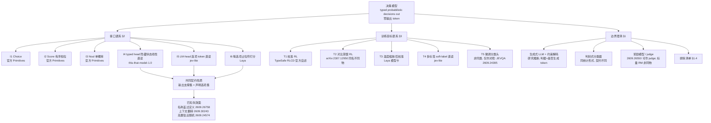

# Decision Models 分类学：边界、接口谱系与训练目标谱系

> ⚠️ **信息来源声明**：本子文档由 AI Agent 基于公开论文、官方文档与第三方模型卡整理生成，**属"领域研究"第一批（结构层）**，不含 `papers/` 逐篇深读与 `open-implementations.md` 实现清单（待第二批门禁通过后开工）。TypeSafe 未发布正式技术论文，官方材料属"一手但自述"；第三方预印本未经同行评审。所有引用均于 2026-10-16 实测可达。
>
> **调研日期**：2026-10-16
> **覆盖范围**：截至 2026-10-16 的公开材料；通用校准/分类文献为经典工作
> **调研口径**：本文件是 [report.md](report.md) 的**子文档**，回答"这一模型类别的边界与谱系"；**不做排行榜**，任何对照必须带条件列
> **条目路径**：`LLM-Research/TechnicalTopics/DecisionModels-research/taxonomy.md`
> **子文档导航**：[taxonomy.md](taxonomy.md)（边界/接口/训练目标）· [calibration.md](calibration.md)（校准证据链）· [experiments.md](experiments.md)（可执行实验协议）
>
> **证据等级标签（沿用 [report.md §1.2](report.md) 的单一主等级，混合取最弱）**：`精读原文`（已抓取并阅读正文）/ `摘要级`（只读题录/摘要）/ `二手`（他人转述，本人未核一手）/ `受限核验`（目标不可达或按规则不核验）。括号内注明**来源类型**（官方文档 / 预印本 / 模型卡 / 媒体分析 / 索引仓库）。**不可确证的一律写入 §5「未确证/待跟踪」，不进正文。**

---

## 〇、本文件的四条硬约束

1. **单一主等级、混合取最弱**：一行结论若同时依赖官方文档与模型卡，标 `二手`。
2. **不做跨论文排行榜**：本文件只做**类别判定**与**谱系定位**；凡出现数值对照，必带「对照模型 / 缓存 / 工作负载 / 任务」四要素中适用的条件列。
3. **代码引用纪律**：本文件**不引用任何源码**（未克隆任何第三方仓库，见 [report.md §6.5](report.md)），因此**不存在代码事实**，全部实现类条目均为**研究推断**并逐条标注。
4. **边界先于谱系**：先讲清"什么不算决策模型"（§1），再讲接口（§2）与训练目标（§3）——否则谱系会把判别式分类器和 reward model 一起吞进来。

---

## 一、边界：决策模型 vs 生成式 LLM vs 判别式分类器 vs 奖励模型 / judge

### 1.1 四个概念的判据表

| 判据 | **决策模型**（本条目对象） | **生成式 LLM** | **判别式分类器** | **奖励模型 / judge** |
|---|---|---|---|---|
| 输出形状 | 对**请求时声明**的选项/档位的概率分布 | token 序列（自回归逐 token） | 固定标签空间的分布（训练时定死） | 标量分数（奖励）或偏好/评级文本 |
| 答案空间何时确定 | **请求时**（schema 驱动，新 schema 无需重训） | 生成时由解码决定 | **训练时**（类别数即输出维度） | 标量：无类别结构；judge：生成文本 |
| 是否生成 token | **否**（零输出 token） | 是 | 否 | RM 否；LLM-as-judge 是 |
| 概率的语义 | 「**这个选项是正确答案**」的概率 | token 似然（≠ 答案正确率） | 「样本属于该类」的判别分数 | 「这个回答比那个好」的相对量 |
| 校准是否为核心契约 | **是**（官方把"更高概率≈更可能正确"写进契约） | 否（一般不作承诺） | 否（一般不作承诺） | 部分（Bradley-Terry 类偏好模型隐含可比性） |
| 典型出处 | [TypeSafe System One 文档](https://docs.typesafe.ai/concepts/system-one)（精读原文·官方文档） | 任意自回归 LLM | 经典监督分类 | RM 见 RLHF 文献；judge 见 [2609.26550](https://arxiv.org/abs/2609.26550)（精读原文·预印本） |

> **判据来源说明**：「答案空间在请求时确定」「零输出 token」两条来自官方文档原文（`unstructured state in, typed probabilistic decisions out`；不生成文本）；「概率的语义 = 答案正确的概率」来自官方 confidence 文档（`confidence` 是把分布尖锐程度折叠成的 0–1 标量，且官方推荐三段门控）。**官方未公开架构建模细节**，因此"如何实现该契约"属 §2 的接口谱系，不由本节断言。

### 1.2 与判别式分类器的真实差别（这一条最容易被写错）

从统计形式看，决策模型**就是**一个条件分布估计器 `p(option | state, question)`；它与判别式分类器的差别**不是统计形式，而是契约与工作流**（**研究推断**，非任一来源的原文结论）：

| 差别维度 | 决策模型 | 判别式分类器 | 证据状态 |
|---|---|---|---|
| 标签空间 | 请求时声明（同一权重可服务任意 schema） | 训练时固定 | 官方文档（精读原文）·Laya/this-that-model 模型卡（二手）："选项在请求时定义、新 schema 无需重训" |
| 题目与状态的关系 | 一个 state 可挂**多道独立问题**，同一次前向求解 | 一个样本一个标签 | 官方 Primitives + `this-that-model` 模型卡（二手） |
| 输出支撑集 | **等于**声明选项集（"选项之外不可表示"） | 等于训练标签集 | `this-that-model` 模型卡（二手） |
| 失败模式 | 名称/定义冲突、上下文翻转、跨语言塌陷（见 §1.4） | 域外泛化、类别不平衡 | 见 [calibration.md §5](calibration.md) |

**结论（本文件综合判断）**：把决策模型归为"零样本、schema 驱动的判别式分类器"是**准确的**；把它当成"新架构"或"新范式"缺乏公开证据支撑——官方材料只给契约，没有架构论文（[report.md §4.2](report.md)，精读原文·官方文档）。

### 1.3 与奖励模型 / judge 的边界

决策模型**可以被当作 judge 使用**（判"这个回答是否满足准则"），此时它是**成对/成组偏好判定的分类器**，不是奖励模型：

- **支持**：JEV-as-a-Judge 用决策模型返回标签概率、用置信度决定接受或上抛推理型评判者，在常规偏好与证据事实性上与最强 LLM 评判者差距 ≤3 个百分点（摘要表述）（[2609.26550](https://arxiv.org/abs/2609.26550)，精读原文·预印本；其中"费用 0.36%"单条为 `摘要级`，正文查无，见 [report.md §1.2.1](report.md)）。
- **边界**：**需检查推导过程**的任务上差距拉大（同上）；且 judge 的**概率语义与 RM 的标量语义不可互换**——前者是"标签正确率"，后者是"相对优劣"，两者之间没有可比的校准定义（**研究推断**）。
- **反例方向**：Laya 模型卡自陈其 `action.act_probability` 读作 1.0、对正确性 **AUROC 0.30**（低于随机），而同卡 `confidence` 在同一 396 条上 AUROC 0.77（[Laya 模型卡](https://huggingface.co/convaiinnovations/laya)，二手·模型卡）。**同一系统内部，多个"分数"的可用性可以完全不同**——引用任何"决策模型的分数"时必须写明是哪个字段。

### 1.4 什么**不算**决策模型（排除清单）

| 被排除者 | 排除理由 | 证据 |
|---|---|---|
| **生成式 LLM + 语法约束解码**（如 JSON schema / 正则约束） | 仍逐 token 生成，仍存在解码循环、token 预算与解析层；答案空间由语法而非模型概率分布承载 | **研究推断**（无单一来源；本文件据"是否生成 token"判据给出） |
| **生成式 LLM + 输出选项字母**（prompt 里要求"只回答 A/B/C"） | 概率来自 token 似然而非"答案正确率"，且**字母解析失败**与**选项位置偏置**是已知风险 | `jev-lite` 模型卡明确对比：其读法是 logits-at-option-letters，故"不可能回答选项之外"（二手·模型卡）；选项名/位置效应见 [2609.26758](https://arxiv.org/abs/2609.26758)（精读原文·预印本） |
| **经典微调分类头**（在同一状态编码器上加 linear head 训标注数据） | **不满足**"schema 请求时声明"这一条：模型与该标签空间绑定，新增类需重训 | JEVQA 的正当对照是"同特征监督训练模型"（[2609.24395](https://arxiv.org/abs/2609.24395)，精读原文·预印本）——**它是对照，不是同类** |
| **纯 reward model** | 输出标量，无"选项集"结构，无法承载 Choice/Noul 契约 | 见 §1.3 |
| **embedding + 最近邻检索** | 不返回"答案正确率"意义上的概率分布 | **研究推断** |

> **一条重要的建设性读法**：上述被排除者**都可以是决策模型的对照基线**，也常常是生产系统里更划算的选择。本条的排除是**分类学**意义上的，不是能力评价——JEVQA 恰恰说明"同特征监督训练模型仍领先"（[2609.24395](https://arxiv.org/abs/2609.24395)，精读原文·预印本）。

### 1.5 边界的一条时间线注记（避免把旧结论当新事实）

本条目观察对象**以 2026-09-15 起的公开材料为主**（[report.md §1.1](report.md)）。2023–2024 年同名字面（RLCD）与经典校准文献（Guo et al. 2017 等，见 [calibration.md §1](calibration.md)）在此**只作为方法论参照**，**不得**据以推断 2026 年系统的内部机制。

---

## 二、接口谱系：Choice / Score / Noul / typed head / 隐藏状态线性直读

### 2.1 三个官方原语（接口层）

| 原语 | 回答什么 | 返回字段 | 语义定位 | 证据 |
|---|---|---|---|---|
| **Choice** | 在已声明选项中选哪一个 | `choice`、`probabilities`（全选项分布）、`confidence` | `switch`/`match` 分支 | 精读原文·官方文档 |
| **Score** | 处在哪个档位 | `score`（可落两档之间）、`legend`、`probabilities`、`confidence` | 阈值比较 | 精读原文·官方文档 |
| **Noul** | 该判断是否为真 | `noul`（0–1 单概率） | `if` | 精读原文·官方文档 |

两条必须记住的接口事实（均见 [官方 Primitives 文档](https://docs.typesafe.ai/primitives)，精读原文·官方文档）：**Noul 没有独立 `confidence`**（概率本身即答案，需门控时用 `|2p−1|` 搬到 0–1 尺度）；**答案空间由请求方定义**，返回值不可能落在该空间之外。

### 2.2 读出（readout）谱系：五种可核验的接口形态

> **纪律说明**：本节全部为**第三方实现的自述**（模型卡），**未读取任何源码**，故全部条目标 `二手`；凡涉及"为什么这样设计"的解释均为**研究推断**。

| # | 形态 | 机制自述 | 可核验出处 | 与契约的关系 |
|---|---|---|---|---|
| **I1** | **Choice 接口**（选项集 + 全分布） | 在声明选项上返回完整分布 + `confidence` | 官方 Primitives（精读原文·官方文档）；`jev-lite` 三类原语表（二手·模型卡） | 定义了"答案空间 = 选项集" |
| **I2** | **Score 接口**（有序档位） | 返回档位（可落两档之间）+ `legend` + 分布 | 同上 | 引入**序**信息，允许"档位之间"这一答案 |
| **I3** | **Noul 接口**（单命题概率） | 0–1 单概率，无独立 confidence | 同上（官方）+ `this-that-model` `answer.confidence` 示例（二手·模型卡） | 最小接口：一次伯努利参数估计 |
| **I4** | **typed head：隐藏状态线性直读** | 答案从指定位置的隐藏状态读出，对**声明的标签 token** 打分并在这批标签上归一化：`p_k(j|x) = softmax_j(⟨w_ℓ(k,j), h_k⟩ / τ)`；"支撑集就是你的选项表，选项之外**不可表示**而非概率低"；≤255 选项 | [`this-that-model-1.0` 模型卡](https://huggingface.co/flock-io/this-that-model-1.0)（二手·模型卡） | 唯一给出**显式打分公式**的形态；公式本身是模型卡自报 |
| **I5** | **LM-head / 选项 token 直读** | 答案从选项字母位置的 logits 读出：`softmax(logits[letters[:n]])`；"没有解析、没有重试循环" | [`jev-lite` 模型卡](https://huggingface.co/vagmi/jev-lite)（二手·模型卡） | 复用生成模型的 LM head，**零新增参数**路径 |
| **I6** | **每选项占位符打分**（`[MASK]` 型） | 每个选项在自己的 `[MASK]` token 处打分，再在该题选项上 softmax；答案空间请求时定义、新 schema 无需重训 | [Laya 模型卡](https://huggingface.co/convaiinnovations/laya)（二手·模型卡） | 与 I4 同类，但以**占位符 token** 而非线性头承载选项 |

**谱系判读（研究推断）**：I4/I5/I6 是**同一契约的三种异构实现**——差异在"用什么承载选项的表示"，共同点是**归一化只在声明的选项集上做**，这正是"类型错误不可能"的机制来源。**这一机制解释是研究推断，官方从未公开其 readout 形式**（[report.md §9.2 U1](report.md)，未确证）。

### 2.3 接口形态的代价与已知失效（必须与形态绑定陈述）

| 接口 | 已知代价/失效 | 出处与等级 |
|---|---|---|
| I2 Score | 有序档位是**最弱原语**：Laya 自陈 SST-5 仅 **0.372** | 二手·模型卡 |
| I2/I6 高基数选项 | 选项共享固定 head token 预算，77 选项时每标签仅 ~3–4 token，Laya **0.425**；官方声明 Jev 支持 ≤255 选项 | 二手·模型卡（两家自述，**不同任务、不同标签数，不可并表**） |
| I3 Noul | 可能**跟随选项标签而非 state**：Laya 的 `false:`/`true:` 渲染在明显正面输入上给出自信的 "no"（其 issue #156） | 二手·模型卡（自报 issue） |
| I4 typed head | 匹配 typed-head 对照在 Visual Jev 中**无一致准确率优势** | 精读原文·预印本（[2609.25845](https://arxiv.org/abs/2609.25845)） |
| 任意接口 + "分数字段" | 同一系统内不同字段可用性差异极大（`act_probability` AUROC 0.30 vs `confidence` 0.77，n=396） | 二手·模型卡 |
| I1/I3 名称-定义冲突 | 选项**名称**的语义极性可盖过定义，表现为反转而非混淆 | 精读原文·预印本（[2609.26758](https://arxiv.org/abs/2609.26758)） |

> **对照表条件列纪律**：上表任何"谁更高"的数值都**只在原论文/模型卡自身条件下成立**（不同题目集、不同标签数、不同是否微调）。本文件**不给跨来源排名**。

---

## 三、训练目标谱系

### 3.1 谱系全图

| # | 目标族 | 优化什么 | 需要什么数据 | 与校准的关系 | 出处与等级 |
|---|---|---|---|---|---|
| **T1** | **校准 RL**（RLCD = Reinforcement Learning for **Calibrated Decisions**） | 策略输出的分布本身；奖励为**严格 proper scoring rule** | 未公开（官方未说明标注来源） | **直接**：诚实报告概率是唯一最大化期望奖励的方式 | 官方 primer（精读原文·官方文档）+ Laya 模型卡（二手·模型卡，**第三方自主解释**） |
| **T2** | **对比蒸馏 RL**（RLCD = Reinforcement Learning from **Contrastive Distillation**，**同名不同物**） | 对齐自然语言表述的原则（无害/有用/故事大纲） | **正/负两种 prompt** 各自采样 → 构造偏好对 → 训偏好模型 → RL | 无校准目标 | [arXiv:2307.12950](https://arxiv.org/abs/2307.12950)（`摘要级·题录/摘要`；ICLR 2024） |
| **T3** | **温度缩放 / 后校准** | 只改分布的**陡峭度**（一个/一组温度），不改 argmax 排序 | **带标签的验证集** | 事后把 ECE 拉低；不提升准确率 | Laya 模型卡（二手·模型卡）；方法学参照见 [calibration.md §1](calibration.md) |
| **T4** | **多标签直读 / soft-label 交叉熵** | 在选项字母上做**软标签**交叉熵，直接学习教师分布 | 教师软分布（须开"反序平均"去位置偏置） | 间接：软标签本身携带不确定性 | `jev-lite` 模型卡（二手·模型卡） |
| **T5** | **微调分类头** | 在固定标签空间上监督训练 | 该任务标注数据 | 无（一般不作校准承诺）；**不满足 schema 请求时声明** | 见 §1.4 |

### 3.2 三个"RLCD"必须逐文消歧（本专题最易写错处）

| | **T1** TypeSafe 的 RLCD | **T2** 2023 论文的 RLCD | **T1′** Laya 的 RLCD |
|---|---|---|---|
| 全称 | Reinforcement Learning for **Calibrated Decisions** | Reinforcement Learning from **Contrastive Distillation** | Reinforcement Learning for **Calibrated Decisions** |
| 出处 | 官方 AI primer（2026） | [arXiv:2307.12950](https://arxiv.org/abs/2307.12950)，ICLR 2024 | Laya 模型卡（2026） |
| 公开的机制 | **未公开**（只给目标与契约） | 正/负 prompt → 对比输出 → 偏好对 → 偏好模型 → RL；**不用人类反馈** | 分布上 RL；探索在 logits 加零均值高斯噪声；奖励为严格 proper scoring rule（log + spherical，有序题加 ranked probability score）；REINFORCE + group-mean baseline（GRPO 风格） |
| 是否生成文本 | 否 | **是**（对齐生成模型输出分布） | 否 |
| 与校准的关系 | 直接（目标即校准决策） | 无 | 直接（proper scoring rule） |
| 证据等级 | 精读原文·官方文档 | `摘要级·题录/摘要` | 二手·模型卡 |

> **不可混淆的三条**：① 把 T2 当作"Jev 的训练配方出处"是**事实错误**（该论文既无决策模型、也无概率校准目标、更不涉及类型化输出）；② 写"RLCD 用 proper scoring rule 做奖励"时**必须注明来源是 Laya 而非 TypeSafe**；③ 官方**未披露**其 RLCD 的算法细节、标注来源、样本量与语言分布（[report.md §3.4](report.md)），故 T1 一律记为**厂商自述（一手但自述）**。

### 3.3 训练目标与接口的耦合（研究推断）

| 组合 | 是否见过公开材料 | 说明 |
|---|---|---|
| T1/I4（校准 RL + 线性 typed head） | **未见官方确认** | 官方未公开 readout，故 T1 与具体接口的绑定属推断 |
| T1′/I6（校准 RL + 占位符打分） | 见 Laya 自述 | 第三方自主设计的完整组合 |
| T4/I5（soft-label 交叉熵 + LM head 直读） | 见 `jev-lite` 自述 | 教师软标签来自 Qwen3.6-35B-A3B，反序平均去位置偏置 |
| T3/I1–I6（任意接口 + 后校准） | 普遍可行 | 温度缩放只作用于分布陡峭度，**与接口形态解耦** |

**一条工程含义**：T3 是**唯一与接口形态完全解耦**的校准手段，因此在不知道实现细节时它是**唯一可自行施加**的校准步骤（**研究推断**）。其代价与所需标注量见 [calibration.md §6](calibration.md)。

---

## 四、Mermaid 分类图（节点均可对到具体论文/实现）

**图例与证据等级（每个节点一行）**

| 节点 | 对应出处 | 证据等级 |
|---|---|---|
| A 决策模型 | [TypeSafe System One](https://docs.typesafe.ai/concepts/system-one) | 精读原文·官方文档 |
| B1 Choice / B2 Score / B3 Noul | [TypeSafe Primitives](https://docs.typesafe.ai/primitives) | 精读原文·官方文档 |
| B4 typed head | [`this-that-model-1.0` 模型卡](https://huggingface.co/flock-io/this-that-model-1.0) | 二手·模型卡 |
| B5 LM-head 直读 | [`jev-lite` 模型卡](https://huggingface.co/vagmi/jev-lite) | 二手·模型卡 |
| B6 占位符打分 | [Laya 模型卡](https://huggingface.co/convaiinnovations/laya) | 二手·模型卡 |
| C1 校准 RL | [TypeSafe AI primer](https://docs.typesafe.ai/introduction/machine-learning-primer) | 精读原文·官方文档（**厂商自述**） |
| C2 对比蒸馏 RL | [arXiv:2307.12950](https://arxiv.org/abs/2307.12950) | `摘要级·题录/摘要` |
| C3 温度缩放 | Laya 模型卡（ECE 0.466→0.081 自陈） | 二手·模型卡 |
| C4 soft-label 直读 | `jev-lite` 模型卡（objective = soft-label CE） | 二手·模型卡 |
| C5 微调分类头（对照） | [arXiv:2609.24395](https://arxiv.org/abs/2609.24395) | 精读原文·预印本 |
| D1 生成式 + 约束解码 | 无单一来源 | **研究推断** |
| D2 判别式分类器 | 见 §1.2 | **研究推断**（统计形式判断） |
| D3 judge | [arXiv:2609.26550](https://arxiv.org/abs/2609.26550) | 精读原文·预印本 |
| E 支撑集 = 选项集 | 官方契约 + I4/I5/I6 三种实现自述 | 混合取最弱：**二手** |
| F 失效面 | [2609.26758](https://arxiv.org/abs/2609.26758) / [2609.30243](https://arxiv.org/abs/2609.30243) / [2609.24574](https://arxiv.org/abs/2609.24574) | 精读原文·预印本 |

---

## 五、未确证 / 待跟踪（不进正文）

| # | 事项 | 状态 |
|---|---|---|
| TX1 | "决策模型是双向编码器 + 并行标签头" / "TypeSafe fork 过 LLaDA" | **推测**，官方无架构披露；沿用 [report.md §9.2 U1/U2](report.md) |
| TX2 | 官方 I4/I5/I6 中**哪一种**是 TypeSafe 的实际 readout | **未知**。第三方论文提到"从 LM head 读候选概率"（[2609.25845](https://arxiv.org/abs/2609.25845)，精读原文·预印本），但那是**对 Visual Jev（第三方实现）**的描述，非 TypeSafe 披露 |
| TX3 | Tz 谱系中"决策模型是否接受多轮对话条件化" | Laya 卡提到多轮用 `TD(λ=1.0)` over prefix slices（二手·模型卡）；官方未述。**不作为类别判据** |
| TX4 | `confidence` 与 `probabilities` 之外，是否存在**跨问题一致性**约束 | 有旁证论文质疑概率公理自洽性（[2609.33209](https://arxiv.org/abs/2609.33209)，`摘要级·预印本`），本文件不据此下结论 |
| TX5 | T5 类（微调分类头）是否被官方/第三方纳入"决策模型"口径 | **口径未统一**。本文件按契约判据将其排除（§1.4），并记为**本文件的判定**而非行业共识 |

> 上述事项若后续被独立确证，应升级进正文并更新本表；**在此之前不得作为任何结论的依据**。

---

## 六、参考来源（均于 2026-10-16 实测可达）

### 一手但自述（官方文档）

- [TypeSafe — System One 概念](https://docs.typesafe.ai/concepts/system-one)
- [TypeSafe — Primitives（Choice / Score / Noul）](https://docs.typesafe.ai/primitives)
- [TypeSafe — Confidence](https://docs.typesafe.ai/confidence)
- [TypeSafe — AI primer（RLHF / RLVR / RLCD）](https://docs.typesafe.ai/introduction/machine-learning-primer)
- [TypeSafe — Models（版本、价格、上下文、别名）](https://docs.typesafe.ai/models)

### 同名 RLCD 消歧（必引）

- [arXiv:2307.12950 — RLCD: Reinforcement Learning from Contrastive Distillation](https://arxiv.org/abs/2307.12950)（`摘要级·题录/摘要`）

### 第三方预印本

- [arXiv:2609.25845 — Visual Jev：共享视觉上下文下的决策模型](https://arxiv.org/abs/2609.25845)
- [arXiv:2609.26758 — 选项名 vs 定义：类型安全不等于无错](https://arxiv.org/abs/2609.26758)
- [arXiv:2609.30243 — JevOut：自然上下文可翻转决策](https://arxiv.org/abs/2609.30243)
- [arXiv:2609.24574 — CSS 文本标注中的决策模型评估](https://arxiv.org/abs/2609.24574)
- [arXiv:2609.26550 — JEV-as-a-Judge](https://arxiv.org/abs/2609.26550)
- [arXiv:2609.24395 — JEVQA：视频质量预测](https://arxiv.org/abs/2609.24395)
- [arXiv:2609.33209 — Beyond Calibration（概率公理自洽性）](https://arxiv.org/abs/2609.33209)（`摘要级`）

### 开源实现材料（只读主页/模型卡，**未读源码、未克隆**）

- [convaiinnovations/laya — 模型卡](https://huggingface.co/convaiinnovations/laya)
- [flock-io/this-that-model-1.0 — 模型卡](https://huggingface.co/flock-io/this-that-model-1.0)
- [vagmi/jev-lite — 模型卡](https://huggingface.co/vagmi/jev-lite)
