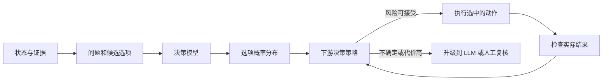
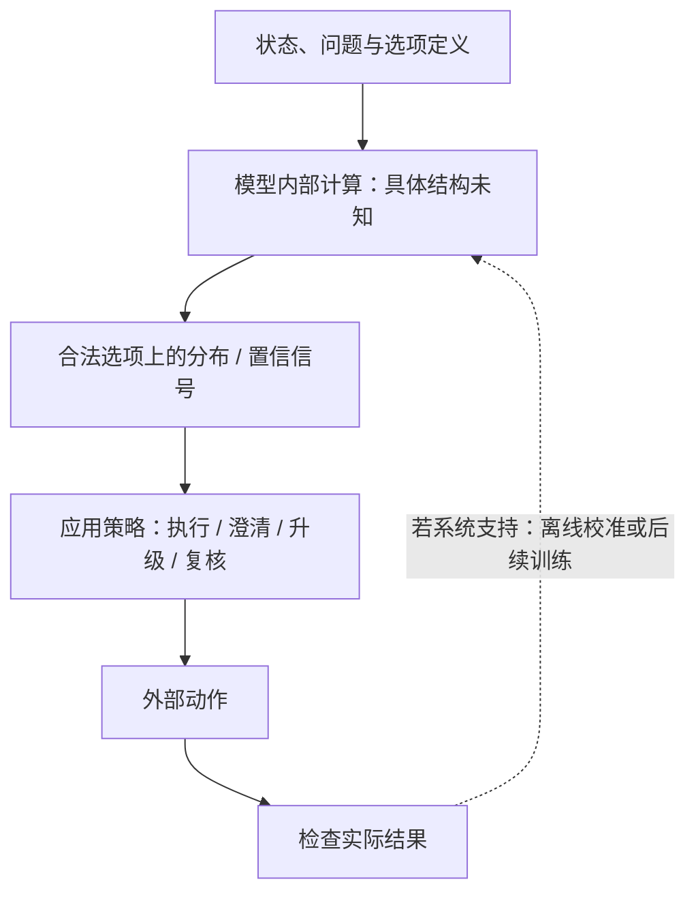
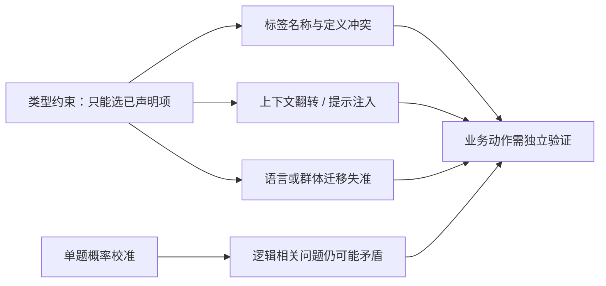

# 决策模型综述：把概率判断变成可行动的选择

> **核心问题**：当模型面对几个明确选项时，能否直接给出选项概率，让系统根据错误代价决定自动执行、继续思考还是交给人？“输出只能落在合法选项里”解决的是格式问题，却不自动保证判断正确、概率可信或流程安全。

本专题以 TypeSafe 的 JEV / System One 作为公开材料较多的主线案例，结合 typed decision model 研究、校准与鲁棒性论文、Agent 集成工作和开源复刻。需要先分清证据层级：TypeSafe 官方文档描述了接口契约和方法主张，但截至本文所引材料，没有公开足以确认 JEV 内部网络结构与训练配方的技术报告；论文和模型卡中的实现不能反推其专有架构。

## 1. 从一个分诊例子理解问题

客服系统收到一条消息，需要把它分到“退款”“换货”或“人工处理”。生成式语言模型可以写出一段解释，随后由程序解析类别；普通分类器可以直接预测类别，但通常针对训练时固定的标签集合；决策模型希望做另一种接口：请求方给出当前问题和候选选项，模型返回这些候选上的概率分布。

这张图里**模型输出**和**业务动作**是两件事。模型估计“每个选项有多可能是正确答案”；系统再结合错判代价、复核成本和权限要求决定是否自动执行。即使模型给出 `[退款 0.72, 换货 0.20, 人工处理 0.08]`，如果退款错误代价很高，合适动作仍可能是复核，而不是选最大概率直接执行。

给定状态 $x$、问题 $q$、结果类别 $y$、候选动作 $a$ 和损失函数 $L(a,y)$，一个简单策略是选择期望损失最小的动作：

$$
a^*(x)=\arg\min_a \sum_y L(a,y)\,p(y\mid x,q,\mathcal A).
$$

这里 $\mathcal A$ 是请求方声明的选项集合。如果把“暂不判断、升级复核”也作为动作，它就有自己的成本。概率只有在目标分布上足够校准时，才能可靠支持这种风险策略；一个尖锐的分布不等于一个正确的分布。

## 2. “决策模型”是什么，又不是什么？

当前研究中的 typed decision model 通常把自然语言状态和问题映射到一个有限选项空间，直接返回选项概率，而不先生成一段答案再解析。TypeSafe 把这种接口称为 **System One**，强调快速、聚焦的判断；这属于厂商的系统定位，不等于认知科学意义上的 System 1 已在模型内部得到验证。

| 系统形式 | 输出是什么 | 选项集合何时确定 | 常见优势与边界 |
|---|---|---|---|
| 生成式 LLM | token 序列，可能包含理由、标签和解释 | 生成时形成 | 擅长开放式推理与证据整合；token 似然不是答案正确率 |
| JSON / 语法约束生成 | 符合 schema 的 token 序列 | 由提示或解码约束 | 能降低格式错误；仍在生成文本，合法结构不代表判断正确 |
| 固定标签分类器 | 固定类别上的分数或概率 | 通常在训练时确定 | 单任务上可高效；新增标签往往需要重训或改输出头 |
| 奖励模型 / judge | 标量奖励、偏好分或评判文本 | 由训练目标或 judge 提示决定 | 能比较候选答案；偏好分不等同“该标签正确的概率” |
| 类型化决策接口 | 在请求方声明的有限选项上返回分布、档位或命题概率 | 请求时声明是 JEV 官方接口主张 | 适合有界分类和风险路由；类型约束不保证语义正确、校准或抗攻击 |

在数学形式上，类型化决策仍可写成条件分布 $p(y\mid x,q,\mathcal A)$。与常见固定标签分类器相比，关键差别通常不在“有没有 softmax”，而在于**选项空间能否在调用时声明、概率以什么语义解释、下游如何消费它**。把 JEV 简称为“schema 驱动的分类接口”有助于建立直觉；仅凭接口就宣布它是全新神经网络架构，则超过公开证据。

### 官方接口的三个原语

TypeSafe 文档公开三种基本问题形态：[System One](https://docs.typesafe.ai/concepts/system-one) · [Primitives](https://docs.typesafe.ai/primitives)

| 原语 | 读者提出的问题 | 返回结构 | 用法直觉 |
|---|---|---|---|
| **Choice** | 在候选项中哪个成立？ | 选项标识、选项分布及 confidence 字段 | 有限类别的路由或标签判断 |
| **Score** | 处于哪个等级？ | 有序档位、档位说明及概率信息 | 有序评级，例如风险等级 |
| **Noul** | 某个命题是否成立？ | 一个 0–1 概率 | 二元门控或事实判断 |

官方所说的“类型安全”指返回值受限于请求中声明的选项或档位：系统不会产生选项集之外的第三个值。它保证的是**答案空间结构正确**，不代表答案选对。`Noul` 的单一概率本身就是其答案，不应未经定义就将其与 Choice 的最大选项概率或产品返回的 `confidence` 字段混为一谈。[Confidence 文档](https://docs.typesafe.ai/confidence)

## 3. 接口背后的机制：什么已公开，什么仍未知？

以下只画**接口层概念数据流**，不是 JEV 的网络结构图；官方没有披露其内部表示、读出头或在线学习路径。

公开材料可以确认输入输出契约；中间的状态编码、读出方式、损失函数和训练数据要按具体论文或实现判断。若把某个开源模型卡中的结构直接说成 JEV 的内部实现，就越过了证据边界。

开源实现自述展示了几种可能的 readout（从模型内部读出答案分数的方式）：

| 实现样式 | 公开例子 | 机制直觉 | 证据边界 |
|---|---|---|---|
| 隐藏状态直读的专用打分头 | [this-that-model](papers/2609.23886-this-that-model.md) | 从指定隐藏状态对本次候选标签打分，再在候选内归一化 | 模型卡与论文描述其自有模型，不能反推 JEV 结构 |
| 复用 LM head 的选项 token | [jev-lite](open-implementations.md) 及部分 Kev 实现 | 读取候选字母 token 的 logits，只对合法候选做 softmax | tokenizer、选项字母和 prompt 格式可能引入词面或位置偏差 |
| 每个选项位置分别打分 | Laya 模型卡所述实现 | 在各候选对应的占位表示处打分，再归一化 | 属于该模型卡自述，不是类型化决策模型的统一实现 |

这些路线说明“类型化输出”不是唯一内部实现。即便两个系统都只返回请求中声明的选项，它们仍可能在状态编码、选项词面、概率校准和训练目标上差异很大。开源实现可帮助提出可检验的机制假设，但若只读了模型卡，就不能写成源码事实；实现和许可证细节见[开源实现分册](open-implementations.md)。

## 4. 概率何时能支撑决策？

**准确率**回答“选对了多少”；**区分能力**回答“正确样本的分数是否通常高于错误样本”；**校准**回答“系统报约 0.8 的那批判断，长期是否约有 80% 正确”。这三者不能互相替代。

设一批预测都被赋予约 0.8 的正确概率。若长期正确率也约为 0.8，这一范围才称校准良好。它不意味着某一个 0.8 判断有可直接观察的 80% 正确性，也不保证换到新语言、新人群或新任务仍成立。

| 指标 | 主要测什么 | 阅读限制 |
|---|---|---|
| ECE / reliability diagram | 置信分箱与经验正确率的差距 | 依赖分箱、样本量和分布；总体 ECE 可能掩盖子群失准 |
| Brier score | 概率向量与真实类别之间的平方误差 | 同时受校准、分辨率和类别分布影响 |
| Negative log-likelihood | 给真实类别分配的概率是否过低 | 对极端低概率预测较敏感 |
| AUROC | 错误样本能否被低置信度排在前面 | 衡量排序，不代表概率数值可直接解释 |
| Coverage / risk | 自动处理覆盖率与该覆盖部分的风险 | 必须与升级比例、复核成本、被拒样本一起看 |

### 训练时校准与事后校准

**训练时校准**把概率质量放进训练目标。TypeSafe 官方把其训练方向称为 **RLCD（Reinforcement Learning for Calibrated Decisions）**，并表示使用 proper scoring rule；这意味着在该目标下，如实报告概率会优化期望分数。但官方未公开完整算法、奖励实现与训练数据，因此应称为厂商对训练目标的描述，而不是可复现配方。[TypeSafe AI primer](https://docs.typesafe.ai/introduction/machine-learning-primer)

同名缩写必须消歧：2023 年论文中的 RLCD 是 **Reinforcement Learning from Contrastive Distillation**，研究语言模型对齐，与 TypeSafe 所称的 calibrated decisions 不是同一方法。[Yang et al., arXiv:2307.12950](https://arxiv.org/abs/2307.12950) Laya 等开源复刻也给出自己的 RLCD 训练解释，这属于各自实现的自述，不能反向证明 JEV 的训练机制。

**事后校准**则在有标签的留出集上调整概率分布，例如 temperature scaling。对所有 logits 使用同一个正温度，通常改变分布的尖锐度而不改变 argmax 类别；因此它可以改善概率误差，却不会单独修复标签语义冲突、错误排序或分布外失效。温度应在校准集上拟合，并在独立测试集上检查跨域迁移。[校准分册](calibration.md)

**confidence 不是通用字段。** 系统可能用最大类别概率、熵、专用置信度头，或单独的校准字段。JEV-as-a-Judge 明确区分 native `confidence` 与最大选项概率；开源模型卡也报告某些概率字段在同一任务上的错误排序。因此，设计门控时要写清读取哪个字段、如何验证，以及适用于哪个任务和模型版本。[JEV-as-a-Judge, v5, §4](https://arxiv.org/html/2609.26550v5)

## 5. 研究路线：从单次判断到可校准的系统决策

这组研究不是一条产品架构升级史，而是围绕若干彼此独立的问题展开。一个问题上的结果不能替另一个问题背书。

| 问题线 | 代表工作 | 它检验或改变什么 | 证据支持到哪里 |
|---|---|---|---|
| **基准比较：准确率是否够用？** | CSS 文本标注横评、Visual Jev | 把 typed decisions 放进社会科学标注和共享视觉上下文，比较任务表现与概率接口 | CSS 横评在 18 个任务、7,977 个样本上报告：决策模型在 15 个可比任务中有 14 个低于 per-task 最佳 LLM，中位 macro-F1 差 11.6 个百分点；其置信度校准又优于多数被比 LLM。说明准确率和校准必须分开看，不支持单一“胜负”结论。[CSS, v2, §§3–4.1、Table 2](https://arxiv.org/html/2609.24574v2) |
| **校准：置信度能否支持升级？** | 事故叙述校准、JEV-as-a-Judge、REFLEX | 用置信度或概率分布决定接受快速判断、转交更强模型或复核 | 证明的是指定数据、阈值和评估流程下的风险—覆盖折中；不能把一个产品阈值搬到新任务。[事故叙述分册](papers/2609.24052-crash-narrative-calibration.md) · [JEV-as-a-Judge](papers/2609.26550-jev-as-a-judge.md) · [REFLEX](papers/2609.26532-reflex-selective-control.md) |
| **语义鲁棒性：输入怎样改变所选项？** | Option Name vs Definition、Decision Hijacking、JevOut | 改变选项名称、注入指令或加入自然背景，观察定义、概率和动作选择 | 有限输出仍可能被词面和上下文操纵；格式正确不代表语义遵循。[Option Name vs Definition, v3, §§2–4](https://arxiv.org/html/2609.26758v3) · [Decision Hijacking, §§3–5](https://arxiv.org/html/2609.28613v1) · [JevOut, v2, §§3–4](https://arxiv.org/html/2609.30243v2) |
| **概率结构：多个判断能否彼此一致？** | Probability Axioms | 比较命题、否定、析取等逻辑关系下的概率 | 单题校准不要求多个相关问题之间同时自洽。[Probability Axioms, §§3–6](https://arxiv.org/html/2609.33209v1) |
| **系统集成：怎样把判断放进 Agent？** | System Switch、Jev-Mem、Visual Jev | 让快速决策模型承担每步控制、记忆动作选择或共享视觉问题处理；不确定时调用慢模型 | 这些是不同任务与系统设计，评估对象不相同，不能把结果合成统一收益。[System Switch, §§3–6](https://arxiv.org/html/2610.09683v1) · [Jev-Mem](papers/2609.23986-jev-mem.md) · [Visual Jev](papers/2609.25845-visual-jev.md) |

### 5.1 基准比较：结构化概率是否弥补能力差距？

CSS 横评把 18 个 computational social science 文本标注任务（共 7,977 个样本）放进同一 zero-shot 协议，比较决策模型、19 个 LLM 基线和小型模型。作者报告，在 15 个纳入主比较的任务中，Jev 在 14 个任务上低于该任务表现最好的 LLM，中位 macro-F1 差 11.6 个百分点。这个“per-task best LLM”是在同一个测试项上从候选 LLM 中选出的 oracle comparator，比较条件偏向 LLM 一侧；因此结果支持“决策模型并非普遍替代强 LLM”，而不是证明任何具体部署里的 LLM 都更好。[CSS, v2, §§3–4.1、Table 2](https://arxiv.org/html/2609.24574v2)

同一研究对置信度给出另一种图景：按论文的分箱和汇总口径，Jev 的 confidence 校准误差低于 19 个 LLM 中的 16 个；但仍有三个前沿模型的中位 ECE 更低（Jev 0.157，对照中最低 0.066）。论文还发现同伴支持/共情任务上，决策模型可出现高置信度近随机表现；附录显示类似失效也出现在生成式模型中，并非决策模型独有的“坏签名”。所以较稳妥的总结是：**结构化概率让校准成为可观察接口，但不自动带来更高准确率；具体效用取决于任务族和对照。**[CSS, v2, §§4.1–4.4、Appendix B](https://arxiv.org/html/2609.24574v2)

事故叙述编码研究提供了另一类证据：决策模型把非结构化叙述转换为结构化事故变量，研究者可以同时观察标签准确率、漏报、校准和人工复核需求。它的意义不在于证明“所有文本编码都更便宜”，而是说明当下游变量和错误类型可明确枚举时，类型化输出便于形成可审计的数据处理流程。[事故叙述校准, §§2–5](papers/2609.24052-crash-narrative-calibration.md)

### 5.2 校准如何变成升级策略？

JEV-as-a-Judge 把模型置信度放进“先快判、低把握再升级到推理 judge”的级联。其方法价值之一是先用 96 个 pilot selection pairs 冻结双序阈值，再在 1,610 个 held-out pairs 上报告；这样避免看过测试结果后反复调阈值。全量级联的上抛率为 31.5%，聚合结果与指定 GPT-6 Astra 比较者接近，但子集差异明显：RewardBench 子集略有优势，JudgeBench 子集的点估计略低且区间跨零。新旧样本混合比例变化也改变聚合结果。因此该研究支持“门控可在特定任务混合中形成折中”，不支持“一个阈值稳定胜过强 judge”。[JEV-as-a-Judge, v5, §§3–5、§8、Tables 1、3–4](https://arxiv.org/html/2609.26550v5)

REFLEX 与 System Switch 把同一想法放进 Agent 控制回路。REFLEX 在冻结的 100 项工具任务上用 JEV 承担有界决策，在低置信或需要生成时调用强 LLM；作者在 τ=0.5 设置下报告成功率 95%、平均每项 1.12 次强模型调用，对照 strong-only 为 88% 和 4.10 次。但换成不同 fallback 后收益并不一致；在 τ²-bench 的匹配实验中，作者还报告另一种便宜级联的成功率点估计更高，区间未能判定差异。专用决策层是否值得加入，取决于现有路由有多强、任务动作空间和 fallback 错误是否互补。[REFLEX, §§3–5](https://arxiv.org/html/2609.26532v1)

System Switch 将快决策层和慢视觉推理器放进实时 Doom 闭环。离线留出问题上，置信度门控比随机升级有效；作者报告在 held-out 局上选定 actor 与升级率后，离线增益为 +0.13（doomLaya 选项顺序）或 +0.08（打乱选项顺序）。但 33 局、三个 seed 的闭环试验中没有任何变体到达出口。失效不只是分类错误：推理器把普通门判断成锁门，而环境状态没有提供区分信息，错误计划继而改变后续行动。**离线 risk-coverage 改善不等于闭环任务成功**；门控也依赖状态表示、可观测反馈和恢复策略。[System Switch, v1, §§3–6](https://arxiv.org/html/2610.09683v1)

### 5.3 标签、自然上下文与恶意指令是不同的鲁棒性问题

**选项名称与定义冲突。** Option Name vs Definition 只改变候选名与定义的对应关系，展示“类型正确”与“遵循定义”的差别。论文在 1,200 个 task-specific decisions 上报告，带明显极性的 `yes/no` 名称相对 `0/1` 中性名称可使翻转率最多提高 70.4 个百分点；随机无语义字符串则接近中性对照。type-error rate 仍为 0：模型一直返回合法选项，却可能选中定义错误的一项。[Option Name vs Definition, v3, §§2–4、Appendix D](https://arxiv.org/html/2609.26758v3)

**恶意指令注入。** Decision Hijacking 从 InjecAgent 重建 510 个案例，观察到恶意文本会移动合法选项之间的概率，但在该实验中很少直接让 Jev 选中攻击目标；加入可访问分数的自适应优化后，攻击者能更强地提高目标概率，验证成功率也从 1.8% 升到 3.5%。这说明闭集接口并不自动消除注入，但概率变化、目标动作选择和真实环境副作用是三种不同指标。[Decision Hijacking, v1, §§3–5](https://arxiv.org/html/2609.28613v1)

**普通背景上下文重定向。** JevOut 不依赖显式“忽略前文”命令，而用概率反馈寻找自然语气的补充背景。论文在四种决策系统、七个数据集上报告：Jev 在 508 个初始答对决策中有 312 个（61.4%）可被目标上下文翻转；每个决策最多使用 64 次通过自然度与保答案检查的 targeted evaluations。这个比例是对初始正确题和接受后上下文的条件结果，不是现实流量中的自然错误率。[JevOut, v2, §§3–4、Appendix B–D](https://arxiv.org/html/2609.30243v2)

三项工作揭示的不是一个统一的“鲁棒性分数”：选项名测试词面先验；Decision Hijacking 测工具内容里的攻击指令；JevOut 测日常背景如何悄然改变状态解释。部署测试需要分别构造这几类扰动，并记录概率位移、最终动作和环境副作用。

### 5.4 校准之外，还要问概率是否彼此一致

Probability Axioms 将评估从“每道题的概率是否校准”推进到“逻辑相关的问题能否同时成立”。作者在 ChaosNLI 与 PubMedQA 的 160 个三分类项目上构造“是 X”“不是 X”“属于另外两项之一”等关联问法，无需人工标签也能检查一致性。论文报告，480 个否定问句对中，Jev 的 $p(X)$ 与 $p(\neg X)$ 平均偏离互补和 1 达 0.064；三项单标签概率平均和为 1.14。对使用多个概率做成本权衡、资源分配或决策合成的系统，即使每题边缘校准看起来不错，跨问题矛盾仍可能导致整体策略不一致。[Probability Axioms, v1, §§3–6](https://arxiv.org/html/2609.33209v1)

### 5.5 系统整合改变了什么？

Jev-Mem 把 typed decisions 放进 Agent 记忆的控制平面：决定存什么、是否建立关系、怎样分配检索预算以及何时停止；复杂推理与答案合成仍交给 System Two。它提出的是“有界控制决策与生成式推理分工”的系统架构主张。实验主要在 LoCoMo 单一 benchmark 上，效果由 LLM-as-a-Judge 评分，论文没有足够消融把结果归因于某个独立组件，因此主报告将其视为架构案例，而不是已证实的通用记忆方案。[Jev-Mem, §§1–5](papers/2609.23986-jev-mem.md)

Visual Jev 研究共享视觉上下文：同一张图编码一次，再批量处理多个问题后缀，从 backbone 的 LM head 读取候选概率。作者在 GQA 与 SNLI-VE 等训练任务上报告等权 macro accuracy 从 0.706 提升到 0.761；但 held-out 的 TextVQA / TallyQA 变化很小。N=32 的 warm-amortized 配置下批处理与 prefix 复用提升吞吐，N=1 时复用反而更慢。这说明“多问题共享一个 state”可改变计算路径，但批处理不等于统计独立，也不代表每个问题的概率不受顺序或数值精度影响。[Visual Jev, §§3–6](papers/2609.25845-visual-jev.md)

## 6. 失效边界：输出闭集，不代表判断闭世界

类型约束能阻止模型返回未声明的第三个标签；它无法保证选项定义清楚、证据充分或部署分布稳定。现有研究暴露了几类不同失效：

| 失效类型 | 机制 | 代表证据 | 对读者意味着什么 |
|---|---|---|---|
| 选项词语覆盖定义 | 标签名带有的语义极性压过题目给定 rubric | Option Name vs Definition 中，极性名称可引发选择反转；随机无语义字符串则接近中性对照 | 选项名称是模型输入的一部分，不是无害 ID |
| 自然上下文翻转判断 | 背景叙述改变状态解释或候选相关性 | JevOut 在初始正确的判断上加入自然文本后，报告目标选项翻转；部分翻转仍为高置信度 | 闭集输出仍会受普通语境操纵 |
| 指令注入位移概率 | 恶意内容改变合法选项之间的概率质量 | Decision Hijacking 区分概率位移与最终攻击成功；两种度量不是一回事 | 只看 argmax 可能漏掉已被操纵、但尚未越过决策阈值的样本 |
| 高置信度域外错误 | 训练域、语言或人群变化导致概率失准 | Laya 模型卡自报特定非拉丁脚本测试近零准确率、置信度仍高；这是模型卡证据，非独立复现 | 置信门控必须按部署子群验证 |
| 相关问题之间不自洽 | 单题概率分别看似合理，但违反互补、加和等关系 | Probability Axioms 检查否定、析取与多选之间的一致性 | 边缘校准与联合逻辑一致是两项性质 |

这张图区分五个层次：type safety 管输出结构；calibration 管概率与经验正确率的对应；robustness 管输入与分布变化；coherence 管相关概率能否同时成立；业务验收管实际动作是否达成目标。通过其中一层不能推出其他层也通过。

## 7. 将概率放进系统策略

决策模型更适合被视为一条**有明确升级条件的判断路径**，而非替代所有推理模型：

1. 为任务定义互斥且尽量完备的候选项；如果“信息不足”是有效结果，就把它显式放进选项。
2. 在与部署相近的任务、语言和用户群体上检查准确率、校准、子群误差和选项扰动。
3. 根据错误代价和人工复核成本设策略阈值，不直接搬用厂商默认阈值。
4. 对低置信、高影响、证据冲突或超出验证范围的输入，升级到生成式模型或人工处理。
5. 执行后核对真实状态。返回合法选项或置信度高，不等于任务已经完成。

| 观测结果 | 可采用的策略 | 仍需检查 |
|---|---|---|
| 该子群概率已验证、错判代价低 | 自动选最大期望效用动作 | 是否有选项定义歧义、数据分布漂移 |
| confidence 可靠地区分错误，复核成本可接受 | 按 coverage-risk 曲线确定升级阈值 | 阈值是否在独立留出集上冻结 |
| 置信度高但关键动作不可逆 | 增加独立证据检查或人工确认 | 模型置信不等于授权或事实真值 |
| 输入超出训练/测试覆盖或选项不完备 | 拒绝、澄清或交由推理模型生成候选 | 不要把闭集分布强行解释成开放世界判断 |

置信度门控只有在 confidence 字段能在对应任务、版本和子群上排序错误时才成立。AUROC 不差不代表阈值能迁移；总体 ECE 低也不代表每个群体都可靠。策略评估应报告覆盖率、错误率、升级比例和实际复核成本。[校准分册](calibration.md) 讨论概率证据；[实验协议](experiments.md) 提供可执行测试设计。

## 8. 综合判断与开放问题

当前证据支持的谨慎结论是：

- 类型化概率接口为有界分类、路由、审核和升级策略提供了比自由文本更直接的数据结构。
- 它不是已被证明普遍优于固定分类器或生成式 LLM 的新架构。对 JEV 的算法与模型细节，官方公开材料仍有限。
- 决策模型的潜在价值可能在可校准的低成本判断和系统路由；准确率、概率可靠性、任务覆盖与错误代价必须同时评估。
- 有限输出空间能消除“生成出不存在的类别”这一类格式错误，但无法阻止语义误判、提示注入、跨域失准或相关概率矛盾。

开放问题包括：概率是否能跨任务和损失矩阵迁移？请求时定义选项如何避免标签名称与次序偏差？多个问题共享一个状态时，批处理会不会改变概率？怎样抵抗语境优化和指令注入？决策模型作为 Agent 控制层时，如何把用户授权、可逆性和外部状态检查纳入决策策略？这些问题比单独比较延迟或每次 API 费用更接近该领域的研究核心。

## 9. 推荐阅读路线

### 建立概念和接口

1. 先看本报告 §1–§3，再读[类型学](taxonomy.md)中的“决策模型、生成式 LLM、固定分类器与 reward model”边界。
2. 对照 `this-that-model` 与 `jev-lite` 两篇精读，理解隐藏状态读出与 LM-head 读出的差别；再看[开源实现分册](open-implementations.md)，勿将开源实现归因于 JEV。

### 理解概率与失效

3. 读 [CSS 文本标注横评](papers/2609.24574-css-text-annotation.md) 和 [事故叙述校准](papers/2609.24052-crash-narrative-calibration.md)，区分准确率、校准和风险—覆盖。
4. 连读 [Option Name vs Definition](papers/2609.26758-option-name-vs-definition.md)、[Decision Hijacking](papers/2609.28613-decision-hijacking.md)、[JevOut](papers/2609.30243-jevout-natural-context-flip.md)，比较词面冲突、恶意指令和自然语境三种失效。
5. 再读[概率公理一致性](papers/2609.33209-probability-axioms-coherence.md)，理解单题校准与跨题逻辑一致的区别。

### 看系统怎么使用判断

6. 读 [JEV-as-a-Judge](papers/2609.26550-jev-as-a-judge.md)、[REFLEX](papers/2609.26532-reflex-selective-control.md) 与 [System Switch](papers/2610.09683-system-switch.md)，看置信门控如何影响升级策略以及闭环结果。
7. 最后读 [Jev-Mem](papers/2609.23986-jev-mem.md) 和 [Visual Jev](papers/2609.25845-visual-jev.md)，观察 typed decisions 如何嵌入记忆控制和共享视觉状态。

## 10. 主要来源

- TypeSafe, [System One](https://docs.typesafe.ai/concepts/system-one)、[Primitives](https://docs.typesafe.ai/primitives)、[Confidence](https://docs.typesafe.ai/confidence)：厂商对输出接口与概率字段的自述。
- Ibrahim & Zaki, [Evaluating Decision Models for Text Annotation in Computational Social Science](https://arxiv.org/html/2609.24574v2), §§3–5。
- Sun et al., [Type-Safe Is Not Error-Free](https://arxiv.org/html/2609.26758v3), §§2–4。
- Wu & Lim, [Decision Hijacking](https://arxiv.org/html/2609.28613v1), §§3–5。
- Xu et al., [JevOut: Natural Context Can Flip Decision Models](https://arxiv.org/html/2609.30243v2), §§3–4。
- Li et al., [Beyond Calibration: Probability Axioms](https://arxiv.org/html/2609.33209v1), §§3–6。
- Bailo, [System Switch](https://arxiv.org/html/2610.09683v1), §§3–6。

全量逐篇精读和版本定位见 [`papers/`](papers/)。校准定义与跨域证据见[校准分册](calibration.md)；实验设计见[实验协议](experiments.md)；开源实现和自述边界见[开源实现分册](open-implementations.md)。
