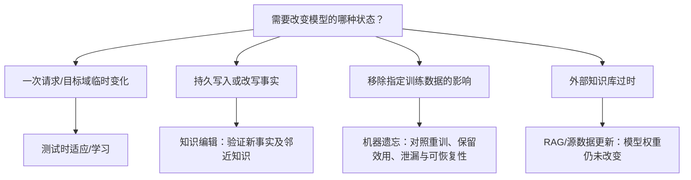

# 知识编辑与机器遗忘：更新、隔离还是移除模型信息？

> 本专题讨论预训练之后改变模型知识状态的研究。知识编辑回答“怎样改掉某项已学事实”，机器遗忘回答“怎样减弱或移除指定训练数据对模型的影响”；测试时学习回答“模型怎样利用当前输入更新临时或持续状态”。它们都涉及模型变化，但目标、更新位置和验证标准不同。

## 1. 先判断你要改变什么

当模型给出错误或过时事实，可能有几种不同需求：

1. **当前请求里临时适应**：只对一段上下文或测试流有效，之后可 reset。见[测试时学习与适应](../TestTimeAdaptation/report.md)。
2. **持久修改某条知识**：希望新事实在其它提示改写中也能生效，同时不改坏邻近知识。这是知识编辑。
3. **删除训练数据的影响**：目标不是给模型写入相反答案，而是让模型行为接近从未使用指定数据训练过的参照。这是机器遗忘。
4. **更新外部事实源**：如果系统用 RAG/数据库回答，替换外部文档可能比编辑模型参数更容易审计；这不等于模型已忘记旧知识。

这张图是选择研究问题的入口，不意味着系统只能使用其中一种方法。组合使用时，要说明每一层的知识状态、更新时点和 reset/rollback 规则。

## 2. 知识编辑：四种“写入”机制

几类代表方法体现了编辑位置的变化：

| 方法 | 写入位置/机制 | 试图解决的问题 | 主要边界 |
| :-- | :-- | :-- | :-- |
| [ROME](papers/edit-rome-local-weight.md) | 把 MLP 写作 key–value 关联，对选定层做 rank-one 权重更新 | 单个主体—关系—宾语事实能否局部改写 | 因果定位给出候选位置，不证明知识只存于那里；单事实改变不保证推理后果同步改变 |
| [MEMIT](papers/edit-memit-mass.md) | 为一批事实求目标残差，并分到多个 MLP 层 | 如何把多条事实批量写入，减少逐条编辑冲突 | 事实回忆不等于多跳后果更新；局部性依任务、协方差近似和更新规模 |
| [MEND](papers/edit-mend-hypernetwork.md) | 用预训练编辑网络将一次编辑梯度映射为权重改变量 | 如何学习可重复调用的快速编辑器，而不为每条编辑手工求解 | editor 先依编辑/局部性数据训练；近似 locality 样本不能覆盖全部输入 |
| [WISE](papers/edit-wise-side-memory.md) | 保留主模型，增加可路由 side memory | 如何管理连续编辑、冲突、回滚与隔离 | side memory 仍有路由失误、容量增长和检索成本；它不是 RAG，也不是遗忘保证 |

这些路线在“更新存在哪里”上取舍不同：主模型权重修改紧凑，但多次编辑可能互相干扰；专用 editor 学习如何产生更新，预处理成本转移到 editor 训练；side memory 隔离新旧信息，更容易回滚，但要额外路由并管理编辑内容。论文中的 locality、generality、reliability 是针对各自数据和协议的指标，不能把不同 benchmark 的单项分数拼成编辑算法排行榜。

### 一条编辑至少要问四种结果

- **Efficacy**：目标问法是否改成新事实？
- **Generalization**：同一事实换一种自然表达是否也成立？
- **Locality**：相邻但无关的事实和能力是否保留？
- **Propagation**：新事实参与多跳推理或相关关系时，后果是否一致？

前三项常见于 CounterFact / ZsRE 等局部事实基准；多跳基准如 MQuAKE 会测试编辑后的关系能否进入后续推理。某一目标提示答对，只能支撑目标提示层面的编辑成功。

## 3. 机器遗忘：不复述、不知道与不可恢复是不同主张

机器遗忘通常把目标模型和一个“只用 retain data 训练”的 retraining model 作参照。完全重训昂贵，所以近似方法试图在不重训的情况下减弱 forget-set 影响。但“对常规提示不再答出”可能只是拒答或把正确答案概率压低，未必意味着相关信息已从参数中移除。

### TOFU：先定义可控制的 forget / retain 对照

TOFU 用虚构作者和问答对控制待忘知识的来源，并把 forget-set 表现与 retain-set、真实作者和一般知识表现分开测。它便于判断一个优化方法是否让指定实体信息变得不可回答，同时对照保留效用；但合成实体问答不覆盖真实语料中的重复、交叉引用和复杂知识纠缠。[TOFU 精读](papers/unlearning-tofu.md)

### MUSE：把多个利益相关方要求拆开

MUSE 将机器遗忘扩展成六种要求：逐字复述、事实知识、成员推断泄漏、保留效用、可扩展性与连续请求稳定性。它说明 forget-set 答错、隐私攻击无法判断成员、保留能力不退化和删除吞吐可接受是不同目标；一个低遗忘分数不能替代其他项目。[MUSE 精读](papers/unlearning-muse.md)

### Recoverability：从标准接口拒答转向白盒审计

Recoverability 研究在结构化虚构隐私字段上，用受限解码检查模型低概率区域是否仍藏有目标信息。论文展示“正常 greedy 解码不再输出”与“知道字段格式的白盒审计还能恢复”之间的差别。它提供的是特定合成数据、模型和攻击者知识下的审计证据，不是对真实隐私数据“仍必然可恢复”的普遍结论。[Recoverability 精读](papers/unlearning-recoverability.md)

机器遗忘因此要声明威胁模型：普通用户还是知晓模型和算法的审计者？检测的是记忆片段、事实问答、成员身份还是可推断后果？是否与 retraining baseline 比较？当前论文分别覆盖其中一些维度，没有单篇工作证明了对任意攻击均“完全删除”。

## 4. 编辑和遗忘如何与适应、解释、对齐相邻

| 研究方向 | 直接改变什么 | 与本专题的关系 |
| :-- | :-- | :-- |
| [测试时学习与适应](../TestTimeAdaptation/report.md) | 测试样本、LoRA 或 fast weights，可能只在单样本/会话期间保留 | 侧重利用新输入改善后续预测；不自动是持久知识编辑或机器遗忘 |
| [机制可解释性](../MechanisticInterpretability/report.md) | 对内部表示、电路和行为因果关系提出假设 | 可帮助提出编辑位置或遗忘审计方法；某层被定位不证明其中“存着完整事实” |
| [对齐与后训练](../Alignment/report.md) | 用偏好/规则/反馈更新整体策略 | 旨在改变输出行为或价值目标，不等于精确改写单条知识，也不保证删除某训练样本影响 |
| [RAG](../RAG/report.md) | 外部文档、索引与检索上下文 | 可更新权威来源或撤下文档；模型参数中是否仍有旧信息是另一问题 |

这是本专题的核心分界：**编辑在回答“如何写入一个有界的修正”，遗忘在回答“目标信息影响如何消失并经受审计”，测试时适应在回答“新输入怎样临时或在线改变状态”。** 机制可能组合，但实验必须分别评价各自的目标。

## 5. 推荐阅读路线与尚未解决的问题

推荐先读 [ROME](papers/edit-rome-local-weight.md) 建立局部权重编辑直觉，再读 [MEMIT](papers/edit-memit-mass.md) 理解批量冲突；接着读 [MEND](papers/edit-mend-hypernetwork.md) 和 [WISE](papers/edit-wise-side-memory.md) 比较 learned editor 与隔离存储。遗忘路线先读 [TOFU](papers/unlearning-tofu.md) 理解可控 forget/retain 任务，再读 [MUSE](papers/unlearning-muse.md) 的多维评测，最后用 [Recoverability](papers/unlearning-recoverability.md) 检查标准拒答之外的信息残留。

尚未解决的问题包括：编辑多个相关事实时如何保证关系闭包；知识更新如何在长期变更后仍支持回滚和版本审计；真实隐私删除如何建立可验证的 retraining 参照；白盒/黑盒审计者能力不同如何改变“已遗忘”的定义；以及模型、检索库、缓存和用户记忆分别承载信息时，删除请求如何跨层传播。
