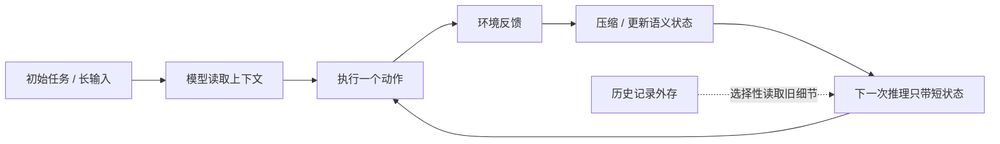

# You Don’t Need Long Context：把长历史改写成可持续更新的短状态

来源：Belcak et al., [*You don’t need long context*](https://arxiv.org/html/2611.05306v1)，arXiv v1（2026-11-03）。重点阅读 §1–§5、Appendix A、C–F，尤其对比 full-history accumulation、end-of-conversation compaction 与 single-action compaction。论文中的任务成功率由作者 benchmark 测得；成本与 token 估算不作为本精读重点。

## 长上下文的两个来源，其实是两个不同问题

一类任务本身输入很长，要跨文档找证据；另一类是 Agent 做很多轮动作后，交互历史不断增长。前者问“怎样读取大量输入”，后者问“后续动作是否真的需要每条旧消息”。把二者统一归结为更大的 context window，容易把可容纳长度误当成任务所需记忆。[§1–§2](https://arxiv.org/html/2611.05306v1)

论文将 Agent 历史看作一种可能过度保留的信息缓存：每一步工具输出和中间推理都被追加到上下文，后续每次推理继续携带它们；但许多历史细节可由当前状态、已验证结论、已做动作和剩余任务概括。研究问题于是变成：频繁把历史压成短状态，能否保住完成任务所需的信息？

## 三种上下文策略与“语义状态”想法

作者比较 full-history accumulation（FHA）、接近总窗口上限时压缩的 end-of-conversation compaction（EoCC），以及每次动作后立即压缩的 single-action compaction（SAC）。EoCC 以系统提示引导模型整理对后续有用的状态；SAC 则要求模型一次行动只依赖精简状态和当前反馈，完成动作后立即更新状态描述。对长输入任务，另行比较选择性读取，而不是始终把整份材料完整塞进上下文。[§2.4–§5](https://arxiv.org/html/2611.05306v1)

论文由此提出 Semantic State Space Model（SSSM）的概念：模型在每个动作后，用自然语言表达可解释的对话/任务状态，再由下一次推理实例读取状态、决定动作并更新状态。它与经典状态空间模型不同：后者以连续隐状态在 token 生成中传递记忆；SSSM 的状态是显式自然语言描述。该构想将“超长历史”问题转为“什么状态足以支持下一步”，但状态摘要仍可能漏掉以后才变得重要的细节。[§5.1、§6](https://arxiv.org/html/2611.05306v1)

EoCC 减少每轮带入的历史，SAC 把状态更新推到每次动作后；若任务日后还可能需要精确旧记录，则要靠外存与选择性回读，而不是假设摘要能无损保存一切。

## 它怎样连接长上下文与 Agent 研究

传统长上下文路线扩展位置表示、长序列训练、注意力计算、KV cache 和证据定位；本文把瓶颈从模型窗口推到系统状态管理：先判断任务的充分状态是什么，再决定何时压缩和保留哪些信息。两者不是互斥替代关系：长输入可能仍需长上下文或分块检索，而长程交互历史可以被摘要成短状态；混合任务往往同时有长输入与多轮累积。

可将阅读路线理解为：

1. [Lost in the Middle 与 LongBench/RULER](../report.md#5-如何测量有效上下文)：长输入能否被定位和综合；
2. 本文的 EoCC/SAC：多轮任务是否需要保留完整历史；
3. Agent memory / external retrieval：压缩后丢失的信息能否按需从外部状态恢复；
4. [软件工程 Agent 主报告](../../../Agents/SoftwareEngineeringAgents/report.md)：短状态怎样与工具反馈、仓库操作和测试结果形成闭环。

## 证据与不能外推的地方

论文在长程软件工程、工具使用、信息检索等任务上比较 EoCC 与 FHA；其强模型实验显示，在多个设定里降低总上下文上限后，任务分数接近对应 full-history 基线。但开权重模型的响应明显异质：有的相对稳健，有的随着压缩变激进而显著下降，Qwen 3 Coder Next 在最紧的 SWE-bench Verified 配置甚至大幅坍塌，作者将其归因于冗长轨迹挤压了每次压缩后的有效操作空间。[§3–§5、Appendix C–D](https://arxiv.org/html/2611.05306v1)

这不是“长上下文不需要了”的普遍证明。作者明确指出，压缩必然丢信息；若任务未来可能查询旧 coin toss 序列一类精确记录，就必须把完整历史存到可检索外部状态，选择性读取工具把“必须一直放在 prompt 中”与“必要时能够取回”分离。[§3.1–§3.2](https://arxiv.org/html/2611.05306v1) Benchmark、模型、prompt、工具 harness 和摘要提示共同决定结果；论文部分前沿闭源模型与开权重模型的任务处理协议也不同。摘要质量、错误累积、不可恢复的被删事实，以及任务中途出现新需求时旧细节重新重要，都是独立的失效条件。更稳健的结论是：**长历史不是长程 Agent 的唯一记忆机制；但短状态能否充分，必须按任务状态转移和可恢复信息逐项判断。**

## 延伸问题

- 怎样判断一个状态摘要保留了决策所需信息，而不是只保持表面任务分数？
- 能否用外部仓库/文档状态补偿压缩遗忘，并验证摘要中的行动结果确实发生？
- 同一任务中，何时应保留完整上下文、何时压缩、何时检索回旧记录？
- benchmark 上成功率稳定，能否说明状态叙述与因果依赖一致，还是模型只是依靠环境反馈重新发现信息？
