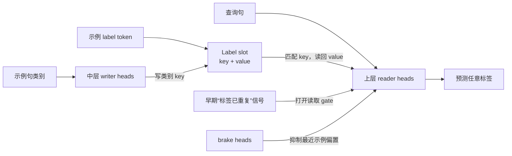

# A Circuit for In-Context Learning：示例怎样写入，再怎样被读出

来源：Gao 与 Gao, [*A Circuit for In-Context Learning*](https://arxiv.org/html/2611.05344v1)，arXiv v1（2026-11-03，CC BY 4.0）。重点阅读 §1–§9、§11–§14 与 Appendix A–E。论文研究的是三个 3–4B Transformer 上的 few-shot 句子分类；机制结论不等于对所有 ICL 能力的通用解释。

## 研究对象：标签无法靠预训练记住，必须在当前 prompt 里学

论文用带任意标签的 few-shot 句子分类测试 in-context learning（ICL）：prompt 先给若干带标签示例，再给一个新句子；标签如 `foo`、`bar` 与类别关系是临时指定的，不可能只靠词面知识记住。模型必须在一次前向里利用示例，给查询句分配标签。此前研究找到 induction heads、task vectors 等候选部件，但本文要解释的是：这些局部路径怎样共同组成一个可运行的记忆与检索电路。[§1–§2](https://arxiv.org/html/2611.05344v1)

## 机制：label token 是槽位，示例句与查询句分别写 key、做 read

作者提出一条分布式 key-value 记忆路径：每个标签 token 的 residual stream 提供一个可被注意力读取的“槽位”。中间层注意力头把示例句的类别信息写进标签位置的 key，使同类句子对应的标签槽拥有相似键；更高层的 reader heads 用查询句表示与这些键匹配，再从匹配标签槽的 value 取回标签身份。关键区分是，**示例句的语义决定 key，任意标签身份保存在 value**；若只交换 `foo/bar`，主要改变 value 读取结果；若将示例句换成另一类，则主要改变 key。[§3–§4、Figure 2–5](https://arxiv.org/html/2611.05344v1)

softmax 注意力必须把权重分给某个位置，所以即使没有匹配标签也会出现“注意力汇总”的默认行为。论文发现，一个早期 query 信号会在标签出现重复时调节 reader，使其读标签槽而非 prompt 开头的 sink；另一组“brake” heads 抵消 reader 对最近示例的偏好，避免标签顺序直接变成类别偏置。电路因此不是单个 induction head，而是写入群体、读取群体、门控、抑制/校准多个角色组合而成。[§4–§8](https://arxiv.org/html/2611.05344v1)

图中 key 表示标签前示例句的类别，value 表示任意标签身份；两者由不同提示干预检验，不能合并成“模型把整条例子存进一个 head”。

## 为什么这项工作比“发现相关 head”更进一步

作者用 token-identical twin prompts 做 activation patching：一次只改变示例文本、标签身份或标签重复状态，再把一个 prompt 的内部激活移植到另一个，观察正确标签 margin 如何变化；并用 head ablation 与随机 head 对照，测试群体作用。这样可以分别追踪“改变语义输入”和“改变任意类别名”通过哪类节点起作用，而不只是看某头关注了哪些 token。[§2、§8–§9](https://arxiv.org/html/2611.05344v1)

它与早期电路研究形成清楚的谱系：Induction Heads 描述局部重复模式复制；IOI 电路展示任务特定的多头路径、备用机制与解释不完整；本论文把 arbitrary-label ICL 分解为带 key/value、read gate 与 anti-recency brake 的人口级机制。共同方法论教训是，机制解释需要最小对照提示、分组件干预与显式失效预测；一个 attention pattern 或单头因果效应不足以说明完整算法。[§13–§14](https://arxiv.org/html/2611.05344v1)

## 跨模型证据与边界

机制先在 Qwen3-4B 上提出，再在 SmolLM3-3B 与 Llama-3.2-3B 上检验相同干预的方向。论文称许多功能关系可复现，但具体实现层、head 数量、gate 强度和冗余程度不同；例如同样能实现 key/value 机制，三种模型却把 reader 放在不同层，也有些功能分布到一组弱头而非显著单头。[§9–§11](https://arxiv.org/html/2611.05344v1)

范围仍然是一个构造清晰的句子分类任务，提示里有少量类别和人工标签。它没有证明开放域问答、数学推理、指令跟随或多轮对话共享同一 ICL 电路；更没有证明语言模型学习的所有任务都能还原为显式 key-value slot。最有价值的后续问题是：自然语言标签、标签本身具语义、示例顺序变化、长示例链和 post-training 会怎样改变该电路？群体中的冗余 head 如何在不同模型中维持同一算法？

阅读定位：arXiv v1，§2 的 prompt batteries 与干预设计；§3–§8 的写入、读取、门控和刹车；§9–§11 的跨模型、标签语义与规模/指令调优比较；§14 Discussion 中的 scope 和失败预测。所有边际值和干预效应均为论文报告。[原文](https://arxiv.org/html/2611.05344v1)
