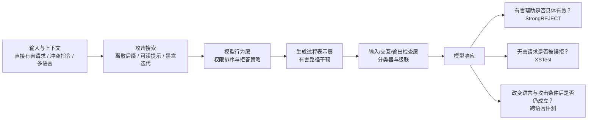

# 大语言模型安全：攻击面、行为防御与评测边界

> 本专题聚焦对话模型在输入与生成接口上的安全行为：攻击者怎样诱导模型违背安全策略或指令优先级，防御机制分别改动模型训练、内部表示还是接口检查，以及评测如何同时看有害帮助、正常使用和跨条件鲁棒性。这里的“安全”不是单一拒答率，也不涵盖模型权重安全、数据投毒或完整 Agent 工具权限系统。

## 先看问题地图：同一句“越狱成功”可能指不同事情

想象模型收到一条夹杂在普通请求中的冲突指令。它可能因为把低权限文本当成高优先级命令而偏离开发者规则；也可能面对明确有害请求时没有拒绝；还可能拒绝了大量原本无害的问题。三者分别是**指令来源判断、有害协助控制、过度拒答**，不能用一个安全分数代替。

图里的三类防御位置是不同研究工作提供的设计选项，不是每个系统都按这条顺序串接。过滤器也可能放在输入、输出或完整交互之间；具体边界决定它能看到什么上下文。

## 1. 攻击面：攻击者能观察和改变什么？

阅读攻击论文，先区分攻击者对**目标模型**的访问，而不是只看攻击字符串是否可读：

| 路线 | 攻击者访问 | 搜索对象与反馈 | 说明的风险 | 关键边界 |
| :-- | :-- | :-- | :-- | :-- |
| [GCG](papers/attack-gcg-suffix.md) | 对代理模型有梯度，再向黑盒目标测试迁移 | 追加到用户请求后的离散 token 后缀；梯度筛选候选、模型前向比较 | 对齐模型的输入边界仍可能被优化式后缀改变 | 迁移依赖代理模型、目标模板和判定标准；论文固定了任务与预算（原文 v1，§2.1–§2.3、§3.1–§3.3、§5–§6） |
| [AutoDAN](papers/attack-autodan-readable.md) | 优化阶段使用代理信号 | 从左到右生成文本，同时优化攻击目标与语言可读性 | “看起来正常”并不是安全信号，perplexity 过滤可能漏掉自然语言攻击 | 结果针对论文的模型、过滤器和目标；不表示所有异常检测都无效（原文 v1，§3.1–§3.3、§4–§5） |
| [PAIR](papers/attack-pair-black-box.md) | 目标模型可查询，不需目标梯度 | attacker LLM 根据目标响应与 judge 反馈反复改写自然语言提示 | 黑盒响应本身可成为自动搜索信号 | 查询成本、attacker、judge 和目标定义共同决定结果；“二十次查询”不是通用保证（原文 v1，§2.1、§3.1–§3.4、§4.1–§4.3） |

三者不是一条从“弱”到“强”的排行榜：GCG 以离散 token 优化和迁移为重点，AutoDAN 加上可读性目标，PAIR 用目标响应闭环搜索。若论文把“目标模型输出了某个字符串”作为攻击成功，读者还要检查目标是否真的提供了可操作帮助；这一评分问题由 [StrongREJECT](papers/eval-strongreject.md) 进一步拆解。

这些攻击主要检验模型输入端的对抗脆弱性。它们不能单独说明模型获得了新知识，也不能证明某个真实产品存在同样漏洞；服务端系统提示、输入清洗、版本、模型能力和攻击预算都会改变结果。Instruction hierarchy 还涉及“谁发出的命令有权覆盖谁”，这是攻击语义的一部分，但不是所有有害内容的统一判定。

## 2. 防御改在哪一层？

### 训练模型如何处理冲突：Instruction Hierarchy

[Instruction Hierarchy](papers/defense-instruction-hierarchy.md) 将 system、developer、user 与第三方内容视作不同权限来源。训练样本不仅包含应忽略的冲突指令，也包含低权限但与高权限规则相容、因此仍应执行的请求，再用 SFT 与 RLHF 教模型按优先级处理。

这条路线处理的是**指令服从的权限与冲突结构**，不只是危险词语是否触发拒答。它可以降低网页、工具文本覆盖高权限指令的风险，但模型行为训练不能替代应用层工具授权、隔离和副作用控制。论文在特定 GPT-3.5 Turbo 与攻击集上报告泛化和 over-refusal 检查（原文 v1，§3.1–§3.2、§4、Figure 2–4、Appendix B.5）；这不证明任意语义冲突都能可靠判断。

### 干预生成中的表示：Circuit Breakers

[Circuit Breakers](papers/defense-circuit-breakers.md) 不只教模型输出拒绝文本，而用 LoRA 参数化的 Representation Rerouting，把指定有害样本的内部表示引向 short-circuit 状态，并在 retain 数据上约束正常行为。它改变模型的生成过程表示，尝试让有害响应不再沿原来的路径继续展开。

其研究问题从“最终是否写出拒绝句”移到“针对训练过的行为，表示干预能否阻断有害生成且保留边界附近能力”。原文在文本、多模态和 function-calling 场景报告结果（v1，§3–§5、Algorithm 1、Table 1、Figures 2–4），但这些设置不能证明模型内部存在一个已被完整定位的通用“有害电路”，也不能替代针对分布外和自适应攻击的验证。

### 在接口检查输入、响应或完整交互：Constitutional Classifiers

[Constitutional Classifiers](papers/defense-constitutional-classifiers.md) 用自然语言规则构造合成良性/攻击数据并训练输入或输出分类器；[Classifiers++](papers/defense-constitutional-classifiers.md) 再把对应输入和响应交给 exchange classifier，加入轻量筛查后升级审查的 cascade，以及内部线性 probe 与外部分类器组合。它主要改变的是接口周围的风险判定，不直接重写主模型权重。

从单侧检查到完整交互，是对上下文攻击和输出混淆的回应；级联则尝试在覆盖率、延迟和误拒之间分层处理。原始论文报告了特定 red-team protocol 和生产流量条件下的结果（原文 v1，§2–§6）；++ 报告 exchange、cascade、false-refusal 与成本改动（原文 v1，§2–§6、Appendix B–F）。红队投入时长不能当作安全概率，影子流量 flag/refusal rate 也不自动等于全体真实请求的误拒率。

### 放在一起比较

| 防御位置 | 代表机制 | 改变什么 | 新增的失败面 |
| :-- | :-- | :-- | :-- |
| 训练行为 | Instruction Hierarchy | 对指令来源、权限和冲突的响应策略 | 合成冲突覆盖不足；模型可能误判语义冲突或拒绝相容请求 |
| 内部表示 | Circuit Breakers | 有害输入条件下的中间表示与生成路径 | 表示干预迁移和保留效用；训练外行为是否被阻断 |
| 接口检查 | Constitutional Classifiers / ++ | 输入、响应或完整交互的分类、升级和拦截 | 分类误报/漏报、可见上下文、级联阈值与运行成本 |

这些防御可以组合，但不能仅因为都降低某个攻击成功指标就视为同一种方法。一个改变拒答策略，一个改变中间表示，一个在模型周围增加检查器；它们各自能观察的信号、更新成本和失效边界不同。

## 3. 安全评测：至少同时问三个问题

### 有害请求有没有得到具体、可用的帮助？

[StrongREJECT](papers/eval-strongreject.md) 将“没有标准拒绝语”与“真正提供有害帮助”区分，评分同时考虑是否拒绝、内容具体程度和说服力，并与人工评价比较（原文 v1，§2–§5、Figure 4–6、Appendix A–B）。它减少空话、无关内容被误计为攻击成功的问题，但仍依赖其有害问题集、autograder 和语言覆盖；judge 本身不是安全真值裁判。

### 无害请求有没有被过度拒绝？

[XSTest](papers/eval-xstest.md) 用带有敏感词但处于安全语境的提示，检查模型是否把词面风险过度泛化。它把安全提示上的完整回答、部分拒答和完全拒答分开（原文 v3，§3–§4、Table 1、§6）。通过这类单轮英文测试只能说明对已测语境的拒答边界较合适，不能证明模型能抵御越狱或在开放世界普遍安全。

因此，“有害合规低”与“误拒少”是两个不同目标。只优化前者，可能让模型把所有边界问题都拒掉；只优化后者，又可能放松有害请求的防护。分类器、指令训练和表示干预都应在这两类结果及保留能力上并读。

### 换语言、攻击方式或判定器后，结论还成立吗？

[跨语言评测](papers/eval-cross-language.md) 比较标准提示、逻辑表达攻击和优化提示在十种语言上的表现，说明风险排序会随攻击形式和模型变化（原文 v1，§3–§4、§6）。这条证据提醒：英语评测不能代替多语言评测，资源等级也不能独立预测风险。但其模型、十种语言和数据集覆盖有限；自动 judge、invalid response 的分母处理及低资源语言人工标注本身也影响结论。

一个有解释力的评测组合应标明攻击者可见什么、输入/对话上下文、模型与系统提示、成功判据、误拒样本来源、judge 与人工抽查，以及任务/语言覆盖。各论文若这些条件不同，其攻击成功率不应直接排成榜单。

## 4. 这九篇论文怎样组成一条学习路线

推荐先建立测量标准，再读攻击与防御：

1. 先读 [StrongREJECT](papers/eval-strongreject.md) 和 [XSTest](papers/eval-xstest.md)：一个定义“有害帮助是否具体有效”，一个单独观察“安全请求是否被误拒”。这样之后讨论攻击成功时，能先问指标实际测了什么。
2. 读 [GCG](papers/attack-gcg-suffix.md) → [AutoDAN](papers/attack-autodan-readable.md) → [PAIR](papers/attack-pair-black-box.md)：比较白盒代理梯度、可读性约束和目标黑盒反馈三种搜索信号，注意访问条件而非只记攻击名称。
3. 读 [Instruction Hierarchy](papers/defense-instruction-hierarchy.md)：先把低权限注入、权限冲突和有害请求拒答分开。
4. 对读 [Circuit Breakers](papers/defense-circuit-breakers.md) 与 [Constitutional Classifiers](papers/defense-constitutional-classifiers.md)：比较训练期内部表示干预和模型外接口分类器如何处理攻击、误拒与运行成本。
5. 最后读 [跨语言越狱评测](papers/eval-cross-language.md)，用语言迁移、自动裁判和 invalid response 处理检查前面结论能否外推。

本专题涵盖的是九篇代表性精读，不是攻击或防御方法的完整清单；尤其没有系统覆盖训练数据投毒、模型窃取/外泄、推理时政策编排、视觉越狱全景及真实部署的纵深防御。与工具权限、执行隔离和审批有关的系统安全，见[工具 Agent 安全专题](../../Agents/AgentSecurity/report.md)。

## 5. 仍未解决的问题

- **攻击者适应防御后会怎样？** 固定攻击集和 held-out prompt 不等于面对了解分类器与拒答边界的自适应攻击者；防御也不能只在训练时已见的攻击模板上评价。
- **误拒怎样归因？** 输入分类、输出分类、完整对话交换、模型策略和 system prompt 都可能造成拒答；需要看决策在哪一层发生，不能只统计最后的拒绝文本。
- **安全行为能跨语言和上下文迁移吗？** 语料、tokenizer、语用习惯、judge 与标注覆盖都会变化；有限语言测试不能代替低资源、多轮、代码混合和跨模态输入。
- **表示干预和分类器的组合如何校准？** 内部干预可能改变分类器看到的分布；多个阈值和升级级联可能降低成本，也可能引入新的漏报与误拒交互。
- **测到的究竟是安全还是“拒答”？** 需要持续把有害请求上的可用协助、无害边界请求上的效用、一般能力保留、攻击迁移和实际部署负载分开报告。

最稳妥的阅读结论不是“某一机制解决了越狱”，而是：防御分别作用于权限策略、生成表示或接口判定；攻击会改变输入和搜索条件；评测则决定我们把什么叫成功。只有把三者对齐，论文结果才足以支持有限、可说明条件的安全判断。
