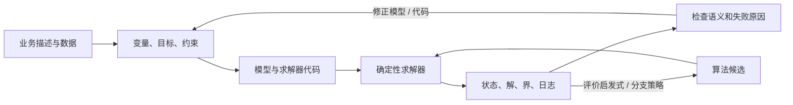

# 大模型辅助运筹建模与求解：从自然语言到可验证的决策

## 先看问题：LLM 插入了决策流程的哪一段？

运筹优化通常不是让求解器直接读一段业务描述。分析者要先把描述变成决策变量、目标函数、约束和数据，再交给 MILP、CP、网络流或专用算法。大型语言模型可以参与这条链，但“会写公式”“能生成可运行代码”和“找到有用决策”是不同的能力。

求解器解决的是**给定模型**。它可以证明模型的解可行、报告最优性或停止原因，却无法单靠一次最优解证明模型忠实表达了用户的意图。若需求漏掉“每个客户必须由恰好一个工厂服务”，求解器仍可能把剩余模型正确解到最优。因此，大模型辅助运筹的核心闭环是“提议—检查—修正”，而非一次提示生成答案。

## 三种任务，三种成功标准

| 任务 | LLM 负责什么 | 外部检查提供什么 | 检查通过仍不能证明什么 |
|---|---|---|---|
| **自动建模** | 从文本和数据中抽取变量、目标、约束，生成数学表达和代码 | 解析/类型检查、求解器状态、可行解或最优值 | 自然语言中的业务规则都已被表示；目标、单位与数据含义忠实 |
| **求解器组件增强** | 选择 LNS 邻域、分支变量或其他策略 | 求解时间、节点数、incumbent、bound、gap、primal integral | 在其他实例分布、求解器版本或时限下仍占优 |
| **算法发现** | 生成或修改可执行启发式程序 | 确定性评价函数对候选运行打分 | 候选本身有通用优势；结果不是基准、启发式或预算特化 |

“LLM 直接解了 MIP”常把这些层混在一起。自动建模系统可能最终调用 Gurobi；LLM-LNS 让模型设计邻域，MILP 子求解器继续承担局部优化；FunSearch 生成算法，评估器负责判断程序的输出。读论文时先确定哪一层由 LLM 改变，再看该层对应的评价指标。

## 从 NL4Opt 到 OptiMUS：建模不是把文本换成方程

NL4Opt 将自然语言到线性规划拆成实体识别和逻辑表示生成两个任务。这一拆分揭示了真实困难：读者必须找出变量、目标方向、数量和约束关系；系统还得把它们组合成等价、求解器可接受的模型。NL4Opt 的第二个子任务可提供标注实体作为输入，所以其成绩不能直接代表从原始文本到完整模型的端到端能力。[NL4Opt, §§1–2、§2.1](papers/2022-nl4opt.md)

OptiMUS 将这一流程组织成 Manager、Formulator、Programmer 和 Evaluator。Formulator 逐条建立变量、约束和目标；Programmer 编写求解器代码；Evaluator 运行代码并反馈运行错误；Manager 决定下一步由谁处理。连接图记录每条约束依赖哪些变量和参数，使代理只携带相关上下文。[OptiMUS, §§3.1–3.3](papers/2402.10172-optimus.md)

这个设计抓住了 solver feedback 的价值：运行错误通常容易定位，模型约束的遗漏和语义错误更难发现。OptiMUS 的失败分析包含错误或缺失约束、模型结构本身不对，以及代码错误。它也展示了反馈的上限：运行可执行、返回解或报告 infeasible/unbounded，都不自动证明模型符合原描述；错误模型可能稳定地产生一个“正确地解错题”的结果。[OptiMUS, §4.4–4.5, Table 5]

## 求解器反馈怎样参与搜索？

有用的反馈必须与决策目标对应。语法错误指导代码修复；求解器 infeasible/unbounded 等状态提示模型或数据需要诊断；feasible incumbent、dual bound 和 gap 衡量当前搜索进度；节点数和求解时间则评价策略对整个求解过程的影响。不同信号不能互相替代：低节点数未必意味着更快，找到好 incumbent 也未必证明最优。

LLM-LNS 把 LLM 放到 Large Neighborhood Search 的**邻域选择**环节。外层演化 prompt 策略，内层演化启发式；候选策略被送入 LNS，由求解器反馈目标值与进度。论文用较小 MILP 训练邻域策略，再测试更大的实例；其大规模实验覆盖一组设定的 set covering、vertex cover、independent set 和 knapsack 实例。作者报告在这些实例和相同时间限制下，LLM-LNS 的解质量与 primal integral 优于所列基线，包括 Gurobi 和 SCIP。[LLM-LNS, §4.2、Tables 4–5、Appendix C]

这个结果说明“LLM 发现的邻域策略可以改进该实验中的 LNS 工作流”，不是“LLM 全面胜过传统求解器”。实例类别、规模、时间限制、下层 solver、基线设置和运行波动都是结论的一部分。论文也指出，它的 fitness 对目标值作未归一化平均，实例目标量纲差异可能让大数值实例主导演化，跨异质任务时需要更谨慎设计评价函数。[LLM-LNS, §I Limitations]

LLM4Branch 把策略移到 branch-and-bound 内部：LLM 生成一个可执行的分支打分程序，零阶搜索再调程序参数，目标直接使用完整求解器的成本，而不是只模仿 strong-branching 的单步标签。论文用 SCIP 8.0.0 运行分支策略，在四类标准 MILP 和两类挑战基准中比较，medium/hard 实例用于观察泛化；其中“CPU-based methods”胜场与 GPU 模型参考结果分开统计。[LLM4Branch, §§4–5、Tables 1–2]

它展示了一种更紧密的反馈环：从“模型看起来像专家的选择”转向“求解器跑起来的总体效果”。同时，策略依赖作者选定的 91 维节点特征、程序骨架和参数搜索过程；结论适用于该特征与测试基准，不能推成通用分支策略会被 LLM 自动超越。

## 算法发现：程序如何积累经验？

FunSearch 将预训练 LLM、程序数据库和确定性评价器组成进化搜索。每轮从数据库取高分程序构造提示，要求 LLM 修改受约束的程序片段；评估器执行候选，合格程序回到数据库，岛模型在保留多样性的同时继续搜索。[FunSearch, “Methods: Implementation details / Prompt building / Evolutionary method and program selection”](papers/funsearch.md)

因此，“FunSearch 不更新模型权重”是准确的；“FunSearch 独立生成候选、没有跨代反馈”则不准确：过往高分程序会进入后续 prompt，进化岛也会保存和选择历史程序。更合适的区别是：搜索经验通过外部种群与提示传递，不通过模型参数微调传递。

EoH 显式保留一对表示：自然语言 thought 描述启发式思想，code 是可执行算法；进化操作可改变 thought、code 或二者，评价器依据问题实例的表现选留候选。[EoH, §3、§4](papers/2401.02051-eoh.md) 这让人更容易检查“改了哪种算法想法”，但 thought 可读不等于解释了算法为何有效。

源综述把 FunSearch 的约百万次样本与 EoH 的几千次查询并列，进一步推断出约三个数量级的通用样本效率跃迁。原论文的任务、查询口径、候选评估次数与设置不完全相同，重复出现在总报告和分报告中也不是独立验证。因此本专题保留定性关系：显式 thought-code 表示为搜索提供一种知识传递形式；不把两篇论文的 headline 查询量当作控制变量一致的效率比。[FunSearch, Nature 2024; EoH, arXiv v3, §4]

## 评测边界：基准、预算和“正确”都要写清

建模与求解需要不同的评价协议。自动建模要区分实体抽取、模型语义、代码可运行、可行性与参考解匹配；求解算法要说明目标质量、time limit、bound/gap、seed 与硬件；算法发现还要说明候选评价调用数、solver 调用数、实例生成方式和是否对测试问题筛选过。更完整的比较见[运筹建模与求解评测：正确性、反馈与基准边界](topics/evaluation-protocols.md)。

NL4Opt 是早期自然语言 LP 基准。它的表述和数据集有研究价值，但其 formulation 子任务使用 gold entity annotation，因此它测的是“给定已抽取实体后生成逻辑形式”的一部分能力，而非完整 NL-to-solver 流程。[NL4Opt, §2.1–2.3](papers/2022-nl4opt.md)

MIPLIB-NL 从 MIPLIB 2017 中选取 MILP，恢复结构并反向生成自然语言和外部数据，构成 223 个一一对应的基准实例。其价值是把较大的模型结构和数据绑定纳入评测；这些文字从模型结构反向生成，并经人工与 LLM 检查，不等同于真实决策者自然撰写的需求。验证包含最多 8 次独立重建尝试；任意一次 solver outcome 对上即记作实例语义充分，所有尝试失败也不会直接判定 benchmark 错。[MIPLIB-NL, §§3.2–3.5]

作者还报告 223 个发布实例来自 245 个候选：163 个通过自动重建验证，82 个进入专家复核后保留 60、舍弃 22。8 个 infeasible 与 15 个 open 实例经专家检查后保留，但没有 certified optimum 的实例不纳入需要 objective-value 比对的量化实验。[MIPLIB-NL, §3.4] 这些流程构成更强的来源证据，却仍有边界：逆向生成文本和结构化数据的 benchmark 测试的是恢复被编码模型，不能覆盖真实业务交流中省略的信息和冲突需求。

## 阅读路径

1. 从 [NL4Opt](papers/2022-nl4opt.md) 开始：它把文本解析与数学表示分开。
2. 读 [OptiMUS](papers/2402.10172-optimus.md)：看生成模型、程序与求解器怎样循环反馈。
3. 比较 [FunSearch](papers/funsearch.md) 和 [EoH](papers/2401.02051-eoh.md)：看候选程序如何进入种群、经验如何通过 prompt 表示。
4. 读 [LLM-LNS](papers/llm-lns.md) 与 [LLM4Branch](papers/2605.10401-llm4branch.md)：将反馈从“修正格式和代码”推进到“优化求解器组件”。
5. 最后读 [MIPLIB-NL](papers/2602.10450-miplib-nl.md) 和[评测边界分析](topics/evaluation-protocols.md)，判断这些结果能否迁移到大规模、含结构化数据的任务。

本专题主要分析 AI 方法与精确优化系统之间的接口。化工和冶金预研是潜在应用线索；其中传统 OR、预测模型、数字孪生和 LLM 代理属于不同证据类型，不因出现在同一行业案例中就视为一项已验证的 LLM+OR 方法。

## 开放问题

- 怎样让自然语言、数据文件、数学模型和代码形成可追踪的单一实例对象，并用独立信号发现遗漏约束？
- 求解器状态反馈如何区分“实现错误”“模型语义错误”“数据错误”和“在给定时限内尚未找到可行解”？
- 算法发现中的历史候选怎样表达最有用的经验；thought、程序代码、搜索轨迹与模型权重各自承担什么作用？
- 如何在统一的 held-out 实例、硬件与时间预算上比较 LLM 生成策略、学习型策略、人工启发式与求解器默认策略？
- 如何设计贴近真实领域语言又可核验的 benchmark，同时避免反向生成文本过度透露原始模型结构？

所有关键数字按论文报告结果引用；本专题未运行求解器或复现论文实验。
