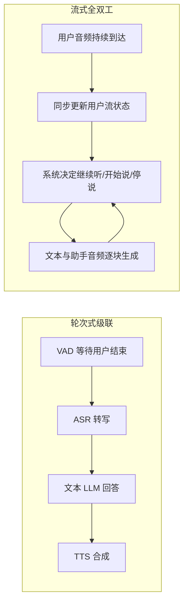

# 实时多模态交互：流式输入、全双工轮次与在线评测

> “能语音回答”不等于“能实时对话”。实时系统必须在输入尚未结束时决定继续听、提交当前片段、开始回答、接受打断或结束输出；同时还要让语义、音频和可能的视频信号在时间上对齐。本专题聚焦这些机制与测量问题，不推测闭源模型未公开的内部架构。

## 1. 先分清系统要实时做的几件事

想象用户说：“把刚才那家餐厅……不是，是我上周去的那家。”系统处理的不是一个已定稿的字符串，而是一段仍在变化的输入：新声音持续到达，用户可能停顿、补充或改口；模型何时把当前前缀当作完整意图，会直接影响回答。

实时语音/多模态交互至少包含五个彼此相关、却不能互相代替的问题：

| 子问题 | 系统要决定什么 | 常见失效 |
| :-- | :-- | :-- |
| 输入流处理 | 音频/视频何时切块、哪些历史状态保留 | 片段边界丢信息、长对话状态漂移 |
| 端点与轮次控制 | 用户何时说完、系统是否可以接话 | 过早截断、等待过久、背景说话触发回复 |
| 语义响应 | 部分输入是否足以给出有用答案 | 抢答后被用户后续信息推翻 |
| 输出流生成 | 先说哪部分、如何同步文本和语音 | 首响快但内容断裂、文字与发音错位 |
| 打断与恢复 | 用户重新开口时是否停说并纳入新信息 | 系统压住用户、停止后不能续接上下文 |

因此，实时能力不是一个延迟数字，也不是“模型会说话”的二元属性。阅读一篇工作时，先问它改变的是音频表示、轮次决策、语义生成、语音解码，还是整个交互协议。

## 2. 从级联流水线到并行语音流

级联系统的模块边界清楚，ASR、LLM 和 TTS 可以独立替换；但等待端点再启动下游会累积延迟，把声音先转成文本也可能丢掉语调、情绪和非语音线索。Moshi 代表一种不同选择：把用户与助手音频作为并行时间流交给同一个自回归模型联合建模，不预先切成固定说话轮次；对齐的文本通道既可帮助语言质量，也可作为流式识别/合成接口。[Moshi 精读](papers/duplex-moshi.md)

这种结构让模型能在用户尚未完全停下时准备回应，但不自动知道何时礼貌接话。音频 codec 帧率、每次生成的 token 数、用户/助手流的延迟偏移和输出缓冲共同决定最早响应时点；若太早开口，后续输入可能改变问题；若等太久，又失去交互感。

## 3. 轮次控制可以放在哪一层？

### 3.1 把轮次状态写进生成序列：BayLing-Duplex

BayLing-Duplex 从回合式语音模型初始化，交织用户音频、助手文本和助手音频块，再用 `[SILENCE]`、`[ASSISTANT]`、`[PAD]`、`[EPAD]` 等状态 token 表达“继续听、开始回答、文本已结束但音频仍在生成、整轮结束”。它把何时说话纳入语言模型的 next-token 决策，而不是独立调用轮次分类器。[BayLing-Duplex 精读](papers/duplex-bayling.md)

这里的取舍是 block 粒度：block 越短，模型越能频繁检查是否该接话，但每块可容纳的文本 token 越少；block 越长，语义内容更充足，响应粒度却更粗。论文固定的 block 配置只是其实验选择；打断成功率也必须和是否及时开口、输出内容是否连贯一起读，不能把“很少被打断”误当作对话质量高。

### 3.2 把语义端点和输入拒绝作为状态机：TurnFSM

TurnFSM 处理的不是助手语音生成，而是另一项容易被忽略的控制：一段持续到达的声音何时“够完整”可以提交给下游模型，以及提交后是否为有效输入、应不应拒绝。它把 Semantic VAD 和 utterance-level rejection 写成有状态的串行判定，试图将一部分外部控制逻辑内化到模型预测中。[TurnFSM 精读](papers/duplex-turnfsm.md)

这与 BayLing-Duplex 的职责不同：TurnFSM 负责输入分段和拒绝，后续仍需下游模型理解并生成回答；BayLing-Duplex 则把听/说和助手语音输出放进全双工序列。输入控制准确率不能代替语义回答质量，语音生成能力也不等于具备可靠端点控制。

### 3.3 流式多模态输入与输出不是“全双工”的同义词

Qwen2.5-Omni 的 Thinker–Talker 结构、TMRoPE 和分块输入/语音输出说明，音频、视频、文本与生成语音可以在一个系统中分工、对齐并逐段处理；但分块流式能力不自动等于用户讲话重叠时仍能同时听和说。具体流式机制和模型家族边界见 [Qwen 报告 §4](../../Models/Qwen/report.md)；闭源 GPT-4o 的 system card 可作为接口和安全评测证据，未公开的内部 token 组织应保持未知。[GPT 系列报告](../../Models/GPT/report.md)

多模态实时系统还要面对两个时钟：输入时钟决定音频、视频帧何时到达；输出时钟决定模型何时提交语义、开始语音、生成后续块。用户实时视频可作为回答条件，与“模型生成视频”是不同方向；视频生成机制见 [AIGC/VideoGen](../../AIGC/VideoGen/report.md)，跨媒介表示问题见 [AIGC 学习地图](../../docs/aigc-learning-path.md)。

## 4. 评测不能压成一个“实时能力”分数

不同论文测试的交互事件不同：

| 研究/评测 | 测量什么 | 不直接测什么 |
| :-- | :-- | :-- |
| [InstructS2S-Eval](papers/eval-instructs2s-eval.md) | 语音指令回答、文本—语音对齐、首段输出延迟 | 用户打断、话轮交接、自然对话长期体验 |
| [Full-Duplex-Bench](papers/eval-full-duplex-bench.md) | 暂停处理、backchannel、轮次切换、打断 | 所有维度上的语义/任务成功率 |
| [TurnBench](papers/eval-turnbench.md) | 端点/中断事件预测的 recall、误报与事件时延 | 回复内容正确或系统整体对话质量 |
| [Coupled but Late](papers/eval-coupled-but-late.md) | 两个全双工模型互相反馈后的轮次时间动态 | 人机对话满意度、答案语义质量 |

至少分别检查输入到首个音频/文本的延迟、端点误判、打断后的停止/恢复、文本—语音对齐、语义正确性和多轮上下文保持。平均时延可能掩盖尾延迟；高打断成功率可能来自模型总是保持静音；事件时间预测准确也不保证它能给出合适回复。ASR 转写器、自动裁判和人类参考数据的构造，都要纳入评价边界。

## 5. 设计选择如何共同影响交互体验

- **表示与帧率**决定输入/输出 token 粒度。更细的音频 token 可提高时间分辨率，但扩大自回归序列；更强压缩节省计算，却可能抹去情绪、短事件和说话人细节。
- **分块大小**控制缓冲、语义完整度和首响粒度。单独优化首响可能牺牲后续语句完整性或音质。
- **状态控制位置**决定系统可诊断性：外置 VAD/endpointing 易单独校准，内化状态 token 可与语义共同决策，但错状态可能沿整个生成流传播。
- **训练数据与目标**要覆盖静音、重叠、打断、犹豫、改口和背景声；只在单轮合成指令上训练，不能验证真实双人对话行为。
- **端到端与级联**是在模块边界和联合优化之间取舍。端到端可减少中间转写的信息损失；级联则更易检查错误来自端点、识别、语言推理还是合成。

这些选择相互耦合：codec 帧率决定块时长，块时长影响轮次监督，轮次状态影响语音生成，评测协议又决定模型会优化怎样的接管时机。一个模块的增益不能直接外推成整个系统更自然、更安全或更有帮助。

## 6. 推荐阅读顺序与开放问题

1. 先读 [Moshi](papers/duplex-moshi.md)，理解并行语音流为何改变固定话轮假设。
2. 对读 [BayLing-Duplex](papers/duplex-bayling.md) 与 [TurnFSM](papers/duplex-turnfsm.md)，区分生成侧轮次决策与输入端点控制。
3. 读 [Qwen2.5-Omni](../../Models/Qwen/report.md)理解流式音视频条件与 Thinker–Talker 分工；对闭源语音系统则用 [GPT 系列报告](../../Models/GPT/report.md)的 system card 证据边界来读。
4. 用 [Full-Duplex-Bench](papers/eval-full-duplex-bench.md)、[TurnBench](papers/eval-turnbench.md) 和 [Coupled but Late](papers/eval-coupled-but-late.md) 对照事件层级、误报和模型—模型耦合。
5. 最后回到 [AudioGen](../../AIGC/AudioGen/report.md) 区分音效/音乐生成与语音对话；两者共享声学 codec 或扩散模块，不代表优化目标相同。

仍待解决的问题包括：怎样在信息未完整时保持低延迟而不过早抢话；非语音声学线索和视频上下文如何安全进入对话状态；不同语言、说话风格和噪声下的端点/打断是否稳健；自动轮次指标如何和真实用户偏好、任务正确性、可打断性共同验证；以及模型停顿、沉默或拒绝时系统怎样向用户表达不确定性。

本专题串起可查证的代表机制与评测，不是实时语音/多模态产品支持清单，也没有跨硬件系统延迟复测。论文数字均按其输入协议、模型版本、codec、block 设置和评价方式读取。
