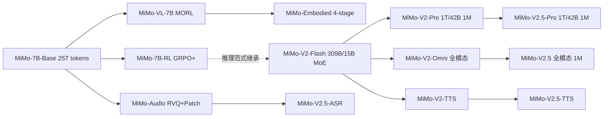

# 小米 MiMo 系列模型深度调研报告

> 文档定位：本报告聚焦小米（Xiaomi）大语言模型核心团队（LLM-Core Team）自 2025 年 4 月以来公开发布的 MiMo 系列模型，覆盖基座、推理、视觉-语言、语音、具身、MoE 旗舰等多条产品线，并梳理其技术演进、关键创新与商业化战略。撰写时间：2026 年 6 月（初版）；**最近更新：2026-10-17** —— 增量增补 **§九 MiMo-V2.6 系列**（独立章节）与 **§十 MiMo-V3 / HySparse2「架构公开、模型未发布」**，并同步 §1.1 时间线、§十二 结论与参考文献；技术报告另见 [精读分册](<papers/2610.11959-mimo-v2-6.md>)。**覆盖到的最新已发布模型：2026-09-22 的 MiMo-V2.6 系列**（V3 只有架构公开，见 §十）。
> 信息可信度：标注「确认」表示来自 arXiv 技术报告 / 官方 GitHub / Hugging Face 模型卡 / 小米官方发布；标注「推测」表示根据公开二手信息整合，可能存在误差。
>
> **证据等级映射（2026-10 起，仅加说明、不改旧行）**：旧文「确认」⇋ 新等级「**精读原文**」（一手页面 / 论文 / 模型卡 / 官方发布记录原文）；旧文「推测」⇋「**二手**」或「**未确证**」。注意旧「确认」中有个别条目实际来源是媒体转述（如财新），按新口径应记「二手」——本轮只做映射说明，**不追溯改写既有正文**（仅文首覆盖说明按本轮更新；原 §九/§十 因新增两章顺延为 §十一/§十二，正文内容未改）。本轮新增内容一律使用**单一主等级**：精读原文 / 摘要级 / 二手 / 受限核验（同一处混合多源时取最弱）；厂商自报数字一律写明「**厂商自报**」，拿不到实证的写「**未确证**」。

---

## 一、概述与背景

### 1.1 小米进入大模型赛道的时间线

小米对大模型的布局可以划分为三个阶段：

1. **内部 MiLM 阶段（2023–2024）**：以 MiLM2 系列（包含 4B 端侧模型与 30B 云端模型）为代表，主要服务小爱同学、HyperOS、IoT 终端等内部产品，未对外开源（确认）。该阶段的代表性技术包括「TransAct 大模型结构化剪枝」与端侧量化，强调「端侧跑通」与「云-端协同」。
2. **MiMo 1.0 时代（2025.04–2025.11）**：以 2025 年 4 月 30 日 [MiMo-7B](https://github.com/XiaomiMiMo/MiMo) 系列开源为标志，小米首次以 LLM-Core 团队的名义对外发布大模型，主线包括：
   - MiMo-7B（基座 + RL 推理模型，2025.04）
   - MiMo-VL-7B（视觉语言模型，2025.06）
   - MiMo-Audio-7B（端到端语音大模型，2025.09）
   - MiMo-Embodied-7B（具身 + 自动驾驶统一基座，2025.11）
3. **MiMo V2 时代（2025.12 至今）**：从稠密 7B 跃迁到大规模 MoE，进入「Agent 时代」战略：
   - MiMo-V2-Flash（309B 总参 / 15B 激活 MoE，2025.12 开源）
   - MiMo-V2-Pro / Omni / TTS（万亿级 MoE 三件套，2026.03.19 发布）
   - **MiMo-V2.5 系列（2026.04.23）**：全面升级，含 V2.5-Pro、V2.5、V2.5-TTS、V2.5-ASR
   - **V2-Pro / V2-Omni 退役（2026.06.30）**：旧版停止服务，迁移至 V2.5 系列
   - **MiMo-V2.6 系列（2026.09.22 发布并开源）**：Pro 1.02T 总参 / 42B 激活、Flash 310B / 15B，双模型原生全模态 + 1M 上下文；技术报告 2026-10-08（[arXiv:2610.11959](https://arxiv.org/abs/2610.11959)）；V2.5-Pro / V2.5 于 2026-10-21 退役（详见 §九）
   - **MiMo-V3 / HySparse2（2026.09.22 架构公开；模型未发布）**：两级 KV 共享的混合稀疏注意力架构，论文在 80B-A3B 验证模型上报告 1M 上下文预填充 FLOPs 较 Hybrid SWA 低 5.02×；截至 2026-10-17，V3 无权重、无 API、无模型卡（详见 §十）

### 1.2 战略坐标：「人车家全生态」与 Agent 化

雷军在 2026 年 3 月 19 日的发布会上明确：小米将在未来三年于 AI 领域投入至少 600 亿元，其中 2026 年 AI 研发与资本预算超过 160 亿元，目标是「进入全球大模型第一阵营」（确认，来源：财新）。MiMo 系列被设计为支撑小米「人-车-家全生态」的统一智能底座：

- **人**：MiMo-7B / MiMo-V2-Pro 用于通用对话、推理与编码，MiMo-Audio / MiMo-V2-TTS 用于语音交互（小爱同学、HyperOS）。
- **车**：MiMo-Embodied 为小米汽车的智驾团队（陈龙、王乃岩、叶航军等核心架构）提供 VLA（Vision-Language-Action）基座。
- **家 / IoT**：端侧 4B 模型 + MoE 稀疏激活，强调低成本部署。

### 1.3 团队组织

MiMo 系列由小米 **LLM-Core Team**（核心团队）主导，公开作者列表中可见 Bingquan Xia、Zihao Yue、Bowen Shen、Dawei Zhu 等 60+ 名研究员；[2025 年加入的罗福莉](https://huggingface.co/XiaomiMiMo)（曾任 DeepSeek 核心研究员）参与 MiMo-VL；自动驾驶 / 具身方向由首席科学家陈龙博士（前 Wayve Staff Scientist，Lingo 系统主导者）与第一作者郝孝帅领衔，构成与 LLM-Core 平行但相互复用的双线团队结构。

---

## 二、基座模型设计与训练：MiMo-7B-Base

### 2.1 设计哲学：为「推理」而生

不同于通用预训练目标，MiMo 团队在 [arXiv:2505.07608](https://arxiv.org/abs/2505.07608) 中明确提出一个核心论点：

> 「RL 训练得到的推理模型的有效性高度依赖于 base model 自身的推理潜力（inherent reasoning potential）。要真正解锁语言模型的推理能力，不能只在 post-training 上做文章，预训练阶段就必须为推理量身定制。」

这一判断让 MiMo-7B 成为业内首批**「为推理而预训练」**的开源 7B 模型，刻意提高预训练语料中推理 pattern 的密度。

### 2.2 模型架构

MiMo-7B 采用 decoder-only Transformer，核心结构与 Llama / Qwen 同构（无激进改动），关键参数（确认）：

| 项目 | 取值 |
|---|---|
| 层数 (layers) | 36 |
| 隐藏维度 (hidden) | 4,096 |
| FFN 中间维度 | 11,008 |
| 注意力头数 | 32 |
| KV 组数 (GQA groups) | 8 |
| 归一化 | pre-RMSNorm |
| 激活函数 | SwiGLU |
| 位置编码 | RoPE（Stage 1/2 base=10,000；Stage 3 base=640,000） |
| 序列长度 | Stage 1/2: 8,192；Stage 3: 32,768 |
| 训练 token 总量 | ~25T |

**关键架构创新：Multi-Token Prediction (MTP) 模块**。受 DeepSeek-V3 启发，MiMo-7B 引入 MTP 作为辅助训练目标：

- 预训练阶段使用 **单层 MTP**（多层无额外收益），损失权重前 10.3T tokens 为 0.3，之后降为 0.1。
- 推理阶段，将训练好的单层 MTP 复制为多份并冻结主干微调，得到多个并行 MTP 层用于 **speculative decoding**：
  - 第 1 层 MTP 接受率 ≈ **90%**（AIME24 实测）
  - 第 3 层仍能保持 >75%
- 该机制对长链式推理（reasoning models 通常输出极长）尤为友好。MTP 在 SGLang 与官方 fork 的 vLLM 中均原生支持。

> 注意：MiMo-7B-Base **不是 MoE**。社区曾误以为 7B 模型采用稀疏架构，实际上 MoE 直到 MiMo-V2-Flash（2025.12）才首次出现。

### 2.3 预训练数据策略：三阶段课程学习

MiMo-7B 的核心创新更多体现在数据侧，而非架构。其预训练数据流水线包含四个关键环节：

#### 2.3.1 推理友好的数据抽取

- **HTML 抽取器自研**：通用工具（如 Trafilatura）会丢失数学公式与代码块，团队为数学博客、代码教程、论坛页面专门优化抽取器，并增强 PDF 解析以保留 STEM 与代码内容。
- **快速全局去重**：URL + MinHash 双重去重，团队声称通过「极致工程优化」可在 **1 天内** 完成全语料全局去重。

#### 2.3.2 多维度数据过滤

放弃传统启发式规则（这类规则会误伤含数学/代码的高质量页面），转而**微调小型 LLM 作为质量打分器**，进行领域分类与多维度质量评分。

#### 2.3.3 合成推理数据

- 选取标注「高推理深度」的 STEM 内容，让推理模型生成深度分析；
- 收集数学/代码题目，让推理模型解题；
- 加入创意写作等通用领域查询。
- **关键发现（确认）**：合成推理数据可在「极高 epoch 数」下重复训练而不过拟合——这一点与非推理数据形成鲜明对比。

#### 2.3.4 三阶段数据混合（Three-Stage Data Mixture）

| 阶段 | 数据策略 | 序列长度 | tokens 量级 | 学习率行为 |
|---|---|---|---|---|
| Stage 1 | 全量数据（除 reasoning 合成响应），下采样广告/新闻/低密度文本，上采样高质量专业领域 | 8,192 | ~10.2T 常数段 + warmup 84B | 线性 warmup→1.07e-4 → cosine 衰减到 3e-5 |
| Stage 2 | 在 Stage 1 之上将数学/代码占比拉升至 ~70% | 8,192 | ~4T | 维持 3e-5 |
| Stage 3 | 加入 ~10% 数学/代码/创意写作的合成 reasoning 响应；扩展长度到 32K，RoPE base 拉到 640K | 32,768 | 1.5T 维持 3e-5 + 500B cosine 衰减到 1e-5 | — |

Batch size 在 168B tokens 内线性 warmup 到 2,560，Stage 1/2 维持，Stage 3 降为 640；优化器 AdamW(β1=0.9, β2=0.95, wd=0.1)，梯度裁剪 1.0。

### 2.4 基座模型的「推理潜力」实证

MiMo 团队在评测时刻意采用 **pass@k** 而非单次 pass@1，观察「能力上限」而非「单次表现」。结论：

> MiMo-7B-Base 在所有 benchmark、所有 k 值下均显著超过同规模 Llama-3.1-8B / Gemma-2-9B / Qwen2.5-7B，**乃至 32B 基线模型**。差距随 k 增大而扩大，尤其在 LiveCodeBench 上极其显著。

| Benchmark | Llama-3.1-8B | Gemma-2-9B | Qwen2.5-7B | **MiMo-7B-Base** |
|---|---|---|---|---|
| BBH (3-shot) | 64.2 | 69.4 | 70.4 | **75.2** |
| AIME 2024 (Pass@1) | 0.3 | 0.0 | 10.1 | **32.9** |
| AIME 2025 (Pass@1) | 0.0 | 0.0 | 4.3 | **24.3** |
| LiveCodeBench v5 | 0.4 | 0.0 | 5.0 | **32.9** |
| SuperGPQA | 19.9 | 22.6 | 24.6 | **25.1** |
| AGIEval | 38.2 | 21.6 | 44.4 | **48.3** |

中文与通用知识层面 MiMo-7B-Base 弱于 Qwen2.5-7B（C-Eval 68.7 vs 81.8、CMMLU 70.9 vs 82.7），属于刻意权衡——为推理倾斜数据配比的代价。

### 2.5 长上下文能力

MiMo-7B-Base 在 RULER 32K 上达到「近完美」NIAH 检索表现，并在长上下文推理类任务（CWE、FWE、VT）上多数场景超过 Qwen2.5-7B。

---

## 三、强化学习推理模型：MiMo-7B-RL 系列

MiMo 团队将 post-training 拆为两条路径：
- **MiMo-7B-RL-Zero**：直接从 Base 启动 RL（类似 DeepSeek-R1-Zero）
- **MiMo-7B-RL**：先做 SFT 冷启动，再 RL（最终主力模型）

### 3.1 SFT 冷启动

- 数据：开源 + 自建 distill 数据，去除 16-gram 与 evaluation 重叠的 query；剔除中英混杂或不完整响应；每条 query 至多 8 个响应。最终 ~500K samples（首版）。
- 超参：学习率常数 3e-5，batch 128，sequence packing 至 32,768。

**重大更新（2025.05.30）**：`MiMo-7B-RL-0530` 将 SFT 数据从 500K 扩展到 **6M**，RL 上下文从 32K 扩展到 **48K**，AIME24 从 68.2 跃升到 **80.1**，正式追平甚至超过 DeepSeek-R1（79.8）。

### 3.2 RL 数据：130K 可验证问题

| 类别 | 来源 | 数量 | 质量控制 |
|---|---|---|---|
| 数学 | 开源 + 自建竞赛题 | **100K** | LLM 过滤证明题/选择题；保留原题以防 reward hacking；全局 n-gram 去重；SFT 模型 16 次 rollout，过滤 pass rate >90% 的题目（删除 ~50% 简单题） |
| 代码 | 开源 + 自建 | **30K** | 删除无 test case 题目；删除 golden 解都过不了的题；删除 16 次 rollout 全 0 的题 |

**奖励**仅使用 rule-based accuracy reward（不引入格式奖励、长度惩罚）：
- 数学：使用 [Math-Verify](https://github.com/huggingface/math-verify) 库进行符号判等。
- 代码：自研在线 judge 环境，支持大规模并行单元测试执行。

### 3.3 RL 算法：改进版 GRPO

MiMo 采用 **改进版 Group Relative Policy Optimization (GRPO)**（确认），并结合社区最新成果：

$$\mathcal{J}_{\text{GRPO}}(\theta) = \mathbb{E}_{q,\{o_i\}}\left[\frac{1}{\sum_i |o_i|}\sum_{i,j} \min\left(\rho_{i,j} A_{i,j},\ \text{clip}(\rho_{i,j}, 1-\varepsilon_{\text{low}}, 1+\varepsilon_{\text{high}}) A_{i,j}\right)\right]$$

其中 $\rho_{i,j} = \pi_\theta(o_i|q)/\pi_{\theta_{old}}(o_i|q)$，advantage 由组内 reward 标准化得到：$A_{i,j} = (r_i - \text{mean})/\text{std}$。

**与 vanilla GRPO 的差异**（融合 DAPO/Open-Reasoner-Zero 等社区经验）：
1. **去除 KL Loss**：完全移除 KL 正则项以充分释放策略空间，实测训练稳定性不受影响。
2. **Dynamic Sampling**：rollout 阶段过采样并丢弃 pass rate ∈ {0, 1} 的 prompt，保证每个 batch 都有有效梯度。
3. **Clip-Higher**：增大 $\varepsilon_{\text{high}}$ 而保持 $\varepsilon_{\text{low}}$ 固定，缓解策略熵塌缩，鼓励探索新解。

### 3.4 创新点 1：Test Difficulty Driven Reward（IOI 风格）

针对**代码 RL 中的稀疏奖励问题**——困难题往往全部 rollout 都拿不到任何奖励——MiMo 借鉴 **IOI（国际信息学奥林匹克）** 评分规则，提出测试难度驱动的密集奖励：

1. **测试用例难度分级**：用多个模型对每道题做大量 rollout，统计每个 test case 的 pass rate，按 pass rate 聚类为多档难度。
2. **两种奖励方案**：
   - **Strict Reward**：必须通过当前难度组及所有更低难度组才得相应分数。
   - **Soft Reward**：每组分数等权分配到组内 test case，最终奖励为通过 test 的累积。

这一设计让 7B 模型在原本毫无信号的难题上也能获得部分 reward，是 MiMo-7B-RL 在 LiveCodeBench v5/v6 上**显著超越 OpenAI o1-mini** 的关键机制之一。

### 3.5 创新点 2：Easy Data Filter & Re-Sampling

随着策略提升，越来越多题目 pass rate=1，被 dynamic sampling 过滤后导致 batch 构造效率骤降。直接删除「全过题」会引发策略震荡。MiMo 的方案：

- 维护一个 **easy data pool**（pass rate=1 的题）；
- 每次 rollout 以概率 α=10% 从 pool 中采样；
- 保持策略稳定的同时显著提升采样效率，尤其是 RL 后期。

### 3.6 RL 训练超参

- 训练 batch 512，actor mini-batch 32，每次迭代 16 次梯度更新；
- 学习率 1e-6，最大序列长度 32,768；
- rollout 温度=top-p=1.0（多样性优先）。

### 3.7 RL 基础设施：Seamless Rollout Engine

为提升 256×H20 GPU 集群的 RL 训练吞吐，MiMo 自研 **Seamless Rollout Engine**：

- **Continuous Rollout**：流式接续 rollout 任务，避免等待整批完成；
- **Asynchronous Reward Computation**：基于 Ray 的异步奖励计算，代码题目独立 server 池避免阻塞；
- **Early Termination**：提前终止已被判负的样本。

| 方法 | 整体加速 | Rollout 加速 | GPU 空闲比 |
|---|---|---|---|
| Naive Dynamic Sampling | 1.00× | 1.00× | 69.3% |
| + Continuous Rollout | 1.99× | 2.20× | 38.8% |
| + Async. Reward | 2.09× | 2.34× | 34.0% |
| + Early Termination | **2.29×** | **2.61×** | **27.7%** |

验证阶段亦获得 1.96× 加速。MiMo 团队还把 MTP 适配进 vLLM、增强 vLLM external launch 模式的鲁棒性（清理 prefix cache 一致性、关闭 async output processing 等），并贡献回 SGLang 主线。

### 3.8 Discussion：作者观察到的若干工程教训

技术报告 §3.6 列出了若干珍贵的「负面经验」：

- **「轻量 SFT」反而有害**：尝试只让模型对齐答案格式（如 `\boxed{}`）的轻量 SFT 后再 RL，初期表现高于 RL-Zero，但 500 步后被 base 模型直接 RL 反超，最终性能也不如「重量」SFT 后再 RL。
- **数学与代码的 domain interference**：从 base 直接 RL 在 step 2000–2500 间出现「代码涨、数学跌」；分析显示 base 强探索能力倾向于「hack」数学的奖励（凑答案），而代码因 test case 验证使作弊困难。**这是为什么最终选择 SFT→RL 路径**。
- **语言混杂惩罚**难以设计：英文回答中夹中文易判，反之困难（公式/代码本身就是英文），强行加 penalty 可能引入新的 reward hacking。
- **On-Policy + 持续扩展生成预算**：vanilla GRPO 容易过早饱和；改用 on-policy 变体（与 MiMo-VL 一致）后，配合从 32K → 38K → 48K 的渐进式生成预算扩展，可持续提升 AIME 表现，最终在 0530 版上追平 R1。

---

## 四、性能对比分析

### 4.1 MiMo-7B 系列纵向演进

| Benchmark | Base | RL-Zero | SFT | RL | RL-0530 |
|---|---|---|---|---|---|
| MATH500 | 37.4 | 93.6 | 93.0 | 95.8 | **97.2** |
| AIME 2024 | 32.9 | 56.4 | 58.7 | 68.2 | **80.1** |
| AIME 2025 | 24.3 | 46.3 | 44.3 | 55.4 | **70.2** |
| LiveCodeBench v5 | 32.9 | 49.1 | 52.3 | 57.8 | **60.9** |
| LiveCodeBench v6 | 29.1 | 42.9 | 45.5 | 49.3 | **52.2** |
| GPQA-Diamond | — | — | 50.7 | 54.4 | **60.6** |

> 关键观察：RL-Zero 在数学上提升幅度最大（+56 points），证明 base 模型本身蕴含巨大「未释放推理潜力」；但 RL（含 SFT 冷启动）的最终上限更高。SFT 数据规模 500K → 6M 带来 AIME24 +9.6 与 AIME25 +6.6 的纯 SFT 收益，并且不抑制后续 RL。

### 4.2 与同规模/更大规模推理模型横向对比

下表数据来源于 MiMo 官方技术报告（2025.05），对比于 v1 版 MiMo-7B-RL；2025.05.30 后 RL-0530 进一步显著提升。

| Benchmark | GPT-4o | Claude-3.5 | o1-mini | QwQ-32B | R1-Distill-14B | R1-Distill-7B | **MiMo-7B-RL** |
|---|---|---|---|---|---|---|---|
| MATH500 | 74.6 | 78.3 | 90.0 | 90.6 | 93.9 | 92.8 | **95.8** |
| AIME 2024 | 9.3 | 16.0 | 63.6 | 50.0 | **69.7** | 55.5 | 68.2 |
| AIME 2025 | 11.6 | 7.4 | 50.7 | 32.4 | 48.2 | 38.8 | **55.4** |
| LiveCodeBench v5 | 32.9 | 38.9 | 53.8 | 41.9 | 53.1 | 37.6 | **57.8** |
| LiveCodeBench v6 | 30.9 | 37.2 | 46.8 | 39.1 | 31.9 | 23.9 | **49.3** |
| GPQA Diamond | 49.9 | **65.0** | 60.0 | 54.5 | 59.1 | 49.1 | 54.4 |
| MMLU-Pro | 72.6 | 78.0 | **80.3** | 52.0 | 68.8 | 53.5 | 58.6 |
| IF-Eval | 84.3 | **86.5** | 84.8 | 40.4 | 78.3 | 60.5 | 61.0 |

**关键结论**：
- **数学 / 代码**：MiMo-7B-RL **以 7B 参数全面超越 OpenAI o1-mini 与 QwQ-32B-Preview**，仅在 AIME24 上微弱落后于 R1-Distill-Qwen-14B；在 LiveCodeBench v6 上比 QwQ-32B 高出 10+ 分。
- **通用能力**：在仅用数学/代码进行 RL 的前提下，MMLU-Pro / IF-Eval 等指令跟随类指标弱于 R1-Distill 系列，符合「专才」定位。
- **GPQA**：MiMo-7B-RL 与 R1-Distill-Qwen-14B 拉开差距不大，证明 RL 具有跨域迁移能力。

### 4.3 与同规模「蒸馏型」推理模型本质差异

MiMo-7B-RL 的根本不同在于**「自训练」而非「蒸馏」**：
- DeepSeek-R1-Distill-Qwen-7B、R1-Distill-Llama-8B 等都是从 R1 教师模型蒸馏；
- Qwen 系列也大量依赖 base→SFT→DPO/GRPO；
- MiMo-7B-RL 是 **从零预训练 + 自有 RL** 全链路自研，并且开源了 Base、SFT、RL-Zero、RL 四个 checkpoint，方便社区复现 RL。

这条路径的代价是：MiMo-7B-Base 的中文与通用知识不如 Qwen2.5-7B；优势是：base model 的推理潜力极高，使得 RL「事半功倍」。

---

## 五、技术创新点小结

将 MiMo-7B 的工程贡献抽象成一个清单，便于横向对照：

1. **预训练**
   - 推理优先的 HTML / PDF 抽取工具链
   - 小 LLM 作为多维质量打分器（替代规则过滤）
   - 三阶段课程：通用 → 数学/代码 70% → 合成 reasoning + 长上下文
   - 25T tokens / 7B 模型规模
   - **MTP**：训练时单层、推理时多层 speculative decoding（90% 接受率）

2. **后训练 RL**
   - 改进版 **GRPO**：去 KL Loss + Dynamic Sampling + Clip-Higher
   - **Test Difficulty Driven Reward**（IOI 风格的密集代码奖励）
   - Easy Data Re-sampling（10% 概率回采老样本）
   - 仅使用 rule-based 准确率奖励，不引入格式奖励
   - On-policy 变体 + 渐进式生成预算扩展（32K→48K）

3. **基础设施**
   - **Seamless Rollout Engine**（continuous rollout / async reward / early termination → 2.29× / 1.96× 加速）
   - vLLM / SGLang 中的 **MTP 推理支持**
   - 自研代码 online judge 用于 RL 奖励计算

4. **数据策略**
   - 合成 reasoning 数据可重复多 epoch 训练而不过拟合（重要发现）
   - SFT 从 500K → 6M 验证规模法则在 SFT 阶段同样适用，且不损害后续 RL

---

## 六、与同规模模型的横向对比

| 维度 | MiMo-7B-RL | DeepSeek-R1-Distill-7B | Qwen2.5-7B-Instruct/QwQ-32B | Llama-3.1-8B-Instruct |
|---|---|---|---|---|
| 训练范式 | 自研 base + SFT + RL（GRPO 改进） | R1 教师模型蒸馏 | base + SFT + RL（DPO/GRPO） | SFT + DPO |
| 推理能力（AIME24） | 68.2 (0530: 80.1) | 55.5 | QwQ-32B: 50.0 / Qwen2.5-7B: 10.1 | <1 |
| 代码（LiveCodeBench v5） | 57.8 (0530: 60.9) | 37.6 | QwQ-32B: 41.9 | <1 |
| 通用指令跟随 | 中等（IF-Eval 61.0） | 中等 | 强（80+） | 强（80+） |
| 中文能力 | 中等（C-Eval 68.7） | 同 Qwen | **强（80+）** | 弱 |
| 推理加速 | **MTP + speculative**，90% 接受率 | 普通 KV cache | 普通 | 普通 |
| 上下文窗口 | 32K（0530: 48K） | 32K | Qwen2.5-1M 系列已支持 1M | 128K |
| 开源完整度 | Base + SFT + RL-Zero + RL 全套 | 仅 Distill 版 | 全套 | 全套 |

**总结性判断**（推测，但有充分公开数据支撑）：
- 在 **「7B 规模 + 数学/代码推理」** 这个细分赛道，MiMo-7B-RL（尤其是 0530 版）目前是**开源 SOTA**。
- 在通用对话、中文知识、指令跟随等维度，Qwen2.5/Qwen3 仍然是更全面的选择。
- MiMo 的真正价值不只在最终模型，更在于**「7B 也能 RL 出顶级推理能力」的工程证据**：base model reasoning potential 是 RL 上限的真正决定因素。

---

## 七、MiMo 系列的多模态扩展

### 7.1 MiMo-VL-7B（2025.06.04，[arXiv:2506.03569](https://arxiv.org/abs/2506.03569)）

**架构**：Qwen2.5-ViT（保留原生分辨率）+ 随机初始化 MLP projector + **MiMo-7B-Base**（继承 LLM-Core 推理潜力）。

**训练 = 4 阶段预训练（共 2.4T tokens）+ MORL**：

| Stage | 用途 | 训练范围 | tokens | 序列长度 | 学习率 |
|---|---|---|---|---|---|
| 1 | Projector Warmup | 仅 Projector | 300B | 8K | 1e-3 |
| 2 | Vision-Language Alignment | ViT + Projector | 167B | 8K | 1e-4→1e-5 |
| 3 | Multimodal Pre-training（OCR / Grounding / Video / GUI / Reasoning） | 全参 | 1.4T | 8K | 1e-5 |
| 4 | Long-context SFT（含长 reasoning） | 全参 | 550B | 32K | 2.5e-5 |

**MORL（Mixed On-policy RL）**：在 verl 框架上将 RLVR 与 RLHF 统一调度，结合：
- **Visual Reasoning / Text Reasoning**（math-verify 规则奖励，复用 MiMo-7B 的数学题）
- **Image Grounding**（GIoU 奖励 / point-in-box）
- **Visual Counting**（计数准确率）
- **Temporal Video Grounding**（IoU 奖励）
- **RLHF**（双 reward model：text-only 来自 MiMo-7B；多模态来自 MiMo-VL-7B 自身，Bradley-Terry 训练）

算法采用 **fully on-policy GRPO 变体**——单步策略更新无 clipped surrogate；继承 MiMo-7B 的去 KL、动态采样、Clip-Higher、easy data filter；引入 **Reward-as-a-Service (RaaS)** 统一接入多种奖励。

**亮点指标**：
- MMMU 66.7（开源 7B SOTA），在 40 个 benchmark 中 35 个超过 Qwen2.5-VL-7B；
- OlympiadBench 59.4（**超越 78B 模型**）；
- OSWorld-G 56.1（**GUI grounding SOTA，超越专用模型 UI-TARS**）；
- 内部用户偏好评测中 Elo 分数为开源 VLM 第一，与 Claude 3.7 Sonnet 同档。

### 7.2 MiMo-Audio-7B（2025.09.19，[arXiv:2512.23808](https://arxiv.org/abs/2512.23808)）

**架构**：1.2B RVQ Audio Tokenizer + 7B LLM。Tokenizer 采用 **8 层 RVQ 堆叠**，25Hz 帧率，每秒生成约 200 tokens；patch encoder 将连续 4 个时间步聚合为 1 个 patch，下采样至 6.25Hz 表示，从而压缩长音频序列长度。

**关键定位**：业界首个开源端到端原生语音大模型 instruct 版本（MiMo-Audio-7B-Instruct）；在 MMSU、MMAU、MMAR、MMAU-Pro 等音频理解 benchmark 与 Big Bench Audio 等口语对话 benchmark 上声称达到开源 SOTA，部分指标超越 GPT-4o 与 Gemini 2.0（确认源：小米官方与 arXiv）。

### 7.3 MiMo-Embodied-7B（2025.11.21，[arXiv:2511.16518](https://arxiv.org/abs/2511.16518)）

**定位**：业界首个**统一具身智能与自动驾驶**的开源跨域基座 VLM。基于 MiMo-VL 进行 continue-train。

**架构 = ViT + Projector + LLM**（沿用 MiMo-VL）。

**四阶段训练课程**（核心创新）：
1. **具身监督微调**：可供性推断 / 任务规划 / 空间理解
2. **自动驾驶监督微调**：多视角相机 / 驾驶视频 / 驾驶 QA / 关键目标坐标
3. **链式思维 (CoT) 训练**：让模型显式输出「观察→分析→候选→理由→结论」的推理链
4. **强化学习微调**：多选题奖励 + bbox IoU 奖励 + 格式模板约束

**结果**：在 **17 个具身 benchmark + 12 个自动驾驶 benchmark** 全面 SOTA，在 RoboRefIt、Part-Afford、VABench-Point、CV-Bench、RoboSpatial、CODA-LM、DRAMA、LingoQA、DriveLM、MAPLM、BDD-X 等核心榜单领先。

**团队信号**：第一作者郝孝帅（前 BAAI Robobrain 1.0/2.0 核心，2025.08 加入小米）；项目负责人陈龙（前 Wayve Staff Scientist，Lingo VLA 主导者，MIT 35 under 35）。这一项目标志着小米将 LLM-Core 与汽车 / 机器人团队从**「不同 base 模型」**向**「统一 base 模型」**的范式合并。

---

## 八、向 MoE / Agent 的跃迁：MiMo-V2 系列

### 8.1 MiMo-V2-Flash（2025.12.16 开源）

**关键参数**（确认）：
- **309B 总参 / 15B 激活**（MoE 稀疏比 ~5%）
- **混合滑动窗口注意力（Hybrid SWA + Sink Bias）**，采用 **1:5 Global Attention : SWA** 比例
- **3 层 MTP** 推理加速
- 主打「极高推理效率 + Agent 工作流」

**2026-02-04 更新**：Thinking Mode 下 SWE-Bench 达到 **78.6%**，工具调用准确率提升至 **97%**。

代码能力据小米官方对标 Claude Sonnet 系列闭源模型；以激进稀疏度兑现「以 15B 激活打平甚至超过 671B 稠密 / 大稀疏」的成本曲线（确认源：小米合作伙伴大会、ModelScope 官方页）。

### 8.2 MiMo-V2-Pro / Omni / TTS（2026.03.18 发布）

| 模型 | 总参 / 激活 | 上下文 | 主打 |
|---|---|---|---|
| **MiMo-V2-Pro**（旗舰文本 / Agent） | ~1T / 42B（MoE，混合注意力架构） | **1M tokens 原生** | Claw-Eval 75.7（全球前三）、AA Intelligence Index 49（中国第二、全球第八） |
| **MiMo-V2-Omni**（全模态基座） | 未公开（推测同量级 MoE） | **256K** | BigBench Audio 94.0、MMAU-Pro 69.4、FutureOmni 66.7 |
| **MiMo-V2-TTS**（端到端语音合成） | 自研 Audio Tokenizer + 多码本联合建模 | — | 1 亿小时数据训练，句中情感切换、精准歌唱音高、四川/河南/粤/台湾方言 |

发布前两款模型以「Hunter Alpha」「Healer Alpha」代号匿名上线 OpenRouter，调用量多日登顶日榜，累计调用量突破 1 万亿 tokens。

**API 定价**（platform.xiaomimimo.com）：
- MiMo-V2-Pro 256K 上下文 \$1.0/\$3.0 (输入/输出 per M tokens)；1M 上下文 \$2.0/\$6.0
- MiMo-V2-Omni 256K \$0.40/\$2.0
- 通过 OpenClaw、OpenCode、KiloCode、Blackbox、Cline 提供一周免费试用

**资本承诺**：雷军在发布会上宣布 2026 年 AI 研发与资本预算超 160 亿元，未来 3 年至少 600 亿元（确认）。

### 8.3 MiMo-V2.5 系列（2026.04.23 全面升级）

MiMo-V2.5 系列是 V2 的全面升级，覆盖旗舰文本、全模态、语音合成与语音识别：

| 模型 | 总参 / 激活 | 上下文 | 核心能力 |
|---|---|---|---|
| **MiMo-V2.5-Pro** | **1T / 42B**（MoE） | **1M tokens** | 高强度代理场景可比 **Claude Opus 4.6** |
| **MiMo-V2.5** | 未公开（推测同量级 MoE） | **1M tokens** | **原生全模态感知**——图像 / 视频 / 音频 / 文本，代理能力日常任务可比 V2.5-Pro |
| **MiMo-V2.5-TTS** | 自研 Audio Tokenizer | — | 高质量语音合成，**风格控制 / 音色克隆** |
| **MiMo-V2.5-ASR**（2026.06.02） | 自研 Audio Tokenizer | — | **双语 + 方言**识别，**歌词转录**，复杂音频场景 |

**关键升级点**：
- V2.5-Pro 与 V2.5 均支持 **1M 上下文**，V2.5 强调「原生全模态感知」——同一模型内端到端处理图像、视频、音频、文本；
- V2.5-TTS 新增风格控制与音色克隆能力，超越 V2-TTS 的基础情感切换；
- V2.5-ASR 支持双语与多方言（含四川、河南、粤语、台湾方言），在歌词转录与复杂音频场景下表现突出。

### 8.4 V2-Pro / V2-Omni 退役（2026.06.30）

小米官方宣布 **MiMo-V2-Pro 与 MiMo-V2-Omni 将于 2026 年 6 月 30 日正式停止服务**，用户需迁移至 V2.5 系列。V2-Flash 与 V2-TTS 继续维护。此举标志着小米从「V2 多版本并行」转向「V2.5 统一旗舰」策略。

### 8.5 系列演进逻辑

可以观察到两条主线：
1. **稠密 7B 主线**（2025）：以 MiMo-7B 为底座，向 VL / Audio / Embodied 横向扩展，每条线复用 base 模型 + 阶段化课程 + GRPO 变体。
2. **稀疏 MoE 主线**（2025.12 起）：从 309B/15B Flash 起步，9 个月内跃迁到 ~1T/42B Pro，再于 2026.04 全面升级至 V2.5 系列；MoE + 1M 长上下文 + 混合注意力 + MTP 成为标配。V2.5 系列进一步统一全模态感知与语音能力。

> 2026-09 的 MiMo-V2.6 沿用这条稀疏 MoE 主线（Pro 与 V2.5-Pro 同骨架、Flash 与 V2.5 同骨架，见 §9.9），代际增益主要来自 mid-training 与规模化 RL（§9）；V3 目前只公开了 HySparse2 架构、尚无模型发布（§十），因此**不进**上图。

## 九、MiMo-V2.6 系列：全模态与规模化 RL（2026-09-22 发布并开源）

> **证据等级：精读原文**（官方发布页 / 官方更新时间线 / 官方定价页 / 技术报告 PDF / HF 模型卡 / `config.json` 原文，均于 2026-10-17 回查）。除特别写明外，本章规模、训练与评测数字均为**厂商自报**；唯一的第三方独立数字来自 Artificial Analysis，按仓库口径记「**二手**」（第三方页面，但分数由该机构自家评测产出，见 §9.6）。技术报告的逐节精读见分册 [MiMo-V2.6 技术报告精读](<papers/2610.11959-mimo-v2-6.md>)。

### 9.1 发布、版本与迁移

- **发布日 2026-09-22**（官方模型更新时间线；官方发布页同日），技术报告 arXiv:2610.11959 于 **2026-10-08** 提交。HF 权重仓库 `createdAt` 为 2026-09-21T15:39Z（≈北京时间 09-21 23:39），早于公告，**不作为发布日依据**。
- **版本节奏**：V2.5（2026-04-23）→ V2.6（2026-09-22），约 5 个月；V2.6 不是新骨架，而是**同一 MoE 骨架上的 mid-training + 规模化 RL + 全模态接入**（§9.9）。
- **API 型号**（全小写）：`mimo-v2.6-pro`、`mimo-v2.6-flash`、`mimo-v2.6-pro-ultraspeed`。**没有**名为 `mimo-v2.6` 的独立型号——「V2.6」是系列名（§9.2 表首行据此标注）。
- **开源范围**（官方发布页）：Pro / Flash 权重（HF `*-RL` 仓库，`license: mit`）、技术报告、7k+ RL 任务环境、端到端 RL 框架、可组合 mini-harness，以及从 V2.6 蒸馏的 `MiMo-V2.6-Distill-Qwen-9B`；ModelScope 同步。
- **迁移与退役**：V2.5-Pro / V2.5 自 2026-10-14 18:00（UTC+8）起自动路由到 V2.6，**2026-10-21 10:00（UTC+8）旧模型 ID 失效**（官方文档）。与 §8.3 的 V2.5 记录衔接，V2.6 成为唯一旗舰线。

### 9.2 三型号对照表（V2.6 系列 / V2.6-Pro / V2.6-Flash，带条件列）

> 表头说明：官方没有 `mimo-v2.6` 独立型号，第一列写**系列共性或缺失**；第三、四列为两个开源权重成员；`pro-ultraspeed` 是与 Pro 同权重的推理加速变体（§9.2 末），不单列为「模型」。

| 维度 | V2.6（系列） | V2.6-Pro | V2.6-Flash | 条件 / 口径 |
|---|---|---|---|---|
| 定位 | 系列名（无独立型号） | 旗舰、原生全模态、万亿参数级 | 全模态、高智能、低成本 | 官方更新时间线（2026-09-22） |
| 总参 / 激活 | — | **1.02T / 42B** | **310B / 15B** | 技术报告引言 + 表 1；safetensors 汇总 1,024,216,603,392 / 310,756,322,688 |
| 层数（总 / SWA / GA） | — | 70 / 60 / 10 | 48 / 39 / 9 | 技术报告表 1；两版 `config.json` 的 `hybrid_layer_pattern` |
| 隐藏维度 | — | 6,144 | 4,096 | `config.json` |
| 路由专家（总 / 激活） | 无共享专家 | 384 / 8 | 256 / 8 | 技术报告 §2.1 + `config.json` |
| 注意力头 Q/KV（SWA；GA） | — | 128/8；128/8 | 64/8；64/4 | 技术报告表 1 |
| 头维度（QK / V） | — | 192 / 128 | 192 / 128 | 技术报告表 1 |
| 上下文 | **1M** | 1M | 1M | `max_position_embeddings` 1,048,576 |
| 输入模态 | 全模态 | text / image / video / audio | text / image / video / audio（AA 只记 text+image） | 模型卡；AA 口径差异见 §9.10 |
| 投机解码 | MTP | 5 层 SWA drafter，窗口 1,024 | 同左 | 技术报告表 1 + 模型卡 |
| 预训练 token | — | 30T（27T 文本 + 3T 全模态） | 48T（26T 文本 + 22T 全模态） | 技术报告 §3.1 |
| 单价（输入 cache miss / 输出） | — | \$0.435 / \$0.87 | \$0.14 / \$0.28 | 官方定价页（USD / 1M tokens） |
| 速度（第三方单点） | — | 48 tok/s | 51.9 tok/s | Artificial Analysis 模型页（2026-10-17 读数） |
| 代表评测（DeepSWE v1.1） | — | 71.9 | 67.9 | **厂商自报**，单次（§9.5） |
| 可得性 | — | HF `MiMo-V2.6-Pro-RL` / `-MOPD`；ModelScope；API | HF `MiMo-V2.6-Flash-RL` / `-MOPD`；ModelScope；API | MIT 许可；官方发布页 |

- **`mimo-v2.6-pro-ultraspeed`**：与 Pro 同权重、最高 **20×** 推理速度（厂商自报，无独立吞吐 benchmark），单价是 Pro 的 **10×**（\$4.35 / \$8.7 per 1M）；不支持 Batch API（官方定价页）。
- **为什么没有「V2.6 基础版」**：官方这次只把 Pro / Flash 两个权重放出来，V2.5 的「标准版」槽位由 Flash 承接，Pro 则首次接入视觉与音频编码器（§9.9）。这一判断的依据是 `config.json` 的专家数/层数与 V2.5 的两个成员一一对应，**不是**官方明文。

### 9.3 规模与 MoE 配置

| 项目 | MiMo-V2.6-Pro | MiMo-V2.6-Flash |
|---|---|---|
| 总参 / 激活 | **1.02T / 42B** | **310B / 15B** |
| 层数（总 / SWA / GA） | 70 / 60 / 10（首层为 dense FFN + 全局注意力） | 48 / 39 / 9（同左） |
| 隐藏维度 | 6,144 | 4,096 |
| 路由专家（总 / 激活） | 384 / 8（**无共享专家**） | 256 / 8（**无共享专家**） |
| 注意力 Q/KV 头（SWA；GA） | 128/8；128/8 | 64/8；64/4 |
| 头维度（QK / V） | 192 / 128 | 192 / 128 |
| SWA 窗口 | 128 | 128 |
| 上下文 | **1M** | **1M** |
| 投机解码 | MTP 5 层 SWA drafter，窗口 1,024 | 同左 |
| 视觉编码器 | MiMo-ViT 681M（28 层：24 SWA + 4 GA，patch 2×16×16） | 同左 |
| 音频编码器 | AudioTokenizer 308M（24 层，20 层 RVQ）+ patch encoder 127M（25 Hz→6.25 Hz） | 同左 |
| 预训练 token | 30T（27T 文本 + 3T 全模态） | 48T（26T 文本 + 22T 全模态） |

> **口径说明（不覆盖旧值）**：Flash 总参在技术报告引言与表 1 均为 **310B**，而 HF 模型卡写 **309B**；两仓库 safetensors 汇总分别为 310.76B（Flash）与 1.024T（Pro）。正文取 **310B**，并保留模型卡原值 309B 备查——这是官方内部两处口径不一致，**不是本轮修正旧数据**。

### 9.4 上下文与训练配方

- **预训练两阶段**：先在文本上训练语言主干，再接入自研 ViT 与音频编码器联合训练全模态；上下文从 **32K** 起步，中途扩到 **256K**（报告 §3.1）。Flash 48T tokens（26T + 22T），Pro 30T（27T + 3T）。
- **mid-training**：以 agent 为中心的数据混合（真实 agent 轨迹 + 仓库级代码 + 图像/视频/音频），先在 **256K** 上下文训练、最后阶段扩到 **1M**；优化器从 AdamW 换成 **Muown**（Muon 变体），理由是大 batch 下矩阵式更新比逐元素自适应更省数据（报告 §3.2）。
- **RL 规模（单次混合 RL）**：6 天直播、Pro / Flash 各 30 步、合计约 75 万条轨迹；Pro **\$2.62M**、Flash **\$0.85M**（技术报告 §4.1 与发布页一致）。每步 **1,568 prompts × 16 rollouts = 25K 条序列**，约 **2.7–3.7B tokens/步**（每条 110K–150K tokens）。Pro 的算力分解：rollout **43.8%**、training **43.5%**、grader **12.7%**。
- **优化与稳定性**：GRPO + 异步 partial rollout（staleness 4）、prompt-mean 聚合、Muown（lr 3e-6、无 weight decay/warmup、梯度裁剪 1.0）；RL 期间**冻结 MoE router**（§9.10 给出理由与数据）。
- **MOPD2（RL 后）**：Multi-Prefix Multi-Teacher On-Policy Distillation，在标准 MOPD 之外增加 prefix-conditioned 单轮 rollout（Teacher-Prefix / SFT-Prefix），把难以设计奖励的领域（长程游戏开发、科研、具身）纳入蒸馏（报告 §5.6）。
- **训练过程指标**：out-of-sample DeepSWE v1.1 由 **58.4 → 72.6**（Pro）与 **48.8 → 65.7**（Flash）；技术报告 §5.3 写 Flash 起点 48.7，发布页写 48.8，差 0.1、未说明口径（§9.10）。

### 9.5 评测（带设置与对照）

| Benchmark | 任务 / 口径 | V2.6-Pro | V2.6-Flash | V2.5-Pro | 外部对照（Opus 5 / GPT-5.6 Sol） |
|---|---|---|---|---|---|
| DeepSWE v1.1 | 代码 Agent，长程软件工程（pass@1） | 71.9 | 67.9 | 19.0 | 74.0 / 73.0 |
| ProgramBench | 由二进制 + 文档重建程序 | 26.5 | 26.0 | 12.5 | 37.0 / 25.0 |
| MiMo Code Bench | 内部代码 Agent 评测 | 63.2 | 61.2 | 40.4 | 68.6 / 59.3 |
| AutomationBench v1.0.6 | 跨应用 SaaS 工作流编排 | 53.1 | 52.3 | 16.0 | 50.3 / 45.8 |
| Toolathlon-Verified | 长程多应用 / MCP 工具 | 76.9 | 73.6 | 49.1 | 80.6 / 74.9 |
| GDPval-AA 2.1 | 专业交付物质量（Elo） | 1673 | — | 1107 | 1708 / 1588 |
| Agents' Last Exam | 长程专业任务 | 31.6 | 27.6 | 13.2 | 31.6 / 30.8 |
| Terminal Bench 4.0 | 终端复杂任务 | 34.9 | 28.8 | 1.5 | 49.0 / 39.9 |
| Terminal Bench 2.1 | 终端任务（旧版） | 89.9 | 87.6 | 65.2 | 89.1 / 88.8 |
| OSWorld-Verified | 计算机操作 | 82.0 | 80.8 | — | 83.4 / 83.0 |
| JobBench | 职场工作流 | 62.0 | 61.2 | 25.0 | 65.7 / 45.4 |
| CyberGym | 真实软件漏洞复现 | 94.0 | 95.1 | 40.0 | — / — |
| MiMo Cyber Bench | 内部网络安全评测 | 80.2 | 77.2 | 0.0 | — / — |
| ExploitGym | 漏洞利用开发 | 17.8 | 6.0 | 0.2 | 22.1 / 30.3 |
| ExploitBench | 多阶段利用 | 47.9 | 25.3 | 16.6 | 70.0 / 78.5 |
| SEC Bench Pro | 由 bug 报告复现复杂漏洞 | 66.3 | 47.5 | 17.7 | — / 79.1 |
| MiMo Visual Coding | 内部视觉编码（WebDev / Image2Code） | 72.3 | 71.5 | — | 70.0 / 73.4 |

> **设置**：全部为**厂商自报**单次结果，取自技术报告表 3 与 Pro 模型卡；评测覆盖 code / cyber / general / visual 四个 agent 类别，含三个内部基准（MiMo Code Bench、MiMo Cyber Bench、MiMo Visual Coding）；外部对照（Claude Opus 5 / GPT-5.6 Sol）按技术报告 §5.2 在**最高 reasoning effort** 下评测；「—」表示原表未给。技术报告**未逐项披露** harness 名称、pass 次数与采样温度。**本表只做逐项对照，不做跨厂商排行榜**。

- **训练动态**：报告图 9/10 给出 DeepSWE、AutomationBench、MiMo Visual Coding 随 RL 步数的变化；多 harness 训练下，三个未见 harness（codex、claude code、mini-swe-agent）的 DeepSWE 均值从约 50% 升到 66%，训练/未见 harness 的差距收窄（报告 §5.3）。
- **稳定性消融**：可训练 router 时第 9 层专家负载 CV 0.78→2.0、峰值 6×→16×、冷专家 0.5%→22%；冻结后 CV≈0.7、峰值≈5.5×、冷专家≈1%，benchmark 正常上升（报告 §5.4）。

### 9.6 第三方独立评测（Artificial Analysis，二手）

- **AA Intelligence Index v4.3.2**：Pro **46**、Flash **38**；AA 的 Pro 页标注同类（开放权重、>150B）**第 1 / 120**、Flash **第 11 / 120**。该指数由 10 项评测组合（AA-Briefcase v1.1、GDPval-AA v2.1、AutomationBench-AA、Terminal-Bench 4.0、SciCode、HLE、GDP.pdf、CritPt、AA-Omniscience、AA-LCR v1.1）；AA 页面注明读数为 reasoning 版本，Pro 输入模态为 text / image / speech / video。
- **成本**：AA 报 Pro **\$0.13/task**、Flash **\$0.06/task**；速度 Pro **48 tok/s**、Flash **51.9 tok/s**（第三方单点，未复测）。
- **口径提醒**：「AA 类内第 1」「开放权重最高分」都是 AA 自家榜单的读数；官方发布页据此写「最强开源模型」，属**厂商自报**的转述。**本报告不据此做跨厂商排行**，也不把 AA 分数与 §9.5 的厂商自报表混算。

### 9.7 定价（USD / 1M tokens，价格已转义）

| 型号 | 输入（cache hit） | 输入（cache miss） | 输出 | Batch 输入 / 输出 | 备注 |
|---|---|---|---|---|---|
| `mimo-v2.6-pro` | \$0.0036 | **\$0.435** | **\$0.87** | \$0.2175 / \$0.435 | 与 V2.5-Pro 同价 |
| `mimo-v2.6-flash` | \$0.0028 | **\$0.14** | **\$0.28** | \$0.07 / \$0.14 | 与 V2.5 同价 |
| `mimo-v2.6-pro-ultraspeed` | \$0.036 | **\$4.35** | **\$8.7** | —（不支持 Batch） | Pro 同权重，最高 20× 速度 |

- **人民币口径**（官方定价页）：Pro ¥0.025 / ¥3.00 / ¥6.00；Flash ¥0.02 / ¥1.00 / ¥2.00；UltraSpeed ¥0.25 / ¥30.00 / ¥60.00（cache hit / cache miss / 输出）。
- 官方明示 V2.6 **沿用 V2.5 系列定价**；cache write 限时免费，联网搜索另计（海外 \$5/1000 次）。

### 9.8 可得性（权重 / API / 工具链）

- **权重**：`XiaomiMiMo/MiMo-V2.6-Pro-RL`、`MiMo-V2.6-Flash-RL`（主检查点），另有 `-MOPD` 变体与 `MiMo-V2.6-Distill-Qwen-9B`；`license: mit`；ModelScope 同步。
- **API**：小米 MiMo 开放平台三型号；MiMo Desktop 客户端与会员订阅同期上线（Pro / Flash 可用，可自带 API Key）；UltraSpeed 面向实时/低延迟场景。
- **开源 RL 资源**（技术报告 §7）：约 7k 任务的 RL 环境（Code 3k / Cyber 1k / General 1k / Visual 2k，另约 1k 音乐生成任务）、端到端 RL 框架（verl + uni-agent + mini-swe-agent）、可组合 mini-harness；分数见分册 §8。
- **发布渠道**：官方发布页、更新时间线、HF 合集 `XiaomiMiMo/mimo-v26`；API 文档给出型号与价格。

### 9.9 与 V2.5 的可判定差异

| 维度 | V2.5（2026-04） | V2.6（2026-09） | 判据 |
|---|---|---|---|
| Pro 输入模态 | **纯文本**（`MiMo-V2.5-Pro/config.json` 无 `vision_config` / `audio_config`） | **原生全模态**（文本 / 图像 / 视频 / 音频；config 含 MiMo-ViT 与音频编码器） | 两版 `config.json` 对照 |
| Pro 骨架 | 70 层 / 384 专家 / hidden 6144 / 10 层 full attention / 1M | **完全一致**（`hybrid_layer_pattern`、专家数、层数逐项相同） | 两版 `config.json` + 报告表 1 |
| Flash 骨架与模态 | V2.5：48 层 / 256 专家 / 9 层 full attention / 1M / 全模态 | **完全一致**（架构与模态未变） | 两版 `config.json` |
| 上下文 | 1M | 1M | 两版 `config.json` |
| 代际增益来源 | — | mid-training（256K→1M）+ 单次混合 RL（You Only RL Once）+ MOPD2 | 报告 §3、§5 |
| 定价 | V2.5-Pro / V2.5 同价 | **不变**（官方：「same API pricing as the V2.5 series」） | 官方发布页 + 定价页 |
| 服务状态 | 2026-10-21 退役 | 唯一旗舰线 | 官方文档 |

- **能力侧的新增（均为厂商自报、无独立复现）**：3D 空间推理（开放世界游戏 / Blender 建模）、具身仿真（Franka Panda 抓取 / 配色 / 摆放）、Computer Use、材料设计 co-scientist、Lean 4 形式化（Li–Yorke「周期三蕴含混沌」，6000+ 行、Lean kernel 验证且无未证明占位）。这些是**案例陈述**，不构成可复现的 benchmark 结论。
- **不成立的等价**：官方未披露 V2.5 总参，「V2.6-Flash 全面超过 V2.5-Pro」是官方表述（厂商自报）；不能据此反推 V2.5 的参数或结构。

### 9.10 失效边界与未确证

**失效边界（引用本节数字前必须一起读）**

1. **厂商自报**：§9.5 整表来自官方技术报告 / 模型卡，无第三方复跑；外部对照列只复述原表，不是本报告复测。
2. **单次 run**：报告未给多次均值 / 方差；DeepSWE 训练曲线在两个检查点之间有可见波动（图 9），「+14.2 / +17.0」是首末对比，不是稳定收敛值。
3. **设置披露不全**：harness 名称、pass 次数、采样温度未逐项给出；baseline 只说明「max reasoning effort」。
4. **长上下文评测有限**：§9.5 未含 1M 端到端长上下文基准；1M 能力主要由 mid-training 与报告叙述支撑。
5. **RL 基础设施长尾**：报告 §5.5 记录 GPU DBE、Kubernetes 故障、grader 网络不可达、partial rollout 长度偏差、MoE 负载尖峰导致的 OOM、CPU OOM 等中断——「6 天跑完」是恢复后的统计，不是无故障时长。
6. **reward hacking 未被消除**：官方用 mid-training 对齐、环境清理、hack agent 与审计多层防御（报告 §4.2.6），这是持续对抗，不是已解决问题。
7. **与闭源的差距仍在**：官方自己承认与 Claude Fable 5.1 / GPT-6 Astra 有差距；AA 页面上 Pro 为 46、Opus 5.5 为 58（TNW 转述 AA，未在本轮复核）。

**未确证 / 待跟踪**

| 项 | 状态 |
|---|---|
| Flash 总参 310B（报告）vs 309B（模型卡） | 官方两处不一致；safetensors 汇总 310.76B，正文取 310B |
| Flash 输入模态 | 模型卡列 text / image / video / audio；AA 页面只记 text + image（2026-10-17 读数）→ 以模型卡为准，AA 口径待核 |
| DeepSWE 起点 48.7（报告）vs 48.8（发布页） | 差 0.1，未说明口径 |
| 「最强开源模型」 | 厂商自报（依据 AA 46）；本报告只记 AA 类内名次，不做跨厂商结论 |
| UltraSpeed 20× | 厂商自报，无独立吞吐 benchmark |
| 训练成本 \$0.85M / \$2.62M、6 天、75 万轨迹 | 厂商自报，无第三方对账 |
| MTP 层数口径 | 报告 / 模型卡写「5 层 SWA drafter」；Flash `config.json` 另有 `num_nextn_predict_layers=3`、Pro config 无该键 → 两者对应关系**未确证** |
| Pro 页 AA 读数 48 tok/s（Flash 51.9） | 第三方单点测量，未复测；仅作参考，不参与结论 |
| `mimo-v2.6-pro-ultraspeed` 的「同质量」 | 官方表述，未给独立评测 |

> **进一步阅读**：技术报告的逐节精读（架构 / RL 三维 / GRS-GAR / 基础设施 / 开源资源 / 失效模式）见 [MiMo-V2.6 技术报告精读](<papers/2610.11959-mimo-v2-6.md>)。

---

## 十、MiMo-V3 与 HySparse2：架构公开 / 模型未发布（2026-09-22）

> **状态（截至 2026-10-17）：架构已公开，模型未发布。** 本章只写论文公开的架构与作者声称的收益，**不构成任何发布信息**；请勿把本章数字读作 MiMo-V3 的实测结果。

> **证据等级：精读原文**（HySparse2 论文原文，arXiv:2609.26368 v1，2026-09-22；作者含 Xiaomi LLM-Core 的 Fuli Luo、Shijie Cao 等 15 人）。「V3 将采用 HySparse2」一句为**二手**（环球网 2026-09-24 转述罗福莉发言，未见官方一手页面）。**未发布核验（2026-10-17）**：HF `XiaomiMiMo` 组织页最新权重为 2026-09-21 上传的 V2.6 系列，无 V3 仓库；官方更新时间线最新条目为 2026-09-22 的 V2.6；官方文档 sitemap（180 条 URL）无 V3 / HySparse 页面；arXiv 检索无「MiMo-V3」论文。

### 10.1 机制：两级 KV 共享

HySparse2 是 HySparse（Gao et al., 2026）的迭代，针对 Agent 推理「短动作 + 长观测」负载：每轮工具返回的长文本都要重新 prefill，上下文持续累加，于是预填充成本、KV cache 容量与长上下文检索精度同时成为瓶颈。它做两级共享：

1. **外层 KV Bridging（YOCO 式 self-decoder / cross-decoder）**
   - 主干拆成 self-decoder（full attention + SWA）与 cross-decoder（full attention + sparse attention）；
   - **只桥接 full-attention 层**：cross-decoder 的每个 full 层用自己的 K/V 投影，从 self-decoder 对应 full 层的 hidden state 构建 KV；Q 仍来自 cross 层自身；
   - 因此 cross-decoder 的全部 KV 都可由 self-decoder 的 hidden state 构造 → **prefill 在 self-decoder 之后即可退出**，跳过全部 cross 层。
2. **内层 KV Reuse（沿用 HySparse）**：每个 hybrid block 内，sparse 层直接复用该 block full 层的 KV cache 与 token 选择索引。

相对 HySparse 的两处改动：

- **token 级稀疏选择**取代 block 级（block = 64）：把稀疏预算分配到单个 token，长上下文检索更精细；
- **去掉独立 SWA 分支**，改为把最近 128 个 token **强制**选入稀疏集合（forced SWA）；局部与全局 token 共享同一份 full-attn KV cache，并消除独立 SWA 分支的投影参数与随深度线性增长的依赖，使 prefill 早退成立。

**实现细节（论文口径）**：full-attention 层同时充当 indexer（用精确注意力分数给出 token 选择），**不需要单独的 indexer 或蒸馏目标**；80B-A3B 验证配置中 Hybrid SWA 用 9 个 full 层、HySparse / HySparse2 只用 5 个 full 层；HySparse2 用 MQA（Q/KV 64/1，head dim 256/256）。

### 10.2 声称的收益（论文自报，80B-A3B 验证模型）

| 指标 | HySparse2 | HySparse | Hybrid SWA | 口径 |
|---|---|---|---|---|
| 1M 预填充 FLOPs | 基准 | **2.92×**（HySparse2 更低） | **5.02×**（HySparse2 更低） | 80B-A3B，FP8 KV，1k–1M |
| 1M KV cache | **2.69 GB** | 6.72 GB | 12.09 GB | 同上（12.09÷2.69 = 4.49×） |
| RULER（预训练） | **90.77** | 84.89 | 88.71 | 80B-A3B，~500B tokens，32k 训练 |
| NoLiMa（预训练） | **49.76** | 40.27 | 30.13 | 同上 |
| RULER-v2 @256k（后训练） | **58.45** | 32.61 | 35.74 | +100B tokens 后训练，256k |
| MRCR-v2 均值（后训练） | 基准 | HySparse2 高 **+11.30** | HySparse2 高 **+6.44** | 后训练，各上下文长度等权平均 |
| RULER-v2 均值（后训练） | 基准 | HySparse2 高 **+19.81** | HySparse2 高 **+18.65** | 同上 |

- **消融 1（token 级 vs block 级）**：RULER-v2 49.56→56.13、MRCR-v2（2-needle）12.94→21.08、GraphWalks 29.38→34.92；代价是 NoLiMa 40.27→38.43、BBH 61.93→60.70。
- **消融 2（forced SWA vs gated SWA）**：GSM8K 64.52→59.44、MRCR-v2 27.66→22.67、LongPPL +1.50%；换来 RULER 88.19→89.84、RULER-v2 53.66→55.98、GraphWalks 35.39→37.13。
- **消融 3（KV Bridging）**：在 **290B-A8B**、约 1.8T tokens、32k 上下文上，**关→开** KV Bridging 的 MMLU 72.68→72.80、TriviaQA 73.32→74.10、RULER 96.32→96.01、DROP 71.37→68.17、LongPPL 3.6053→3.4202（质量基本持平，个别任务有小幅波动）。

### 10.3 边界与失效条件

- **不是 V3 的实测**：全部数字在 **80B-A3B 验证模型**（49 层、hidden 2048、~500B 预训练 + ~100B 后训练）上取得；论文没有给出 V3 的参数、层数、专家数、上下文或发布日期。
- **5.02× 的基线是 Hybrid SWA**（V2 系列骨架），2.92× 的基线是 HySparse；两者都不是「相对 V2.6 的端到端加速」。
- **质量并非全面占优**：forced SWA 在 GSM8K（−5.08）与 MRCR-v2（−4.99）上有可见回退；token 级选择让 NoLiMa 与 BBH 略降。作者把这些视为可接受 trade-off，但**没有给出旗舰规模的下游任务验证**。
- **收益为作者自报**，未见独立复现；KV Bridging 的 290B-A8B 消融只覆盖预训练（32k），未覆盖 1M 推理。
- **V3 未发布**：截至 2026-10-17 无权重、无 API、无模型卡；任何「V3 已具备某能力」的说法都超出公开证据。

### 10.4 二手传播的口径偏差（记录，避免误读）

环球网 / 新浪财经（2026-09-24）称「V3 将搭载 HySparse2」「百万 Token 下预填充算力降低 5 倍、KV 缓存缩小 4.5 倍」。与论文对照：5.02× 的基线是 **Hybrid SWA**（不是 HySparse），4.5× 对应 12.09÷2.69 = 4.49×（同样对 Hybrid SWA）；且这两个数出自 **80B-A3B 验证模型**，不是 V3。该报道标题中的「正式发布」指**架构公开**、不是模型发布——本报告按后者理解，并在章标题写明「架构公开 / 未发布」。

---

## 十一、端侧部署与应用方向

### 11.1 推理加速能力（端云一体）

- **MTP / speculative decoding**：MiMo-7B、MiMo-V2 系列均原生支持 1+ 层 MTP，配合 EAGLE 风格 speculative decoding，在 vLLM 与 SGLang 主线均提供官方实现，第 1 层接受率 90%。
- **MoE 稀疏激活**：MiMo-V2-Flash 仅激活 15B / 309B，MiMo-V2-Pro 激活 42B / 1T，对推理服务的显存与吞吐成本极为友好。
- **混合注意力（Hybrid SWA / Mixed-Attention）**：Flash 与 Pro 均采用滑窗+全局混合注意力，原生支持百万 token 上下文同时控制 KV cache。

### 11.2 端侧落地（MiLM 历史与 MiMo 端侧化）

- 小米 2024 年的 **MiLM2-4B** 已通过 **TransAct 结构化剪枝** + 端侧量化部署到手机/IoT 设备（确认）。
- MiMo 系列的端侧版本目前公开信息有限（推测）：MiMo-V2-Flash 的极致稀疏 MoE 设计与多层 MTP 都指向「云端高吞吐 + 端侧轻激活」的形态；MiMo-Audio 的 6.25Hz patch 表示也利于端侧实时语音交互。
- 应用场景：小爱同学（语音）、HyperOS Copilot、小米汽车智能座舱、IoT 设备语音助理。

### 11.3 汽车与机器人

- **小米汽车智驾**：陈龙团队推动 VLA（Vision-Language-Action）路线，MiMo-Embodied 是其首篇论文与开源基座。MiMo-Embodied 同时具备智驾与具身能力，使「带轮子的智能体」与「带四肢的智能体」能在同一参数空间复用。
- **机器人（推测）**：基于 MiMo-Embodied 的「可供性推断 + 空间理解 + 任务规划 + 链式推理」组合，预计将服务于小米的家用 / 工业机器人形态产品；具体产品时间线未官方披露。

### 11.4 Agent 平台与生态

- **platform.xiaomimimo.com** + **mimo.xiaomi.com**：MiMo-V2 系列采用纯浏览器 API 形态，全球开发者可访问。
- **Xiaomi MiMo Studio**：开发者门户。
- 与 OpenClaw、OpenCode、KiloCode、Blackbox、Cline 等主流 Agent 框架原生集成（确认）。
- 在国际榜单（Hermes Agent、OpenRouter 日/周榜）上 MiMo-V2-Pro 已多次登顶（确认）。

---

## 十二、结论

MiMo 系列只用了不到一年时间，就从「内部 MiLM」走到了「业界一流开源大模型矩阵」。其技术叙事可以总结为三条主线：

1. **「为推理而预训练」的范式确认**：MiMo-7B 用 25T 推理优先 tokens + 三阶段课程 + MTP，证明 7B 模型在 RL 后能直接对标 32B 推理模型乃至闭源 o1-mini，同时给社区贡献了 Base / SFT / RL-Zero / RL 全套 checkpoint。
2. **GRPO 变体 + IOI 风格密集奖励 + Seamless Rollout Engine** 形成可复现、可工业化的 RL 训练栈，被 MiMo-VL、MiMo-Embodied、MiMo-V2 全线复用。
3. **从 7B 稠密到 1T MoE 的跃迁**：以 MiMo-V2-Flash（309B/15B）打通 MoE 工程链路，再以 MiMo-V2-Pro（1T/42B + 1M context）切入 Agent 时代；**V2.5 系列（2026.04）全面升级**，Pro 对标 Claude Opus 4.6，标准版实现原生全模态感知，TTS/ASR 覆盖语音全链路；MiMo-VL → MiMo-Embodied 完成多模态与具身/智驾打通；MiMo-Audio / TTS / ASR 完成语音入口。三条线最终回到小米「人车家全生态」的战略坐标系。

对于研究者，MiMo-7B 是目前研究「base model reasoning potential 与 RL 上限关系」的最佳开源样本；对于工程团队，MiMo-V2-Flash 与 Pro 提供了以国产开源 MoE + 1M 上下文构建低成本 Agent 系统的现实选择；**V2.5 系列则进一步将全模态感知与高强度 Agent 能力推向开源前沿**。

**2026-09 的增量（本轮，§九 / §十）**：MiMo-V2.6 保留了上一代的「MoE + 1M 上下文」骨架（Pro 与 V2.5-Pro、Flash 与 V2.5 的 `config.json` 骨架逐项相同），把 Pro 从纯文本升级为原生全模态，并用一次混合 RL 在 6 天内完成 30 步训练。官方给出的 out-of-sample 提升为 DeepSWE v1.1 **+14.2（Pro，58.4→72.6）**与 **+17.0（Flash，48.8→65.7）**；第三方 AA Intelligence Index **46** 使其成为该指数下开放权重类内最高分（AA 口径，§9.6）。**V3 的 HySparse2 则把「效率」再往前推**：两级 KV 共享 + token 级稀疏 + prefill 早退，论文在 80B-A3B 验证模型上报告 1M 预填充 FLOPs 较 Hybrid SWA 低 5.02×、KV cache 2.69 GB——但 **V3 尚未发布**（架构公开、无权重 / API / 模型卡），这些收益不能算到任何已发布模型头上。

---

## 参考文献

### 一手 arXiv 技术报告
1. Xiaomi LLM-Core. [**MiMo: Unlocking the Reasoning Potential of Language Model — From Pretraining to Posttraining**](https://arxiv.org/abs/2505.07608). arXiv:2505.07608, 2025-05-12 (v2: 2025-06-05).
2. Xiaomi LLM-Core Team. [**MiMo-VL Technical Report**](https://arxiv.org/abs/2506.03569). arXiv:2506.03569, 2025-06-04.
3. Xiaomi MiMo-Core-Team. [**MiMo-Audio: Audio Language Models are Few-Shot Learners**](https://arxiv.org/abs/2512.23808). arXiv:2512.23808, 2025-09 / 2026-初.
4. Hao X. et al. (小米具身/智驾团队). **MiMo-Embodied: Cross-Domain Embodied Foundation Model**. arXiv:2511.16518, 2025-11.
5. Xiaomi LLM-Core Team. **Xiaomi MiMo-VL-Miloco Technical Report**. arXiv:2512.17436, 2025-12.

### 官方仓库与模型卡
6. GitHub: [`XiaomiMiMo/MiMo`](https://github.com/XiaomiMiMo/MiMo)
7. GitHub: [`XiaomiMiMo/MiMo-VL`](https://github.com/XiaomiMiMo/MiMo-VL)
8. GitHub: [`XiaomiMiMo/MiMo-Audio`](https://github.com/XiaomiMiMo/MiMo-Audio) / [`MiMo-Audio-Tokenizer`](https://github.com/XiaomiMiMo/MiMo-Audio-Tokenizer)
9. Hugging Face: [`XiaomiMiMo/MiMo-7B-RL`](https://huggingface.co/XiaomiMiMo/MiMo-7B-RL) / `MiMo-7B-RL-0530` / `MiMo-VL-7B-RL` / `MiMo-Audio-7B-Instruct` / `MiMo-V2-Flash`
10. ModelScope: [`XiaomiMiMo` 组织页](https://www.modelscope.cn/organization/XiaomiMiMo)
11. 官方平台：[mimo.xiaomi.com](https://mimo.xiaomi.com/) ；[platform.xiaomimimo.com](https://platform.xiaomimimo.com)

### 媒体与产业分析
12. 财新（2026-03-20）：[小米发布三款自研大模型 雷军称 2026 年 AI 投入将超 160 亿](https://m.caixin.com/m/2026-03-20/102425462.html)
13. 中国日报中文网（2026-03-20）：[小米 AI 大模型三连发！雷军：未来三年将在 AI 领域投入超 600 亿元](http://cn.chinadaily.com.cn/a/202603/20/WS69bcf34ea310942cc49a4239.html)
14. 雷峰网（2025-11-22）：[小米陈龙团队首作：统一具身与自动驾驶的开源模型 MiMo-Embodied](https://m.leiphone.com/category/ai/oPPkcJzOSXkgMttm.html)
15. 量子位（2026-03）：[小米神操作！认领榜一神秘模型 Hunter Alpha](https://www.qbitai.com/2026/03/389038.html)
16. 见路非道（2026-03-19）：[小米 MiMo-V2 系列完全指南：Pro/Omni/TTS 三大模型全面解读](https://www.cnblogs.com/sing1ee/p/19737250)
17. 华尔街见闻（2025-04-30）：[小米推出首个推理开源大模型 MiMo](https://wallstreetcn.com/articles/3746279)
18. 财联社（2025-04-30）：[小米首个推理大模型开源](https://www.cls.cn/detail/2020226)
19. 知乎专栏：[小米开源 MiMo-7B：从预训练到强化学习](https://zhuanlan.zhihu.com/p/1905558313715872209) / [MiMo-V2-Flash 技术细节全拆解](https://zhuanlan.zhihu.com/p/1987220975503310994)
20. AIGC 行业报告：《小米 AI 布局》（2024-12，东方财富研报）

### 2026-10 增量来源（MiMo-V2.6 / HySparse2）

**一手（官方 / 原文）**

21. Xiaomi MiMo 官方发布页：[MiMo-V2.6: Scaling Up Reinforcement Learning for Self-Improvement](https://mimo.mi.com/docs/en-US/news/latest/v2-6)（2026-09-22）
22. Xiaomi MiMo 官方更新时间线：[Model Release](https://mimo.mi.com/docs/en-US/updates/model) —— 2026-09-22「MiMo-V2.6 Series Release」（pro / flash / pro-ultraspeed）与 2026-10-21 退役说明
23. Xiaomi MiMo 官方定价页：[Pay-As-You-Go](https://mimo.mi.com/docs/en-US/price/pay-as-you-go)（2026-10-08 更新）
24. Xiaomi LLM-Core Team. [MiMo-V2.6: Scaling Reinforcement Learning Towards Self-Improvement](https://arxiv.org/abs/2610.11959). arXiv:2610.11959（v1 2026-10-08）｜技术报告 PDF：[MiMo_V2_6_technical_report.pdf](https://huggingface.co/XiaomiMiMo/MiMo-V2.6-Pro-RL/blob/main/MiMo_V2_6_technical_report.pdf)
25. HF 模型卡：[MiMo-V2.6-Pro-RL](https://huggingface.co/XiaomiMiMo/MiMo-V2.6-Pro-RL)（MIT；createdAt 2026-09-21T15:39Z）｜[MiMo-V2.6-Flash-RL](https://huggingface.co/XiaomiMiMo/MiMo-V2.6-Flash-RL)（MIT）
26. 两仓库 `config.json`（层数 / 专家 / heads / 上下文 / 模态的一手出处）：`MiMo-V2.6-Pro-RL/raw/main/config.json`、`MiMo-V2.6-Flash-RL/raw/main/config.json`；对照用 V2.5 配置：`MiMo-V2.5-Pro/raw/main/config.json`、`MiMo-V2.5/raw/main/config.json`
27. HF 合集：[MiMo-V2.6](https://huggingface.co/collections/XiaomiMiMo/mimo-v26)
28. Jianyu Wei, Yizhao Gao, … Fuli Luo. [HySparse2: Hybrid Sparse Attention with Two-Level KV Sharing](https://arxiv.org/abs/2609.26368). arXiv:2609.26368（v1 2026-09-22）｜[PDF](https://arxiv.org/pdf/2609.26368)
29. **未发布核验的负证据**：[HF 组织页](https://huggingface.co/XiaomiMiMo)（2026-10-17 最新为 V2.6 系列）、官方时间线（第 22 条）、[官方文档 sitemap](https://mimo.mi.com/sitemap.xml)（180 条 URL，无 V3 / HySparse 页面）

**二手 / 第三方**

30. Artificial Analysis 模型页（第三方独立评测）：[MiMo-V2.6-Pro](https://artificialanalysis.ai/models/mimo-v2-6-pro) ｜ [MiMo-V2.6-Flash](https://artificialanalysis.ai/models/mimo-v2-6-flash)
31. 环球网（2026-09-24，经新浪财经转载）：[V3 全新架构核心技术 HySparse2 正式发布 百万 Token 下预填充算力降低 5 倍](https://finance.sina.com.cn/jjxw/2026-09-24/doc-iniswvxm0582826.shtml) —— 「罗福莉宣布下一代 MiMo-V3 将搭载 HySparse2」一句的出处；数字口径以论文为准
