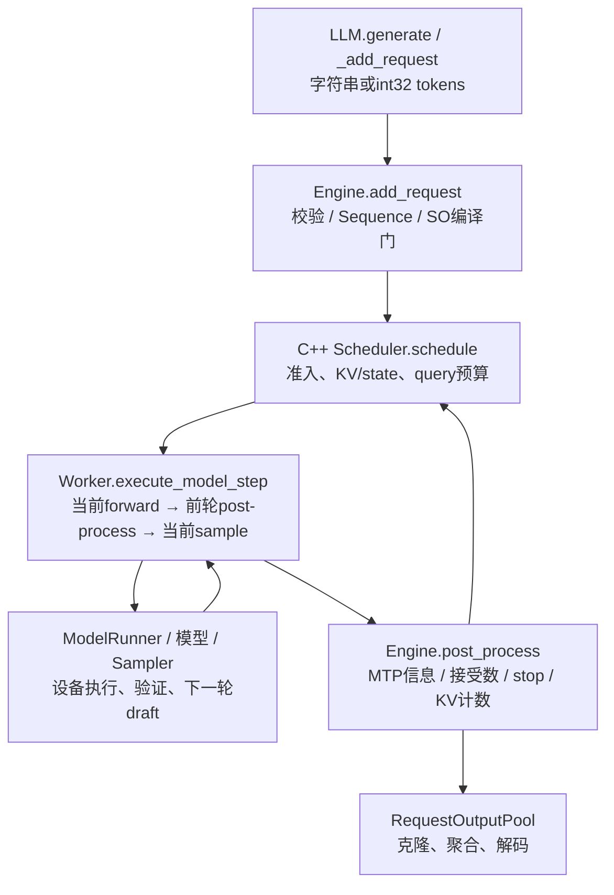

# DeepInfer：离线推理内核、异步调度与状态契约

> **版本**：`deepseek-ai/DeepInfer` @ `9bd9cf243fc53ef9afbf8f04d391d989117d6ab9`，2026-10-22从远端HEAD解析并按完整SHA取源码；包版本0.1.0。使用`code-researcher deep`，运行官方扫描器并追踪源码。**完成的是本文列出的静态切面精读，未构建、未下载模型、未运行GPU/NPU或性能测试；status不代表全上游逐行审计。**
>
> 运行与内存生命周期见 [runtime-and-lifetimes.md](runtime-and-lifetimes.md)；DSpark、SWA和格式约束见 [speculation-cache-and-so.md](speculation-cache-and-so.md)；版本、阅读覆盖及强结论复核见 [sources/MANIFEST.md](sources/MANIFEST.md)、[claim-audit.md](claim-audit.md)。

## 阅读结论

DeepInfer公开的是**针对DeepSeek-V4.1-Flash的离线推理引擎及相邻集成接口**。README将其描述为生产服务所用框架，同时明确KV缓存服务、完整VE/Prefill/Decode分离和DP副本负载均衡没有随本次发布提供。源码能解释模型如何被调度和执行，不能直接等同于一套可部署的完整DeepSeek在线服务。[README.md:3](https://github.com/deepseek-ai/DeepInfer/blob/9bd9cf243fc53ef9afbf8f04d391d989117d6ab9/README.md#L3) [README.md:39](https://github.com/deepseek-ai/DeepInfer/blob/9bd9cf243fc53ef9afbf8f04d391d989117d6ab9/README.md#L39)

最值得读的设计是四个：

1. **Python编排与C++请求状态分工**。`LLM.generate`处理输入并循环，Python Engine连接设备、模型和输出池；C++ Scheduler持有等待/运行状态、分配块、生成SequenceMetadata并回填接受结果。C++扩展并非仅承载数学算子。[deepinfer/entrypoints/llm.py:90](https://github.com/deepseek-ai/DeepInfer/blob/9bd9cf243fc53ef9afbf8f04d391d989117d6ab9/deepinfer/entrypoints/llm.py#L90) [deepinfer/engine/llm_engine.py:860](https://github.com/deepseek-ai/DeepInfer/blob/9bd9cf243fc53ef9afbf8f04d391d989117d6ab9/deepinfer/engine/llm_engine.py#L860) [csrc/engine/scheduler.hpp:667](https://github.com/deepseek-ai/DeepInfer/blob/9bd9cf243fc53ef9afbf8f04d391d989117d6ab9/csrc/engine/scheduler.hpp#L667)
2. **异步调度靠延迟记账和设备侧修正成立**。Worker先发本步forward，再处理前步结果，然后发本步sample；decode结果可留到下一步落账。CPU提前排批时还不知道上一轮接受数，GPU按重排映射修正长度和token来源。zero-overhead是隐藏CPU气泡的目标，不是没有CPU工作或同步。[deepinfer/worker/worker.py:89](https://github.com/deepseek-ai/DeepInfer/blob/9bd9cf243fc53ef9afbf8f04d391d989117d6ab9/deepinfer/worker/worker.py#L89) [deepinfer/worker/worker.py:191](https://github.com/deepseek-ai/DeepInfer/blob/9bd9cf243fc53ef9afbf8f04d391d989117d6ab9/deepinfer/worker/worker.py#L191)
3. **DSpark把草稿质量估计与验证预算接成闭环**。`DFlash`命名的实现产生draft、logprobs与confidence；C++按性能曲线和旧confidence选择总query量，GPU再用较新confidence分配每请求长度。confidence是调度估计，验证仍读取实际proposal logprobs。[deepinfer/model_executor/models/mtp/dflash.py:281](https://github.com/deepseek-ai/DeepInfer/blob/9bd9cf243fc53ef9afbf8f04d391d989117d6ab9/deepinfer/model_executor/models/mtp/dflash.py#L281) [csrc/engine/mtp_varlen.hpp:150](https://github.com/deepseek-ai/DeepInfer/blob/9bd9cf243fc53ef9afbf8f04d391d989117d6ab9/csrc/engine/mtp_varlen.hpp#L150) [deepinfer/model_executor/layers/sampler.py:427](https://github.com/deepseek-ai/DeepInfer/blob/9bd9cf243fc53ef9afbf8f04d391d989117d6ab9/deepinfer/model_executor/layers/sampler.py#L427)
4. **缓存不只有一张KV块表**。分页块、每sequence的SWA/压缩状态槽、需保存和无需保存的区域同时存在。YoCo compact还改变consumer层query布局；长度、行号、回退余量跨越多个模块，是维护的重点。[deepinfer/worker/cache_engine.py:222](https://github.com/deepseek-ai/DeepInfer/blob/9bd9cf243fc53ef9afbf8f04d391d989117d6ab9/deepinfer/worker/cache_engine.py#L222) [deepinfer/model_executor/input_metadata/yoco.py:94](https://github.com/deepseek-ai/DeepInfer/blob/9bd9cf243fc53ef9afbf8f04d391d989117d6ab9/deepinfer/model_executor/input_metadata/yoco.py#L94)

一条直接影响接入的限制是：**结构化输出请求被抢占时不能走普通重算恢复，会结束为FINISHED_PREEMPTED**。NORMAL普通请求可重入waiting；COMPLETION则在构造期要求`stop_preempted_request=true`，因为没有prefill重算通道。不要把“支持抢占”外推成所有请求都能透明恢复。[csrc/engine/scheduler.hpp:98](https://github.com/deepseek-ai/DeepInfer/blob/9bd9cf243fc53ef9afbf8f04d391d989117d6ab9/csrc/engine/scheduler.hpp#L98) [csrc/engine/scheduler.hpp:766](https://github.com/deepseek-ai/DeepInfer/blob/9bd9cf243fc53ef9afbf8f04d391d989117d6ab9/csrc/engine/scheduler.hpp#L766)

## 项目地图与阅读路线

官方扫描器在固定tarball得到336文件、63,630文本行：Python54,929行、C++5,909行、Markdown855行、Shell410行。扫描器没有给出entry candidates，需从公开示例反查入口。其测试分类统计20文件，**不等于20个测试函数**；算子文件内另有pytest测试。[pyproject.toml:27](https://github.com/deepseek-ai/DeepInfer/blob/9bd9cf243fc53ef9afbf8f04d391d989117d6ab9/pyproject.toml#L27) [deepinfer/model_executor/layers/tilelang_ops/schedule_mtp_varlen.py:103](https://github.com/deepseek-ai/DeepInfer/blob/9bd9cf243fc53ef9afbf8f04d391d989117d6ab9/deepinfer/model_executor/layers/tilelang_ops/schedule_mtp_varlen.py#L103)

| 责任 | 应先读的文件 | 本文深度 |
|---|---|---|
| 离线API/启动 | `examples/offline_inference.py`、`examples/_config.py`、`entrypoints/llm.py` | 追输入到返回 |
| 初始化/配置 | `engine/arg_utils.py`、`engine/llm_engine.py`、`worker/base.py` | 追关键默认值和设备交接 |
| 请求状态/调度 | `csrc/engine/scheduler.hpp`、`sequence.hpp`、`block_manager.hpp` | 追schedule、process_outputs、preempt和引用 |
| forward/sample与异步 | `worker/worker.py`、`worker/model_runner.py`、`csrc/engine/zos.cpp` | 追代表decode路径 |
| 草稿/缓存/格式 | `models/mtp/dflash.py`、`layers/sampler.py`、`worker/cache_engine.py`、`structure_output/` | 追跨模块契约，未穷举所有kernel |
| 外部算子/部署 | `requirements-*.txt`、`build.sh`、`doc/inference_deployment_qa.md` | 读依赖/作者自述；未审计外部算子库 |

建议先按`LLM._add_request/_run_engine → LLMEngine.step → Scheduler.schedule/process_outputs → Worker.execute_model_step → Sampler._verification`建立状态与时序骨架，再读attention/MoE内核。[deepinfer/entrypoints/llm.py:144](https://github.com/deepseek-ai/DeepInfer/blob/9bd9cf243fc53ef9afbf8f04d391d989117d6ab9/deepinfer/entrypoints/llm.py#L144) [deepinfer/engine/llm_engine.py:687](https://github.com/deepseek-ai/DeepInfer/blob/9bd9cf243fc53ef9afbf8f04d391d989117d6ab9/deepinfer/engine/llm_engine.py#L687) [deepinfer/worker/worker.py:89](https://github.com/deepseek-ai/DeepInfer/blob/9bd9cf243fc53ef9afbf8f04d391d989117d6ab9/deepinfer/worker/worker.py#L89)

### 构建和硬件边界

`pyproject.toml`声明Python≥3.12、setuptools、Beta阶段；`setup.py`构建`deepinfer._C`，公共源码包括调度、sequence、输入准备、采样准备和ZOS。NVIDIA走CUDAExtension、Ascend走NpuExtension，要求CXX11 ABI；NVIDIA构建还要求激活venv/conda。README支持硬件为SM100与Ascend950，不外推到任意CUDA卡。[pyproject.toml:1](https://github.com/deepseek-ai/DeepInfer/blob/9bd9cf243fc53ef9afbf8f04d391d989117d6ab9/pyproject.toml#L1) [setup.py:17](https://github.com/deepseek-ai/DeepInfer/blob/9bd9cf243fc53ef9afbf8f04d391d989117d6ab9/setup.py#L17) [README.md:35](https://github.com/deepseek-ai/DeepInfer/blob/9bd9cf243fc53ef9afbf8f04d391d989117d6ab9/README.md#L35)

公共requirements锁定transformers、xgrammar、tilelang等，平台文件另锁torch及硬件依赖。本文没有执行构建或验证本机能安装这些组合。[requirements.txt:1](https://github.com/deepseek-ai/DeepInfer/blob/9bd9cf243fc53ef9afbf8f04d391d989117d6ab9/requirements.txt#L1) [requirements-nvidia.txt:1](https://github.com/deepseek-ai/DeepInfer/blob/9bd9cf243fc53ef9afbf8f04d391d989117d6ab9/requirements-nvidia.txt#L1) [requirements-ascend.txt:1](https://github.com/deepseek-ai/DeepInfer/blob/9bd9cf243fc53ef9afbf8f04d391d989117d6ab9/requirements-ascend.txt#L1)

## 一条请求怎样走到输出

代表场景是**离线NORMAL引擎，一批文本prompt，NextN和ZOS启用**；SO、YoCo及CP>1作为分支，不假定每次都开。API默认可返回解码字符串；示例用`decode_sequence=False`拿逐token对象统计PPL。[deepinfer/entrypoints/llm.py:54](https://github.com/deepseek-ai/DeepInfer/blob/9bd9cf243fc53ef9afbf8f04d391d989117d6ab9/deepinfer/entrypoints/llm.py#L54) [examples/_config.py:120](https://github.com/deepseek-ai/DeepInfer/blob/9bd9cf243fc53ef9afbf8f04d391d989117d6ab9/examples/_config.py#L120)

F处理的是**已完成的轮次**，不保证是C刚排的当前轮。各边分别对应API入队、Engine调C++、Worker四阶段、Engine回填和API克隆。[deepinfer/entrypoints/llm.py:144](https://github.com/deepseek-ai/DeepInfer/blob/9bd9cf243fc53ef9afbf8f04d391d989117d6ab9/deepinfer/entrypoints/llm.py#L144) [deepinfer/engine/llm_engine.py:617](https://github.com/deepseek-ai/DeepInfer/blob/9bd9cf243fc53ef9afbf8f04d391d989117d6ab9/deepinfer/engine/llm_engine.py#L617) [deepinfer/engine/llm_engine.py:881](https://github.com/deepseek-ai/DeepInfer/blob/9bd9cf243fc53ef9afbf8f04d391d989117d6ab9/deepinfer/engine/llm_engine.py#L881) [deepinfer/worker/worker.py:121](https://github.com/deepseek-ai/DeepInfer/blob/9bd9cf243fc53ef9afbf8f04d391d989117d6ab9/deepinfer/worker/worker.py#L121) [deepinfer/engine/llm_engine.py:984](https://github.com/deepseek-ai/DeepInfer/blob/9bd9cf243fc53ef9afbf8f04d391d989117d6ab9/deepinfer/engine/llm_engine.py#L984) [deepinfer/entrypoints/llm.py:168](https://github.com/deepseek-ai/DeepInfer/blob/9bd9cf243fc53ef9afbf8f04d391d989117d6ab9/deepinfer/entrypoints/llm.py#L168)

1. **输入归一化**：deepcopy SamplingParams，token转np.int32并给request_id。空prompt报错，越界token记录后返回None，不能认为所有非法请求都遵守统一异常协议。[deepinfer/entrypoints/llm.py:144](https://github.com/deepseek-ai/DeepInfer/blob/9bd9cf243fc53ef9afbf8f04d391d989117d6ab9/deepinfer/entrypoints/llm.py#L144) [deepinfer/engine/llm_engine.py:553](https://github.com/deepseek-ai/DeepInfer/blob/9bd9cf243fc53ef9afbf8f04d391d989117d6ab9/deepinfer/engine/llm_engine.py#L553)
2. **可运行状态**：补EOS、可选多模态替换、compressed tokenizer映射，创建Sequence。SO matcher异步就绪后才入scheduler；`enqueue=False`同步等matcher。[deepinfer/engine/llm_engine.py:521](https://github.com/deepseek-ai/DeepInfer/blob/9bd9cf243fc53ef9afbf8f04d391d989117d6ab9/deepinfer/engine/llm_engine.py#L521) [deepinfer/engine/llm_engine.py:606](https://github.com/deepseek-ai/DeepInfer/blob/9bd9cf243fc53ef9afbf8f04d391d989117d6ab9/deepinfer/engine/llm_engine.py#L606)
3. **排批**：NORMAL在DP组内投票决定整步prefill或decode；不是任意混合两类token。输出metadata及state/block的clone/zero计划。[csrc/engine/scheduler.hpp:275](https://github.com/deepseek-ai/DeepInfer/blob/9bd9cf243fc53ef9afbf8f04d391d989117d6ab9/csrc/engine/scheduler.hpp#L275) [deepinfer/engine/llm_engine.py:889](https://github.com/deepseek-ai/DeepInfer/blob/9bd9cf243fc53ef9afbf8f04d391d989117d6ab9/deepinfer/engine/llm_engine.py#L889)
4. **执行**：Worker修正ZOS metadata后发forward，接着处理前轮、发本轮采样与草稿。forward/sample发射区有`forbid_cuda_sync`，必要同步放在Worker边界。[deepinfer/worker/model_runner.py:308](https://github.com/deepseek-ai/DeepInfer/blob/9bd9cf243fc53ef9afbf8f04d391d989117d6ab9/deepinfer/worker/model_runner.py#L308) [deepinfer/worker/worker.py:143](https://github.com/deepseek-ai/DeepInfer/blob/9bd9cf243fc53ef9afbf8f04d391d989117d6ab9/deepinfer/worker/worker.py#L143)
5. **回填**：先更新MTP信息，再处理接受前缀、stop、SO失败及KV计数。已抢占重算、现处WAITING的请求，其旧decode结果跳过记账。[deepinfer/engine/llm_engine.py:717](https://github.com/deepseek-ai/DeepInfer/blob/9bd9cf243fc53ef9afbf8f04d391d989117d6ab9/deepinfer/engine/llm_engine.py#L717) [csrc/engine/scheduler.hpp:917](https://github.com/deepseek-ai/DeepInfer/blob/9bd9cf243fc53ef9afbf8f04d391d989117d6ab9/csrc/engine/scheduler.hpp#L917)
6. **交付**：Engine返回池管理RequestOutput，API立即clone并按数字request_id恢复输入顺序，必要时decode。请求结束还需flush在途结果。[deepinfer/entrypoints/llm.py:175](https://github.com/deepseek-ai/DeepInfer/blob/9bd9cf243fc53ef9afbf8f04d391d989117d6ab9/deepinfer/entrypoints/llm.py#L175) [deepinfer/engine/llm_engine.py:977](https://github.com/deepseek-ai/DeepInfer/blob/9bd9cf243fc53ef9afbf8f04d391d989117d6ab9/deepinfer/engine/llm_engine.py#L977)

## 五个责任模块及其取舍

### 调度：协调资源、请求状态与DP步型

**代码事实**：C++`_schedule`释放GIL并获取BlockManager锁。NORMAL在ALL点要求全rank有prefill意愿，ANY点任一rank想做即可；第二轮allreduce确认实际排出了prefill，避免waiting非空但slots/块不足而不断空转。[csrc/engine/scheduler.hpp:275](https://github.com/deepseek-ai/DeepInfer/blob/9bd9cf243fc53ef9afbf8f04d391d989117d6ab9/csrc/engine/scheduler.hpp#L275)

decode按output_len排序，从短输出端取请求，缺块时优先抢占另一端长输出请求；再按总序列长度整理scheduled。源码注释写LCFS，但**排序键是输出长度，不是到达时间**，不把它解释成严格的last-arrival-first。[csrc/engine/scheduler.hpp:622](https://github.com/deepseek-ai/DeepInfer/blob/9bd9cf243fc53ef9afbf8f04d391d989117d6ab9/csrc/engine/scheduler.hpp#L622)

**设计解读**：DP同型投票使各rank的模型/EP collective阶段一致，代价是本rank可能陪跑空prompt。ANY间隔缓解只有个别rank有新活的等待；它给的是decode步计数条件，不是请求墙钟等待上界。[csrc/engine/scheduler.hpp:296](https://github.com/deepseek-ai/DeepInfer/blob/9bd9cf243fc53ef9afbf8f04d391d989117d6ab9/csrc/engine/scheduler.hpp#L296)

### Worker：一轮延迟换CPU与设备重叠

**代码事实**：decode开启ZOS时保存`prev_step_state`；prefill或关ZOS立即post-process。前轮采样event在post-process同步，remap连接相邻两批请求，GPU修正接受长度和变长query。[deepinfer/worker/worker.py:182](https://github.com/deepseek-ai/DeepInfer/blob/9bd9cf243fc53ef9afbf8f04d391d989117d6ab9/deepinfer/worker/worker.py#L182) [deepinfer/worker/worker.py:191](https://github.com/deepseek-ai/DeepInfer/blob/9bd9cf243fc53ef9afbf8f04d391d989117d6ab9/deepinfer/worker/worker.py#L191) [deepinfer/worker/worker.py:248](https://github.com/deepseek-ai/DeepInfer/blob/9bd9cf243fc53ef9afbf8f04d391d989117d6ab9/deepinfer/worker/worker.py#L248)

**设计解读**：它比逐轮同步更有机会隐藏CPU气泡，但账本需同时表达已提交token、KV已算token与在途预留。把前批行号当成本批行号会选错token或KV位置；不是只影响日志。借用内存和回填不变式详见运行专题。[csrc/engine/sequence.hpp:193](https://github.com/deepseek-ai/DeepInfer/blob/9bd9cf243fc53ef9afbf8f04d391d989117d6ab9/csrc/engine/sequence.hpp#L193) [csrc/engine/zos.cpp:85](https://github.com/deepseek-ai/DeepInfer/blob/9bd9cf243fc53ef9afbf8f04d391d989117d6ab9/csrc/engine/zos.cpp#L85)

### DSpark：估计收益与验证分布分开保存

**代码事实**：实现类名为DFlash、配置用`dflash_cfg.dspark_*`；本文不把这两个名字当成互不相关的系统。token、logprobs、top-k索引和confidence存入MTPInfoPool，0号slot供padding，其余slot由scheduler分配。[deepinfer/model_executor/models/mtp/dflash.py:143](https://github.com/deepseek-ai/DeepInfer/blob/9bd9cf243fc53ef9afbf8f04d391d989117d6ab9/deepinfer/model_executor/models/mtp/dflash.py#L143) [deepinfer/model_executor/layers/mtp_info_pool.py:14](https://github.com/deepseek-ai/DeepInfer/blob/9bd9cf243fc53ef9afbf8f04d391d989117d6ab9/deepinfer/model_executor/layers/mtp_info_pool.py#L14) [csrc/engine/scheduler.hpp:792](https://github.com/deepseek-ai/DeepInfer/blob/9bd9cf243fc53ef9afbf8f04d391d989117d6ab9/csrc/engine/scheduler.hpp#L792)

`MTPVarlen.schedule`比较“期望产出/预计耗时”，用N−2轮confidence决定总query，用可得的较新confidence分配每请求长度；ZOS较新长度在GPU重分配。无曲线则退回全草稿长度。**confidence不会代替proposal q进入拒绝验证。**[csrc/engine/mtp_varlen.hpp:150](https://github.com/deepseek-ai/DeepInfer/blob/9bd9cf243fc53ef9afbf8f04d391d989117d6ab9/csrc/engine/mtp_varlen.hpp#L150) [deepinfer/worker/worker.py:209](https://github.com/deepseek-ai/DeepInfer/blob/9bd9cf243fc53ef9afbf8f04d391d989117d6ab9/deepinfer/worker/worker.py#L209) [deepinfer/model_executor/layers/sampler.py:446](https://github.com/deepseek-ai/DeepInfer/blob/9bd9cf243fc53ef9afbf8f04d391d989117d6ab9/deepinfer/model_executor/layers/sampler.py#L446)

**设计解读**：模型head与硬件性能模型构成闭环，也引入曲线、在线耗时、confidence行序、schedule/process轮数的耦合；不能据head存在断言每个batch都会加速。部署问答给出低并发可下降的作者估算，本报告不当成性能复现。[csrc/engine/mtp_varlen.hpp:191](https://github.com/deepseek-ai/DeepInfer/blob/9bd9cf243fc53ef9afbf8f04d391d989117d6ab9/csrc/engine/mtp_varlen.hpp#L191) [doc/inference_deployment_qa.md:245](https://github.com/deepseek-ai/DeepInfer/blob/9bd9cf243fc53ef9afbf8f04d391d989117d6ab9/doc/inference_deployment_qa.md#L245)

### 缓存：分页、state与consumer视图共同作用

**代码事实**：Engine分别创建block_manager/state_manager，CacheEngine分别分配gpu_blocks/gpu_states。state中存储区和runtime dropped区布局不同，传CE和写disk使用不同大小。**这些原语存在，不表示独立KV存储服务也已发布。**[deepinfer/engine/llm_engine.py:262](https://github.com/deepseek-ai/DeepInfer/blob/9bd9cf243fc53ef9afbf8f04d391d989117d6ab9/deepinfer/engine/llm_engine.py#L262) [deepinfer/worker/cache_engine.py:918](https://github.com/deepseek-ai/DeepInfer/blob/9bd9cf243fc53ef9afbf8f04d391d989117d6ab9/deepinfer/worker/cache_engine.py#L918) [deepinfer/worker/cache_engine.py:222](https://github.com/deepseek-ai/DeepInfer/blob/9bd9cf243fc53ef9afbf8f04d391d989117d6ab9/deepinfer/worker/cache_engine.py#L222) [README.md:39](https://github.com/deepseek-ai/DeepInfer/blob/9bd9cf243fc53ef9afbf8f04d391d989117d6ab9/README.md#L39)

YoCo mask只收窄SWA可见域；compact移除consumer多余query，两者要求keep覆盖window+最大回退。DFlash target层必须在consumer边界同侧，compact不允许Engram落在consumer部分。**mask/compact比较的是相同截断语义，不能证明与未截断完整计算等价。**[deepinfer/environ.py:188](https://github.com/deepseek-ai/DeepInfer/blob/9bd9cf243fc53ef9afbf8f04d391d989117d6ab9/deepinfer/environ.py#L188) [deepinfer/model_executor/models/deepseek.py:118](https://github.com/deepseek-ai/DeepInfer/blob/9bd9cf243fc53ef9afbf8f04d391d989117d6ab9/deepinfer/model_executor/models/deepseek.py#L118) [deepinfer/model_executor/input_metadata/yoco.py:86](https://github.com/deepseek-ai/DeepInfer/blob/9bd9cf243fc53ef9afbf8f04d391d989117d6ab9/deepinfer/model_executor/input_metadata/yoco.py#L86)

### 格式约束：异步编译、临时推进与请求级失败

**代码事实**：SOMatcherBuilder.submit/pump分开编译线程和入队；Sampler先提交已接受token，临时推进draft生成逐位置mask，再rollback临时推进。mask在process_sampling前施加。matcher异常标aborted/so_status=-1，C++将其结束为FINISHED_SO_FAILED。[deepinfer/structure_output/so_matcher_builder.py:97](https://github.com/deepseek-ai/DeepInfer/blob/9bd9cf243fc53ef9afbf8f04d391d989117d6ab9/deepinfer/structure_output/so_matcher_builder.py#L97) [deepinfer/model_executor/layers/sampler.py:332](https://github.com/deepseek-ai/DeepInfer/blob/9bd9cf243fc53ef9afbf8f04d391d989117d6ab9/deepinfer/model_executor/layers/sampler.py#L332) [deepinfer/model_executor/layers/sampler.py:433](https://github.com/deepseek-ai/DeepInfer/blob/9bd9cf243fc53ef9afbf8f04d391d989117d6ab9/deepinfer/model_executor/layers/sampler.py#L433) [csrc/engine/scheduler.hpp:973](https://github.com/deepseek-ai/DeepInfer/blob/9bd9cf243fc53ef9afbf8f04d391d989117d6ab9/csrc/engine/scheduler.hpp#L973)

**设计解读**：局部失败降低一个SO请求牵连整批collective的机会，不是整个系统容错证明。SO抢占即结束意味着调用方要分清格式失败、编译失败与资源抢占，不能都当成正常stop。[deepinfer/model_executor/layers/sampler.py:377](https://github.com/deepseek-ai/DeepInfer/blob/9bd9cf243fc53ef9afbf8f04d391d989117d6ab9/deepinfer/model_executor/layers/sampler.py#L377) [csrc/engine/scheduler.hpp:766](https://github.com/deepseek-ai/DeepInfer/blob/9bd9cf243fc53ef9afbf8f04d391d989117d6ab9/csrc/engine/scheduler.hpp#L766)

采样还存在明确的数值取舍：[`tilelang_ops/common.py:53`](https://github.com/deepseek-ai/DeepInfer/blob/9bd9cf243fc53ef9afbf8f04d391d989117d6ab9/deepinfer/model_executor/layers/tilelang_ops/common.py#L53)定义`DRAFT_PROB_PENALTY=5e-5`，CUDA残差使用带此缩放的draft概率，不能仅凭比值接受测试宣称严格无损。具体公式、源码推导和未测边界见[机制专题](speculation-cache-and-so.md)。

## 参数沿真正入口解读

| 参数 | 固定版本的条件语义 | 证据 |
|---|---|---|
| NextN | 环境默认5、0关闭；不等于每轮验证5个 | [deepinfer/environ.py:128](https://github.com/deepseek-ai/DeepInfer/blob/9bd9cf243fc53ef9afbf8f04d391d989117d6ab9/deepinfer/environ.py#L128) |
| ZOS | 裸EnvVar默认False；EngineArgs按EngineType补值并rearm；NORMAL/COMPLETION默认开，PROMPT关；已有环境值保留 | [deepinfer/engine/arg_utils.py:48](https://github.com/deepseek-ai/DeepInfer/blob/9bd9cf243fc53ef9afbf8f04d391d989117d6ab9/deepinfer/engine/arg_utils.py#L48) [deepinfer/engine/engine_type.py:4](https://github.com/deepseek-ai/DeepInfer/blob/9bd9cf243fc53ef9afbf8f04d391d989117d6ab9/deepinfer/engine/engine_type.py#L4) |
| 变长验证 | 显式开MTP_VARLEN；预热得到曲线；无曲线回退全长 | [deepinfer/worker/base.py:274](https://github.com/deepseek-ai/DeepInfer/blob/9bd9cf243fc53ef9afbf8f04d391d989117d6ab9/deepinfer/worker/base.py#L274) [csrc/engine/mtp_varlen.hpp:150](https://github.com/deepseek-ai/DeepInfer/blob/9bd9cf243fc53ef9afbf8f04d391d989117d6ab9/csrc/engine/mtp_varlen.hpp#L150) |
| YoCo | 默认off；模型需有consumer，keep>0且≥window+backtracking；keep140是特定模型配方 | [deepinfer/model_executor/model_metadata_utils.py:75](https://github.com/deepseek-ai/DeepInfer/blob/9bd9cf243fc53ef9afbf8f04d391d989117d6ab9/deepinfer/model_executor/model_metadata_utils.py#L75) [csrc/engine/input_metadata/prepare_tensor_input_v4.cpp:348](https://github.com/deepseek-ai/DeepInfer/blob/9bd9cf243fc53ef9afbf8f04d391d989117d6ab9/csrc/engine/input_metadata/prepare_tensor_input_v4.cpp#L348) |
| batch invariant | NVIDIA可启用；NPU路径显式禁止；固定seed确定采样还需README的其他条件 | [deepinfer/worker/runtime_config.py:54](https://github.com/deepseek-ai/DeepInfer/blob/9bd9cf243fc53ef9afbf8f04d391d989117d6ab9/deepinfer/worker/runtime_config.py#L54) [README.md:25](https://github.com/deepseek-ai/DeepInfer/blob/9bd9cf243fc53ef9afbf8f04d391d989117d6ab9/README.md#L25) |
| 抢占恢复 | EngineArgs默认停止，离线LLM默认改为可重算；SO和COMPLETION独立约束 | [deepinfer/engine/arg_utils.py:34](https://github.com/deepseek-ai/DeepInfer/blob/9bd9cf243fc53ef9afbf8f04d391d989117d6ab9/deepinfer/engine/arg_utils.py#L34) [deepinfer/entrypoints/llm.py:65](https://github.com/deepseek-ai/DeepInfer/blob/9bd9cf243fc53ef9afbf8f04d391d989117d6ab9/deepinfer/entrypoints/llm.py#L65) [csrc/engine/scheduler.hpp:98](https://github.com/deepseek-ai/DeepInfer/blob/9bd9cf243fc53ef9afbf8f04d391d989117d6ab9/csrc/engine/scheduler.hpp#L98) |

EnvVar首次读后缓存进类属性；直接改os.environ不保证已读开关变化。EngineArgs为少数入口专门rearm。长驻进程比较两套设置应分进程，或明确恢复描述符和相关缓存。[deepinfer/environ.py:31](https://github.com/deepseek-ai/DeepInfer/blob/9bd9cf243fc53ef9afbf8f04d391d989117d6ab9/deepinfer/environ.py#L31) [tests/worker/test_state_cache_ops.py:387](https://github.com/deepseek-ai/DeepInfer/blob/9bd9cf243fc53ef9afbf8f04d391d989117d6ab9/tests/worker/test_state_cache_ops.py#L387)

## 测试、错误与观测

| 已读测试 | 验证目标及条件 | 证据的边界 |
|---|---|---|
| sampler统计 | 随机PIT+KS；128轨迹、最长2048token、多种温度/top-p，EP8单模型case | 不是全配置无偏证明；本轮未跑 [tests/models/test_sampler.py:1](https://github.com/deepseek-ai/DeepInfer/blob/9bd9cf243fc53ef9afbf8f04d391d989117d6ab9/tests/models/test_sampler.py#L1) [tests/models/test_sampler.py:35](https://github.com/deepseek-ai/DeepInfer/blob/9bd9cf243fc53ef9afbf8f04d391d989117d6ab9/tests/models/test_sampler.py#L35) [tests/models/test_sampler.py:240](https://github.com/deepseek-ai/DeepInfer/blob/9bd9cf243fc53ef9afbf8f04d391d989117d6ab9/tests/models/test_sampler.py#L240) |
| batch invariant | 同prompt批量与单条的token/logprob对比；单条使用批量产物golden trajectory | 不等于自由随机生成必逐字一致 [tests/models/test_batch_invariant.py:91](https://github.com/deepseek-ai/DeepInfer/blob/9bd9cf243fc53ef9afbf8f04d391d989117d6ab9/tests/models/test_batch_invariant.py#L91) |
| sync guard | mock全局debug mode，检查嵌套/跨线程恢复；另有GPU e2e | mock不是设备同步/性能结果 [tests/test_cuda_sync_guards.py:14](https://github.com/deepseek-ai/DeepInfer/blob/9bd9cf243fc53ef9afbf8f04d391d989117d6ab9/tests/test_cuda_sync_guards.py#L14) [tests/test_cuda_sync_guards.py:172](https://github.com/deepseek-ai/DeepInfer/blob/9bd9cf243fc53ef9afbf8f04d391d989117d6ab9/tests/test_cuda_sync_guards.py#L172) |
| YoCo等价脚本 | L1比metadata，L2比teacher-forcing logp/top-k与MTP confidence | 不比较完整未截断；本轮未执行 [examples/yoco/README.md:3](https://github.com/deepseek-ai/DeepInfer/blob/9bd9cf243fc53ef9afbf8f04d391d989117d6ab9/examples/yoco/README.md#L3) |
| state cache ops | SWA/store/CE布局往返、C1/C2、移除配置拒绝 | 不证明远端存储可靠 [tests/worker/test_state_cache_ops.py:656](https://github.com/deepseek-ai/DeepInfer/blob/9bd9cf243fc53ef9afbf8f04d391d989117d6ab9/tests/worker/test_state_cache_ops.py#L656) |

Engine有空输入/token范围校验、sequence创建日志；调度有position_end、MTP slot和状态断言。统计打印异常被记录，处理与模型执行失败分开。[deepinfer/engine/llm_engine.py:553](https://github.com/deepseek-ai/DeepInfer/blob/9bd9cf243fc53ef9afbf8f04d391d989117d6ab9/deepinfer/engine/llm_engine.py#L553) [csrc/engine/scheduler.hpp:682](https://github.com/deepseek-ai/DeepInfer/blob/9bd9cf243fc53ef9afbf8f04d391d989117d6ab9/csrc/engine/scheduler.hpp#L682) [deepinfer/engine/llm_engine.py:1004](https://github.com/deepseek-ai/DeepInfer/blob/9bd9cf243fc53ef9afbf8f04d391d989117d6ab9/deepinfer/engine/llm_engine.py#L1004)

CPU计时、forward/sample events、graph计时、StatsLogger和可选profile HTTP构成观测面。每步统计带实际生成/验证数、confidence误差、MoE负载比，有助于分开草稿质量与调度成本；字段存在不保证监控完整。[deepinfer/engine/llm_engine.py:297](https://github.com/deepseek-ai/DeepInfer/blob/9bd9cf243fc53ef9afbf8f04d391d989117d6ab9/deepinfer/engine/llm_engine.py#L297) [deepinfer/engine/llm_engine.py:763](https://github.com/deepseek-ai/DeepInfer/blob/9bd9cf243fc53ef9afbf8f04d391d989117d6ab9/deepinfer/engine/llm_engine.py#L763) [deepinfer/worker/worker.py:129](https://github.com/deepseek-ai/DeepInfer/blob/9bd9cf243fc53ef9afbf8f04d391d989117d6ab9/deepinfer/worker/worker.py#L129) [deepinfer/engine/llm_engine.py:235](https://github.com/deepseek-ai/DeepInfer/blob/9bd9cf243fc53ef9afbf8f04d391d989117d6ab9/deepinfer/engine/llm_engine.py#L235)

## 维护者应先守住的边界

- **改流水深度先改账本**：prev_step_state只有一个待处理step，MTP预算选择假定schedule/process至多差一轮；不能只增加排队深度。[deepinfer/worker/worker.py:74](https://github.com/deepseek-ai/DeepInfer/blob/9bd9cf243fc53ef9afbf8f04d391d989117d6ab9/deepinfer/worker/worker.py#L74) [csrc/engine/mtp_varlen.hpp:191](https://github.com/deepseek-ai/DeepInfer/blob/9bd9cf243fc53ef9afbf8f04d391d989117d6ab9/csrc/engine/mtp_varlen.hpp#L191)
- **显式处理借用期**：scheduler复用vector和RequestOutputPool不能跨step直接持有；异步消费者要copy/clone。[csrc/engine/pybind_scheduler.cpp:34](https://github.com/deepseek-ai/DeepInfer/blob/9bd9cf243fc53ef9afbf8f04d391d989117d6ab9/csrc/engine/pybind_scheduler.cpp#L34) [deepinfer/engine/llm_engine.py:860](https://github.com/deepseek-ai/DeepInfer/blob/9bd9cf243fc53ef9afbf8f04d391d989117d6ab9/deepinfer/engine/llm_engine.py#L860) [deepinfer/entrypoints/llm.py:175](https://github.com/deepseek-ai/DeepInfer/blob/9bd9cf243fc53ef9afbf8f04d391d989117d6ab9/deepinfer/entrypoints/llm.py#L175)
- **新模型需要满足实现契约**：ModelMetadata拒绝非MoE、C4/C128、compression overlap/APE；DFlash要求特定head类型及滑窗一致。[deepinfer/model_executor/model_metadata_utils.py:52](https://github.com/deepseek-ai/DeepInfer/blob/9bd9cf243fc53ef9afbf8f04d391d989117d6ab9/deepinfer/model_executor/model_metadata_utils.py#L52) [deepinfer/model_executor/model_metadata_utils.py:94](https://github.com/deepseek-ai/DeepInfer/blob/9bd9cf243fc53ef9afbf8f04d391d989117d6ab9/deepinfer/model_executor/model_metadata_utils.py#L94) [deepinfer/model_executor/models/mtp/dflash.py:94](https://github.com/deepseek-ai/DeepInfer/blob/9bd9cf243fc53ef9afbf8f04d391d989117d6ab9/deepinfer/model_executor/models/mtp/dflash.py#L94)
- **SWA与NextN一起改**：最大回退受NextN+1约束，keep、ring/state大小也依赖它；草稿长度不是独立于显存/布局的旋钮。[deepinfer/environ.py:128](https://github.com/deepseek-ai/DeepInfer/blob/9bd9cf243fc53ef9afbf8f04d391d989117d6ab9/deepinfer/environ.py#L128) [deepinfer/worker/cache_engine.py:88](https://github.com/deepseek-ai/DeepInfer/blob/9bd9cf243fc53ef9afbf8f04d391d989117d6ab9/deepinfer/worker/cache_engine.py#L88)
- **集成钩子不是完整服务**：do_save_kvcache、process_output、init_pd_split等基类方法留给上层，空实现不能证明3FS/在线路由/完整PD已可用。[deepinfer/engine/llm_engine.py:801](https://github.com/deepseek-ai/DeepInfer/blob/9bd9cf243fc53ef9afbf8f04d391d989117d6ab9/deepinfer/engine/llm_engine.py#L801)

进一步补证应在受支持硬件固定checkpoint和依赖，执行sampler统计检验、ZOS开关对比、YoCo L2与SO资源抢占用例。本报告无此运行结果，不写吞吐排行榜，也不把部署问答里的生产数字当成本轮测量。
