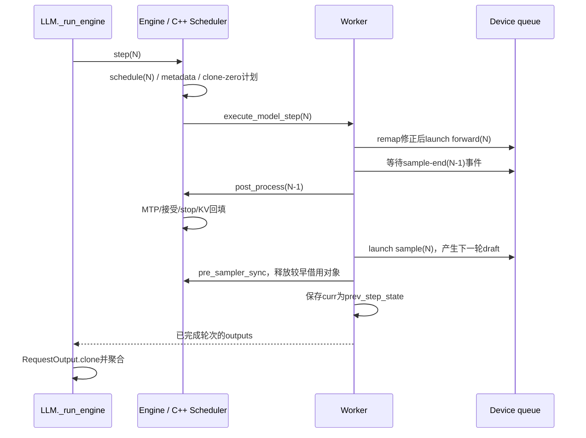

# DeepInfer运行专题：ZOS、回填与借用内存

> 对象为DeepInfer `9bd9cf243fc53ef9afbf8f04d391d989117d6ab9`；方法为`code-researcher deep`静态追踪，未执行模型。主报告见 [report.md](report.md)，范围见 [来源清单](sources/MANIFEST.md)。

## 为什么不能只画forward调用链

`LLMEngine.step()`返回的是已经可交付的RequestOutput，不保证属于它本次刚排出的batch。Worker保留前一步state，将CPU回填延后到下一次forward发射之后；因此请求的“调度过、算完、采样完、提交过”是不同事实。[deepinfer/engine/llm_engine.py:860](https://github.com/deepseek-ai/DeepInfer/blob/9bd9cf243fc53ef9afbf8f04d391d989117d6ab9/deepinfer/engine/llm_engine.py#L860) [deepinfer/worker/worker.py:89](https://github.com/deepseek-ai/DeepInfer/blob/9bd9cf243fc53ef9afbf8f04d391d989117d6ab9/deepinfer/worker/worker.py#L89)

图里“launch”不是设备已执行结束；event等待只针对相应采样终点，不能把图读成所有设备任务串行等待CPU。代码位置是Engine.step、Worker四阶段、Engine.post_process和API克隆；prefill/关ZOS会把当前轮也立即处理，是本图的例外。[deepinfer/engine/llm_engine.py:881](https://github.com/deepseek-ai/DeepInfer/blob/9bd9cf243fc53ef9afbf8f04d391d989117d6ab9/deepinfer/engine/llm_engine.py#L881) [deepinfer/worker/worker.py:121](https://github.com/deepseek-ai/DeepInfer/blob/9bd9cf243fc53ef9afbf8f04d391d989117d6ab9/deepinfer/worker/worker.py#L121) [deepinfer/worker/worker.py:143](https://github.com/deepseek-ai/DeepInfer/blob/9bd9cf243fc53ef9afbf8f04d391d989117d6ab9/deepinfer/worker/worker.py#L143) [deepinfer/worker/worker.py:182](https://github.com/deepseek-ai/DeepInfer/blob/9bd9cf243fc53ef9afbf8f04d391d989117d6ab9/deepinfer/worker/worker.py#L182) [deepinfer/engine/llm_engine.py:984](https://github.com/deepseek-ai/DeepInfer/blob/9bd9cf243fc53ef9afbf8f04d391d989117d6ab9/deepinfer/engine/llm_engine.py#L984) [deepinfer/entrypoints/llm.py:175](https://github.com/deepseek-ai/DeepInfer/blob/9bd9cf243fc53ef9afbf8f04d391d989117d6ab9/deepinfer/entrypoints/llm.py#L175)

## 三本账与一个映射

| 状态 | 所有者与意义 | 不能混为 |
|---|---|---|
| `input.tokens` | sequence已提交token；prompt及已经接受的生成结果 | 尚未验证的draft |
| `cache.num_tokens/previous_num_tokens` | KV计算进度；先乐观推进，再按实收token回填 | 完整输入长度 |
| `schedule.total_inflight_tokens/last_inflight_tokens` | 已调度但CPU还没落账的预留范围 | 已向用户承诺的输出 |
| `remap` | 本batch请求对前batch行号的对应，无前驱用−1 | 永远相同的batch位置或MTP slot |

这些字段分别落在`SequenceInput/KvCacheState/SequenceScheduleState`和`prepare_zos_inputs`调用，不能只看某一个`seqlen`判断请求状态。[csrc/engine/sequence.hpp:175](https://github.com/deepseek-ai/DeepInfer/blob/9bd9cf243fc53ef9afbf8f04d391d989117d6ab9/csrc/engine/sequence.hpp#L175) [csrc/engine/sequence.hpp:200](https://github.com/deepseek-ai/DeepInfer/blob/9bd9cf243fc53ef9afbf8f04d391d989117d6ab9/csrc/engine/sequence.hpp#L200) [csrc/engine/sequence.hpp:235](https://github.com/deepseek-ai/DeepInfer/blob/9bd9cf243fc53ef9afbf8f04d391d989117d6ab9/csrc/engine/sequence.hpp#L235) [deepinfer/worker/worker.py:209](https://github.com/deepseek-ai/DeepInfer/blob/9bd9cf243fc53ef9afbf8f04d391d989117d6ab9/deepinfer/worker/worker.py#L209)

C++调度计算`seqlen_k = cache.num_tokens + total_inflight_tokens + seqlen_q`，为本轮建立SequenceMetadata后再记录新的在途预留。position_end还预留NextN相关位置并检查不越runtime_max_model_len。这个额外区间解释了为什么“max_tokens还没到”也可能触发位置预算约束。[csrc/engine/scheduler.hpp:692](https://github.com/deepseek-ai/DeepInfer/blob/9bd9cf243fc53ef9afbf8f04d391d989117d6ab9/csrc/engine/scheduler.hpp#L692)

回填时先`finish_inflight_step`；若旧decode在途期间请求已被抢占并重入WAITING，跳过该旧输出。正常路径先`advance_optimistically(seqlens_q[i])`，从flat accepted_token_ids中只取首个−1以前的前缀，再加主模型输出，并逐token判stop；最后`commit_processed_tokens(token_cnt)`把KV进度收回到实收数量。[csrc/engine/scheduler.hpp:899](https://github.com/deepseek-ai/DeepInfer/blob/9bd9cf243fc53ef9afbf8f04d391d989117d6ab9/csrc/engine/scheduler.hpp#L899) [csrc/engine/scheduler.hpp:917](https://github.com/deepseek-ai/DeepInfer/blob/9bd9cf243fc53ef9afbf8f04d391d989117d6ab9/csrc/engine/scheduler.hpp#L917) [csrc/engine/scheduler.hpp:955](https://github.com/deepseek-ai/DeepInfer/blob/9bd9cf243fc53ef9afbf8f04d391d989117d6ab9/csrc/engine/scheduler.hpp#L955) [csrc/engine/scheduler.hpp:997](https://github.com/deepseek-ai/DeepInfer/blob/9bd9cf243fc53ef9afbf8f04d391d989117d6ab9/csrc/engine/scheduler.hpp#L997)

**维护推断**：新的异步取消/恢复逻辑必须同时维护这三本账。只清cache计数却继续处理旧输出，会把已经作废的forward再次记到新请求进度；现有WAITING分支就是防止这类重复记账的落点，不能单独删掉当成冗余检查。[csrc/engine/scheduler.hpp:917](https://github.com/deepseek-ai/DeepInfer/blob/9bd9cf243fc53ef9afbf8f04d391d989117d6ab9/csrc/engine/scheduler.hpp#L917)

## CPU不知道最新接受数时，输入怎样正确

`_correct_seqlens_qk`将本轮与上轮metadata交给C++`prepare_zos_inputs`，拿到remap和基础q/k长度；没有请求交集可短路。CPU数组异步搬到设备后：

1. 变长模式用前轮设备confidence重新分配固定total_q内的每请求q；
2. NextN>0时用实际accepted counts修正k；
3. 变长q异步拷回pinned CPU buffer，记录D2H event；
4. 当前forward发射后、准备当前sampler前同步该D2H event，用真实q更新CPU sampling metadata。

以上不是推测的实现顺序，分别可见`worker.py`内设备修正与event消费。[deepinfer/worker/worker.py:209](https://github.com/deepseek-ai/DeepInfer/blob/9bd9cf243fc53ef9afbf8f04d391d989117d6ab9/deepinfer/worker/worker.py#L209) [deepinfer/worker/worker.py:218](https://github.com/deepseek-ai/DeepInfer/blob/9bd9cf243fc53ef9afbf8f04d391d989117d6ab9/deepinfer/worker/worker.py#L218) [deepinfer/worker/worker.py:230](https://github.com/deepseek-ai/DeepInfer/blob/9bd9cf243fc53ef9afbf8f04d391d989117d6ab9/deepinfer/worker/worker.py#L230) [deepinfer/worker/worker.py:145](https://github.com/deepseek-ai/DeepInfer/blob/9bd9cf243fc53ef9afbf8f04d391d989117d6ab9/deepinfer/worker/worker.py#L145)

输入token也有fresh与重用前轮设备结果两种来源。C++`zos.cpp`对fresh请求从当前sequence取token和draft；其他请求需通过上轮设备sample/predict数组补正。Compressed tokenizer还有额外的历史窗口和padding契约，不能只让普通token数组对齐。[csrc/engine/zos.cpp:99](https://github.com/deepseek-ai/DeepInfer/blob/9bd9cf243fc53ef9afbf8f04d391d989117d6ab9/csrc/engine/zos.cpp#L99) [deepinfer/worker/worker.py:236](https://github.com/deepseek-ai/DeepInfer/blob/9bd9cf243fc53ef9afbf8f04d391d989117d6ab9/deepinfer/worker/worker.py#L236)

## 谁可以跨step保留对象

| 对象 | 具体寿命 | 接入规则 |
|---|---|---|
| `SchedulerOutputs.clone_states/clone_blocks/zero_states` | 借用scheduler内部vector；下一次schedule会clear/复用 | 立即消费或复制，不跨step存视图 |
| `process_outputs`统计数组 | 借用进程静态vector；下一次process_outputs覆盖 | 异步日志队列要持有copy |
| `RequestOutputPool`产物 | Engine文档写下一次step会释放 | API当步`RequestOutput.clone(raw_output)` |
| `SequenceMetadata`及待unpin的块 | DeferredRelease收集，后续pre_sampler_sync释放；clone_done event结束后unpin | 不在设备clone尚未完成时回收原块 |

对应证据分别是pybind说明、C++静态数组、Engine返回值注释与DeferredRelease实现。这里的“池管理”并不代表Python普通引用计数能延长底层C++对象寿命。[csrc/engine/pybind_scheduler.cpp:34](https://github.com/deepseek-ai/DeepInfer/blob/9bd9cf243fc53ef9afbf8f04d391d989117d6ab9/csrc/engine/pybind_scheduler.cpp#L34) [csrc/engine/scheduler.hpp:879](https://github.com/deepseek-ai/DeepInfer/blob/9bd9cf243fc53ef9afbf8f04d391d989117d6ab9/csrc/engine/scheduler.hpp#L879) [deepinfer/engine/llm_engine.py:860](https://github.com/deepseek-ai/DeepInfer/blob/9bd9cf243fc53ef9afbf8f04d391d989117d6ab9/deepinfer/engine/llm_engine.py#L860) [deepinfer/entrypoints/llm.py:179](https://github.com/deepseek-ai/DeepInfer/blob/9bd9cf243fc53ef9afbf8f04d391d989117d6ab9/deepinfer/entrypoints/llm.py#L179) [deepinfer/engine/llm_engine.py:67](https://github.com/deepseek-ai/DeepInfer/blob/9bd9cf243fc53ef9afbf8f04d391d989117d6ab9/deepinfer/engine/llm_engine.py#L67)

DeferredRelease.release会释放metadata/output，等待clone_done_evt后对state/block做unpin；`pre_sampler_sync`还接入可选KV保存、SO编译结果pump及结束请求finalize。这个名字不能理解成只做一次“采样前同步”：它是多个资源生命周期的交汇点。[deepinfer/engine/llm_engine.py:100](https://github.com/deepseek-ai/DeepInfer/blob/9bd9cf243fc53ef9afbf8f04d391d989117d6ab9/deepinfer/engine/llm_engine.py#L100) [deepinfer/engine/llm_engine.py:830](https://github.com/deepseek-ai/DeepInfer/blob/9bd9cf243fc53ef9afbf8f04d391d989117d6ab9/deepinfer/engine/llm_engine.py#L830)

**维护推断**：异步输出流、跨线程metrics或自定义引擎若把上述数组直接塞进队列，可能在消费者读取前就被复用；结果未必立刻崩溃，也可能表现为日志/输出内容被后轮覆盖。因此应在上层扩展点固定拥有权，而非依靠调度时机碰巧安全。[csrc/engine/pybind_scheduler.cpp:109](https://github.com/deepseek-ai/DeepInfer/blob/9bd9cf243fc53ef9afbf8f04d391d989117d6ab9/csrc/engine/pybind_scheduler.cpp#L109) [deepinfer/engine/llm_engine.py:867](https://github.com/deepseek-ai/DeepInfer/blob/9bd9cf243fc53ef9afbf8f04d391d989117d6ab9/deepinfer/engine/llm_engine.py#L867)

## 排批与抢占不是泛化的vLLM故事

NORMAL显式选择prefill或decode。ALL尝试点（默认70个decode step间隔）要求全员有新prefill意愿；ANY保底点（默认100）允许任一rank触发。`want`同时受缓存水位和waiting影响；第二次投票确认有rank真排到了请求，其他rank才陪跑空prompt。不能将这些步间隔换算为固定毫秒SLA。[deepinfer/environ.py:174](https://github.com/deepseek-ai/DeepInfer/blob/9bd9cf243fc53ef9afbf8f04d391d989117d6ab9/deepinfer/environ.py#L174) [csrc/engine/scheduler.hpp:296](https://github.com/deepseek-ai/DeepInfer/blob/9bd9cf243fc53ef9afbf8f04d391d989117d6ab9/csrc/engine/scheduler.hpp#L296)

decode资源不足时的行为取决于请求类型：

| 条件 | `_preempt`行为 | 后果 |
|---|---|---|
| stop_preempted_request=True | 标FINISHED_PREEMPTED并释放 | 调用方需识别非正常终止 |
| SO状态非0 | 即使stop=False也直接结束 | 无透明SO重算恢复 |
| 普通NORMAL、stop=False | reset_for_recompute、放waiting队首、释放块 | 后续再走prefill；不是swap-in恢复 |
| COMPLETION且stop=False | 构造期TORCH_CHECK拒绝 | 已公开的基类不允许该组合 |

这些条件来自同一构造闸门与_preempt分支，不用“一定重算”或“一定无损”覆盖所有请求。[csrc/engine/scheduler.hpp:98](https://github.com/deepseek-ai/DeepInfer/blob/9bd9cf243fc53ef9afbf8f04d391d989117d6ab9/csrc/engine/scheduler.hpp#L98) [csrc/engine/scheduler.hpp:766](https://github.com/deepseek-ai/DeepInfer/blob/9bd9cf243fc53ef9afbf8f04d391d989117d6ab9/csrc/engine/scheduler.hpp#L766)

## 该怎样验证这条运行路径

已有同步guard测试能定位CPU发射区意外同步、跨线程debug-mode恢复；sequence数组测试检查int32/布局等边界。但它们并不直接代替跨步取消、抢占、SO失败的组合测试。[tests/test_cuda_sync_guards.py:14](https://github.com/deepseek-ai/DeepInfer/blob/9bd9cf243fc53ef9afbf8f04d391d989117d6ab9/tests/test_cuda_sync_guards.py#L14) [tests/engine/test_sequence.py:58](https://github.com/deepseek-ai/DeepInfer/blob/9bd9cf243fc53ef9afbf8f04d391d989117d6ab9/tests/engine/test_sequence.py#L58)

维护建议是为同一固定请求集记录request_id、schedule/process计数、remap、cache.num_tokens与输出token，分别比较ZOS开/关、无draft/NextN、抢占前/后；对输出池消费者做延迟消费与显式clone的对照。**本轮未运行这些实验**，这里只说明由源码不变式导出的验证路径，不把建议写成已通过测试。
