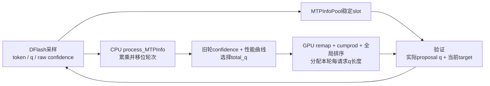

# DeepInfer机制专题：DSpark预算、SWA状态与结构化输出

> DeepInfer固定版本`9bd9cf243fc53ef9afbf8f04d391d989117d6ab9`；`code-researcher deep`静态阅读。本文解释已读源码的接口与取舍，不是训练/性能复现。入口见 [report.md](report.md)。

## 草稿、confidence和验证分布是三种数据

DFlash构造函数要求模型附带特定NextPredictHead，读`dflash_cfg.dspark_target_layer_ids`、Markov rank、noise token等字段；主模型forward收集目标层特征并写DFlash main cache。起草时先用golden token与noise初始化token槽，再跑draft层，随后逐位置做采样。类名与README的DSpark描述应通过这条实际调用链对应，而不是按名字推断两个独立架构。[deepinfer/model_executor/models/mtp/dflash.py:94](https://github.com/deepseek-ai/DeepInfer/blob/9bd9cf243fc53ef9afbf8f04d391d989117d6ab9/deepinfer/model_executor/models/mtp/dflash.py#L94) [deepinfer/model_executor/models/mtp/dflash.py:143](https://github.com/deepseek-ai/DeepInfer/blob/9bd9cf243fc53ef9afbf8f04d391d989117d6ab9/deepinfer/model_executor/models/mtp/dflash.py#L143) [deepinfer/model_executor/models/mtp/dflash.py:230](https://github.com/deepseek-ai/DeepInfer/blob/9bd9cf243fc53ef9afbf8f04d391d989117d6ab9/deepinfer/model_executor/models/mtp/dflash.py#L230) [deepinfer/model_executor/models/deepseek.py:220](https://github.com/deepseek-ai/DeepInfer/blob/9bd9cf243fc53ef9afbf8f04d391d989117d6ab9/deepinfer/model_executor/models/deepseek.py#L220)

Markov分支以已取出的draft token查嵌入，再做低秩投影加到下一位置logits；confidence head读取hidden与可选markov embedding，给每位置一个接受率估计。草稿logprobs则来自同一`process_sampling`，与token及top-k词表映射一起保存；不能把confidence当成q(token)。[deepinfer/model_executor/models/mtp/dflash.py:308](https://github.com/deepseek-ai/DeepInfer/blob/9bd9cf243fc53ef9afbf8f04d391d989117d6ab9/deepinfer/model_executor/models/mtp/dflash.py#L308)

| 数据 | 保存位置/用途 | 如果混淆会怎样 |
|---|---|---|
| draft token ids | MTPInfoPool.token_ids，验证候选及下一步输入 | pool行错位会验证另一请求候选 |
| draft logprobs与索引 | 稀疏top-k或全词表q，验证接受与残差 | 不能重算一份不同支撑集q后当原提议 |
| raw confidence | 预测token被接受的估计 | 仅调度收益估计，不是提议概率 |
| cumulative accept_rates | raw confidence累乘，选择prefix预算 | 后位置需要前位置均接受，不能直接把独立位置分数相加 |

存储契约与confidence累乘分别落在MTPInfoPool和C++process_MTPInfo。它同时移位prev/current值并更新process_cnt，跳过已经抢占回WAITING的在途旧结果。[deepinfer/model_executor/layers/mtp_info_pool.py:14](https://github.com/deepseek-ai/DeepInfer/blob/9bd9cf243fc53ef9afbf8f04d391d989117d6ab9/deepinfer/model_executor/layers/mtp_info_pool.py#L14) [csrc/engine/scheduler.hpp:1196](https://github.com/deepseek-ai/DeepInfer/blob/9bd9cf243fc53ef9afbf8f04d391d989117d6ab9/csrc/engine/scheduler.hpp#L1196)

## 总query预算与单请求长度的两阶段决策

设每请求至少算一个主token，第i条第j个draft的累计预计接受率为a(i,j)。C++将候选按预计接受率排序，每扩一个候选就估算：

\[
\widehat{throughput}(B)=\frac{N+\sum_{(i,j)\in S_B}a(i,j)}{baseline(graph(B))+slope\cdot graph(B)+sampler\_ms}.
\]

这是对实际`cur_expected / time_ms`代码的整理，**不是作者性能实测或全局最优证明**。`graph(B)`选择能容纳当前query量的曲线点；无曲线时直接用完整draft长度。[csrc/engine/mtp_varlen.hpp:150](https://github.com/deepseek-ai/DeepInfer/blob/9bd9cf243fc53ef9afbf8f04d391d989117d6ab9/csrc/engine/mtp_varlen.hpp#L150) [csrc/engine/mtp_varlen.hpp:231](https://github.com/deepseek-ai/DeepInfer/blob/9bd9cf243fc53ef9afbf8f04d391d989117d6ab9/csrc/engine/mtp_varlen.hpp#L231)

两个ranked queue故意使用不同轮次：总预算用N−2轮accept_rates，分请求长度用较新的值；schedule_cnt和process_cnt区分CPU回填是否完成。源码明确要求未来confidence不能影响较早draft是否被验证，这是因果约束，不能为了“分数更准”随意把同轮完整confidence回灌到总预算。[csrc/engine/mtp_varlen.hpp:160](https://github.com/deepseek-ai/DeepInfer/blob/9bd9cf243fc53ef9afbf8f04d391d989117d6ab9/csrc/engine/mtp_varlen.hpp#L160) [csrc/engine/mtp_varlen.hpp:191](https://github.com/deepseek-ai/DeepInfer/blob/9bd9cf243fc53ef9afbf8f04d391d989117d6ab9/csrc/engine/mtp_varlen.hpp#L191)

ZOS中，CPU只先定total_q；GPU kernel用remap取前批最新raw confidence，逐请求cumprod，全局按分数与flat-index平局规则排序，给每请求`1+wins`。函数内有reference和参数化对比测试；本文读到测试定义，未执行设备对拍。[deepinfer/worker/worker.py:218](https://github.com/deepseek-ai/DeepInfer/blob/9bd9cf243fc53ef9afbf8f04d391d989117d6ab9/deepinfer/worker/worker.py#L218) [deepinfer/model_executor/layers/tilelang_ops/schedule_mtp_varlen.py:37](https://github.com/deepseek-ai/DeepInfer/blob/9bd9cf243fc53ef9afbf8f04d391d989117d6ab9/deepinfer/model_executor/layers/tilelang_ops/schedule_mtp_varlen.py#L37) [deepinfer/model_executor/layers/tilelang_ops/schedule_mtp_varlen.py:103](https://github.com/deepseek-ai/DeepInfer/blob/9bd9cf243fc53ef9afbf8f04d391d989117d6ab9/deepinfer/model_executor/layers/tilelang_ops/schedule_mtp_varlen.py#L103)

图中q长度是query长度，验证中的proposal q是分布，两者同字母不同概念。存储、预算、GPU分配、验证入口分别对应pool、MTPVarlen、schedule_mtp_varlen与Sampler._verification。[deepinfer/model_executor/layers/mtp_info_pool.py:52](https://github.com/deepseek-ai/DeepInfer/blob/9bd9cf243fc53ef9afbf8f04d391d989117d6ab9/deepinfer/model_executor/layers/mtp_info_pool.py#L52) [csrc/engine/mtp_varlen.hpp:262](https://github.com/deepseek-ai/DeepInfer/blob/9bd9cf243fc53ef9afbf8f04d391d989117d6ab9/csrc/engine/mtp_varlen.hpp#L262) [deepinfer/model_executor/layers/tilelang_ops/schedule_mtp_varlen.py:11](https://github.com/deepseek-ai/DeepInfer/blob/9bd9cf243fc53ef9afbf8f04d391d989117d6ab9/deepinfer/model_executor/layers/tilelang_ops/schedule_mtp_varlen.py#L11) [deepinfer/model_executor/layers/sampler.py:411](https://github.com/deepseek-ai/DeepInfer/blob/9bd9cf243fc53ef9afbf8f04d391d989117d6ab9/deepinfer/model_executor/layers/sampler.py#L411)

### 性能反馈也有适用边界

SamplerRuntimeEstimator维护9个样本的中位数，至少5个样本后使用；ForwardRuntimeEstimator用最近5000step、每graph至少10个样本的分层中位数，修正启动曲线。估计的slope被截到非负，避免外推成非正耗时。**这些是算法参数，不能当成benchmark样本规模或普适的最优窗口。**[csrc/engine/mtp_varlen.hpp:20](https://github.com/deepseek-ai/DeepInfer/blob/9bd9cf243fc53ef9afbf8f04d391d989117d6ab9/csrc/engine/mtp_varlen.hpp#L20) [csrc/engine/mtp_varlen.hpp:40](https://github.com/deepseek-ai/DeepInfer/blob/9bd9cf243fc53ef9afbf8f04d391d989117d6ab9/csrc/engine/mtp_varlen.hpp#L40) [csrc/engine/mtp_varlen.hpp:216](https://github.com/deepseek-ai/DeepInfer/blob/9bd9cf243fc53ef9afbf8f04d391d989117d6ab9/csrc/engine/mtp_varlen.hpp#L216)

分布/序列长度发生突变、刚启动或confidence校准失效时，旧估计未必代表当下负载。合理的维护动作是分别记录验证预算、实收token、模型forward及sample耗时，而不是只看接受率；现有StepStats已经拆开这些字段。[deepinfer/engine/llm_engine.py:763](https://github.com/deepseek-ai/DeepInfer/blob/9bd9cf243fc53ef9afbf8f04d391d989117d6ab9/deepinfer/engine/llm_engine.py#L763)

## 验证的数学：比值测试之外还有数值取舍

Sampler先按row_to_req/local_step对齐参数，必要时把原draft top-k分布映射到当前target top-k词表，再交fused_sample；验证器读取pool中实际保存的draft ids/logprobs。force_topk是实现的候选空间裁剪，与SamplingParams.top_k不是同一层参数。[deepinfer/model_executor/layers/sampler_utils.py:162](https://github.com/deepseek-ai/DeepInfer/blob/9bd9cf243fc53ef9afbf8f04d391d989117d6ab9/deepinfer/model_executor/layers/sampler_utils.py#L162) [deepinfer/model_executor/layers/sampler.py:446](https://github.com/deepseek-ai/DeepInfer/blob/9bd9cf243fc53ef9afbf8f04d391d989117d6ab9/deepinfer/model_executor/layers/sampler.py#L446)

读到的CUDA路径以`min(target_lp-draft_lp,0)`指数化作为接受概率；拒绝采样权重则是：

\[
r(y)\propto\max\bigl(p_{target}(y)-e^{-\epsilon}q_{draft}(y),0\bigr),\qquad\epsilon=5\times10^{-5}.
\]

`DRAFT_PROB_PENALTY`及其理由见common.py，实际kernel在残差里减去带penalty的draft质量。**这不是不加扰动的精确p−q残差**，不能仅凭函数名或p/q接受判据宣称严格分布无损。[deepinfer/model_executor/layers/tilelang_ops/common.py:1](https://github.com/deepseek-ai/DeepInfer/blob/9bd9cf243fc53ef9afbf8f04d391d989117d6ab9/deepinfer/model_executor/layers/tilelang_ops/common.py#L1) [deepinfer/model_executor/layers/tilelang_ops/common.py:53](https://github.com/deepseek-ai/DeepInfer/blob/9bd9cf243fc53ef9afbf8f04d391d989117d6ab9/deepinfer/model_executor/layers/tilelang_ops/common.py#L53) [deepinfer/model_executor/layers/tilelang_ops/cuda/fused_sample.py:383](https://github.com/deepseek-ai/DeepInfer/blob/9bd9cf243fc53ef9afbf8f04d391d989117d6ab9/deepinfer/model_executor/layers/tilelang_ops/cuda/fused_sample.py#L383) [deepinfer/model_executor/layers/tilelang_ops/cuda/fused_sample.py:435](https://github.com/deepseek-ai/DeepInfer/blob/9bd9cf243fc53ef9afbf8f04d391d989117d6ab9/deepinfer/model_executor/layers/tilelang_ops/cuda/fused_sample.py#L435)

源码注释对该penalty给出单步概率误差界推导，fused_sample的reference也使用同一残差；这是作者对数值稳定取舍的显式说明。本文没有把注释中的单步理想推导升级成多step、top-k映射、SO、有限精度和所有硬件实现的全覆盖证明，也没有测实际偏差。[deepinfer/model_executor/layers/tilelang_ops/common.py:3](https://github.com/deepseek-ai/DeepInfer/blob/9bd9cf243fc53ef9afbf8f04d391d989117d6ab9/deepinfer/model_executor/layers/tilelang_ops/common.py#L3) [deepinfer/model_executor/layers/tilelang_ops/fused_sample.py:61](https://github.com/deepseek-ai/DeepInfer/blob/9bd9cf243fc53ef9afbf8f04d391d989117d6ab9/deepinfer/model_executor/layers/tilelang_ops/fused_sample.py#L61) [deepinfer/model_executor/layers/tilelang_ops/fused_sample.py:232](https://github.com/deepseek-ai/DeepInfer/blob/9bd9cf243fc53ef9afbf8f04d391d989117d6ab9/deepinfer/model_executor/layers/tilelang_ops/fused_sample.py#L232)

现存sampler测试使用随机PIT/KS等统计方法找偏差，能提供实测信号，但“未拒绝统计检验”本身也不是精确等价证明。本轮未运行测试，不填任何p值或通过率。[tests/models/test_sampler.py:1](https://github.com/deepseek-ai/DeepInfer/blob/9bd9cf243fc53ef9afbf8f04d391d989117d6ab9/tests/models/test_sampler.py#L1) [tests/models/test_sampler.py:240](https://github.com/deepseek-ai/DeepInfer/blob/9bd9cf243fc53ef9afbf8f04d391d989117d6ab9/tests/models/test_sampler.py#L240)

## 分页block与SWA/state是不同生命周期

BlockManager用引用计数和双向空闲链表管理整数块，0号块留作空/padding；allocate增引用，free归零回队列。该代码没有给每块实现跨请求hash前缀索引，报告不把它描述成已发布的完整prefix cache服务。[csrc/engine/block_manager.hpp:27](https://github.com/deepseek-ai/DeepInfer/blob/9bd9cf243fc53ef9afbf8f04d391d989117d6ab9/csrc/engine/block_manager.hpp#L27) [csrc/engine/block_manager.hpp:82](https://github.com/deepseek-ai/DeepInfer/blob/9bd9cf243fc53ef9afbf8f04d391d989117d6ab9/csrc/engine/block_manager.hpp#L82) [README.md:39](https://github.com/deepseek-ai/DeepInfer/blob/9bd9cf243fc53ef9afbf8f04d391d989117d6ab9/README.md#L39)

StateBlock布局先放需保存SWA，再放YOCO consumer SWA与compression state。分区依据模型n_prefill_layer，不取决于运行中开没开截断；传CE需要完整runtime状态，disk只保存stored区域。`state_size_to_disk`不是整个state slot大小。[deepinfer/worker/cache_engine.py:222](https://github.com/deepseek-ai/DeepInfer/blob/9bd9cf243fc53ef9afbf8f04d391d989117d6ab9/deepinfer/worker/cache_engine.py#L222) [deepinfer/worker/cache_engine.py:265](https://github.com/deepseek-ai/DeepInfer/blob/9bd9cf243fc53ef9afbf8f04d391d989117d6ab9/deepinfer/worker/cache_engine.py#L265) [deepinfer/worker/cache_engine.py:780](https://github.com/deepseek-ai/DeepInfer/blob/9bd9cf243fc53ef9afbf8f04d391d989117d6ab9/deepinfer/worker/cache_engine.py#L780)

SWA ring长度包含window与最大回退；kvstore视角还可能加prefill extra-state和YoCo余量。这些布局字段有class-level缓存，状态测试专门清理缓存避免前一配置导致假通过。改window/NextN/keep时要连同ring、拷贝边界和cache reset一起检查。[deepinfer/worker/cache_engine.py:88](https://github.com/deepseek-ai/DeepInfer/blob/9bd9cf243fc53ef9afbf8f04d391d989117d6ab9/deepinfer/worker/cache_engine.py#L88) [deepinfer/worker/cache_engine.py:130](https://github.com/deepseek-ai/DeepInfer/blob/9bd9cf243fc53ef9afbf8f04d391d989117d6ab9/deepinfer/worker/cache_engine.py#L130) [tests/worker/test_state_cache_ops.py:387](https://github.com/deepseek-ai/DeepInfer/blob/9bd9cf243fc53ef9afbf8f04d391d989117d6ab9/tests/worker/test_state_cache_ops.py#L387)

### YoCo compact究竟省掉哪部分

- mask保留full query布局，只换SWA pivots；compact创建consumer view，替换positions、query累计长度、SWA写槽与压缩key区间等query-aligned字段。[deepinfer/model_executor/input_metadata/yoco.py:86](https://github.com/deepseek-ai/DeepInfer/blob/9bd9cf243fc53ef9afbf8f04d391d989117d6ab9/deepinfer/model_executor/input_metadata/yoco.py#L86) [deepinfer/model_executor/input_metadata/yoco.py:94](https://github.com/deepseek-ai/DeepInfer/blob/9bd9cf243fc53ef9afbf8f04d391d989117d6ab9/deepinfer/model_executor/input_metadata/yoco.py#L94)
- 视图是浅拷贝，未替换tensor仍共享，注释禁止原地修改；CP>1还需重新mirror切分及consumer边界重分布。它不是简单地对hidden末尾切片。[deepinfer/model_executor/input_metadata/yoco.py:94](https://github.com/deepseek-ai/DeepInfer/blob/9bd9cf243fc53ef9afbf8f04d391d989117d6ab9/deepinfer/model_executor/input_metadata/yoco.py#L94) [deepinfer/model_executor/input_metadata/yoco.py:130](https://github.com/deepseek-ai/DeepInfer/blob/9bd9cf243fc53ef9afbf8f04d391d989117d6ab9/deepinfer/model_executor/input_metadata/yoco.py#L130)
- 模型层循环在n_prefill_layer边界切metadata，DFlash target特征也按consumer侧布局分配。目标层跨边界、consumer Engram等组合有启动断言。[deepinfer/model_executor/models/deepseek.py:118](https://github.com/deepseek-ai/DeepInfer/blob/9bd9cf243fc53ef9afbf8f04d391d989117d6ab9/deepinfer/model_executor/models/deepseek.py#L118) [deepinfer/model_executor/models/deepseek.py:190](https://github.com/deepseek-ai/DeepInfer/blob/9bd9cf243fc53ef9afbf8f04d391d989117d6ab9/deepinfer/model_executor/models/deepseek.py#L190)
- keep必须覆盖window+backtracking；mask/compact是同一截断可见域的两种实现。部署问答把bounded replay描述为近似SWA，因此不能借“mask/compact等价”偷换成“截断无精度损失”。[csrc/engine/input_metadata/prepare_tensor_input_v4.cpp:348](https://github.com/deepseek-ai/DeepInfer/blob/9bd9cf243fc53ef9afbf8f04d391d989117d6ab9/csrc/engine/input_metadata/prepare_tensor_input_v4.cpp#L348) [doc/inference_deployment_qa.md:183](https://github.com/deepseek-ai/DeepInfer/blob/9bd9cf243fc53ef9afbf8f04d391d989117d6ab9/doc/inference_deployment_qa.md#L183) [examples/yoco/README.md:3](https://github.com/deepseek-ai/DeepInfer/blob/9bd9cf243fc53ef9afbf8f04d391d989117d6ab9/examples/yoco/README.md#L3)

## SO状态机怎样跟推测执行配合

编译线程只完成future，不直接改scheduler；主线程pump把完成matcher挂回sequence再执行on_ready入队。这样将昂贵编译与推理调度分开，但第一次构建仍需创建编译器，部分输入校验也会直接抛异常，不能称所有失败都被异步吞掉。[deepinfer/structure_output/so_matcher_builder.py:46](https://github.com/deepseek-ai/DeepInfer/blob/9bd9cf243fc53ef9afbf8f04d391d989117d6ab9/deepinfer/structure_output/so_matcher_builder.py#L46) [deepinfer/structure_output/so_matcher_builder.py:58](https://github.com/deepseek-ai/DeepInfer/blob/9bd9cf243fc53ef9afbf8f04d391d989117d6ab9/deepinfer/structure_output/so_matcher_builder.py#L58) [deepinfer/structure_output/so_matcher_builder.py:97](https://github.com/deepseek-ai/DeepInfer/blob/9bd9cf243fc53ef9afbf8f04d391d989117d6ab9/deepinfer/structure_output/so_matcher_builder.py#L97)

运行时的四个操作必须配对：

1. 将上一步真正接受的token提交给matcher；
2. 临时接受draft前缀，逐位置计算合法token mask；
3. rollback仅本次临时接受的draft数；
4. 在target logits采样/验证前应用相应位置mask。

这些位置分别在Sampler._get_so_mask与_verification，mask拷贝还用独立stream/event和record_stream表达寿命。不要把临时accept当作永久输出，也不要为了并行把同一matcher无保护地共享到多个请求。[deepinfer/model_executor/layers/sampler.py:351](https://github.com/deepseek-ai/DeepInfer/blob/9bd9cf243fc53ef9afbf8f04d391d989117d6ab9/deepinfer/model_executor/layers/sampler.py#L351) [deepinfer/model_executor/layers/sampler.py:366](https://github.com/deepseek-ai/DeepInfer/blob/9bd9cf243fc53ef9afbf8f04d391d989117d6ab9/deepinfer/model_executor/layers/sampler.py#L366) [deepinfer/model_executor/layers/sampler.py:391](https://github.com/deepseek-ai/DeepInfer/blob/9bd9cf243fc53ef9afbf8f04d391d989117d6ab9/deepinfer/model_executor/layers/sampler.py#L391) [deepinfer/model_executor/layers/sampler.py:433](https://github.com/deepseek-ai/DeepInfer/blob/9bd9cf243fc53ef9afbf8f04d391d989117d6ab9/deepinfer/model_executor/layers/sampler.py#L433)

错误路径将matcher标aborted并so_status=-1，C++结束请求；抢占则因不支持SO重算而直接FINISHED_PREEMPTED。建议接入方保留这些终止原因；一次格式失败不得被包装成“合法完成了一段文本”。[deepinfer/model_executor/layers/sampler.py:377](https://github.com/deepseek-ai/DeepInfer/blob/9bd9cf243fc53ef9afbf8f04d391d989117d6ab9/deepinfer/model_executor/layers/sampler.py#L377) [csrc/engine/scheduler.hpp:973](https://github.com/deepseek-ai/DeepInfer/blob/9bd9cf243fc53ef9afbf8f04d391d989117d6ab9/csrc/engine/scheduler.hpp#L973) [csrc/engine/scheduler.hpp:766](https://github.com/deepseek-ai/DeepInfer/blob/9bd9cf243fc53ef9afbf8f04d391d989117d6ab9/csrc/engine/scheduler.hpp#L766)

## 尚未闭合的证据

- 实际confidence校准、变长预算收益、数值penalty对多轮输出的影响均未运行测量。
- NVIDIA与Ascend有独立kernel实现，本轮主要追CUDA验证与公共接口，不能宣称两者所有数值边界相同。
- 没有实现/部署独立KV存储、PD路由或生产调度负载均衡；部署文档属于作者自述，与公开引擎源码分别引用。
- 训练confidence/draft head的目标与数据不是本轮代码阅读结论；只读到已加载参数与推理路径。
