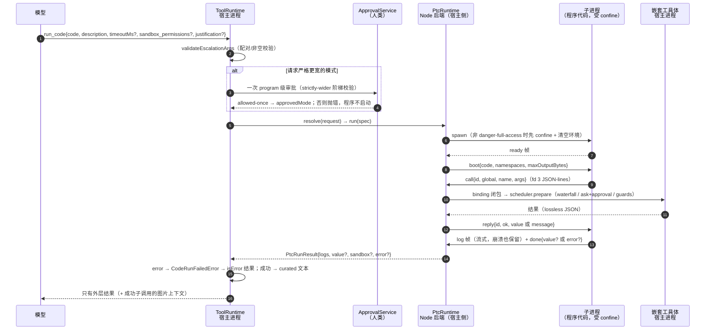

# DSH `ptc` 线深读：Programmatic Tool Calling 的机制与安全边界

> **2026-10-22 源码复核**：当前无 Git 身份的快照、文件指纹及已核范围见 [sources/MANIFEST.md](sources/MANIFEST.md)；版本字符串不等于 commit。

> **对象**：`/tmp/dsh-src`（DSH 仓库 checkout，**无 `.git`**，全程只读，不 commit、不改动）。本题所有代码引用均相对该目录；引用的限制条目原文见 `packages/ptc-runtime/ptc-runtime-node/README.md`。
> **版本依据**：`package.json:3` → `"version": "0.2.1-rc.2"`。仓库无 `.git`，无法用 tag/commit 交叉验证，此为该文件的一手声明。
> **方法**：`code-researcher` skill 的 `deep` 模式（Codebase Map → Runtime Story → Design Inquiry → Maintainer Notes）；结论一律带 `文件:行`。
> **一手文件 21 个**：`package.json`、`core/tools/src/ptc.ts`、`core/tools/src/ptc-calls.ts`、`core/tools/src/index.ts`、`core/tools/tests/ptc.spec.ts`、`core/tools/tests/ptc-calls.spec.ts`、`core/tools/README.md`、`ptc-runtime/ptc-runtime/src/{index,types}.ts`、`ptc-runtime/ptc-runtime/README.md`、`ptc-runtime/ptc-runtime-node/src/{index,config,launch,protocol,policy-processes}.ts`、`ptc-runtime/ptc-runtime-node/README.md`、`sandbox/sandbox/src/escalation.ts`、`experimental/ptc-runtime-python/README.md`、`experimental/ptc-runtime-python/src/{index,launch}.ts`、`snapshots/session/ptc-node-workspace/cordis.yml`。

## 结论摘要（5 条）

1. **`ptc` 是"程序化工具调用"：模型输出一段程序，程序在运行时里用 `await tools.<name>(args)` 调工具。** 与 one-tool-per-turn 的差别不在速度，而在**谁决定调用序列**：一次 `run_code` 调用内部可以嵌套任意多次工具 sub-dispatch，这些 sub-dispatch 记入 Session 日志用于重建，但**只有外层 curated 结果进入模型历史**（`packages/core/tools/src/ptc.ts:1-7`；协议字段见 `packages/ptc-runtime/ptc-runtime/src/types.ts:20,51-67,81`）。
2. **能用的入口只有一个工具 `run_code`，开关是 `tools` 的 `mode: 'ptc'`（或 per-agent `presentAs('ptc')`）。** 在 `ptc` 模式下一次装配只把 `run_code` 投给模型，其余工具名在模型直呼时被确定性拒绝并给出改道提示；程序运行在独立子进程（Node 后端 `isolation = 'process'`，受 `ctx.sandbox.confine` 约束），而**嵌套工具在宿主进程内执行**（`packages/core/tools/src/index.ts:60,812,1034-1035,1473-1479`；`packages/ptc-runtime/ptc-runtime-node/src/index.ts:41,219,231`）。
3. **安全边界：程序级"更宽模式"审批复用了 `approveEscalation`，且审批发生在 `runtime.resolve/run` 之前；嵌套工具各自走自己的 `tools/pre-execute` + approval，互不继承。** 所查调用链中程序级升级审批在执行前，但这**不构成整个系统无绕过路径的证明**，并有三处反复用护栏（同 Session 换模式即 abort 并等清理、失效进程、升级运行时丢弃 `stateOwner`）。**证明方式（否定性结论必须写清搜索面）**：在 `packages/core/tools/src/ptc.ts`、`packages/core/tools/src/ptc-calls.ts`、`packages/ptc-runtime/**` 内 `grep -rn 'approveEscalation\|approval'` 全量枚举，**唯一审批调用**是 `ptc.ts:395 await approveEscalation({...})`，其余命中为类型导入（`ptc.ts:21,23`）与 schema 描述（`:103,104,113,124`）。这证明的是"**这些文件里没有第二条审批路径**"，**不是**"整个系统不存在该路径"。

需要明确的是：**幂等重放当前模式本来就不触发审批**（`escalation.ts:173`），且程序自身对文件系统的直接效果由 OS 沙箱一次性授权覆盖、不逐次审批——这是设计而非绕过（见「机制 §4」与「未能确证」）。
4. **失败是结果字段而非异常；超时/中断在运行时侧被归一成 `timeout` / `abort` 两类 kind。** `PtcRunResult.error.kind` 有 8 类正交取值；`run_code` 把它转成 `CodeRunFailedError`（code `CODE_RUN_FAILED`），最终以结构化 `isError` 结果回给模型，文本形如 `code run failed (<kind>): <message>` + `Captured output:` + `File sandbox:` 行（`types.ts:139-144,146-150`；`ptc.ts:168-173,736-741`）。
5. **已知限制分四处原文可引**：Node 后端 8 条（进程/隔离/输出上限，`ptc-runtime-node/README.md:158-171`）、seam 4 条（一次性 run、无可流式日志、后端封闭能力不等、无统一 binding 字节上限，`ptc-runtime/README.md:122-132`）、Python 后端 11 条（Unix-only、无 profile 挂载等，`ptc-runtime-python/README.md:121-138`）、`core/tools` 3 条（PTC 中间值不受字节限制等，`core/tools/README.md:225-238`）。原文逐条引用见「机制 §6」。

---

## 机制

### 1. 一次 `run_code` 的调用链（含进程/审批边界）

图中每条边都有源码依据：schema 与参数校验（`ptc.ts:101-105,378-390`）、审批在 `run` 之前（`ptc.ts:391-405`，测试 `ptc.spec.ts:2460,2480,2484-2485`）、`resolve`→`run`（`ptc.ts:715-727`）、confine/spawn（`ptc-runtime-node/src/index.ts:219,231`）、`boot`/`call`/`reply`/`done` 帧（`protocol.ts:10-21,24-34,55-59,65-67`）、子进程 `call` 到宿主 binding 的分派（`ptc-runtime-node/src/index.ts:307-325`）、嵌套工具的 pre-execute/ask/guard（`core/tools/src/index.ts:1497-1543`）、失败转换（`ptc.ts:736-741`）、图片上下文（`ptc.ts:641-646`）。

### 2. 与 one-tool-per-turn 的差别：类型与协议层面

**（a）模型输出的对象不同。** 原生模式模型产出一个 Function Call；`ptc` 模式模型产出一段源码，工具名只是程序里的一个全局对象成员：

- `PtcBindingFunction = (args: unknown) => Promise<PtcJsonValue>`（`types.ts:20`）——工具被抽象成**宿主侧异步函数**；
- `PtcBindingNamespace` 把一组成员聚成一个全局对象（e.g. `tools`），并规定名字按 own property 解析、`__proto__` 也只能是普通键（`types.ts:51-67`；`ptc.ts:686-694` 用 null-prototype + `defineProperty` 落实）；
- `PtcRunRequest.program` 是源码字符串，`bindings` 是宿主函数表（`types.ts:73-105`）。

**（b）"谁能被调用"由注册表按 agent 视图投影，而不是模型挑 schema。** 程序可绑定的集合 = `registry.schemas(exec.agent)` 去掉 `run_code` 自身（`ptc.ts:691-694`），所以程序能调的恰好是提示里声明过的那些；装配时 `wireSchemas` 在 `ptc` 下**只投 `run_code`**，`knownNames` 也只留它（`core/tools/src/index.ts:1028-1035`）。模型若直呼其它工具，注册表在策略管线之前就确定性拒绝并给出改道文案（`core/tools/src/index.ts:1473-1479`，提示语原文见 `index.ts:60`）。

**（c）调用序列的执行者在运行时，不在模型回合。** 每个 sub-dispatch 派生 `<parent>:ptc:<n>` 的 callId（`ptc.ts:539-546`），继承 `rootCallId` 与 `parent` token（`ptc.ts:549-550`），并按与原生循环同一套并发契约排队：有序阶段（start/prepare/finalize-commit）单车道，只有 body 阶段并发，`exclusive` 独占（`ptc.ts:417-446,468-522`）。

**（d）历史里只剩 curated 结果。** sub-dispatch 以 `tool/ptc-dispatch-start` 与 `tool/ptc-dispatch` 事件落 Session（`ptc.ts:613-620,580-600`），模型历史只留外层 `logs` + `result` + `sandbox`（`ptc.ts:352-377,742-746`）。"curated"是字面意义：只有 `print`/`console.log` 与返回值成为输出，中间值不跨边界（`ptc-runtime-node/src/index.ts:46-48`；`core/tools/README.md:215`）。成功带图的子调用结果会以外层上下文追加，而不是内联进程序值（`ptc.ts:641-646`）。

### 3. 谁会加载它、跑在哪

| 问题 | 答案 | 证据 |
|---|---|---|
| 开关 | `@deepseek-ai/dsh-tools` 的 `mode: 'native' \| 'ptc'`；per-agent 用 `presentAs('ptc')` | `core/tools/src/index.ts:812-813,985-1026` |
| 没有 runtime 会怎样 | 装配期抛可操作的错（"mode ptc requires a PTC runtime…"），不做静态 `inject`，以免 native 部署被绑架 | `core/tools/src/index.ts:1053-1063` |
| 组合示例 | 一个真实 profile：`id: tools` + `config.mode: ptc`，同文件还插入 `literal-sdk` 夹具 | `snapshots/session/ptc-node-workspace/cordis.yml:26-28` |
| 程序跑在哪 | 独立托管 Node **子进程**（`isolation = 'process'`），每次调用新进程；非 `danger-full-access` 时 `confine` 到沙箱 runner，环境变量按黑名单清空 | `ptc-runtime-node/src/index.ts:40-41,46-49,219,224-231` |
| 嵌套工具跑在哪 | **宿主进程**：程序只发 `call` 帧，宿主持有真函数表并在同一 `ToolRuntime` 上 dispatch | `protocol.ts:13`；`ptc-runtime-node/src/index.ts:307-325`；`ptc.ts:558-559` |
| Python 后端 | 独立 CPython 子进程，Unix-only，`danger-full-access` 时显式跳过 confine | `ptc-runtime-python/src/index.ts:756-757,1029-1030`；`ptc-runtime-python/README.md:136` |
| 另一类消费者 | seam 也被 `dsh-workflow-ptc` 复用（workflow 编排），不属于 `run_code` 这条线 | `ptc-runtime/ptc-runtime/README.md:28` |

进程边界是这条线最重要的设计事实：**"程序"在沙箱里，"工具"不在沙箱里**。所以"程序调工具"这一步必须跨进程回宿主，而这一步正好是审批与策略管线的插入点（沙箱侧：`ptc-runtime-node/src/index.ts:219,231`；跨进程回宿主：`protocol.ts:24-34,65-67` + `ptc-runtime-node/src/index.ts:307-325`；管线：`core/tools/src/index.ts:1497-1543`）。

### 4. 审批与沙箱复用：能证明有效的 / 只能标注的

**复用链路（能证明有效）。** `run_code` 的可选参数直接复用沙箱包的目标词表与校验器（`ptc.ts:21,101-105,384`）；真正判定用同一个 `approveEscalation`，并且把主语改成 `'program'`：

- 阶梯是 `read-only → workspace-write|danger-full-access`、`workspace-write → danger-full-access`（`sandbox/sandbox/src/escalation.ts:28-31`）；
- 重复当前有效模式**不审批**直接返回（`escalation.ts:173`）；非严格更宽直接抛错（`escalation.ts:177-179`）；
- 无 approval 服务、无 agent 均 fail-closed（`escalation.ts:180-185`；`core/tools/src/index.ts:1741-1747`；测试 `ptc.spec.ts:2414`）；
- 四种结局一一映射，拒绝/取消/不可用分别给出不同文案（`escalation.ts:199-206`）。

**时序（能证明有效）。** 审批在 `resolve/run` 之前完成：审批未返回时 `runtime.resolve` 一次都没被调用、`lastRequest` 为空（`ptc.spec.ts:2480,2484-2485`）；非授予结局下程序从不启动（`ptc.spec.ts:2392` 参数化覆盖 `rejected/cancelled/unavailable`）。取消（调用方取消或策略变更）同样发生在启动之前（`ptc.spec.ts:2423`）。

**授权范围（能证明有效）。** 一次授权只覆盖**这一次程序执行**：批准后的 mode 只写进本次 `policy` 并随 `PtcRunRequest.sandboxPolicy` 下传（`ptc.ts:393-405,725`）；Session 的常驻策略不变（`ptc.spec.ts:2489-2492` 断言 `resolve({session}).mode` 仍是 `read-only`）。拒绝时不会自动重放，并明确提示"先检查已完成的效果"（`ptc.ts:122-125`；测试 `ptc.spec.ts:2439,2454`）。

**嵌套工具的审批独立（能证明有效）。** 宿主收到 `call` 帧后走 `scheduler.prepare`，即 `tools/pre-execute` waterfall → `ask` 转 `serviceAsk` → 单调 guards（`core/tools/src/index.ts:1497-1543,1735-1778`）。测试同一个程序里 `run_code` 被批准、`echo` 被拒绝，且请求序为 `[run_code, echo]`（`ptc.spec.ts:2489`）。所以"外层批了 danger-full-access"不会让内层 `bash`/`fs` 免审——它们各自按自己解析出的策略重新走一遍（`ptc.ts:124` 的模型可见措辞也这么写）。

**三处反复用护栏（能证明有效）。**

1. **同一 Session 的并发**：`PtcCalls.run` 在读最新模式前先 abort 并 await 掉模式已变的前驱调用，新调用用 `AbortSignal.any([caller, policyChange])` 复合信号；registry dispose 后拒绝新调用（`ptc-calls.ts:44-63,28-33`；测试 `ptc-calls.spec.ts:21,54,70`）。
2. **进程失效**：`session/event` 的 `sandbox/mode` 变化会把该 Session 的进程标为 invalidated 并异步释放，下一次 run 之前 `wait`（`ptc-runtime-node/src/policy-processes.ts:23-54,61-63`）。
3. **状态不跨授权**：只有"本次 policy 模式 == 常驻模式"时才把 `stateOwner` 交给运行时，即保留式 REPL 环境在升级执行中租不到（`ptc.ts:717`；测试 `ptc.spec.ts:2491` 断言升级时 `stateOwner` 为 `undefined`，而常规运行是 `agent`，`ptc.spec.ts:2508`）。

**递归自调用被切断（能证明有效）。** 程序可绑定的集合显式跳过 `run_code`（`ptc.ts:691-694`），程序无法用 `tools.run_code(...)` 绕过外层那一层审批嵌套出第二个程序。

**只能标注、不能说"有效"的部分。**

- **程序内部的直接文件效果不走工具层审批（结构推断：无拦截点）。** 程序里 `await import('node:fs')` 之类直接动文件时，工具层没有拦截点——`tools/pre-execute` 只在工具 dispatch 时跑，而这一步在子进程里发生、不经过注册表；约束来自 OS 沙箱那一次授权。官方措辞是"Direct filesystem access follows this execution's sandbox policy"（`ptc-runtime-node/src/index.ts:48,219`）。这是**一次授权覆盖整段程序**的必然结果，不是漏洞，但它意味着"逐操作审批"在这条线上不存在。
- **`denied` 不是执行证据。** `PtcRunSandbox.denied` 的注释明确写"Program failure text matched backend diagnostics; not enforcement proof or an exhaustive denial record"（`types.ts:115-123`），`enforcement` 也可能只是 `partial`（`ptc.ts:373`）。
- **沙箱的实际强度取决于后端。** 代码只能证明"把 argv 交给了 `ctx.sandbox.confine`"，不能证明内核层面的封闭完整性（见「未能确证」）。

### 5. 失败与超时语义

**错误怎么回给模型。** 三层收口：

1. 运行时侧：失败是 `PtcRunResult` 的字段，**从不以 reject 表达**（`types.ts:146-150`），8 类正交 kind：`exception | timeout | abort | worker-exit | invalid-output | output-limit | protocol | sandbox-unavailable`（`types.ts:139-144`）。
2. 传输侧：`ptc.ts` 把 `result.error` 转成 `CodeRunFailedError`（`CODE_RUN_FAILED`），文本 = `code run failed (<kind>): <message>` + 可选 `Captured output:` 逐行 + 可选 `File sandbox: <mode>; enforcement: <…>; operation denied`；若被沙箱拒绝，再附上一段"更宽模式只能批一次、嵌套工具各自审批、不会自动重放"的指引（`ptc.ts:168-173,736-741,122-125`）。
3. 注册表侧：`HarnessError` 被管线转成结构化 `isError` 结果（`info: { name: 'CodeRunFailedError', code: 'CODE_RUN_FAILED' }`），content 文本含 kind、message 与日志（测试 `ptc.spec.ts:1508-1520`）。成功路径则由 `render` 拼 `logs` + `result`，空输出回落为 `(run_code completed with no output)`（`ptc.ts:370-376`）。

**超时。** 模型可传 `timeoutMs`（正有限数，0 不免除 deadline，`ptc.ts:112-113,385-390`）；运行时按 `clampTimeout(timeoutMs, defaultMs, maxMs)` 夹到 `[default 120s, max 600s]`（`ptc-runtime-node/src/index.ts:94`；`config.ts:33-34`）；实现是 `setTimeout` 到点后 abort，`onAbort` 根据 `timedOut` 分派为 `timeout`（消息带毫秒数）或 `abort`（`ptc-runtime-node/src/index.ts:153-154,185-189`）。deadline 的口径是"含嵌套工具与嵌套审批等待"（`ptc.ts:112-113`；`config.ts:12`）——**外层那次程序级升级审批不在 deadline 内**，因为它发生在 `resolve/run` 之前（§4 时序证据）。这不是矛盾，但读文档时容易误以为整轮都受 `timeoutMs` 保护。

**中断。** 外层 signal abort 会经 `runController` 下传（`ptc.ts:413-415,724`），`finally` 里先 `runController.abort('run_code settled')` 再 `drainDispatches()`：在飞的 sub-dispatch 被 abort（执行器据此杀子进程），排队未启动的被 abandon 且**不落日志**（`ptc.ts:417-446,524-537,610-612,729-733`）。运行时侧同样把 abort 归一为 `abort` kind（`ptc-runtime-node/src/index.ts:185-189`；协议注释 `protocol.ts:47-59`）。Session 模式变更与 registry 卸载各有一条 abort 路径（`ptc-calls.ts:22-33`；`policy-processes.ts:24-31`）。

**其它终局。** `output-limit`（外层字节上限，Node 默认 64 MiB，`config.ts:35`；`index.ts:236-243`）、`invalid-output`（完成值不是 lossless JSON，`index.ts:302-304`）、`protocol`（伪造/乱序控制帧，`index.ts:269,276-332`）、`worker-exit`（子进程未结算即死，如 OOM，`index.ts:270-275,328-332`）、`sandbox-unavailable`（runner 起不来或分类器命中，`index.ts:272-274,337,338-340`）。

### 6. 原文：已知限制与延期工作

以下四条为**逐字引用**（仅调整了 Markdown 层级，未改字句）。

**（a）Node 后端** `packages/ptc-runtime/ptc-runtime-node/README.md:158-171`：

> ## Known Limitations and Deferred Work
>
> These limits qualify the execution guarantees and retained output.（`packages/ptc-runtime/ptc-runtime-node/README.md:162`）
>
> - **Confinement inherits the selected backend's limits** — full and partial enforcement are reported separately; sandbox policy and managed-process containment are distinct guarantees.（`packages/ptc-runtime/ptc-runtime-node/README.md:164`）
> - **The heap cap is not a process-tree memory limit** — native allocations and descendant memory are outside the V8 old-generation bound. No process-tree CPU meter is supplied.
> - **Cleanup inherits subprocess observability** — escaped descendants on a fallback platform may remain outside the managed range; see the subprocess provider's stated limits.
> - **Default execution is one-shot** — retained state requires `executionMode: persistent-in-memory`; neither mode offers a yield/wait API.
> - **In-memory environments retain one process per live owner** — idle owners keep their process and heap until explicit release, owner disposal or failure. Fan-out can retain many processes; idle expiration remains deferred.
> - **Output caps reject rather than retain every byte** — spill can preserve only the bounded result delivered by this provider.
> - **Bindings are bounded at transport admission** — control limits do not bound the memory a host binding allocates while producing its result.
> - **The console shim has five methods** — `log`, `info`, `warn`, `error` and `debug`.

**（b）seam（`ctx.ptcRuntime`）** `packages/ptc-runtime/ptc-runtime/README.md:122-132`：

> ## Known Limitations and Deferred Work
>
> These limits define what the seam cannot do; they are current package constraints, not a task backlog.
>
> - **`run()` is one-shot** — `logs` arrive only on the resolved `PtcRunResult`; the seam exposes no streaming-log or progress API for a live program's output.
> - **Retained memory is disposable**: providers may keep state for an explicit owner; restart, release, and provider-specific failures discard it. Programs, binding calls and results remain logged by consumers; live objects are neither serialized nor replayed.
> - **Providers have different confinement capabilities** — the shipped Node provider enforces a resolved file policy, while the private experimental Python provider rejects an explicit policy. No container provider is supplied.
> - **No uniform binding byte cap applies across providers** — each provider owns its transport limits; a binding can still allocate memory before its result reaches those limits.

**（c）Python 后端** `packages/experimental/ptc-runtime-python/README.md:121-138`：

> ## Known Limitations and Deferred Work
>
> These limits define what the package does and does not cover; they are current package constraints, not a task backlog.
>
> - **The cross-language guard covers the executed surfaces and the frame field shapes, not the field types** — the mirror e2e compares required/optional field sets, not that `cpuSeconds` is an `int` on both sides; a type-level drift is caught by review plus the backend's real-subprocess suite.
> - **A descendant that escapes the child's process group with `setsid()` is not reaped by the group teardown** — `kill(-pid)` cannot reach it; the run still settles on the value the done frame decided, and the close-deadline backstop forces settlement if the orphan holds the pipes open, but the orphan itself outlives the fiber until it exits on its own.
> - **A `log` frame that arrives after settlement is dropped** — once the run has settled, host-side capture is closed; a late fd-3 `log` frame (from a thread that outlived the done frame) is discarded rather than appended to `logs`.
> - **A binding REPLY value has no seam-level byte or depth cap** — `maxValueBytes` meters only the done frame's completion value; a wide binding reply is rebuilt host-side (`snapshotJsonValue` traversal) and encoded whole, bounded on both sides only by process memory (like a binding argument, which has no child-side budget either).
> - **No shipped profile mounts this provider** — the keyless `ptc-python-turn` snapshot replaces the headless PTC runtime through the real Loader; released profiles use the sandboxed Node process backend.
> - **Workflow execution requires Node** — compositions using this Python provider disable `workflow-ptc`, `tool-workflow`, and `tool-ralph`; the workflow provider rejects an incompatible runtime when loaded.
> - **Cross-channel log interleaving is backend-dependent** — Python stdout, stderr, and fd-3 log frames travel independently; each channel preserves its own order, while their total order in `result.logs` may differ.
> - **CPython 3.10 or newer is required** — the configured executable is resolved and version-probed at load; unsupported interpreters fail before `ctx.ptcRuntime` is registered.
> - **Execution is local and Unix-only** — the interpreter, working directory, and sandbox runner must belong to the host running this plugin. The provider uses POSIX resource limits and process-group signals; it does not support Windows or remote execution providers.
> - **Sandbox enforcement inherits backend limits** — a successful program can report partial enforcement, and file confinement does not establish multi-tenant isolation or complete descendant cleanup.
> - **Diagnostic prefixes omit the package's experimental qualifier** — the marker `[dsh-ptc-runtime-python] log capture truncated at <N> bytes` identifies this provider independently of its npm package name. The protocol mirror verifies identical marker bytes in TypeScript and Python.

**（d）`core/tools` 里与 PTC 直接相关的 3 条** `packages/core/tools/README.md:225-238`（原文节选，保留全部 PTC 条目）：

> ## Known Limitations and Deferred Work
>
> These limits define when the registry needs special care. They are current package constraints, not a task backlog.
>
> - **PTC mode's SDK language follows the one loaded runtime, and a presentation is per agent rather than per tool** — `mode: ptc` rejects prompt assembly unless `ctx.ptcRuntime.language` has a registered SDK renderer; within one agent no tool can be native-only while another is ptc-only.
> - **PTC mode intermediate values are execution-local and unbounded by bytes** — they cannot be reconstructed from session replay and may exhaust process or worker memory; only the outer `run_code` output has the worker's configurable hard cap.
> - **State depends on the runtime**: the default backend starts fresh; a REPL backend retains memory per live Agent. Agent disposal awaits release. Restart and execution failures can clear memory; model-visible guidance explains how to recreate missing variables. Programs and results remain in the Session log, without serializing live objects.

---

## 证据索引

| # | 结论 | `文件:行` | 说明 |
|---|---|---|---|
| 1 | 版本号 | `package.json:3` | `"version": "0.2.1-rc.2"`，仓库无 `.git`，只能以该文件为准 |
| 2 | PTC 本质：程序内嵌套调用，仅外层结果入历史 | `packages/core/tools/src/ptc.ts:1-7` | 模块文档原文："each sub-dispatch is logged … only the outer curated result enters model history" |
| 3 | 工具即宿主异步函数 | `packages/ptc-runtime/ptc-runtime/src/types.ts:20` | `PtcBindingFunction = (args) => Promise<PtcJsonValue>` |
| 4 | 工具被聚成一个全局命名空间 | `packages/ptc-runtime/ptc-runtime/src/types.ts:51-67` | `PtcBindingNamespace`，名字按 own property 解析 |
| 5 | 程序输入是源码字符串 | `packages/ptc-runtime/ptc-runtime/src/types.ts:73-105` | `PtcRunRequest.program` + `bindings` |
| 6 | 模型可见 schema 只有 `run_code` | `packages/core/tools/src/index.ts:1028-1035` | `ptc` 下 `schemas` 过滤为 `[run_code]`，`knownNames` 同名 |
| 7 | 直呼其它工具被拒并改道 | `packages/core/tools/src/index.ts:60,1473-1479` | 提示语 + `ToolNotFoundError`（文案："only run_code is callable directly …"） |
| 8 | sub-dispatch id 与父子关系 | `packages/core/tools/src/ptc.ts:539-550` | `<parent>:ptc:<n>`、继承 `rootCallId`/`parent` |
| 9 | sub-dispatch 落 session 事件 | `packages/core/tools/src/ptc.ts:580-600,613-620` | `tool/ptc-dispatch-start` / `tool/ptc-dispatch` |
| 10 | 外层输出形状 | `packages/core/tools/src/ptc.ts:289,352-377` | `{logs, result?, sandbox?}` 与 render 回落文案 |
| 11 | 嵌套工具在宿主进程执行 | `packages/ptc-runtime/ptc-runtime-node/src/protocol.ts:13`；`ptc-runtime-node/src/index.ts:307-325` | "functions themselves stay host-side"；宿主按 `bindings` 查函数表 |
| 12 | 入口开关 | `packages/core/tools/src/index.ts:812-813,985-1026` | `mode: native\|ptc`；per-agent `presentAs` |
| 13 | 缺 runtime 报错 | `packages/core/tools/src/index.ts:1053-1063` | 装配期 fail loud，且有 SDK renderer 表校验 |
| 14 | 真实组合示例 | `snapshots/session/ptc-node-workspace/cordis.yml:26-28` | `id: tools` + `config.mode: ptc` |
| 15 | 程序跑在受约束子进程 | `packages/ptc-runtime/ptc-runtime-node/src/index.ts:40-41,219,224-231` | `isolation='process'`；非全权限才 `confine`；环境变量黑名单 |
| 16 | 每次调用新进程 | `packages/ptc-runtime/ptc-runtime-node/src/index.ts:46-49` | executionInstructions 原文"Each call runs in a fresh Node process" |
| 17 | Python 后端形态 | `packages/experimental/ptc-runtime-python/src/index.ts:756-757,1029-1030` | `language='python'`、`isolation='process'`、非全权限才 confine |
| 18 | 另一消费者 | `packages/ptc-runtime/ptc-runtime/README.md:28` | "`dsh-workflow-ptc` uses it for workflow orchestration" |
| 19 | 升级词表/配对校验复用 | `packages/core/tools/src/ptc.ts:21,101-105,384`；`packages/sandbox/sandbox/src/escalation.ts:41,51-61` | 同一个 `ESCALATION_TARGETS`/`validateEscalationArgs` |
| 20 | 程序级审批复用同一编排 | `packages/core/tools/src/ptc.ts:391-405` | `approveEscalation({..., subject:'program'}, {toolName: RUN_CODE_NAME})` |
| 21 | 严格更宽阶梯 | `packages/sandbox/sandbox/src/escalation.ts:28-31,171-179` | `WIDER_MODES`；重复当前模式直接返回、不审批 |
| 22 | 审批 fail-closed | `packages/sandbox/sandbox/src/escalation.ts:180-185,199-206` | 无 approver/agent 抛错；四种结局一一映射 |
| 23 | 嵌套 ask 也 fail-closed | `packages/core/tools/src/index.ts:1735-1778` | 无 approval 服务或无 agent → deny 并给出不同文案 |
| 24 | 审批先于 resolve/run | `packages/core/tools/tests/ptc.spec.ts:2460,2480,2484-2485` | 审批未答时 `resolver` 未被调用、`lastRequest` 为空 |
| 25 | 非授予结局不启动程序 | `packages/core/tools/tests/ptc.spec.ts:2392,2423,2414` | `rejected/cancelled/unavailable` + 取消 + 无审批服务 |
| 26 | 授权只覆盖本次执行 | `packages/core/tools/src/ptc.ts:725`；`tests/ptc.spec.ts:2489-2492` | `sandboxPolicy: policy` 随请求下传；Session 模式仍为 `read-only` |
| 27 | 不自动重放、先查已完成效果 | `packages/core/tools/src/ptc.ts:122-125`；`tests/ptc.spec.ts:2439,2454` | 模型可见措辞 + 拒绝后行为断言 |
| 28 | 嵌套工具审批独立 | `packages/core/tools/src/index.ts:1497-1543`；`tests/ptc.spec.ts:2489` | pre-execute waterfall → `serviceAsk` → guards；请求序 `[run_code, echo]` |
| 29 | 策略变更即取消并等清理 | `packages/core/tools/src/ptc-calls.ts:21-34,44-63` | abort 前驱 + `AbortSignal.any`；测试 `ptc-calls.spec.ts:21,54,70` |
| 30 | 进程失效机制 | `packages/ptc-runtime/ptc-runtime-node/src/policy-processes.ts:23-35,43-63` | `sandbox/mode` 事件 → invalidated → 下次 run 前 `wait` |
| 31 | 升级时不留保留式状态 | `packages/core/tools/src/ptc.ts:717`；`tests/ptc.spec.ts:2491,2508` | 模式不同则不带 `stateOwner`；常规运行带 `agent` |
| 32 | 递归 `run_code` 被禁用 | `packages/core/tools/src/ptc.ts:691-694` | 绑定集合跳过 `RUN_CODE_NAME` |
| 33 | 直接文件效果靠 OS 沙箱 | `packages/ptc-runtime/ptc-runtime-node/src/index.ts:48,219` | 措辞 "Direct filesystem access follows this execution's sandbox policy" |
| 34 | `denied` 不是执行证据 | `packages/ptc-runtime/ptc-runtime/src/types.ts:115-123` | 注释 "not enforcement proof or an exhaustive denial record" |
| 35 | 8 类失败 kind | `packages/ptc-runtime/ptc-runtime/src/types.ts:139-144` | exception/timeout/abort/worker-exit/invalid-output/output-limit/protocol/sandbox-unavailable |
| 36 | 失败是字段不是 reject | `packages/ptc-runtime/ptc-runtime/src/types.ts:146-150` | "An error is a FIELD on a resolved result, never a rejection of `run()`" |
| 37 | 失败转结构化 isError | `packages/core/tools/src/ptc.ts:168-173,736-741` | `CodeRunFailedError` + kind/captured output/sandbox 文本 |
| 38 | isError 携带 code 与日志 | `packages/core/tools/tests/ptc.spec.ts:1508-1520` | `info.code='CODE_RUN_FAILED'`；文本含 `code run failed (timeout)` 与日志 |
| 39 | deadline 默认/上限与实施 | `packages/ptc-runtime/ptc-runtime-node/src/{config.ts:33-34,index.ts:94,153-154,185-189}` | 120s/600s 夹取；`setTimeout` → abort → `timeout`/`abort` |
| 40 | deadline 口径含嵌套等待 | `packages/core/tools/src/ptc.ts:112-113`；`ptc-runtime-node/src/config.ts:12` | "including nested tool and approval waits" |
| 41 | abort 不遗留孤儿 sub-dispatch | `packages/core/tools/src/ptc.ts:413-415,524-537,610-612,729-733` | 在飞被 abort、排队被 abandon（不落日志）、settle 后 drain |
| 42 | 协议/输出/exit 终局分类 | `packages/ptc-runtime/ptc-runtime-node/src/index.ts:236-243,269,270-275,302-304,328-332,337-340` | output-limit / protocol / worker-exit / invalid-output / sandbox-unavailable |
| 43 | 已读的原文限制 | `ptc-runtime-node/README.md:158-171`、`ptc-runtime/README.md:122-132`、`ptc-runtime-python/README.md:121-138`、`core/tools/README.md:225-238` | 见 §6 逐字引用 |

---

## 未能确证

1. **OS 沙箱在本机/各后端上的真实封闭强度。** 代码只能证明"非 `danger-full-access` 时把 argv 交给 `ctx.sandbox.confine`，并把 `enforcement` 原样上报"（`ptc-runtime-node/src/index.ts:219-222`；`types.ts:115-123`）。卡住原因：本任务约定只读 `/tmp/dsh-src`、不启动 DSH 运行时，无法实跑一次越界写入去看内核是否真的拦住；Darwin 与 Linux 的 runner 行为差异、`enforcement: 'partial'` 在什么条件下出现，都没有一手运行证据。
2. **`danger-full-access` 部署下的审批实际可见面。** 该模式下 `confined` 直接为 `undefined`（`ptc-runtime-node/src/index.ts:219`），而重复当前模式不触发审批（`escalation.ts:173`）——从代码可推出"此时程序不受 OS 封闭且无需审批"，但"这是否被发布 profile 采用、采用后审批卡是否仍以其他策略出现"，需要读 `packages/bundle/*` 与发布 profile 才能回答，本次未读。
3. **审批通道自身的超时/降级语义。** 本次只读到调用方（`ptc.ts`、`escalation.ts`、`core/tools` 的 `serviceAsk`）与 `ApprovalService` 的结构化类型，未读 `packages/core/user-approval` 的实现与 `packages/client/ui-approval` 的呈现路径。卡住原因：问题被限定在 `ptc` 线；`approval.request` 的默认超时、无 UI 时的行为无法从消费端代码断言。
4. **`workflow-ptc` 是否共用同一套 binding 收窄。** 只确证它也消费 `ctx.ptcRuntime`（`ptc-runtime/README.md:28`），未读 `packages/workflow/workflow-ptc/src/*`。所以"workflow 编排路径上的工具暴露面与 `run_code` 一致"目前是**未确证**，不能外推。
5. **是否存在跨调用的 sub-dispatch 结果缓存/复用。** 除 `persistent-in-memory` 的保留式 REPL 环境外，我在 `ptc.ts`、`ptc-calls.ts`、`ptc-runtime-node/src/index.ts`、`policy-processes.ts` 里没有找到任何缓存层；但"没找到"不等于"全仓不存在"——未检索 spill/`dsh-cache` 类包。列表因此标注为"未发现"，不作为结论。
6. **Python 后端的实际发布可用性。** 其 README 明写 "No shipped profile mounts this provider"（`ptc-runtime-python/README.md:132`），但这是文档自述；我没有逐一枚举全部 profile/快照去反证，故只能引述而不能独立核实。
7. **`maxOutputBytes`/`maxPendingCalls` 等上限在真实部署里的覆盖值。** 已读的是 Loader 默认（`config.ts:31-44`：64 MiB / 128 并发 / 128 MiB 帧 / 3s grace），但发布 profile 是否覆写其中某项未核查。

---

*取证方式：`code-researcher` skill `deep` 模式；`/tmp/dsh-src` 全程只读。本文所有"能证明"的结论均可按「证据索引」逐行复核；凡标注"未能确证"者，均给出卡点与后续读法，不作推断性断言。*
