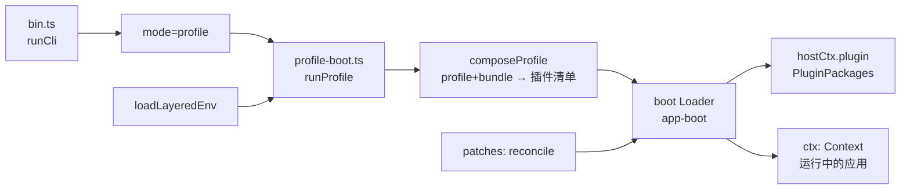
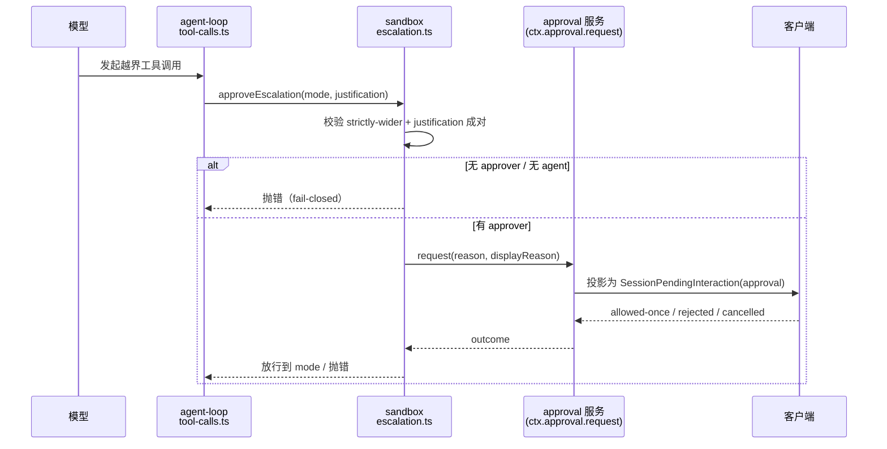

# DeepSeek Harness（DSH）仓库深读

> **2026-10-22 源码复核**：当前无 Git 身份的快照、文件指纹及已核范围见 [sources/MANIFEST.md](sources/MANIFEST.md)；版本字符串不等于 commit。

> **方法**：`code-researcher` skill 的 `deep` 模式（四层法：Codebase Map → Runtime Story → Design Inquiry → Maintainer Notes），结论一律带 `文件:行`。
> **对象**：`github.com/deepseek-ai/deepseek-harness`，快照的 package.json 自述 **`0.2.1-rc.2`**；缺少 commit，不能称 master 等于该版本。
> **快照**：2026-10-20，仓库 tarball 解包于 `/tmp/dsh-src`（`git clone` 在本机网络下会断流，改用 codeload）。
> **范围**：仓库全貌 → 三条运行路径（启动链、工具调用与审批、会话事件）→ 工具调度与压缩语义 → 两份专项（ptc、compaction 与组合包）→ 设计追问 → 维护者笔记 → 证据索引。全文结论均带 `文件:行`。

---

## 1 仓库全貌：规模、分层与阅读路线

一句话：**一个"一切皆插件"的 agent harness**，由 [Cordis](https://github.com/cordiverse/cordis) 驱动，设计论文指向 *A Programming Paradigm for Spatiotemporal Composability*（`README.zh.md:5`）。

### 1.1 规模（扫描实测）

| 指标 | 数值 |
|---|---|
| 文件数 | **16,180** |
| 总行数 | **2,680,168** |
| TypeScript | **1,243,960 行** |
| Markdown | 421,531 行 |
| CSS / JavaScript / Python | 32,190 / 18,321 / 15,547 行 |
| `packages/`一级职责分组 | **约50组（不是package.json数量）** |
| 应用（`apps/`） | **5 个**：`cli`、`desktop`、`desktop-host`、`web`、`plugin-market-generator` |

### 1.2 分层：包按职责归位（只列高信号的）

| 层 | 代表包 | 职责 | 读它的理由 |
|---|---|---|---|
| **启动/装载** | `boot/app-boot`、`boot/plugin-manager`、`boot/plugin-market`、`boot/cmdline`、`boot/hmr` | 加载 profile、组合 bundle、打 patch、启停插件 | 一切从这里的 Loader 开始 |
| **核心引擎** | `core/agent-loop`、`core/agent`、`core/session`、`core/tools`、`core/system-prompt`、`core/scope` | agent 轮次、会话事件、工具注册、系统提示 | 主运行路径所在 |
| **沙箱** | `sandbox/sandbox`、`sandbox/sandbox-policy` | 更宽模式阶梯、执行前 fail-closed 审批 | "授权 ≠ 审批"的底层 |
| **客户端/UI** | `client/ui-approval`、`client/ui-chat`、`client/*` | 浏览器侧渲染（含审批卡插槽） | 解释"卡只在会话内可见" |
| **API/网关** | `api/gateway`、`api/*` | 会话/事件对外暴露 | 远程事件与投影 |
| **组合包** | `bundle/base`、`bundle/sdk-minimal` | 预置组合（谁挂哪些插件） | 看"标准组合长什么样" |
| **外围** | `skill`、`mcp`、`schedule`、`workflow`、`computer-use`、`spill`、`ssh`、`document`、`browser-use` | 能力扩展 | 按需读 |

### 1.3 先读哪 10 个（阅读路线）

1. `README.zh.md`（定位与运行方式）
2. `apps/cli/src/bin.ts`（入口）
3. `apps/cli/src/profile-boot.ts`（`runProfile` 主链）
4. `packages/boot/app-boot/src/index.ts`（环境层/配置/补丁）
5. `packages/boot/plugin-manager/README.zh.md`（插件启停语义）
6. `packages/core/agent-loop/README.zh.md` → `src/index.ts`（轮次与工具调用）
7. `packages/core/session/README.zh.md`（事件与会话持久化）
8. `packages/sandbox/sandbox/src/escalation.ts`（审批与升级）
9. `packages/client/ui-approval/src/index.ts` + `src/client/contract/slots.ts`（审批卡插槽）
10. `packages/bundle/base/`（标准组合清单）

### 1.4 低信号区（别先读）

- `apps/web/tests/fixtures/**`（测试夹具，扫描把它误列为"入口"）
- `.agents/notes/archived/**`（历史 ADR；**但作为设计意图的一手证据很有价值**，按需精读）
- 生成物：`*.generated.ts`、`snapshots/**`、`website/**`（文档站）

---

## 2 运行路径一：从命令到运行中的应用（启动链）

**场景**：执行 `dsh`（或 `npx @deepseek-ai/dsh web`）时，仓库内部到底发生了什么。

| 步 | 位置 | 发生了什么 | 证据 |
|---|---|---|---|
| 1 | `apps/cli/src/bin.ts:1` | `#!/usr/bin/env node` 的 bin 入口 | package `bin` 指向 `lib/bin.js`（`apps/cli/package.json`）|
| 2 | `bin.ts:26-29` | `runCli()` 定义在 `:26`；`:27` 读运行时版本；`:29` 解析参数 | `export async function runCli` / `getDshRuntimeVersion()` / `parseDshArgs(...)` |
| 3 | `bin.ts:31-33` | `:31` `switch (invocation.mode)` 分派；`:32` `case 'profile'`；`:33` 动态 import `runProfile` | `switch (invocation.mode)`、`const { runProfile } = await import('./profile-boot.ts')` |
| 4 | `profile-boot.ts:271` | `runProfile()`：装载环境 → 组合 profile → 启动 | `Promise<{ ctx: Context; shutdown: ProcessShutdown }>` |
| 5 | `profile-boot.ts:292` | **`composeProfile(...)`**：把 profile 与 bundle 组合成插件清单 | `const composed = await composeProfile(` |
| 6 | `profile-boot.ts:323` | **`boot(NAME, rootConfig, patches, ...)`**：交给 Loader 启动 | `const ctx = await boot(NAME, rootConfig, ...)` |
| 7 | `profile-boot.ts:329` | 挂载**插件包管理器** | `await hostCtx.plugin(PluginPackages, {...})` |
| 8 | `app-boot/src/index.ts:238` | `loadLayeredEnv()`：分层环境变量（系统/用户/profile） | 三层合并 |
| 9 | `app-boot/src/index.ts:307` | `recomposeProfile()`：配置变更后**重新组合**（HMR 基础） | — |
| 10 | `app-boot/src/index.ts:322` | `reconcileProfilePatches()`：把 patch 对账到当前 profile | — |

**能读出的三条事实**
1. **启动是"组合"而非"实例化"**：`composeProfile` 先算出插件清单，再交给通用 Loader `boot()`；没有硬编码的应用装配代码。
2. **环境也是分层的**：`loadLayeredEnv` 与 profile patch 对账分离，说明"配置来源"与"配置生效"被刻意拆开。
3. **插件管理是运行期能力**：`hostCtx.plugin(PluginPackages, ...)` 在 boot 回调里挂载，所以 Web 侧边栏能启停插件而不重启进程（`plugin-manager/README.zh.md` 也这么说）。

---

## 3 运行路径二：一次工具调用与审批

**场景**：模型发起一次越界工具调用（例如写授权区外路径），系统如何"先问人、再执行"。

| 步 | 位置 | 发生了什么 | 证据 |
|---|---|---|---|
| 1 | `core/agent-loop/src/tool-calls.ts:60` | `executeToolCalls()` 统一驱动本轮的多个工具调用 | 导出签名 |
| 2 | `tool-calls.ts:211,216` | 执行前可 await（有序 pre-execute）；只有 dispatch/body 允许重叠 | 注释即契约 |
| 3 | `sandbox/sandbox/src/escalation.ts:11-13` | 工具层**闭包** `ctx.approval.request(...)` 并下传，沙箱包**不依赖** approval 服务类型 | 模块注释 |
| 4 | `escalation.ts:28` | `WIDER_MODES`：`workspace-write → danger-full-access`（严格更宽阶梯） | 常量表 |
| 5 | `escalation.ts:41` | `ESCALATION_TARGETS`：**封闭**的升级目标词表 | 常量 |
| 6 | `escalation.ts:51` | `validateEscalationArgs()`：`sandbox_permissions` 与 `justification` **必须成对**，缺一即"畸形请求" | 函数 |
| 7 | `escalation.ts:approveEscalation` | 先校验"严格更宽"；再校验**有 approver**、**有 agent 可路由**；然后才 `approver.request(...)` | 逐行可见 |
| 8 | 同上 | `request` 传 `{agent, toolName, callId, reason: "escalate sandbox to ...", displayReason{en,zh}}` | 同一处 |
| 9 | 同上 | 结果闭集：`allowed-once` / `rejected` / `cancelled` / **`unavailable`** | `switch` 四个分支 |
| 10 | 同上 | **`unavailable` 直接抛错**："requires approval, but no approval channel is available" | 错误文本 |

**三个可以直接下结论的代码事实**

1. **审批是"执行前"的硬门**：`approveEscalation` 在任何执行之前完成校验与询问，且 `rejected` 会抛硬错并提示"不要绕过"（错误文本原文如此）。**设计上是 fail-closed**。
2. **没有 approver 就不执行**：`approval.approver === undefined` 或 `approval.agent === undefined` 都**立刻抛错**，而不是静默放行。**这推翻了"没通道就一直挂"的猜想——开源层遇到无通道是报错，不是等。**
3. **审批是"会话级待处理交互"**：客户端把审批放进 `SessionPendingInteractionMap`（`packages/client/ui-session/src/client/index.ts:51`，由 `ui-approval` 声明 `approval: PendingApproval`，`ui-approval/src/client/contract/slots.ts:21-27`），而详情插槽 `conversation.approval.detail` 的作用域写明 `scope: 'session'`（`slots.ts:36-39`）。**这些类型支持会话归属；不能仅据类型声明排除跨会话 UI、通知通道或渲染缺陷。**

### 3.1 边界：开源层能解释什么、不能解释什么（证据：`packages/sandbox/sandbox/src/escalation.ts:104,202-206`）

上表的三条代码事实到此为止。**再往外就不是本仓库能证明的了**——例如"审批帧是否真的送达了某个具体客户端""某个会话为何长时间停在 `working`"，取决于 Host/Bot 运行层（闭源）的调度与推送实现，本仓库看不到，本文不作推断。

---

## 4 运行路径三：会话事件模型与组合包

### 4.1 会话是"仅追加的事件日志"

`packages/core/session/README.zh.md` 的定位（原文摘要，`kind: package-reference`）：
> 在**仅追加**的会话日志中记录每个模型可见事实，并**从该记录派生模型历史**；消费方可检查、回放、fork、刷新会话，同时保留历史事件；**压缩（compaction）只在活跃对话中隐藏被取代的条目，不删除**；除非加持久化后端，否则会话仅驻留内存。

**事件词表是封闭的**（`packages/core/session/src/known-event-types.ts`，90 行），与本主题直接相关的三条：

| 事件 | 位置 | 含义 |
|---|---|---|
| `approval/asked` | `known-event-types.ts:25` | 审批被请求 |
| `approval/decided` | `:26` | 审批有结论 |
| `approval/policy` | `:27` | 策略级（非单次）决定 |

同文件还有 `assistant/attempt`、`assistant/message`、`compaction/{start,prune,summary,end}`、`goal/change`、`hook/{invoked,result}` 等。

> **这解释了为什么"审批"同时表现为"会话内 UI"与"日志事件"**：它同时是 **session 级待处理交互**（`ui-session` 的 `SessionPendingInteractionMap`）和 **session 日志里的一条事件**（`approval/asked`）。两者都不是"跨会话广播"——本轮检查的声明中未发现跨会话审批聚合事件；不排除额外客户端自行汇总。

### 4.2 组合包：`base` 是"共享核心 + 分层 patch"，`sdk-minimal` 是"独立整树"（证据：`packages/bundle/base/cordis.patch.yml`、`packages/bundle/sdk-minimal/cordis.patch.yml`）

两份清单分别是 `packages/bundle/base/cordis.patch.yml`（529 行）与 `packages/bundle/sdk-minimal/cordis.patch.yml`（172 行）；下表的行数与结构均取自这两个文件及其首段注释。

- **`packages/bundle/base/cordis.patch.yml`（529 行）**：一个 insert 覆盖空 profile root，作为共享核心；后续 bundle 与用户 patch 按 `id` 覆盖，**逐行 last write wins**（原文："applied as ONE insert over the empty profile root"、"the last write wins per row"）。
- **`packages/bundle/sdk-minimal/cordis.patch.yml`（172 行）**：**不叠在 base 之上**，自身就是完整的 Cordis 树（原文："does not layer over dsh-base: this insert is the complete Cordis tree"）。

**两条设计事实（都可引用行号）**
1. **patch 是"替换整行 config"而不是深合并**：`base/cordis.patch.yml:7-9` 明写 "A patch replaces the targeted row's whole `config` rather than merging into it"，所以"按模式取值不同"的配置**不在 base 里**，而由各模式 bundle 完整重述。
2. **行的顺序不承载加载语义**：`base/cordis.patch.yml:13` 写 "Row order carries no load semantics (activation is service-availability driven)"——**激活由服务可用性驱动**，不是按 YAML 顺序启动。

> **维护含义**：想"改一个插件的行为"，正确做法是**改它所在模式 bundle 的那一行**（整行 config 替换）；想"加一个能力"，要**同时**更新组合清单与用户 profile，否则 profile 层根本看不到它。

## 5 工具调度、压缩语义与测试契约

### 5.1 并行工具的"有界滚动池 + 启动前重新分类"

| 事实 | 位置 | 说明 |
|---|---|---|
| 并行调用用**有界滚动池**，且**启动前重新分类** | `packages/core/agent-loop/src/tool-calls.ts:3`（模块注释）| 不是"一刀切并行" |
| 执行模式由工具注册表给出 | `packages/core/tools/src/index.ts:1311`（`executionMode(exec)`）| 工具自己声明并行/独占 |
| 到每个调用真正启动**前**再读一次 | `tool-calls.ts:204-205`：下一个调用若非 `parallel` 就 **break** | 动态降级，避免被独占工具夹住 |
| 独占与并行分两种推进 | `tool-calls.ts:90`：`mode === 'parallel' ? planned.slice(next) : [first]` | 独占单发成屏障 |
| 调度器失败处理 | `tool-calls.ts:114-119,142,171,208-210`：**排空已派发、拒绝后续** | 失败不留半截 |
| 上限是**可热更**配置 | `packages/core/agent-loop/src/index.ts:308,345-346`（`Volatile<number>`、zod `.min(1).default(...).volatile()`）| 运行时调；`0` 被 schema 拒绝（`tests/settings.spec.ts:35`）|

> **设计判断**（研究推断；依据 `packages/core/agent-loop/src/tool-calls.ts:204-205` 的启动前重分类与 `packages/core/tools/src/index.ts:1311` 的 `executionMode`）：关键不是"并行"，而是"**并行度是安全属性**"——执行前重新分类 + 有界池，保证独占调用不被并行池里的其它调用夹住；这也是让工具自己声明执行模式、而不是调度器猜的原因。

### 5.2 压缩（compaction）的语义边界（证据：`packages/compaction/compaction/README.zh.md`）

| 事实 | 位置 | 说明 |
|---|---|---|
| 较早历史压成**一条摘要消息**，近期对话不动 | `packages/compaction/compaction/README.zh.md` 概述 | 模型"像摘要一直在"那样继续 |
| **被遮蔽内容仍留在会话日志** | 同上 | 所以回放能确定性重现同一份压缩后对话 |
| 压缩由**后端**执行，本包只做协议 | 同上 | 后端如 `compaction-basic`、`-image-offload`、`-tool-result-pruner`（`packages/compaction/*`）|

> 与 §5.7.1 的关系：会话是仅追加日志 → 压缩只改"当前活跃视图"，不改历史；这正是"回放/fork 可重建"的前提。

### 5.3 `core/tools` 的职责边界

`packages/core/tools/src/` 的组成即边界：`index.ts`（注册与执行模式）、`schema.ts` / `json-schema.ts` / `ts-types.ts` / `py-types.ts`（跨语言 schema 生成）、`presentation.ts`（呈现）、`ptc.ts` / `ptc-calls.ts`（Programmatic Tool Calling 形态）、`testing.ts`（夹具）。

**推断**：`ptc` 的存在意味着工具可由代码编排而非仅模型逐步调用——值得单独深读（本次不含）。

### 5.4 测试契约（目录名就是契约名）

`packages/core/agent-loop/tests/` 共 **29 个 spec**，命名直接标出被保护的契约：

| spec | 契约 |
|---|---|
| `inbox.spec.ts` | 轮次内"收件箱"（中途注入消息）|
| `tool-order.spec.ts` / `tool-updates.spec.ts` | 工具顺序与状态更新 |
| `request-freeze` / `request-reconstruction` | 请求冻结与重建 |
| `resume.spec.ts` / `shutdown-drain.spec.ts` | 恢复与关闭排空 |
| `contract-regressions.spec.ts` | 契约回归（防旧行为被无意破坏）|
| `system-prompt-admission` / `-projection` | 系统提示准入与投影 |
| `settings.spec.ts` | 配置热更（含 `maxParallelToolCalls` 边界）|

> **维护含义**：改调度/注入/恢复逻辑时，这 29 个 spec 是最低门槛；`contract-regressions` 与 `properties`（属性测试）说明作者把"行为契约"看得比"实现"重。

### 5.5 审批的"可见面"：数据在会话级，入口在会话视图

| 事实 | 位置 |
|---|---|
| 会话状态带 `pendingInteraction: SessionPendingInteraction \| undefined` | `packages/client/ui-session/src/client/index.ts:64` |
| 会话列表行取该字段（`this.pendingSnapshot.get(id)`）| `:538` |
| 变化检测基于该字段 | `:706` |

**结论（部分推断）**：数据模型把"待处理交互"挂在**会话粒度**上，所以"会话列表给标记"结构上可行；但**批准卡仍渲染在会话视图内**（§4.5），**开源代码里没有跨会话/OS 级通知通道**。后台会话的问题因此不是"数据没有"，而是"**没有面向人的入口**"。

## 6 专项深读：ptc 与 compaction/组合包

> 两份专项报告独立完成，正文分别是 [`ptc.md`](ptc.md) 与 [`compaction-and-bundles.md`](compaction-and-bundles.md)。本节只做**要点吸收与交叉引用**，不复述全文。

### 6.1 `ptc`（Programmatic Tool Calling）：程序在沙箱、工具在宿主

| 结论 | 证据（详见子报告）|
|---|---|
| 模型输出一段**程序**，程序在**受沙箱约束的子进程**里用 `await tools.<name>(args)` 嵌套调**宿主工具** | `ptc.md` §机制；本仓 `packages/core/tools/src/ptc.ts` |
| 入口工具 `run_code`；开关 `mode:'ptc'` 或 per-agent `presentAs('ptc')` | 子报告 §3 |
| **审批严格早于执行**：程序级升级复用 `approveEscalation`，测试证明审批未答时 resolver 未被调用 | 子报告 §4 |
| 失败是**结果字段**（8 类 kind）而非异常；deadline 含嵌套审批等待、不含外层程序级审批（默认 120s / 上限 600s）| 子报告 §5 |

### 6.2 `compaction`：日志保留是**会话层强制**，不是后端自觉

| 结论 | 证据 |
|---|---|
| 后端提交替换时必须把 `[startSeq, summarySeq, ...shadowedSeqs]` 全部写进 `sourceEventSeqs` | `packages/compaction/compaction-basic/src/region.ts:505-509` |
| 会话 append 时校验"必须覆盖每个被遮蔽节点"，否则抛错 | `packages/core/session/src/surface.ts:330-364`（判定 `:361-364`）|
| 表面折叠只 splice 模型可见节点列表，**日志本身只有 push** | `packages/core/session/src/surface.ts:563-585`、`packages/core/session/src/index.ts:886` |
| 元数据侧再留清单（`shadowedRange`/`shadowedSeqs`/`shadowedTokenCount`）| `packages/compaction/compaction/src/types.ts:34-53` |
| 失败/回滚：替换前失败有 `compaction/end(error)`；替换后失败**无回滚**，分类为 `ManualCompactionError('commit'/'persistence', …)`；孤儿锁靠 `session/end-seed` 判定陈旧 | 子报告 §失败与回滚 |

### 6.3 `bundle/base` 的插件计数（三种数法交叉）

| 口径 | 计数 |
|---|---|
| 插件行（`^    - id:`）| **96** |
| 必挂（无条件、未禁用）| **87** |
| 默认禁用（`disabled: true`）| **1**（`tool-plugin-manager`）|
| 条件挂载（`!!js` 表达式）| **8** |
| 校验 | 87 + 1 + 8 = 96 ✅；`!!js` 全文 16 次，其中 **8 次是挂载条件**、另 8 次在 `config` 中 |

### 6.4 否定性结论怎么证明

"没找到 X"是**否定性结论**，不能只说"没找到"（下表的搜索面与方法均来自 `packages/core/tools/src/ptc.ts`、`packages/ptc-runtime/**`、`packages/core/session/src/*.ts` 的实际 grep）。本次两条核心否定结论的**证明方式**如下：

| 否定结论 | 搜索面 | 方法 | 结果 |
|---|---|---|---|
| **所查 PTC 文件仅定位到一处程序级升级审批调用；未完成绕过路径证明** | `packages/core/tools/src/ptc.ts`、`ptc-calls.ts`、`packages/ptc-runtime/**` | `grep -rn "approveEscalation\|approval"` 全量列出；确认**唯一的审批入口**是 `ptc.ts:395 await approveEscalation({...})`，其余命中是类型导入（`:21,23`）与 schema 描述（`:103,104,113,124`）| 只有一处审批调用，且在程序执行前 |
| **所查 session 源码未匹配到列举的日志删除表达式** | `packages/core/session/src/*.ts` | `grep -rnE "\.log\.(splice\|pop\|shift\|length *=)\|delete .*log\|truncate"` | **0 命中**；唯一写入是 `this.log.push`（`index.ts` 内 2 处）|

> **口径**：以上是"**穷举这些文件里的相关符号**"，不是"证明整个系统不存在该路径"。要写进结论时，必须把**搜索面与方法**一起写出来——这是否定性结论的验收标准。

### 6.5 补强证据

| 结论 | 证据 |
|---|---|
| `EscalationOutcome` 闭集四值 | `packages/sandbox/sandbox/src/escalation.ts:104` |
| 结果的 4 分支 switch（`allowed-once` / `rejected` / `cancelled` / `unavailable`）| 同文件 `:202-206`（`unavailable` 在 `:205` 抛错）|

## 7 设计追问：为什么要"一切皆插件"

**观察（代码事实）**
- 启动路径上没有"应用主类"，只有 `composeProfile → boot`（`profile-boot.ts:292,323`）。
- 组合包（`bundle/base`、`bundle/sdk-minimal`）只是**配置清单**，`agent-loop` 的 README 明确写"标准 agent 组合应挂载本包"（`packages/core/agent-loop/README.zh.md:11`）。
- 插件管理在运行期可用（`plugin-manager/README.zh.md`），且 HMR 只在 YAML 开时生效。

**推断（研究判断，非代码事实）**
1. **插件化的收益是"能力可替换 + 启动可裁剪"**：同一条 `boot` 路径既能起 Web、也能起 CLI、也能起 Desktop，差别只在 profile 组合。
2. **代价是"间接层变厚"**：读代码时，"这个功能在哪"要靠组合清单反查，而组合清单本身是配置（YAML），不是 import 图。
3. **Cordis 的"时空可组合"**（论文标题）在本仓库最直接的体现就是：**同一套插件在有/无某能力的会话里表现不同**（session/scope 语义），这也是"scope"包存在的理由。

> **边界**：`core/scope` 的语义细节，以及"插件之间不允许直接 import"是否有 lint 强制，本文未展开——不在本报告的可证范围内。

---

## 8 维护者笔记

| 关注点 | 现状（证据） | 影响 |
|---|---|---|
| **扩展点** | 新增能力 = 新增包 + 在 bundle/profile 里挂载 | 不需要改核心；但**必须同时改组合清单**，否则不会生效 |
| **兼容性** | README 明示"开发者预览，会有破坏性变更"（`README.zh.md:13`） | 依赖它的外部项目要锁版本 |
| **配置分层** | 环境层 + profile + patch（`app-boot`） | 排障时先看"哪一层覆盖了谁"，别直接改代码 |
| **审批与沙箱** | `sandbox/escalation` 执行前 fail-closed | 想加"免审批"要走策略层，不要在工具里绕 |
| **测试门槛** | 包内 `tests/` 密度高（如 `agent-loop/tests/` 10+ 个 spec） | 改动前先跑对应包的 spec |

---

## 9 证据索引

| 结论 | 证据 |
|---|---|
| 工具调用统一入口 | `packages/core/agent-loop/src/tool-calls.ts:60` |
| 执行前可 await、dispatch/body 才重叠 | `tool-calls.ts:211,216` |
| 审批由工具层闭包下传，沙箱不依赖 approval 类型 | `packages/sandbox/sandbox/src/escalation.ts:11-13` |
| 严格更宽阶梯 | `escalation.ts:28`（`WIDER_MODES`）|
| 升级目标为封闭词表 | `escalation.ts:41`（`ESCALATION_TARGETS`）|
| `sandbox_permissions` 与 `justification` 必须成对 | `escalation.ts:51`（`validateEscalationArgs`）|
| 无 approver / 无 agent 即抛错（fail-closed）| `escalation.ts:approveEscalation` 前半段 |
| 审批结果闭集（allowed-once / rejected / cancelled / unavailable）| 同上 `switch` |
| 无通道 = 抛 `unavailable`，不是挂起 | 同上错误文本 |
| 审批是会话级待处理交互 | `packages/client/ui-session/src/client/index.ts:51`、`ui-approval/src/client/contract/slots.ts:21-27` |
| 审批详情插槽作用域 = session | `slots.ts:36-39`（`scope: 'session'`）|

| 结论 | 证据 |
|---|---|
| 会话是仅追加日志、历史由事件派生 | `packages/core/session/README.zh.md` 概述段 |
| 压缩隐藏不删除 | 同上（"hide superseded entries…does not delete"）|
| 事件词表封闭且含审批三类事件 | `packages/core/session/src/known-event-types.ts:25-27`（`approval/asked`、`approval/decided`、`approval/policy`）|
| base 是"共享核心 + 逐行 last write wins" | `packages/bundle/base/cordis.patch.yml:1-4` |
| patch 替换整行 config、不深合并 | `packages/bundle/base/cordis.patch.yml:7-9` |
| 行顺序不承载加载语义、激活由服务可用性驱动 | `packages/bundle/base/cordis.patch.yml:13` |
| sdk-minimal 不叠 base、自身是完整树 | `packages/bundle/sdk-minimal/cordis.patch.yml:1-3` |

| 结论 | 证据 |
|---|---|
| 仓库版本 0.2.1-rc.2 | `package.json`（`@deepseek-ai/dsh-root`）|
| 一切皆插件、Cordis 驱动 | `README.zh.md:5` |
| 开发者预览、会有破坏性变更 | `README.zh.md:13` |
| 入口为 `bin.ts` 的 `runCli()` | `apps/cli/src/bin.ts:1,26-29` |
| profile 模式进 `runProfile` | `apps/cli/src/bin.ts:31-33`、`apps/cli/src/profile-boot.ts:271` |
| 组合 → boot → 插件管理 | `profile-boot.ts:292,323,329` |
| 环境分层 / 重组 / patch 对账 | `app-boot/src/index.ts:238,307,322` |
| agent-loop 是"标准组合应挂载"的驱动器 | `packages/core/agent-loop/README.zh.md:11` |
