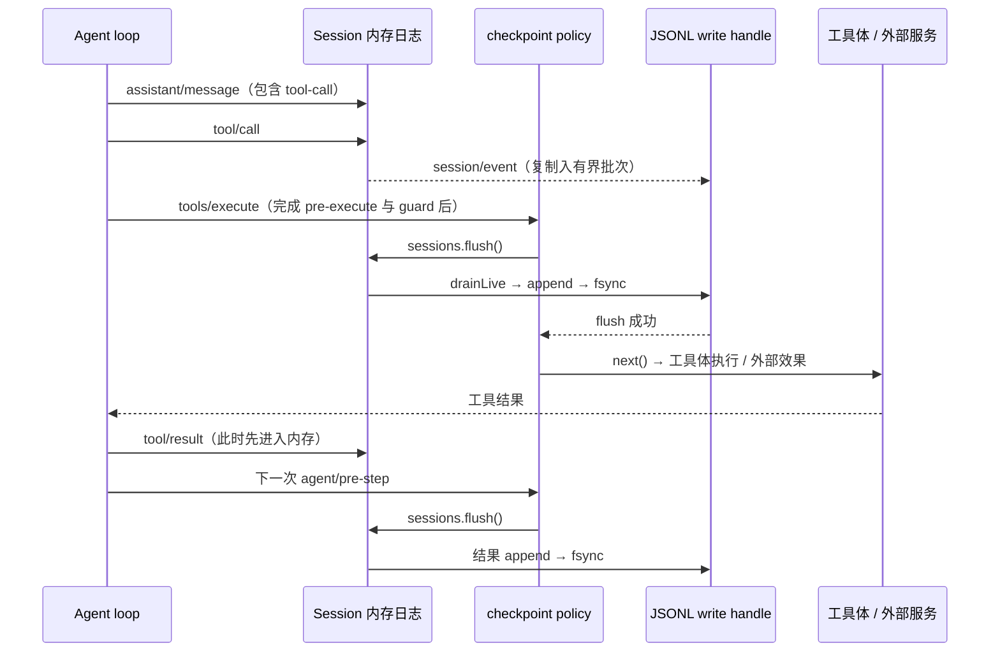

# 工具副作用与会话持久化：记录“要做”不等于记录“做成了”

本文只追一条边界：Agent 发起顶层工具调用后，`tool/call` 何时落盘、工具体何时可能产生外部效果、`tool/result` 何时落盘，以及崩溃后系统如何避免把未知结果伪装成失败或成功。源码固定在 [deepseek-harness commit `22ddee3792402c3e70ec5f86a63c3e3e895a2f60`](https://github.com/deepseek-ai/deepseek-harness/tree/22ddee3792402c3e70ec5f86a63c3e3e895a2f60)；以下路径均以该版本为准。

## 先看结论

这个仓库把**会话记录**和**外部工具效果**分成两个独立提交边界。标准 `base` 组合同时挂载 JSONL 持久化与 `session-checkpoint-policy`，因此顶层工具体运行前会先等待 `tool/call` 刷盘；工具返回后，结果事件在下一步模型请求前刷盘。若进程恰在“外部操作已成功、结果尚未持久化”之间崩溃，恢复只能确定调用开始过，不能判断外部效果是否完成，于是写入 `TOOL_OUTCOME_UNKNOWN`，并明确要求对可能有副作用的操作先核实状态或询问用户，不能盲目重试。

这不是 exactly-once 执行协议。持久化检查点给外部调用建立了可恢复的**意图记录**，但不会与第三方服务的事务原子提交。工具或其服务若支持幂等键，项目文档建议将 `exec.callId` 传递为幂等键；它不是工具注册表自动保证的能力（[策略限制](https://github.com/deepseek-ai/deepseek-harness/blob/22ddee3792402c3e70ec5f86a63c3e3e895a2f60/packages/session/session-checkpoint-policy/README.md#L112-L116)）。

## 一次顶层工具调用的持久化时序

图中顺序由 Agent 追加模型消息、批处理器先记录 `tool/call`、checkpoint policy 包住 `tools/execute`、JSONL handle 排空并 fsync、以及恢复器补齐未回答调用这几段源码共同支持（[`agent.ts`](https://github.com/deepseek-ai/deepseek-harness/blob/22ddee3792402c3e70ec5f86a63c3e3e895a2f60/packages/core/agent-loop/src/agent.ts#L567-L585)、[`batch.ts`](https://github.com/deepseek-ai/deepseek-harness/blob/22ddee3792402c3e70ec5f86a63c3e3e895a2f60/packages/core/tools/src/batch.ts#L154-L175)、[`policy`](https://github.com/deepseek-ai/deepseek-harness/blob/22ddee3792402c3e70ec5f86a63c3e3e895a2f60/packages/session/session-checkpoint-policy/src/index.ts#L63-L82)、[`storage`](https://github.com/deepseek-ai/deepseek-harness/blob/22ddee3792402c3e70ec5f86a63c3e3e895a2f60/packages/session/session-persistence-jsonl/src/storage.ts#L294-L315)、[`repair`](https://github.com/deepseek-ai/deepseek-harness/blob/22ddee3792402c3e70ec5f86a63c3e3e895a2f60/packages/core/session/src/repair.ts#L157-L193)）。

入口与交接由几处源码共同确定：Agent 收到模型输出后先追加 `assistant/message`，再把 tool-call 交给 executor（[`agent.ts:567-585`](https://github.com/deepseek-ai/deepseek-harness/blob/22ddee3792402c3e70ec5f86a63c3e3e895a2f60/packages/core/agent-loop/src/agent.ts#L567-L585)）；批处理器在进入 pre-execute 前追加 `tool/call`，然后才执行 `pipeline.prepare()` 和 dispatch（[`batch.ts:154-175`](https://github.com/deepseek-ai/deepseek-harness/blob/22ddee3792402c3e70ec5f86a63c3e3e895a2f60/packages/core/tools/src/batch.ts#L154-L175)）。工具体在 pipeline 的 `tools/execute` waterfall 下游被调用（[`pipeline.ts:258-285`](https://github.com/deepseek-ai/deepseek-harness/blob/22ddee3792402c3e70ec5f86a63c3e3e895a2f60/packages/core/tools/src/pipeline.ts#L258-L285)）。

`Session.append()` 会先把事件写入会话内存日志，再同步通知 `session/event` 监听器；它返回事件而不等待后端 I/O（[`session/index.ts:806-837`](https://github.com/deepseek-ai/deepseek-harness/blob/22ddee3792402c3e70ec5f86a63c3e3e895a2f60/packages/core/session/src/index.ts#L806-L837)、[`session/index.ts:892-905`](https://github.com/deepseek-ai/deepseek-harness/blob/22ddee3792402c3e70ec5f86a63c3e3e895a2f60/packages/core/session/src/index.ts#L892-L905)）。JSONL provider 把事件副本放进 buffer，空闲时最多等待 200ms 再排空；显式 flush 会取消等待、先排空 buffer，再过 handle 的持久化屏障（[`storage.ts:35-36`](https://github.com/deepseek-ai/deepseek-harness/blob/22ddee3792402c3e70ec5f86a63c3e3e895a2f60/packages/session/session-persistence-jsonl/src/storage.ts#L35-L36)、[`storage.ts:274-315`](https://github.com/deepseek-ai/deepseek-harness/blob/22ddee3792402c3e70ec5f86a63c3e3e895a2f60/packages/session/session-persistence-jsonl/src/storage.ts#L274-L315)、[`storage.ts:549-560`](https://github.com/deepseek-ai/deepseek-harness/blob/22ddee3792402c3e70ec5f86a63c3e3e895a2f60/packages/session/session-persistence-jsonl/src/storage.ts#L549-L560)）。非首次追加在成功返回前执行文件 `sync()`；若写入或 sync 抛错，代码尝试截回追加前大小并重新 sync（[`index.ts:1408-1450`](https://github.com/deepseek-ai/deepseek-harness/blob/22ddee3792402c3e70ec5f86a63c3e3e895a2f60/packages/session/session-persistence-jsonl/src/index.ts#L1408-L1450)）。

真正把这两个阶段连起来的是可选的 checkpoint policy。它先经过工具 `prepare` 中的审批与 guard，再在顶层 `tools/execute` 下游调用 `ctx.sessions.flush()`；flush 成功才 `next()` 进入工具体，flush 失败则工具体不会被调用（[`policy/src/index.ts:52-75`](https://github.com/deepseek-ai/deepseek-harness/blob/22ddee3792402c3e70ec5f86a63c3e3e895a2f60/packages/session/session-checkpoint-policy/src/index.ts#L52-L75)）。项目 `base` 清单包含该策略和 JSONL backend（[`cordis.patch.yml:138-142`](https://github.com/deepseek-ai/deepseek-harness/blob/22ddee3792402c3e70ec5f86a63c3e3e895a2f60/packages/bundle/base/cordis.patch.yml#L138-L142)、[`cordis.patch.yml:415-418`](https://github.com/deepseek-ai/deepseek-harness/blob/22ddee3792402c3e70ec5f86a63c3e3e895a2f60/packages/bundle/base/cordis.patch.yml#L415-L418)）。不过自定义组合可以删改插件；只有 backend、没有 checkpoint policy 时，200ms 批处理窗口仍存在，不能把“已追加到 Session”当成“副作用前已耐久”。

工具返回后，`BatchSettlement.commit()` 追加 `tool/result`，并用 `sourceEventSeqs` 指回对应调用事件；追加本身仍是同步内存提交（[`batch.ts:138-149`](https://github.com/deepseek-ai/deepseek-harness/blob/22ddee3792402c3e70ec5f86a63c3e3e895a2f60/packages/core/tools/src/batch.ts#L138-L149)、[`batch.ts:236-269`](https://github.com/deepseek-ai/deepseek-harness/blob/22ddee3792402c3e70ec5f86a63c3e3e895a2f60/packages/core/tools/src/batch.ts#L236-L269)）。策略在下一个 `agent/pre-step` 刷新前一步结果，避免下一轮请求读取尚未落盘的完成状态（[`policy/src/index.ts:77-82`](https://github.com/deepseek-ai/deepseek-harness/blob/22ddee3792402c3e70ec5f86a63c3e3e895a2f60/packages/session/session-checkpoint-policy/src/index.ts#L77-L82)）。若工具结果就是最终响应后的最后一次事件，强制杀进程仍可能发生在后台 buffer 写入前；策略文档也把最终响应的持久化依赖成功关闭或后台写入列为边界（[`sdk-minimal/README.md:41`](https://github.com/deepseek-ai/deepseek-harness/blob/22ddee3792402c3e70ec5f86a63c3e3e895a2f60/packages/bundle/sdk-minimal/README.md#L41)）。

## 崩溃恢复给出的契约

恢复时 Agent loop 先以 write 模式获取 session handle，读取物理上有效的持久化日志；若最后一轮未闭合，就通过同一个 handle 追加语义修复事件（[`agent-loop/index.ts:786-810`](https://github.com/deepseek-ai/deepseek-harness/blob/22ddee3792402c3e70ec5f86a63c3e3e895a2f60/packages/core/agent-loop/src/index.ts#L786-L810)）。`ToolCallRecovery` 用 assistant 请求、已记录的 `tool/call` 与 `tool/result` 配对：有 call 无 result 会生成 `TOOL_OUTCOME_UNKNOWN`；assistant 请求没有 call 记录则标为 `TOOL_NOT_STARTED`（[`repair.ts:116-143`](https://github.com/deepseek-ai/deepseek-harness/blob/22ddee3792402c3e70ec5f86a63c3e3e895a2f60/packages/core/session/src/repair.ts#L116-L143)、[`repair.ts:157-193`](https://github.com/deepseek-ai/deepseek-harness/blob/22ddee3792402c3e70ec5f86a63c3e3e895a2f60/packages/core/session/src/repair.ts#L157-L193)）。对有记录的启动调用，修复消息明确说：只读或幂等操作可按语义考虑重试；可能有副作用时先查外部状态或问用户；不要盲目重试（同上 `repair.ts:31-40`）。

因此，系统没有对任意工具承诺“恰好执行一次”，也没有自动对第三方状态做对账。使用者要把**“调用已记录”**理解成“工具执行可能开始”，而不是“外部事务已经提交”。对支付、发信、创建资源、部署等不可简单重试的动作，可靠性取决于工具适配器能否以稳定 call ID 使用服务端幂等键，或能否提供查询动作供恢复后人工/Agent 核实。后一句是从持久化与外部服务分属两个提交边界得出的研究判断，不是 Harness 自动提供的能力。

有一个需要特别留意的配置边界：checkpoint policy 不是 JSONL backend 的内建属性，而是单独组合的插件。默认 `base` 有它；部署若自定义 profile 将它移除，工具事件仍可异步批量落盘。此时崩溃可能让持久化日志只留下 assistant 工具请求、没有 `tool/call`，但外部效果已发生；现有 `TOOL_NOT_STARTED` 恢复文本倾向于允许重试。因此，副作用型 Agent 不能只看“启用了 session persistence”，还要确认实际 composition 同时启用了 checkpoint policy。源码展示出这个不对称窗口；本次没有通过删插件的故障注入测试验证该场景。

## 代码中已有的故障测试

仓库提供了 SIGKILL 子进程测试：测试工具先写入一个代表外部效果的 failpoint，再挂起；父进程收到标记后强杀子进程，重新打开 JSONL 日志并检查它包含 `tool/call`，且恢复补出 `TOOL_OUTCOME_UNKNOWN`（[`crash-recovery.e2e.ts:39-64`](https://github.com/deepseek-ai/deepseek-harness/blob/22ddee3792402c3e70ec5f86a63c3e3e895a2f60/packages/session/session-checkpoint-policy/tests/crash-recovery.e2e.ts#L39-L64)、[`crash-recovery.e2e.ts:105-119`](https://github.com/deepseek-ai/deepseek-harness/blob/22ddee3792402c3e3e895a2f60/packages/session/session-checkpoint-policy/tests/crash-recovery.e2e.ts#L105-L119)）。checkpoint policy 的单元测试还分别覆盖“flush 完成前不进入工具体”、flush 失败时不执行，以及 flush 等待期间取消时返回 `ABORTED_BEFORE_DISPATCH`（[`session-checkpoint-policy.spec.ts:112-203`](https://github.com/deepseek-ai/deepseek-harness/blob/22ddee3792402c3e3e895a2f60/packages/session/session-checkpoint-policy/tests/session-checkpoint-policy.spec.ts#L112-L203)）。

这些是该版本**已有的测试代码**，不是本次运行结果。本次做静态源码追踪，没有运行测试、真实工具副作用或故障注入；普通工具是否遵守幂等约定、外部服务是否接受 call ID，以及移除 checkpoint policy 后的 crash 窗口，仍需按具体部署单独验证。

## 阅读路线

1. 先读 `packages/session/session-checkpoint-policy/README.md` 的“what becomes durable”与 limitation，理解它保护哪些边界。
2. 沿 `packages/core/tools/src/batch.ts` → `packages/core/tools/src/pipeline.ts` 看调用记录、策略和工具体的先后关系。
3. 再看 `packages/session/session-persistence-jsonl/src/storage.ts` 与 `index.ts`，区分内存 append、批量 drain、文件 sync 与恢复读取。
4. 最后读 `packages/core/session/src/repair.ts` 与 `session-checkpoint-policy/tests/crash-recovery.e2e.ts`，判断恢复结果为什么是 unknown，而不是重试命令。

## 覆盖边界

本次对固定 commit 精读并追踪了 `agent.ts`、`tools/batch.ts`、`tools/pipeline.ts`、`session/index.ts`、`session/repair.ts`、JSONL `storage.ts` / `index.ts`、checkpoint policy 实现与相应测试，并审阅了 `base` 组合。未逐个检查所有第三方工具、每个组合包或平台文件系统实现，也未实际运行 SIGKILL 测试；所以结论解释仓库提供的通用契约，不代表任意部署或远程服务具备 exactly-once / 幂等保证。
