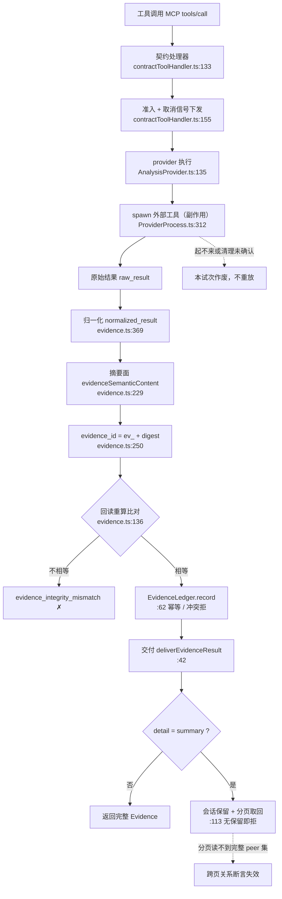

# REA：把逆向工程变成 agent 可核验的证据流

`rea-agents` 6.8.0（MIT，Node `^22.23.4 || ^24.22.1 || >=26.12.1`），一条 MCP 工具链加同名 CLI。它不实现反汇编与解包，而是**编排已有的引擎与命令行工具**，再把结果规约成一种统一记录交给 agent。本文只读代码与文档，不运行、不做逆向。

## 1. 工具层定位：一层"调用规约 + 证据形状"

REA 的目标表把每一类目标写成"要什么才能分析"：原生二进制要 Hopper / Ghidra / IDA（`README.md:192`），APK 要 headless JADX 加完整 JDK（`:212`），抓包要 TShark 4.x（`:219`），固件要 Binwalk / Unblob（`:224`）。也就是说，**分析能力本身来自外部工具，REA 提供的是调用面与结果形状**：把"跑一条命令、看一段输出"换成"取一条带身份、带覆盖声明、带限制清单的 Evidence"。

两条入口共用一套契约：MCP server，与 CLI `rea`。CLI 每次调用是独立进程、结果需自行落盘，文档明写它与 MCP server 使用同一套工作流与证据契约（`docs/cli.md:4-6`）。

判断：它不是与 agent harness 并列的"另一套体系"，而是**能力扩展层**——把不可靠、难核验的逆向调用，变成可继续推理、可离线传递的记录。这个定位的代价见第 5 节。

## 2. 证据模型：自校验的记录，而不是日志

一条 Evidence 是严格 schema（`strict()`）记录：`evidence_id`、`subject`、`provider`、`analysis_profile`、`predicate_type`、`operation`、`parameters`、`caller_input_path`、`raw_result`、`normalized_result`、`confidence`（`observed` / `derived` / `inferred`）、`authority`、`limitations[]`、`relationship_coverage`、`locations[]`、`evidence_links[]`（`src/domain/evidence.ts:82-107`）。工具输出本身即一条 Evidence（`src/contracts/toolOutputSchemaPrimitives.ts:30`）。

三条硬机制决定了它和普通日志的区别：

1. **id 是重算出来的，不是发号的。** `authenticatedEvidenceSchema` 去掉 `evidence_id` 后重算 digest 再比对，不等即拒收（`src/domain/evidence.ts:132-150`）；`analysis_profile` 里的 provider 还必须与 Evidence 的 provider 三项一致（`:110-130`）。因此"这条记录有没有被改过"可以离线验证。
2. **覆盖由 producer 声明，消费者拒收。** inventory 必须带 `coverage.scope`（`root` / `container-entries`）与 `coverage.status`（`complete` / `unknown`），缺字段的记录被拒，消费者不许自行推断（`docs/mcp-contracts.md:120-125`）。`relationship_coverage` 只描述 provider 观测到的直接关系集，`complete` **不**声称覆盖全部运行时边（`docs/tool-design.md:73-77`）。
3. **尺寸被显式建模。** `detail: complete|summary`：summary 把完整记录留在会话里，只回摘要，用 `normalized_result.parent_evidence_id` 翻页取回；无会话保留的 server 以 `capability_unavailable` 拒绝（`docs/mcp-contracts.md:401-418`）。CLI 侧等价物是 `evidence-file` 投影——"读取并认证该文件，再像保留证据一样投影"（`docs/cli.md:27-40`）。

错误分两档，语义不同：认证失败是 `evidence_integrity_mismatch`，认证通过但工作流角色或选择器不支持是 `invalid_request`（`docs/mcp-contracts.md:47-58`）；错误对象带 `recovery` / `remediation` 字段（`docs/error-contract.schema.json`）。

### Evidence 的生命周期：为什么它能被核验

三条读图要点：

1. **身份由语义算出，认证只需重算一次。** `evidenceSemanticContent`（`src/domain/evidence.ts:229-247`）是白名单，只含 subject 的 digest/format/architecture、provider、`analysis_profile`、`predicate_type`、`operation`、`parameters`、`raw_result`、`normalized_result`、`confidence`、`authority`、`environment`、`limitations`、`relationship_coverage`、`locations`、`evidence_links`；`caller_input_path`、请求 id 等本地展示元数据**不在**摘要里，所以同一观察在另一台机器上得到同一 `evidence_id`（`:250-251`），回读时重算比对即可判真伪（`:136-148`）。
2. **失败分三处，位置不同、后果不同。** 外部进程起不来或清理未确认（`src/process/ProviderProcess.ts:312`，`shell:false`；非 Windows 用独立进程组，内存上限只有 Windows Job Object 能真实施加，`:296-299` 直接报错）会让本试次作废而不重放；认证不相等才是 `evidence_integrity_mismatch`；`detail=summary` 在无会话保留时直接被拒（`src/server/contractToolHandler.ts:113-116`）。
3. **分页是刻意的取舍。** summary 只回指针（`normalized_result.parent_evidence_id`），完整记录留在会话；一旦按页取片段，"callers/callees 是完整集合"这个断言就不再成立，所以比较类工具要保留原始记录而不是摘要（`docs/mcp-contracts.md:33-44`）。

## 3. 能力边界：17 - 12 - 7 - 0

按 `README.md:189-228` 目标表的 **36 行**数据逐行归类（口径：第三列"需要什么"）：

| 类别 | 行数 | 含义 |
|---|---|---|
| 内置静态 | **17** | 第三列以 `Built-in …` 开头（13 行），或明确写 `None (static only)` / `None (static APK parsing)`（4 行）——不装任何引擎就能用 |
| 需外部工具/引擎 | **12** | 原生二进制要 Hopper/Ghidra/IDA（1 行）；JEB 项目要自备 JEB 客户端（1 行）；其余 10 行要 pwntools、WABT、JADX、Apktool、adb、tshark/capinfos、sigrok、Binwalk 等 |
| 需运行环境 | **7** | Node.js/npm、Chrome 系浏览器、原生 PTY、数据库快照、EVM 本地载体等 |
| 表内明确不支持 | **0** | 目标表没有"不支持"一类；限制写在"需要什么"里，而不是被隐藏 |

**开箱即用的分水岭不是"能不能跑"，而是"要不要自备引擎或工具"。** 12 行里有两行属于商业引擎（Hopper / IDA / JEB），许可必须自备；17 行内置项是它相较"纯 agent 读反汇编"最实在的增量。

## 4. 合规：MIT 的代码，带条件的用法

代码是 MIT（`LICENSE:1`，`package.json` 的 `license: MIT`）。用法受 `DISCLAIMER.md` 约束：

- **允许**：安全研究、恶意样本与事件分析、漏洞研究与协同披露、CTF 与教学、互操作性、软件保存，以及自有或获授权软件的调试审计（`DISCLAIMER.md:5-8`）。
- **明确不做**：绕过 DRM、许可校验、反作弊等技术保护；开发游戏作弊或篡改在线服务；绕过未授权系统的认证与访问控制；复制专有软件；规避模型提供商的使用政策；转售或共享 AI 账号（`:10-19`）。
- **责任归属**：授权、法域与许可协议由使用者承担；违规请求会被关闭并可能被移出社区（`:21-27`）。
- **商业工具**：Hopper、Ghidra、IDA 用你自己已安装的实例（`README.md:65,344-348`）。

"本地分析"要精确表述。FAQ 原文是：REA 在本地分析目标，**agent 收到工具结果，而模型提供商有自己的数据政策**（`README.md:382-385`）。也就是说，REA 自身不上传目标，但**结果会进入模型上下文**——不能写成"分析不出本机"。另外，进程行为、浏览器、设备等运行时能力会真的执行或交互目标，文档要求按你的用户权限使用（`README.md:230-231`）。第三方组件另有 `THIRD_PARTY_NOTICES.md` 与 `licenses/` 目录。

## 5. 两个坑

**坑一：`complete` 极易被读成"全对"。** 它的语义只是"provider 观测集没有被已知的读取上限截断"（`docs/tool-design.md:73-77`），既不含正确性，也不含完整性证明；schema 层不区分这两件事，只是把 `coverage.status` 摆在那里。给 agent 用的桥接层应当把 `complete` 改写成显式文案（例如"该 provider 未报告读取上限"），否则模型几乎必然过度信任。

**坑二：`evidence_id` 前向不兼容，且不可修复。** 6.6 之前的记录若在 digest 里省略了 `relationship_coverage: null`，会被**永久**判为与现行身份不一致：只能重建观察，重导出旧 bundle 也改不掉身份（`docs/mcp-contracts.md:45-52`，诊断见 `src/domain/evidence.ts:140-145`）。任何"证据长期归档 + 升级"的方案都必须按版本分代，否则一次升级会把历史证据整批变成 integrity mismatch。

## 附：本文依据

通读 `README.md`、`DISCLAIMER.md`、`docs/mcp-contracts.md`、`docs/tool-design.md`、`docs/cli.md`、`src/domain/evidence.ts`、`src/contracts/toolOutputSchemaPrimitives.ts`、`docs/error-contract.schema.json` 与 `package.json`。`src/` 下各 provider 目录（`ghidra/`、`ida/`、`hopper/`、`android/` 等）只读了接口与 `analysis_profile` 相关定义，未逐目录通读；未运行任何分析、未安装、未做逆向。
