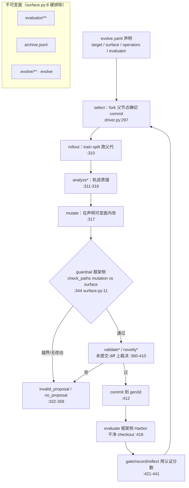

# RSIHub：把"自进化"拆成可组合阶段与不可变评测

`rsihub` 0.1.0（Apache-2.0，Python `>=3.12`，包名 `evolve`），固定到 commit `d6554299`（2026-10-27）。它不发明新的进化算法，而是**给已有的进化方法（AHE / Hyperagents / GEPA / A-Evolve）提供同一套驱动、同一套评测与同一套血缘**——差异被压在 recipe 的 operator 选择里。本文只读代码与文档，不安装、不运行。

**归属**：`NOTICE:1-5` 与 `pyproject.toml` 的 authors 均为 **Simple Agent Lab**（主页 `simpleagentlab.com`）；仓库内 grep `bytedance` / `字节` **零命中**。所以"字节跳动出品"这一说法在本仓库取证范围内**未能确证**。

## 1. Codebase Map

| 维度 | 事实 |
|---|---|
| 语言 / 规模 | Python 3.12+；`src/` 108 文件 / 22,997 行；`tests/` 150 文件 / 32,842 行（测试量大于实现） |
| 依赖 | `harbor==0.18.0`（执行器）、`fastapi` + `uvicorn`（查看器）、`pydantic`、`PyYAML`、`typer`（`pyproject.toml`） |
| 入口 | CLI `evolve = evolve.cli:main`；另有 `evolve agent` 外部 agent 驱动（`src/evolve/agent_driver.py`）与只读查看器（`src/evolve/viewer/app.py`） |

**目录职责**（按运行时权重）：

- `src/evolve/driver.py`（1,547 行）：进化主循环，`_run_child` 是"一代"的完整一趟。
- `src/evolve/surface.py`（37 行）：可变面判定。**全仓库最关键的文件**——评测隔离就落在这 37 行里。
- `src/evolve/archive.py`（470 行）：档案与血缘，含评测回执校验。
- `src/evolve/evaluation/`（`execution.py` 476 行等）：评测执行与记录。
- `src/evolve/composition/`（`recipe.py` 261 行等）：recipe 读取、operator 物化。
- `src/evolve/frozen/`：框架侧"不可变"接口（`config.py` / `interfaces.py` / `public_artifacts.py` / `sdk.py`）。
- `src/evolve/{preflight,runtime,candidate,execution_runtime,integrations/harbor,viewer}`：预检、沙箱、候选包、Harbor 适配、页面。
- `library/<stage>/`：九个阶段各自的 operator 实现，外加 `library/PROTOCOL.md`（子进程契约）。
- `recipes/`：`ahe` / `hyperagents` / `gepa` / `hyperagents_codex_tbench_full`，每个一份 `evolve.yaml`。
- `scaffolds/workspace/`：工作区模板，含 `evaluator/` 与 `operators/*.md`。

**建议阅读路线**：`README.md:92-160`（七阶段 / 九槽两套词表）→ `src/evolve/driver.py:277`（`_run_child`）→ `src/evolve/surface.py:8` → `src/evolve/archive.py:251-310` → `src/evolve/evaluation/execution.py` → `library/PROTOCOL.md`。五处读完，机制闭环。

## 2. Runtime Story：一份 recipe 的一趟

以 `recipes/hyperagents/evolve.yaml` 为例，从声明到血缘：

**0 声明（无代码）**：`evolve.yaml` 声明 `target`（`mini-swe-agent` + 固定 `revision`）、`surface.include`（`target/**`、`operators/**`）、每个阶段一个 operator 及其 `config`、以及 `evaluator`（`engine: harbor`、`dataset: terminal-bench-2-30-v1`、`evaluation_split: train`、`sampling: static`、`tasks_per_round: 30`、`partial_floor: 0.8`）。**recipe 里没有一行驱动逻辑**——它只做"选择与配置"（`README.md:143-146`）。

**1 select**：`driver.py:297 fork_child` 从档案取父节点并 fork 其**确切 commit**；父身份由 `orchestration.py:219 _assert_valid_parent` 校验，子 worktree 还必须属于该父（`:220 _assert_child_worktree_for_parent`）。

**2 rollout → analyze* → mutate**：`driver.py:310-329` 按序拉起三个 operator 子进程（`orchestration.py:57 invoke_operator`）。每个 operator 通过环境变量拿到 `EVOLVE_WORKSPACE` / `EVOLVE_CHECKOUT` / `EVOLVE_RUN_DIR` / `EVOLVE_GENID` / `EVOLVE_PARENT`（`library/PROTOCOL.md`），产物写进 run 目录。若配了 `analyze`，mutate 前会先写 feedback bundle（`driver.py:315-316`）。

**3 guardrail（框架所有，不是 operator）**：`working_tree_changed_paths`（`:331`）取实际改动 → `surface_patterns` + `check_paths`（`:344-345` → `surface.py:11-25`）。两条分流：无改动 `no_proposal`（`:332-343`）、越界 `invalid_proposal` 并记录违规路径（`:346-358`）。**没有 `validate`/`novelty` operator 也不影响这一步**——它本来就不由 recipe 决定。

**4 可选裁决**：`validate`（`:360-386`）与 `novelty`（`:391-410`）都在**未提交的 diff** 上跑；被拒的候选从未 commit、也从未进入评测。

**5 commit**：`commit_child`（`:412`）把候选落到 `gen/<id>` tag，随后退出 worktree 上下文。

**6 evaluate（框架所有）**：`eval_child`（`:418`）→ `_finalize_child`（`:818`）用 `git diff --name-only parent..gen` **重新计算**改了什么（不信任 operator 自述），再把干净 checkout 交给 Harbor 执行；`_stamp_evaluation`（`:865`）落评测事件。注意 `eval_child:791-792` 明确拒绝按轮次采样（"per-round evaluation sampling is not supported; use static sampling"）。

**7 absorb**：`_run_gate_and_record`（`:421`）用**已认证的分数**决定 keep/discard，`record` 加注；`reflect` 可选且 best-effort——失败不回滚本代（`:428-440`）；最后 `_maybe_quarantine`（`:441`）。任何一步失败统一走 `_run_terminal_record`，保证"失败也有记录"。

**副作用边界**：基准目标的 rollout/evaluation 由 Harbor sandbox 执行；报告明确该 runner 使用不可变镜像，并限制容器挂载与权限（`src/evolve/runtime/sandbox.py`）。但**整个 RSIHub 并非都在 Harbor 容器内运行**：阶段 operator 由框架作为子进程调用，并读写 candidate checkout 与 run 目录（`library/PROTOCOL.md`、`src/evolve/driver.py`）。因此 sandbox 的隔离范围是目标执行环境，不能概括成“所有框架副作用都被容器隔离”。

## 3. Design Inquiry

**Q1 为什么"评测必须在可变面之外"，以及它到底靠什么成立？**
三处机制叠加，提升评测路径的可审计性：① **路径硬排除**——`surface.py:8` 的 `IMPLICIT_EXCLUDES = ("evaluator/**", "archive.jsonl", ".evolve/**", "evolve")`，recipe 的 `include` 写得再宽也覆盖不掉这四类，且命中 exclude 直接判违规（`:19-22`）；② **阶段归属**——`guardrail` 与 `evaluate` 由框架执行，`evaluate` 阶段**没有可插的 operator 槽**（`README.md:118-126` 的表 + `driver.py:418` 直调 `eval_child`）；③ **评测回执校验**——评测事件与回执分两个文件（`archive.jsonl` vs `.evolve-eval-receipts.jsonl`，`archive.py:243-244`），回执由事件 JSON 计算 SHA-256（`:307-308`），读档案时检查回执存在、tag 匹配以及 verdict/reason/cost 字段（`:297-306`），无回执事件会降级，不能覆盖已有 top eval（`:274-277`）；`verify_integrity` 会报告缺失/不匹配（`:313+`）。

这里的 SHA-256 回执是**事件与回执之间的一致性检查**，不是带密钥的签名：拥有整个 workspace 写权限的人可以同时改事件和重算回执。因此它支持审计流程、防止单边编辑或意外错配，但不能单独证明评测者身份、评测过程真实或结果正确。

判断：它把“谁能改可变面”和“谁运行评测”拆在不同阶段，并用回执维持记录一致性；这提升可比性的前提，但不是对恶意 workspace 写入者的密码学防篡改保证。

**Q2 为什么用 recipe + operator，而不是插件？**
因为要的是**可比性**，不是可扩展性。九个 stage 是固定槽（`select/rollout/analyze/mutate/validate/novelty/gate/record/reflect`，`README.md:128-140`），operator 只是"某个槽的一种实现"（`library/<stage>/<name>.py`），recipe 只能选与配。于是 AHE、Hyperagents、GEPA 三种方法**共享同一个驱动与同一套评测**，差异全在 `evolve.yaml`（`recipes/*/evolve.yaml`）。插件模型允许自带生命周期，一旦允许，评测口径就没法统一——这正是它要避免的。
operator 之间不是进程内 API，而是**文件契约**：子进程 + 环境变量 + run 目录产物（`library/PROTOCOL.md`）。代价是每代都要付进程启动与序列化成本，收益是 operator 可以用任何语言写、且不可能直接伸手改框架状态。

**Q3 lineage 存什么、怎么防篡改？**
每代存 `genid` / `parent` / `tag=gen/<id>` / `mutated` / `outcome` / `verdict`（keep/discard）/ `reason` / `cost` / `task_set_hash`，外加生命周期事件（`archive.py:251-280`）。防篡改有三层：**回执分离**（评测回执单独一班文件，档案里的自述哈希对不上就不认证）、**改动重算**（评测前用 git tag 之间的 diff 重新算 `mutated`，`driver.py:826`，不采信 operator 自述）、**血缘锚定**（fork 父的确切 commit、`_assert_child_worktree_for_parent` 校验子 worktree 归属）。
局限要说清：这防的是"档案被手改后仍冒充认证评测"，**不防**有 workspace 写权限的人删掉回执文件后重跑——那属于宿主权限问题，不是框架能解决的。

**Q4（Human 直接关心的）Harness² 那种"在线递推自我改进"能不能放进 RSIHub 做可比评测？**
**方法能装，在线性装不下。**
- 能装的部分：Harness² 的 propose / compose 正好对应 `mutate`（在声明可变面内改 prompt / 技能 / 工具说明），"试跑再按行为对比组合"对应 `rollout` + `analyze`，采纳与否对应 `gate`。也就是说 Harness² 可以作为**一个 mutation operator + 一个 gate policy** 落进 `recipes/`，与 AHE / Hyperagents 同列。
- 装不下的部分：Harness² 的"在线"意味着**边跑边改、用同一批任务的表现决定下一步**；而 RSIHub 的可比性前提是**评测集在比较中不动**——`sampling: static` 写死在 recipe（`recipes/hyperagents/evolve.yaml`），`eval_child:791-792` 直接拒绝 per-round 采样。若把 Harness² 的在线递推原样搬进来，评测集会随代变化，得到的只是"自评在变好"。
- 因此判断：**RSIHub 能容纳 Harness² 的"方法"，不能容纳它的"在线性"**。要做可比评测，必须把在线递推**切成代**：每代冻结一份 harness → 在同一 train split 上评测 → 认证分数过 gate 才允许下一代 mutate，且用 held-out split 复验增益是否迁移。这也正好解释了 RSIHub 论文里那句"方法排序随设置变化、增益不总能迁移到 held-out"——那是它自己口径内的诚实结论，不是缺陷。
- 附带一条：`evolve agent` 那条路（`agent_driver.py`）允许外部 agent 连续会话里"发布候选而不结束会话"（`README.md:150-154`），这更接近 Harness² 的形态；但它仍然走同一套 `_assert_admission` / 回执校验（`orchestration.py:343`），在线性只体现在**控制器如何决定下一步**，不体现在评测口径上。

## 4. Maintainer Notes

**加一个新 evolution 方法，动五处**：
1. `recipes/<name>/evolve.yaml`：声明 `target`（含固定 `revision`）、`surface`、九槽的 operator 与 config、`evaluator`。
2. `library/<stage>/<op>.py`：实现该阶段（可在既有实现上派生，如 `library/mutate/hyperagents.py`、`library/select/pareto.py`）；收尾用 `sdk.main(OperatorClass, config_schema=...)` 才能被发现与校验（`library/PROTOCOL.md`）。
3. 若方法需要新的**阶段语义**：先确认能否用既有九槽组合表达——**不要加槽**，加槽会破坏跨方法的可比性。
4. 评测侧若换入口：只动 `scaffolds/workspace/evaluator/`（它在冻结面内，不进 surface）。
5. 跑 `src/evolve/preflight/` 与 `src/evolve/doctor.py` 的检查，再 `evolve run`。

**五个"看着能改、其实破坏可比性/血缘"的点**：
1. **把 `surface.include` 放宽到 `**`，或改掉 `surface.py:8` 的 `IMPLICIT_EXCLUDES`**：前者被隐式排除挡住，后者会直接把 `evaluator/**` 送进可变面——从那代起所有历史分数不可比。
2. **把 evaluate 变成 recipe 可配的 operator**：现在 `evaluate` 阶段没有可插槽（`driver.py:418` 直调 `eval_child`）。一旦允许，方法的"自评"就能替换框架评测，"同一评测"前提消失。
3. **改 `_eval_receipt` 的口径**（`archive.py:307-308`，`sha256(json.dumps(event, sort_keys=True))`）：历史回执全部失配，所有旧代降级为 uncertified，血缘一夜作废。
4. **允许 per-round 采样**：`eval_child:791-792` 现在硬拒。放开就等于"随着进化调评测集"，与 held-out 语义直接冲突。
5. **让 operator 直接写 `archive.jsonl`**：`surface.py:8` 已禁其进入可变面，但 operator 是子进程、拿得到 `EVOLVE_WORKSPACE`（`PROTOCOL.md`），"能写"与"该写"之间只剩回执校验兜底——所以别把回执校验当可选开关。

## 5. 证据索引

| # | 结论 | 类型 | 位置 |
|---|---|---|---|
| 1 | 包名 `evolve`、Python ≥3.12、Apache-2.0、依赖含 `harbor==0.18.0` | 代码事实 | `pyproject.toml` |
| 2 | 归属 = Simple Agent Lab；仓库内无字节跳动痕迹 | 代码事实 | `NOTICE:1-5`；全仓 grep `bytedance`/`字节` = 0 |
| 3 | 七阶段 / 九槽两套词表，`guardrail`+`evaluate` 归框架 | 文档契约 | `README.md:118-146` |
| 4 | 主循环入口 | 代码事实 | `src/evolve/driver.py:128,277` |
| 5 | select：fork 父节点确切 commit + 归属校验 | 代码事实 | `driver.py:297`；`orchestration.py:219-220` |
| 6 | 阶段顺序 rollout→analyze*→mutate | 代码事实 | `driver.py:310-329` |
| 7 | operator 子进程契约（环境变量 / run 目录） | 文档契约 | `library/PROTOCOL.md` |
| 8 | guardrail 用实际 diff 对比可变面 | 代码事实 | `driver.py:331-358` |
| 9 | 可变面判定与**四类隐式排除** | 代码事实 | `src/evolve/surface.py:8,11-25` |
| 10 | 可变面来自 recipe 的 `surface` 段 | 代码事实 | `src/evolve/config.py:129-133` |
| 11 | validate/novelty 在未提交 diff 上裁决 | 代码事实 | `driver.py:360-410` |
| 12 | 评测前用 git tag diff 重算 `mutated` | 代码事实 | `driver.py:818-826` |
| 13 | 评测拒绝 per-round 采样，只允许 static | 代码事实 | `driver.py:791-792`；`recipes/hyperagents/evolve.yaml` 的 `sampling: static` |
| 14 | 回执文件独立 + `sha256` 回执口径 | 代码事实 | `archive.py:243-244,307-308` |
| 15 | 无回执的评测事件被降级、不能覆盖 top eval | 代码事实 | `archive.py:258-277,297-306` |
| 16 | 完整性核查专门报无回执事件 | 代码事实 | `archive.py:313+` |
| 17 | 执行副作用收敛在 Harbor、镜像须不可变 ID | 代码事实 | `runtime/sandbox.py:47-78`；`operator_isolation.py:1` |
| 18 | 三种方法靠 `evolve.yaml` 差异实例化 | 代码事实 | `recipes/{ahe,hyperagents,gepa,hyperagents_codex_tbench_full}/evolve.yaml` |
| 19 | 连续会话形态（`evolve agent`）仍走同一套准入校验 | 代码事实 | `README.md:150-154`；`orchestration.py:343` |
| 20 | Harness² 可作 operator 装入、其"在线性"与静态评测冲突 | **我们的判断** | 依据 #3 #9 #13 #19 |

## 6. 证据范围与结论边界

本报告关于执行路径的判断以 front matter 固定 commit 的 `driver.py`、`surface.py`、`archive.py`、`orchestration.py`、配置/recipe 契约和 `library/PROTOCOL.md` 为证据；它们支持的是**静态代码路径和框架约束**，不构成实际 Harbor 运行结果或不同算法的性能复现。九个阶段的具体 operator、viewer、preflight 和大部分 provider/runner 代码未纳入本篇的逐模块分析，因此不从流程接口推断这些组件的内部行为。

尤其要区分三种可信度：静态源码说明框架会怎样调用、校验和记录；Harbor sandbox 的容器配置说明**目标评测进程**有哪些隔离；事件 hash 只能说明工作区内事件与回执是否一致。operator 自身作为子进程运行并可读写候选工作区，故系统整体安全还取决于宿主权限、workspace 所有者和外部模型/工具调用；本篇没有把这些上层问题说成已由 Harbor sandbox 解决。相关论文机制是仓库 README/CITATION 所述，本文没有据此声称独立验证了论文结果。
