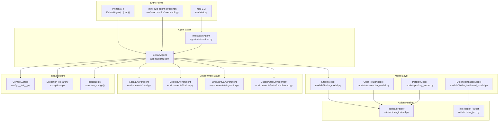
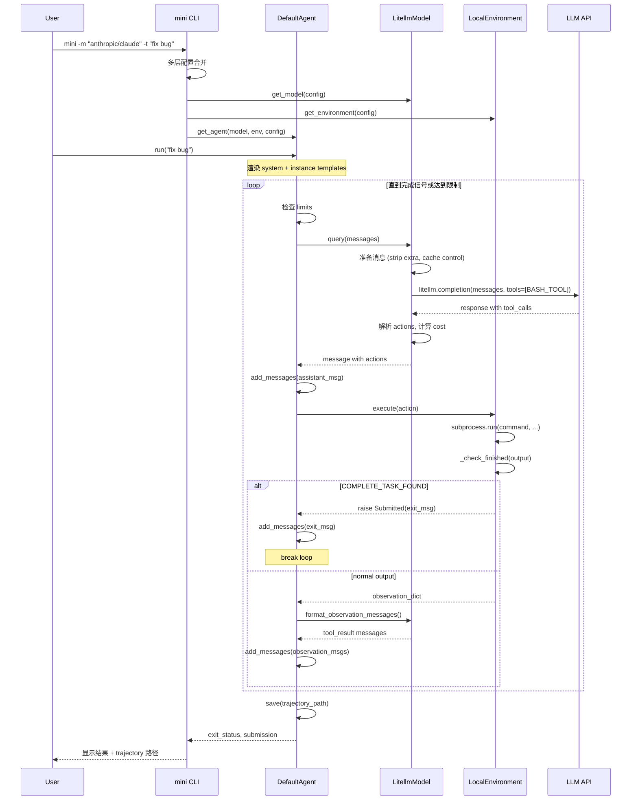
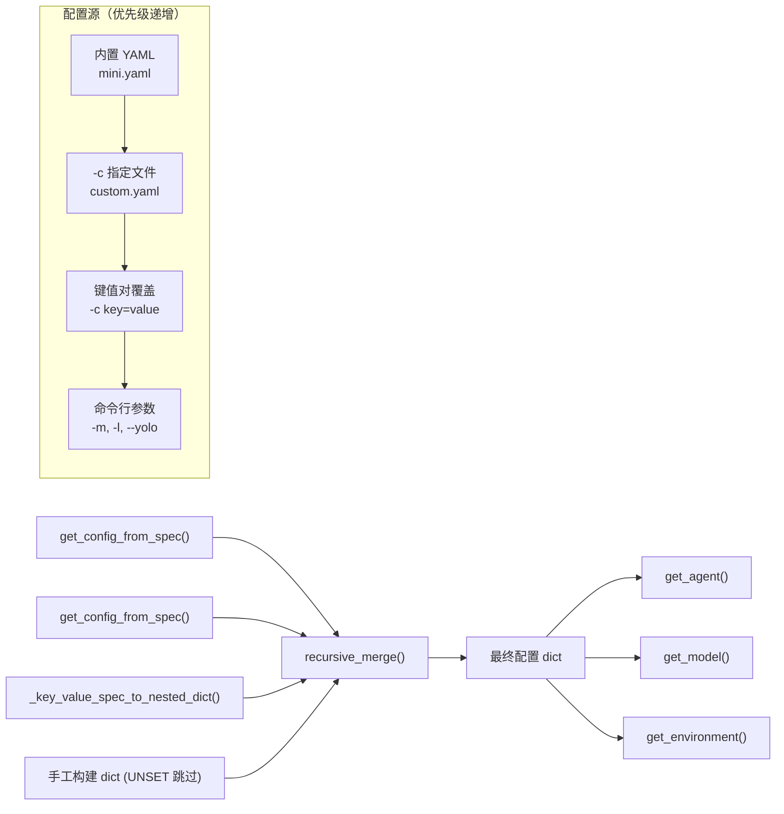

# mini-swe-agent 深度架构报告

> **分析日期**: 2026-06-06
> **分析版本**：本轮按 `v2.3.0` tag 复核，固定 commit [`adfe20233d456104c38c3129161b54f0fd39f2c7`](https://github.com/SWE-agent/mini-swe-agent/tree/adfe20233d456104c38c3129161b54f0fd39f2c7)。旧报告没有保存当时 main 的 SHA，不能将该 tag 反写为历史快照；下列修正只对应本轮固定 tag。
> **复核日期**：2026-10-22；源码只读、未构建、未调用模型或执行 agent；来源与覆盖见 [sources/MANIFEST.md](sources/MANIFEST.md)。
> **代码规模**: ~5,200 行 Python 源码 / ~9,100 行测试
> **仓库地址**: https://github.com/SWE-agent/mini-swe-agent

---

## 目录

1. [Codebase Map —— 项目地图](#1-codebase-map--项目地图)
2. [Runtime Story —— 运行故事](#2-runtime-story--运行故事)
3. [Design Inquiry —— 设计追问](#3-design-inquiry--设计追问)
4. [Maintainer Notes —— 维护者笔记](#4-maintainer-notes--维护者笔记)
5. [Diagrams —— 架构图解](#5-diagrams--架构图解)
6. [Evidence Index —— 证据索引](#6-evidence-index--证据索引)

---

## 1. Codebase Map —— 项目地图

### 1.1 项目定位

`mini-swe-agent` 是一个**极简 AI 软件工程 agent**，由 Princeton & Stanford 的 SWE-bench/SWE-agent 团队构建。它是 v2 版本，相比原始的 [SWE-agent](https://github.com/swe-agent/swe-agent) 做了**激进简化**：

- **唯一工具是 bash** —— 不依赖 LLM 的 tool-calling 接口也能工作
- **线性消息历史** —— 没有历史处理/压缩层，trajectory 就是 messages
- **`subprocess.run` 执行每个动作** —— 无状态 shell session，每条命令独立执行
- `README.md:28` 自述 SWE-bench Verified >74%；`:9` 同时列了 Gemini 3 Pro 的 74% 新闻。本文没有追踪逐实例评测记录、预算和模型设置，不把该宣传数字当作 agent 单独可复现的性能结论

### 1.2 技术栈

| 维度 | 选择 |
|------|------|
| 语言 | Python >=3.10 |
| 包管理 | setuptools (pyproject.toml) |
| LLM 接入 | litellm（主力）、openrouter、portkey、requesty |
| 配置 | YAML + 环境变量 (.env) |
| CLI | Typer + Rich + Textual (TUI) |
| 模板 | Jinja2（prompt 模板） |
| 数据校验 | Pydantic v2 |
| 重试 | tenacity |
| 容器 | Docker/Podman, Singularity/Apptainer, Bubblewrap |
| 测试 | pytest + pytest-asyncio + pytest-xdist + pytest-cov |

**依赖精简原则**：核心依赖只有 pyyaml, requests, jinja2, pydantic, litellm, tenacity, rich, python-dotenv, typer, platformdirs, textual, prompt_toolkit, datasets, openai。所有环境依赖（Docker、Singularity、Bubblewrap、Modal 等）均为可选。

### 1.3 目录结构

```
mini-swe-agent/
├── pyproject.toml                 # 项目元数据、依赖、脚本入口
├── mkdocs.yml                     # 文档构建配置
├── README.md                      # 项目说明
├── src/minisweagent/
│   ├── __init__.py                # 版本号、路径、Protocol 定义 (Agent/Model/Environment)
│   ├── exceptions.py              # 异常层次 (InterruptAgentFlow → Submitted, LimitsExceeded...)
│   ├── __main__.py                # python -m minisweagent 入口
│   ├── agents/
│   │   ├── __init__.py            # get_agent() 工厂函数
│   │   ├── default.py             # DefaultAgent — 核心 agent 类（文件171行）
│   │   └── interactive.py         # InteractiveAgent — 人机交互模式 (human/confirm/yolo)
│   ├── environments/
│   │   ├── __init__.py            # get_environment() 工厂函数
│   │   ├── local.py               # LocalEnvironment — subprocess.run 本地执行
│   │   ├── docker.py              # DockerEnvironment — docker exec 容器执行
│   │   ├── singularity.py         # SingularityEnvironment — 容器执行
│   │   └── extra/
│   │       ├── bubblewrap.py      # BubblewrapEnvironment — Linux 无特权沙箱
│   │       ├── contree.py         # ContreeEnvironment
│   │       ├── swerex_docker.py   # SwerexDockerEnvironment
│   │       └── swerex_modal.py    # SwerexModalEnvironment
│   ├── models/
│   │   ├── __init__.py            # get_model() 工厂 + GlobalModelStats
│   │   ├── litellm_model.py       # LitellmModel — 主力模型类 (tool calling)
│   │   ├── litellm_textbased_model.py  # 基于文本解析的模型 (无 tool calling)
│   │   ├── litellm_response_model.py   # Response API 格式模型
│   │   ├── openrouter_model.py    # OpenRouter 模型
│   │   ├── portkey_model.py       # Portkey 模型
│   │   ├── requesty_model.py      # Requesty 模型
│   │   ├── test_models.py         # 测试用确定性模型
│   │   └── utils/
│   │       ├── actions_toolcall.py      # Tool-call 动作解析 & 观察格式化
│   │       ├── actions_text.py          # 文本正则动作解析 (v1 遗留)
│   │       ├── actions_toolcall_response.py  # Response API 格式
│   │       ├── anthropic_utils.py       # Anthropic thinking block 重排序
│   │       ├── cache_control.py         # Anthropic cache control 标记
│   │       ├── content_string.py        # 多格式消息内容提取
│   │       ├── openai_multimodal.py     # 多模态内容展开
│   │       └── retry.py                # tenacity 重试封装
│   ├── run/
│   │   ├── mini.py                # `mini` CLI 入口 — 主命令行
│   │   ├── hello_world.py         # 最简 Python API 示例
│   │   ├── benchmarks/
│   │   │   ├── swebench.py        # SWE-bench 批量评估
│   │   │   ├── swebench_single.py # 单实例评估
│   │   │   ├── programbench.py    # ProgramBench 评估
│   │   │   └── utils/             # 进度管理
│   │   ├── extra/
│   │   │   └── __init__.py        # 空模块
│   │   └── utilities/
│   │       ├── mini_extra.py      # `mini-extra` CLI (config setup/inspector)
│   │       ├── config.py          # 全局配置管理 (.env)
│   │       └── inspector.py       # Trajectory 浏览器 (Textual TUI)
│   ├── config/
│   │   ├── __init__.py            # get_config_from_spec() — 配置解析
│   │   ├── default.yaml           # 默认配置 (文本解析模式)
│   │   ├── mini.yaml              # CLI 配置 (tool-calling 模式)
│   │   ├── mini_textbased.yaml    # CLI 配置 (文本解析回退)
│   │   ├── inspector.tcss         # Trajectory 浏览器样式
│   │   └── benchmarks/            # 基准测试配置
│   └── utils/
│       ├── serialize.py           # recursive_merge() + UNSET sentinel
│       └── log.py                 # 日志工具
└── tests/                         # 测试 (~9,100 行)
    ├── agents/                    # Agent 测试 (default, interactive, multimodal)
    ├── environments/              # 环境测试 (local, docker, singularity)
    ├── models/                    # 模型测试 (litellm, textbased, portkey, anthropic)
    ├── config/                    # 配置测试
    ├── utils/                     # 工具测试
    └── test_data/                 # 测试数据
```

### 1.4 入口点

| 入口 | 路径 | 用途 |
|------|------|------|
| `mini` CLI | `src/minisweagent/run/mini.py:app` | 主命令行工具，交互式 coding agent |
| `mini-extra` CLI | `src/minisweagent/run/utilities/mini_extra.py:main` | 配置管理、trajectory 浏览器 |
| `hello_world` | `src/minisweagent/run/hello_world.py:main` | 最简 Python API 示例 |
| `swebench` CLI | `src/minisweagent/run/benchmarks/swebench.py:app` | SWE-bench 批量评估 |
| Python API | `DefaultAgent(model, env).run(task)` | 编程集成 |

### 1.5 阅读路线建议

1. **`src/minisweagent/__init__.py`** — 理解三大 Protocol（Agent/Model/Environment）和全局配置
2. **`src/minisweagent/agents/default.py`** — 核心 agent 循环，171 行（包括配置和序列化，非循环本身）
3. **`src/minisweagent/environments/local.py`** — 最简单的环境实现
4. **`src/minisweagent/models/litellm_model.py`** — 主力模型类
5. **`src/minisweagent/run/hello_world.py`** — 端到端运行示例
6. **`src/minisweagent/run/mini.py`** — CLI 入口，展示配置组装流程
7. **`src/minisweagent/agents/interactive.py`** — 人机交互扩展
8. **`src/minisweagent/exceptions.py`** — 控制流异常设计
9. **`src/minisweagent/config/default.yaml`** — prompt 模板设计

---

## 2. Runtime Story —— 运行故事

### 场景：用户通过 `mini` CLI 让 agent 修复一个 bug

**入口**: `src/minisweagent/run/mini.py:app:main()` (line 55)

#### 2.1 配置组装阶段

```python
# mini.py:72-92
configs = [get_config_from_spec(spec) for spec in config_spec]
configs.append({
    "run": {"task": task or UNSET},
    "agent": {"agent_class": agent_class or UNSET, "mode": "yolo" if yolo else UNSET, ...},
    "model": {"model_class": model_class or UNSET, "model_name": model_name or UNSET},
    "environment": {"environment_class": environment_class or UNSET},
})
config = recursive_merge(*configs)
```

配置合并采用**多层递归合并**策略（`src/minisweagent/utils/serialize.py:6-29`）：
- 从左到右优先级递增（后覆盖前）
- `UNSET` 值被跳过（允许可选覆盖）
- 嵌套字典递归合并（不覆盖整个子树）

配置优先级应分两层说明：`mini.py:72-92` 按 `-c` 列表从左到右合并，再叠加显式 CLI 字段；`-c` 的 Typer 默认值只有在未指定时才提供 `mini.yaml`（`:63`），不是永远自动追加一层内置配置。模型名另按显式参数 → config → `MSWEA_MODEL_NAME` 回退（`models/__init__.py:65-75`），不能推广成所有字段统一的环境变量优先级。

#### 2.2 组件实例化

```python
# mini.py:99-101
model = get_model(config=config.get("model", {}))
env = get_environment(config.get("environment", {}), default_type="local")
agent = get_agent(model, env, config.get("agent", {}), default_type="interactive")
```

**Model 工厂** (`src/minisweagent/models/__init__.py:45-62`):
- 通过 `get_model_name()` 从配置/参数/环境变量 `MSWEA_MODEL_NAME` 获取模型名
- 通过 `get_model_class()` 确定模型类（默认 `LitellmModel`）
- 自动检测 Anthropic 模型并启用 cache control

**Environment 工厂** (`src/minisweagent/environments/__init__.py:30-33`):
- 默认 `LocalEnvironment`（直接 `subprocess.run` 在本机执行）
- 支持 docker/singularity/bubblewrap/contree 等沙箱

**Agent 工厂** (`src/minisweagent/agents/__init__.py:25-28`):
- 默认 `InteractiveAgent`（CLI 场景）
- 支持 `DefaultAgent`（编程/benchmark 场景）

#### 2.3 Agent 执行循环

```python
# mini.py:102
agent.run(run_task)
```

`DefaultAgent.run()` (`src/minisweagent/agents/default.py:85-105`) 的完整执行流程：

```
run(task)
  │
  ├─ 1. 渲染 system_template + instance_template (Jinja2)
  │      → messages = [system_msg, user_msg]
  │
  └─ 2. while True:
       │
       ├─ step()
       │   │
       │   ├─ query()                 # → 调用 LLM
       │   │   ├─ 检查 limits (step_limit, cost_limit, wall_time_limit)
       │   │   ├─ model.query(messages) → LLM 返回含 tool_calls 的响应
       │   │   ├─ 累加 cost
       │   │   └─ add_messages(model_message)
       │   │
       │   └─ execute_actions(message)
       │       │
       │       ├─ 对每个 action → env.execute(action)
       │       │   └─ subprocess.run(command, shell=True, ...)  # 本地环境
       │       │      (或 docker exec / bwrap / singularity exec)
       │       │
       │       ├─ 检查输出是否以 "COMPLETE_TASK_AND_SUBMIT_FINAL_OUTPUT" 开头
       │       │   → 是：raise Submitted(exit_message)
       │       │   → 否：返回 observation dict
       │       │
       │       └─ add_messages(*observation_messages)
       │
       ├─ 捕获 InterruptAgentFlow:
       │   ├─ Submitted → add_messages(exit_msg); break
       │   ├─ LimitsExceeded / TimeExceeded → add_messages(exit_msg); break
       │   ├─ FormatError → add_messages(error_msg); 继续循环
       │   └─ UserInterruption → add_messages(user_msg); 继续循环
       │
       ├─ 捕获 Exception:
       │   └─ handle_uncaught_exception() → add_messages(exit_msg); raise
       │
       └─ finally: save(trajectory_path)
```

#### 2.4 LLM 调用路径

`LitellmModel.query()` (`src/minisweagent/models/litellm_model.py:81-105`):

```
query(messages)
  │
  ├─ 1. _prepare_messages_for_api(messages)
  │     ├─ 移除 extra 字段（API 不需要）
  │     ├─ _reorder_anthropic_thinking_blocks()  # Anthropic thinking 块顺序修正
  │     └─ set_cache_control()                   # Anthropic cache control 标记
  │
  ├─ 2. 带重试的 API 调用 (tenacity)
  │     ├─ 最多 10 次尝试 (MSWEA_MODEL_RETRY_STOP_AFTER_ATTEMPT)
  │     ├─ 指数退避 (min=4s, max=60s)
  │     └─ abort_exceptions: 认证错误/权限错误等不重试
  │
  ├─ 3. _query() → litellm.completion()
  │     ├─ model=self.config.model_name
  │     ├─ messages=prepared_messages
  │     └─ tools=[BASH_TOOL]  # 唯一的 tool definition
  │
  ├─ 4. _calculate_cost() → litellm.cost_calculator.completion_cost()
  │     └─ 更新 GLOBAL_MODEL_STATS（全局成本/调用计数，含 limit 检查）
  │
  └─ 5. _parse_actions() → 提取 tool_calls，验证只有 "bash" tool
        └─ 解析失败向外抛异常；本 tag 未实现原始 response 的 FormatError fallback，见 §4.2
```

#### 2.5 任务完成信号

任务完成通过一个**带内信号机制** (`src/minisweagent/environments/local.py:55-65`)：

```python
def _check_finished(self, output: dict):
    lines = output.get("output", "").lstrip().splitlines(keepends=True)
    if lines and lines[0].strip() == "COMPLETE_TASK_AND_SUBMIT_FINAL_OUTPUT" and output["returncode"] == 0:
        submission = "".join(lines[1:])
        raise Submitted({...})
```

每个 Environment 实现都包含相同的 `_check_finished()` 方法。当 LLM 发出 `echo COMPLETE_TASK_AND_SUBMIT_FINAL_OUTPUT` 命令时，下一行开始的输出将被作为最终提交内容。

#### 2.6 关键数据流

```
User Task (string)
    │
    ▼
Jinja2 Templates ──→ System Prompt ──→ LLM ──→ Tool Calls [{command: "..."}]
    │                                            │
    │                                   _parse_actions()
    │                                            │
    │                                   [{command: "...", tool_call_id: "..."}]
    │                                            │
    │                                   env.execute(action)
    │                                            │
    │                                   {output, returncode, exception_info}
    │                                            │
    │                                   _check_finished(output)
    │                                     │            │
    │                              Submitted()    Observation Message
    │                                     │            │
    │                               exit_message    add_messages()
    │                                     │            │
    └─────────────────────────────────────┴────────────┘
                                                  │
                                          messages list (linear history)
                                                  │
                                          save() ──→ .traj.json
```

---

## 3. Design Inquiry —— 设计追问

### 3.1 核心抽象：三大 Protocol

`src/minisweagent/__init__.py:43-81` 定义了三个 `typing.Protocol`：

- **`Model`**: `query()`, `format_message()`, `format_observation_messages()`, `get_template_vars()`, `serialize()`
- **`Environment`**: `execute()`, `get_template_vars()`, `serialize()`
- **`Agent`**: `run()`, `save()`

**为什么用 Protocol 而不是 ABC？**

Protocol 提供**结构化鸭子类型**（structural subtyping）——任何实现了这些方法的对象都满足协议，不需要显式继承。这降低了耦合：你可以写一个完全独立的 Model 实现，只要方法签名匹配就能工作。

**证据**: `src/minisweagent/__init__.py:43-81` — Protocol 定义中没有任何基类，`DefaultAgent.__init__` (`default.py:37`) 接受 `model: Model, env: Environment` 参数，类型检查器用 Protocol 验证，但运行时不做 isinstance 检查。

**设计判断**：这是一个务实的选择。Protocol 比 ABC 更灵活（不需要显式继承），比纯鸭子类型更安全（IDE 和 mypy 能检查）。对于鼓励用户自定义 Model/Environment 的开源项目，这是正确的抽象层次。

### 3.2 "Only Bash" —— 为什么只有一个工具？

**代码证据**: `src/minisweagent/models/utils/actions_toolcall.py:11-27`

```python
BASH_TOOL = {
    "type": "function",
    "function": {
        "name": "bash",
        "description": "Execute a bash command",
        "parameters": {
            "type": "object",
            "properties": {
                "command": {"type": "string", "description": "The bash command to execute"}
            },
            "required": ["command"],
        },
    },
}
```

这就是**唯一的 tool definition**。所有操作——读文件、编辑代码、运行测试、提交结果——都通过 bash 命令完成。

**为什么这样设计？**

1. **通用性**：bash 是图灵完备的，任何操作都可以表达为 bash 命令
2. **模型无关**：不依赖 tool-calling API，纯文本解析也能工作（`LitellmTextbasedModel`）
3. **简化实现**：不需要为每个功能（读文件、写文件、搜索、git 操作等）实现单独的 tool
4. **简化评估**：SWE-bench 的测试环境已经提供了 git、python、测试框架等
5. **可移植性**：bash 在所有 Linux 环境、Docker 容器、沙箱中都可用

**代价**：
- LLM 必须自己决定使用什么命令，可能效率不如专用 tool
- 需要仔细的 prompt 工程引导 LLM 正确使用 bash
- 长输出可能超出上下文窗口（通过 `observation_template` 中的截断机制缓解，见 `default.yaml:115-142`）

**观察**：README 中提到 "在 2024 年，我们在 SWE-agent 中强调 tools 和特殊接口。一年后，随着 LM 变得更强大，很多这些都不再需要。" 这表明设计选择是**时间敏感的**——随着 LLM 能力的提升，"唯一 bash" 策略变得越来越可行。

### 3.3 subprocess.run vs 持久 Shell Session

**每个命令独立执行**（`src/minisweagent/environments/local.py:28-39`）：

```python
result = subprocess.run(
    command, shell=True, text=True, cwd=cwd,
    env=os.environ | self.config.env,
    timeout=timeout or self.config.timeout,
    ...
)
```

**为什么不用持久 shell session？**

1. **状态隔离**：每个命令在独立子进程中运行，不继承前一个子 shell 的 cwd/export 状态；文件和已启动的外部进程仍可能留下效果
2. **沙箱友好**：`subprocess.run` 可以轻松替换为 `docker exec`、`bwrap`、`singularity exec`
3. **并行安全**：shell 局部状态不共享；若多实例使用同一工作目录、容器或外部服务，仍需独立资源和锁
4. **错误恢复**：失败会以 returncode/exception_info 反馈；已写文件和其他外部副作用不会因此回滚
5. **超时控制**：每个命令有独立超时，此处未设置进程组并显式清理整个后代树，不能据 `timeout` 保证残留进程不会影响后续命令

**代价**：
- `cd` 不持久（prompt 中明确告知 LLM：用 `cd /path && command` 模式）
- 环境变量不持久（同样需要在命令前缀设置）
- 如需要状态，LLM 必须写入文件来跨步骤传递

**证据**：prompt 模板中明确说明 (`default.yaml:37-40`)："Directory or environment variable changes are not persistent. Every action is executed in a new subshell."

### 3.4 异常驱动的控制流

`src/minisweagent/exceptions.py` 定义了一个**异常层次**：

```
InterruptAgentFlow               # 基类：中断 agent 循环并添加消息
├── Submitted                    # 任务完成
├── LimitsExceeded               # 达到限制
│   └── TimeExceeded             # 超时
├── UserInterruption             # 用户中断
└── FormatError                  # LLM 输出格式错误
```

**为什么用异常而不是返回值？**

1. **跨层传递**：`Submitted` 在 `Environment.execute()` 深处抛出（`local.py:60`），在 `Agent.run()` 层捕获（`default.py:96`）
2. **携带数据**：每个异常携带要添加到消息历史的 `messages`
3. **避免检查链**：不需要在每个调用层级检查返回值
4. **清晰的终止路径**：异常是不可忽略的终止信号

**代码路径**：
```
env.execute() → _check_finished() → raise Submitted(exit_message)
    │
agent.step() → execute_actions()
    │
agent.run() → except InterruptAgentFlow as e: add_messages(*e.messages)
```

### 3.5 双模动作解析

mini-swe-agent 支持两种动作解析模式：

**模式 1: Tool Calling（推荐）** — `src/minisweagent/models/utils/actions_toolcall.py`
- LLM 返回标准 function call: `{"name": "bash", "arguments": {"command": "..."}}`
- 需要模型支持 tool-calling API
- 更可靠，结构更严格

**模式 2: 文本正则解析（v1 遗留）** — `src/minisweagent/models/utils/actions_text.py`
- 从 LLM 文本输出中用正则提取: `` ```mswea_bash_command\n...\n``` ``
- 兼容不支持 tool-calling 的模型
- 通过 `action_regex` 配置自定义

**选择逻辑**：
- `LitellmModel` 使用 tool calling（发送 `BASH_TOOL` definition）
- `LitellmTextbasedModel` 继承 `LitellmModel`，覆盖 `_query()` 去掉 tools 参数，覆盖 `_parse_actions()` 使用正则
- 默认配置 `mini.yaml` 使用 tool calling，`default.yaml` 使用文本解析

### 3.6 配置系统的分层设计

配置由 `mini.py:63,72-92` 的实际参数列表决定：未传 `-c` 时用默认 `mini.yaml`；显式传多个 `-c` 时按给定顺序合并 YAML 或 `key=value`，最后叠加显式 CLI 字段。文件和键值对没有独立固定优先级，谁在列表后面谁覆盖；环境变量主要由具体组件读取。

**`recursive_merge()` 的关键设计** (`src/minisweagent/utils/serialize.py:6-29`):
- `UNSET` sentinel 值允许可选覆盖——设为 UNSET 的参数会退回到上一层的值
- 嵌套字典递归合并而非整体替换——可以覆盖 `model.model_kwargs.temperature` 而不丢失 `model.model_kwargs.drop_params`
- 这种设计使得命令行覆盖简洁而安全

### 3.7 人机交互三模式

`InteractiveAgent` (`src/minisweagent/agents/interactive.py`) 支持三种运行模式：

| 模式 | 行为 |
|------|------|
| `yolo` | LLM 命令直接执行，无需确认 |
| `confirm` | 非白名单命令需要用户确认 |
| `human` | 用户手动输入命令 |

模式通过 slash commands 切换：`/y`（yolo）、`/c`（confirm）、`/u`（human）。

此外，用户可以：
- `/m` 进入多行输入模式
- `/h` 显示帮助
- 在 LimitsExceeded 时交互式提升限制（`interactive.py:80-94`）
- 在 agent 想要退出时选择继续或提交新任务（`interactive.py:144-160`）

---

## 4. Maintainer Notes —— 维护者笔记

### 4.1 扩展点

| 扩展点 | 方式 | 参考 |
|--------|------|------|
| 添加新模型后端 | 实现 `Model` Protocol + 注册到 `_MODEL_CLASS_MAPPING` | `src/minisweagent/models/__init__.py:78-89` |
| 添加新执行环境 | 实现 `Environment` Protocol + 注册到 `_ENVIRONMENT_MAPPING` | `src/minisweagent/environments/__init__.py:8-16` |
| 自定义 agent 行为 | 继承 `DefaultAgent`，覆盖 `query()` / `execute_actions()` | `src/minisweagent/agents/interactive.py` |
| 自定义 prompt 模板 | 创建新 YAML 配置或覆盖 `system_template` / `instance_template` | `src/minisweagent/config/default.yaml` |
| 自定义动作解析 | 设置 `action_regex` 参数 | `src/minisweagent/models/litellm_textbased_model.py:8` |
| 添加新 benchmark | 注册到 `DATASET_MAPPING` | `src/minisweagent/run/benchmarks/swebench.py:53-62` |

### 4.2 关键不变量

1. **消息历史必须是线性的** —— `self.messages` 是纯 `list[dict]`，每个正常 step 追加；`run:88` 会为新任务重置 messages。trajectory 同时包含 messages 与配置/成本等元数据（`default.py:140-161`）；不能把整个文件等同于 messages。线性历史结构让调试和 fine-tuning 变得简单。扩展时需兼容该序列化契约。

2. **每个 action 必须独立执行** —— 不维护跨 step 的 shell 状态。任何需要持久状态的操作必须通过文件系统。

3. **完成信号必须是 `COMPLETE_TASK_AND_SUBMIT_FINAL_OUTPUT`** —— 所有 Environment 实现的 `_check_finished()` 都检查这个 Magic String。修改它需要同步所有环境实现。

4. **异常携带消息** —— `InterruptAgentFlow` 及其子类的构造函数接收 `*messages`。这些消息直接 append 到 history。不要绕过这个机制。

5. **格式错误的原始响应留存不能假定存在** —— 本次固定 tag 的 `LitellmModel.query`（`litellm_model.py:80-93`）在构造 `extra` 时先运行 `_parse_actions(response)`，没有捕获 FormatError 后写入 `repr(response)` 的 fallback。若此处抛错，agent 的 `handle_uncaught_exception`（`default.py:71-83`）只记录异常文本与 traceback；需要原始响应的诊断应另加验证。

### 4.3 风险与陷阱

| 风险 | 影响 | 缓解 |
|------|------|------|
| Magic String 同步 | `COMPLETE_TASK_AND_SUBMIT_FINAL_OUTPUT` 硬编码在 4+ 个文件中 | 考虑提取为常量 |
| 配置合并复杂度 | `recursive_merge` + `UNSET` sentinel 的行为对新贡献者不直观 | 需要更好的文档 |
| 环境变量泄漏 | `LocalEnvironment` 默认 `os.environ` 会暴露所有环境变量给 agent | 容器可提供额外边界；实际保护还取决于挂载、网络、权限与 secrets 注入，不能仅凭类名视为安全 |
| litellm 版本锁定 | `!= 1.82.7, != 1.82.8` 排除了被攻破的版本 | 需要持续监控供应链安全 |
| 文本解析模式的脆弱性 | 正则表达式 `r"```mswea_bash_command\s*\n(.*?)\n```"` 对 LLM 输出格式敏感 | tool-calling 模式是推荐路径 |
| `shell=True` | `subprocess.run(command, shell=True)` 有注入风险 | 沙箱环境缓解，本地环境依赖用户判断 |

### 4.4 测试覆盖

测试位于 `tests/` 目录，约 9,100 行。主要覆盖：

- **Agent 测试** (`tests/agents/`): 完整 cycle、limits 执行、超时处理、多步完成、消息格式（支持 text/toolcall/response_api 三种参数化）
- **模型测试** (`tests/models/`): litellm 模型、textbased 模型、portkey、anthropic utils、format error 持久化
- **环境测试** (`tests/environments/`): local、docker、singularity 环境
- **配置测试** (`tests/config/`): 模板渲染、配置合并

测试使用 `DeterministicModel` / `DeterministicToolcallModel` / `DeterministicResponseAPIToolcallModel` 进行 mock (`src/minisweagent/models/test_models.py`)，不需要真实的 LLM API 调用。

### 4.5 代码组织原则

- **工厂模式**：Model/Environment/Agent 的实例化都通过 `get_*` 工厂函数，支持简称（如 `"docker"` → `DockerEnvironment`）和全路径（如 `"mymodule.MyClass"`）
- **配置类模式**：每个组件有一个嵌套的 `*Config(BaseModel)` 类，构造函数接受 `**kwargs` 传递给 Config
- **模板变量模式**：每个组件实现 `get_template_vars()`，由 Agent 的 `recursive_merge()` 聚合后用于 Jinja2 渲染
- **序列化模式**：每个组件实现 `serialize()`，返回可 JSON 序列化的 dict，由 Agent 合并到最终 trajectory

---

## 5. Diagrams —— 架构图解

### 5.1 系统架构图



### 5.2 运行时序列图



### 5.3 配置合并流



---

## 6. Evidence Index —— 证据索引

| # | 关键声明 | 主要证据 | 置信度 |
|---|---------|---------|--------|
| 1 | Agent 循环171 行（包括配置和序列化，非循环本身） | `src/minisweagent/agents/default.py` — 整个文件 171 行；核心 run 在85-105行 | 确认 |
| 2 | 唯一工具是 bash | `src/minisweagent/models/utils/actions_toolcall.py:11-27` — `BASH_TOOL` definition | 确认 |
| 3 | 每个命令独立 subprocess | `src/minisweagent/environments/local.py:28-39` — `subprocess.run()` | 确认 |
| 4 | 线性消息历史 | `src/minisweagent/agents/default.py:66-69` — `add_messages()` 只是 `extend` | 确认 |
| 5 | 异常驱动控制流 | `src/minisweagent/exceptions.py` + `agents/default.py:93-105` — `InterruptAgentFlow` 捕获 | 确认 |
| 6 | 完成信号是 Magic String | `src/minisweagent/environments/local.py:55-65` — `_check_finished()` | 确认 |
| 7 | 双模动作解析 | `models/litellm_model.py:127-130` (toolcall) vs `models/litellm_textbased_model.py:29-34` (regex) | 确认 |
| 8 | Anthropic cache control 自动启用 | `src/minisweagent/models/__init__.py:56-60` — 检测模型名中的 anthropic/claude 关键词 | 确认 |
| 9 | 全局成本/调用限制 | `src/minisweagent/models/__init__.py:13-41` — `GlobalModelStats` class | 确认 |
| 10 | 用户交互三模式 | `src/minisweagent/agents/interactive.py:24-31` — `InteractiveAgentConfig.mode` | 确认 |
| 11 | 测试使用确定性 Mock 模型 | `src/minisweagent/models/test_models.py` — `DeterministicModel` 等 | 确认 |
| 12 | 本 tag 未实现格式错误时的原始响应 fallback；异常转为 exit 日志 | `src/minisweagent/models/litellm_model.py:80-93`；`agents/default.py:71-83,98-102` | 已核固定tag |
| 13 | 配置递归合并 + UNSET sentinel | `src/minisweagent/utils/serialize.py:6-29` | 确认 |
| 14 | Protocol 定义三大抽象 | `src/minisweagent/__init__.py:43-81` | 确认 |
| 15 | 工厂函数支持简称和全路径 | `src/minisweagent/models/__init__.py:78-113` / `environments/__init__.py:8-33` / `agents/__init__.py:8-28` | 确认 |

### 推断（未完全确认）

| # | 推断 | 依据 | 置信度 |
|---|------|------|--------|
| I1 | "Only bash" 设计受 LLM 能力提升驱动 | README 中的历史叙述 + 架构设计 | 高 |
| I2 | 独立 subprocess 设计的主要动机是沙箱可替换性 | README 明确提到 "trivial to execute the actions in sandboxes" | 高 |
| I3 | Magic String 方案是刻意保持简单的选择 | 没有其他完成检测机制 | 中 |

---

## 对比阅读边界

本轮只取了 mini-swe-agent 的固定 tag，没有对 SWE-agent v1 或 Claude Code 取固定版本并追踪运行路径。因而不保留“另一系统缺少沙箱/研究用途/模型兼容性”等横向结论。需要比较时，应独立使用 `code-researcher compare`，声明版本、同类场景、成本和未检查项。
---

*报告由 code-researcher (deep mode) 生成。每条关键声明均标注了源码路径。*
