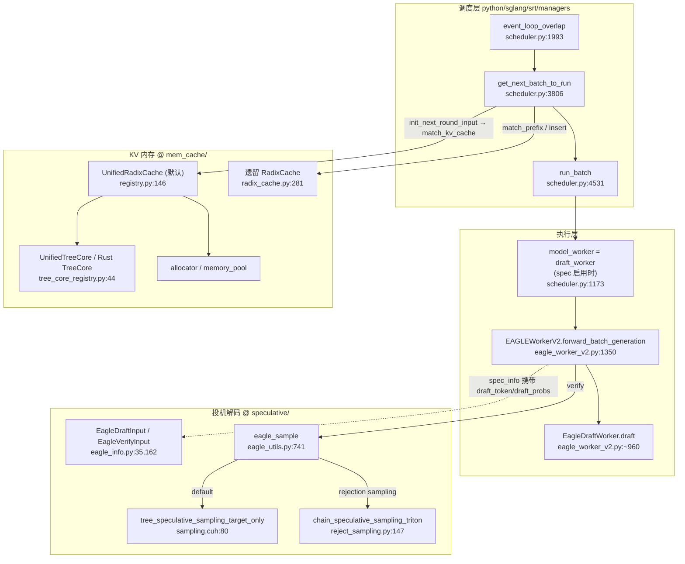
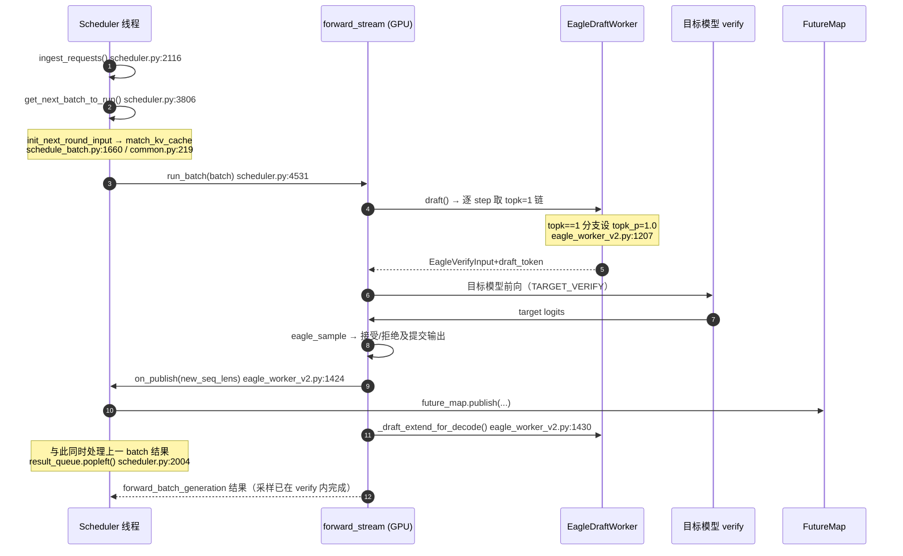

> **2026-10-22 语义复核**：固定源码、已核调用链和未覆盖项见 [sources/MANIFEST.md](sources/MANIFEST.md)；本轮核验限定在列明的行为切面。

# SGLang 仓库代码分析报告

> ⚠️ **信息来源声明**：本报告由 AI Agent 基于公开开源仓库源码整理生成，方法为**只读精读**（clone 到仓库外临时目录，不构建、不修改、读完即删）。所有行为结论均标注 `文件:行`，并区分「代码事实」与「研究推断」。加速比/接受率等性能数字**不在本报告结论范围内**——本报告只做代码事实核验，不做性能复现。
>
> **调研日期**：2026-10-16
> **分析对象**：`sgl-project/sglang` @ `2a08e261ecd4cdfb04ec354f9005f18b88108b7d`（2026-10-16 13:24:48 +0800，提交标题 `[Feat] MiniCPM-V-4.7: add model support (#41993)`；`git describe` = `gateway-v0.3.1-11434-g2a08e261ec`）
> **模式**：`deep`（code-researcher skill）
> **子文档**：调度与 KV 复用见 [scheduler-and-prefix-cache.md](scheduler-and-prefix-cache.md)；投机解码路径与 EAGLE 对照见 [speculative-decoding-path.md](speculative-decoding-path.md)；结论审计见 [claim-audit.md](claim-audit.md)
> **证据标签**：单一主等级（精读原文 / 摘要级 / 二手 / 受限核验）。本报告大量使用 **`[精读原文（SGLang 源码 @ 本报告 SHA）]`**——指逐行阅读了该 commit 的源码，未引用任何二手解读。

---

## 1. 执行摘要

### 1.1 这个项目是什么

SGLang 是一个面向 LLM / 多模态模型的高吞吐推理服务框架（[README.md](<https://github.com/sgl-project/sglang/blob/2a08e261ecd4cdfb04ec354f9005f18b88108b7d/README.md>)，本报告不贴仓库长引用）。本报告只覆盖它**推理引擎核心**的一条纵切面：`python/sglang/srt/` 下的**调度器 → KV 内存 → 注意力 → 投机解码**链路。[精读原文（SGLang 源码 @ 本报告 SHA）]

代码规模（`scan_repo.py` 扫描本 commit 工作树）：10,629 个文件、3,452,457 行；其中 Python 2,495,272 行、Rust 291,191 行、JavaScript 104,371 行、Markdown 33,493 行、C++ 28,988 行。`git ls-files` 层面这是一个**多语言单体仓库**：Python 引擎（`python/sglang/srt/`）+ Rust 侧扩展（`rust/`，含独立 workspace 的 `sglang-radix-tree`）+ 独立网关（`sgl-model-gateway/`）。[精读原文（SGLang 源码 @ 本报告 SHA）]

### 1.2 中心架构思路

用一句话概括本报告读到的三段设计：

1. **前缀复用被抽象成"逻辑 radix 树 + 物理组件"两层**。树只管 token 键的拓扑（`RadixKey` / `TreeNode.key`），KV 槽位的分配、释放、淘汰、拷贝全交给 `TreeComponent` 驱动——`[unified_tree_core.py:416](<https://github.com/sgl-project/sglang/blob/2a08e261ecd4cdfb04ec354f9005f18b88108b7d/python/sglang/srt/mem_cache/unified_cache/unified_tree_core.py>)` 的类注释原文即 "Zero special-casing in the main tree"。这使 Full / SWA / Mamba 三种缓存类型能共用同一棵树。 **[精读原文]** 证据：`python/sglang/srt/mem_cache/unified_cache/components/README.md:1`
2. **调度器把"跑当前 batch"与"处理上一 batch 结果"拆到两条流上重叠执行**，并把投机解码的 draft/verify 也塞进同一个重叠窗口。`[scheduler.py:1993](<https://github.com/sgl-project/sglang/blob/2a08e261ecd4cdfb04ec354f9005f18b88108b7d/python/sglang/srt/managers/scheduler.py>)` 的 `event_loop_overlap` 用 `result_queue` 持有上一 batch 的结果，`[eagle_worker_v2.py:1424](<https://github.com/sgl-project/sglang/blob/2a08e261ecd4cdfb04ec354f9005f18b88108b7d/python/sglang/srt/speculative/eagle_worker_v2.py>)` 在 verify 结束、draft_extend 开始之间**主动回调 `on_publish`**，让调度准备与 draft_extend 并行。 **[精读原文]**
3. **投机解码的验证被分成"默认目标-only"与"可选严格拒绝采样"两条路径**，两者的接受判据**数学上不同**。默认非 rejection 路径在 `python/sglang/srt/speculative/eagle_utils.py:1000-1003` 把残差工作缓冲 `draft_probs` 初始化为全零；可选路径由 `[eagle_worker_v2.py:1191](<https://github.com/sgl-project/sglang/blob/2a08e261ecd4cdfb04ec354f9005f18b88108b7d/python/sglang/srt/speculative/eagle_worker_v2.py>)` 的 `sample_draft_proposal` 产出真实草稿分布，交给 `[reject_sampling.py:147](<https://github.com/sgl-project/sglang/blob/2a08e261ecd4cdfb04ec354f9005f18b88108b7d/python/sglang/kernels/ops/speculative/reject_sampling.py>)` 的 `coin * q < p` 判据。 **[精读原文]**

### 1.3 最重要的三个判断

| # | 判断 | 类型 |
|---|---|---|
| 1 | **本 commit 上，「topk=1 时把 draft 预测概率传给验证阶段」已存在落地路径**，即 `--speculative-use-rejection-sampling`；但**默认关闭**，且**对 EAGLE3 降维词表场景被显式排除**。因此"默认配置下 topk=1 仍把草稿当 one-hot"在代码层面依然成立。 | 代码事实 |
| 2 | **默认 target-only 分支不能只凭“零 draft_probs”判断有偏**。topk=1、两个阈值为 1 时，接受 $p(x)$，拒绝残差排除 $x$（`sampling.cuh:81,93,104-123`），混合后才恢复 $p$。EAGLE 本体的拒绝路径本轮未复核，不主张完整同构。 | 代码事实 + 有条件单步推导 |
| 3 | **overlap scheduler 与 topk>1 互斥**，而 SGLang 对 Llama/Grok 的自动参数选择恰好给出 `topk=4`；同时 `rejection sampling` 要求 `topk=1`。也就是说：**"重叠调度 + 严格随机验证 + 树状投机"三者当前无法同时开启**，这是当前主干上一个显式的设计取舍边界。 | 代码事实 + 研究推断 |

### 1.4 最值得关注的风险

- **同名 `draft_probs` 在不同分支含义不同**：`eagle_utils.py:1000-1003` 的默认路径创建残差工作缓冲，kernel 在 `sampling.cuh:93` 写入已拒候选目标概率；strict 路径传递实际提议分布。修改共享接口前需先确定分支，不能把零缓冲直接解释为“丢弃随机提议概率导致偏差”。
- **同一语义在仓库内存在两套实现**：新 `UnifiedRadixCache`（默认，Rust TreeCore 优先）与遗留 `RadixCache`（`[radix_cache.py:281](<https://github.com/sgl-project/sglang/blob/2a08e261ecd4cdfb04ec354f9005f18b88108b7d/python/sglang/srt/mem_cache/radix_cache.py>)`）。后者仍被 `schedule_policy` 与 FlexKV 后端导入（`[schedule_policy.py:71](<https://github.com/sgl-project/sglang/blob/2a08e261ecd4cdfb04ec354f9005f18b88108b7d/python/sglang/srt/managers/schedule_policy.py>)`），是迁移期的**双真相源**。 **[精读原文]**

---

## 2. 问题与定位

### 2.1 它解决什么

SGLang 的目标场景在 README 里被概括为 "agentic workloads, large-scale serving, and RL rollouts"。从代码形态看，它把三件事做成同一条流水线：

1. **前缀共享**：多轮对话 / few-shot / 树状 beam 场景里大量重复前缀，用 radix 树把已算过的 KV 串起来复用（`[base_prefix_cache.py](<https://github.com/sgl-project/sglang/blob/2a08e261ecd4cdfb04ec354f9005f18b88108b7d/python/sglang/srt/mem_cache/base_prefix_cache.py>)` 的 `BasePrefixCache` 契约）。
2. **continuous batching + overlap scheduling**：请求持续进队、逐步进出，同时用双流掩盖 CPU 调度开销（`[scheduler.py:1993](<https://github.com/sgl-project/sglang/blob/2a08e261ecd4cdfb04ec354f9005f18b88108b7d/python/sglang/srt/managers/scheduler.py>)`）。
3. **投机解码**：EAGLE / EAGLE3 / NEXTN(MTP) / STANDALONE / DFLASH / NGRAM 等多种草稿来源，共用一套 verify 框架（`[spec_info.py:302](<https://github.com/sgl-project/sglang/blob/2a08e261ecd4cdfb04ec354f9005f18b88108b7d/python/sglang/srt/speculative/spec_info.py>)` 的 `create_worker` 按算法分派）。

### 2.2 与更简单做法的取舍

- **不做"每请求一棵树"**：所有请求共享一棵全局 radix 树，靠 `lock_ref` 引用计数区分"可淘汰 / 被占用"（`[radix_cache.py:582](<https://github.com/sgl-project/sglang/blob/2a08e261ecd4cdfb04ec354f9005f18b88108b7d/python/sglang/srt/mem_cache/radix_cache.py>)` `inc_lock_ref`）。代价是任何一次 `match_prefix` 都可能**就地分裂节点**（`[radix_cache.py:662](<https://github.com/sgl-project/sglang/blob/2a08e261ecd4cdfb04ec354f9005f18b88108b7d/python/sglang/srt/mem_cache/radix_cache.py>)`），树结构在只读操作中被改写。
- **不做"验证一律严格拒绝采样"**：默认走目标-only kernel（仍需完整 `target_probs` 及同形缓冲，见 `eagle_utils.py:999-1003`；本报告未测速度差），代价是 T>0 下草稿被当作 point mass。严格模式作为 opt-in 保留。
- **不做"多语言统一"**：树热点用 Rust 重写（`rust/sglang-radix-tree/`），Python 侧只保留接口与回退。代价是**平台/工具链兼容矩阵**成为新的失败面（`[tree_core_registry.py:44](<https://github.com/sgl-project/sglang/blob/2a08e261ecd4cdfb04ec354f9005f18b88108b7d/python/sglang/srt/mem_cache/unified_cache/tree_core_registry.py>)` 的 `_rust_fallback_reason` 列了 6 类回退条件）。

---

## 3. Codebase Map

### 3.1 主入口

| 面 | 入口 | 说明 |
|---|---|---|
| HTTP / OpenAI 兼容 | `python/sglang/srt/entrypoints/` | 服务器进程入口 |
| 请求编排 | `python/sglang/srt/managers/tokenizer_manager.py` | tokenize / 分派 / 结果回传（本报告仅快速阅读职责和交接处） |
| 调度 | `python/sglang/srt/managers/scheduler.py` | 单进程调度主循环（274k 字符级大文件，本报告 traced） |
| 模型执行 | `python/sglang/srt/model_executor/model_runner.py` | CUDA graph、attn backend 选择 |
| 投机解码 | `python/sglang/srt/speculative/` | 按算法分 worker |

普通文本 HTTP/SSE 请求从入口经 tokenizer、scheduler、detokenizer 到断连清理的独立追踪见 [在线请求生命周期专题](online-request-lifecycle.md)。它固定了单独的 2026-10-23 源码 SHA，不会升级本报告现有固定快照上的其他结论。

`scan_repo.py` 的 `entry_candidates` 把 `.agents/skills/*/SKILL.md` 排在前面，这是**误判**：那些是仓库自带的 Agent 协作说明书，不是运行时入口。本报告按运行时重要性人工改判为 `entrypoints/` → `managers/` → `model_executor/`。[精读原文（SGLang 源码 @ 本报告 SHA）]

### 3.2 高信号目录（按本报告实际阅读权重）

| 目录 | 权重 | 理由 |
|---|---|---|
| `python/sglang/srt/speculative/` | 高 | 专题 ②③ 全部落点；53 个文件 |
| `python/sglang/srt/mem_cache/` | 高 | 专题 ① 落点；`unified_cache/` 是新树实现 |
| `python/sglang/srt/managers/` | 高 | 调度主循环、overlap、batch 组装 |
| `python/sglang/kernels/` | 中高 | verify 两个 kernel 的实现（CUDA `.cuh` + Triton） |
| `python/sglang/srt/layers/attention/` | 中 | `RadixAttention` 层与各 backend 的 verify mask |
| `rust/sglang-radix-tree/` | 中 | 默认 TreeCore 的 Rust 实现 |
| `test/` | 中（抽样） | 3711 个测试文件；本报告只抽读 spec/mem_cache 相关 |

### 3.3 低信号 / 元数据区

`docs/`（10 万+ 行，含 1.2k 行 spec 文档，本报告用于交叉验证而非结论依据）、`benchmark/`、`assets/`、`.agents/`、`3rdparty/`。**本报告不基于这些区域下行为结论。**

### 3.4 构建与开发面

`python/pyproject.toml` 显示构建需要 `torch==2.14.1`、`setuptools-rust>=1.11`、`apache-tvm-ffi`；Rust 树核心是独立 Cargo workspace（`rust/sglang-radix-tree/Cargo.toml` 注释：`Keep this crate in its own workspace: tch needs libtorch at build time`）。本报告**未构建、未运行任何测试**——所有结论来自静态阅读。[精读原文（SGLang 源码 @ 本报告 SHA）]

---

## 4. Architecture Overview

### 4.1 分层与所有权

图中每条边都能对应到源码：[精读原文（SGLang 源码 @ 本报告 SHA）]
`scheduler.py:1993`、`scheduler.py:3806`、`scheduler.py:4531`、`scheduler.py:1173`、`eagle_worker_v2.py:1350`、`eagle_utils.py:741`、`sampling.cuh:80`、`reject_sampling.py:147`、`eagle_info.py:17`、`registry.py:146`、`tree_core_registry.py:44`、`radix_cache.py:281`、`schedule_batch.py:1660`。

### 4.2 关键边界

1. **调度器不直接调 kernel**：它只拿 `model_worker.forward_batch_generation(batch, **fwd_kwargs)`（`[scheduler.py:4608](<https://github.com/sgl-project/sglang/blob/2a08e261ecd4cdfb04ec354f9005f18b88108b7d/python/sglang/srt/managers/scheduler.py>)`），`model_worker` 在 spec 启用时被替换成 `draft_worker`（`[scheduler.py:1173](<https://github.com/sgl-project/sglang/blob/2a08e261ecd4cdfb04ec354f9005f18b88108b7d/python/sglang/srt/managers/scheduler.py>)`）。这是"调度与算法解耦"的接缝。
2. **树的逻辑/物理分离**：`UnifiedTreeCore` 只认 key，产出 `CacheAction`/`ComponentAction` 由 `UnifiedRadixCache` 执行（`unified_cache/components/README.md:20` 的 "tree decides, cache executes"）。 **[精读原文]**
3. **verify 与 draft 的 RNG 边界**：验证侧的 coins 可由 per-request seed 确定性生成（`[eagle_utils.py:635](<https://github.com/sgl-project/sglang/blob/2a08e261ecd4cdfb04ec354f9005f18b88108b7d/python/sglang/srt/speculative/eagle_utils.py>)` 的 `_seeded_verify_coins`），但草稿侧采样仍是**无种子 multinomial**——同一 docstring 明确写了这个不对称。 **[精读原文]**

---

## 5. Runtime Story：一个 decode 步的完整路径（含投机解码）

场景选择：**单请求、EAGLE topk=1、temperature>0、overlap scheduler 开启**——这是最能同时暴露三条重点的路径。

**分步细节**

1. **收请求**：`ingest_requests()`（`[scheduler.py:2116](<https://github.com/sgl-project/sglang/blob/2a08e261ecd4cdfb04ec354f9005f18b88108b7d/python/sglang/srt/managers/scheduler.py>)`）。
2. **选批**：`get_next_batch_to_run()`（`[scheduler.py:3806](<https://github.com/sgl-project/sglang/blob/2a08e261ecd4cdfb04ec354f9005f18b88108b7d/python/sglang/srt/managers/scheduler.py>)`）先合并上一 extend 批，再调 `get_new_batch_prefill()`（`[scheduler.py:3969](<https://github.com/sgl-project/sglang/blob/2a08e261ecd4cdfb04ec354f9005f18b88108b7d/python/sglang/srt/managers/scheduler.py>)`）做等待队列准入 —— 只有配置为 cache-aware LPM 时才按最长前缀排序；排序策略并非所有运行配置固定为 LPM（`[schedule_policy.py:171](<https://github.com/sgl-project/sglang/blob/2a08e261ecd4cdfb04ec354f9005f18b88108b7d/python/sglang/srt/managers/schedule_policy.py>)`）。
3. **前缀匹配**：`Req.init_next_round_input()`（`[schedule_batch.py:1660](<https://github.com/sgl-project/sglang/blob/2a08e261ecd4cdfb04ec354f9005f18b88108b7d/python/sglang/srt/managers/schedule_batch.py>)`）→ `match_kv_cache()`（`[common.py:219](<https://github.com/sgl-project/sglang/blob/2a08e261ecd4cdfb04ec354f9005f18b88108b7d/python/sglang/srt/mem_cache/common.py>)`）→ `tree_cache.match_prefix()`。命中长度写回 `req.prefix_len`，命中节点写回 `req.last_node`，；后续准入/缓存保护流程持有锁。匹配本身与锁定是不同操作（见子文档 §3）。 **[精读原文]**
4. **前向**：overlap 路径下 `run_batch` 先 `future_map.resolve_seq_lens_cpu(batch)`——因为**上一轮的 `seq_lens` 此刻才被 GPU 写回**，这是重叠调度最核心的数据依赖修正点（`[scheduler.py:4572](<https://github.com/sgl-project/sglang/blob/2a08e261ecd4cdfb04ec354f9005f18b88108b7d/python/sglang/srt/managers/scheduler.py>)`）。 **[精读原文]**
5. **投机解码内部**：`EAGLEWorkerV2.forward_batch_generation` 分三段——`draft()` → `verify()` → `_draft_extend_for_decode()`，并且在 verify 之后立刻 `on_publish`（`[eagle_worker_v2.py:1424](<https://github.com/sgl-project/sglang/blob/2a08e261ecd4cdfb04ec354f9005f18b88108b7d/python/sglang/srt/speculative/eagle_worker_v2.py>)`，注释原文："Publish before draft_extend so the fence is at verify-end"）。 **[精读原文]**
6. **采样与提交**：`eagle_sample()` 返回 `(predict, accept_lens, accept_index)`，由 `prepare_verify_commit_outputs` 转成新的 `seq_lens` 与 bonus token（`[eagle_worker_common.py:713](<https://github.com/sgl-project/sglang/blob/2a08e261ecd4cdfb04ec354f9005f18b88108b7d/python/sglang/srt/speculative/eagle_worker_common.py>)`）。 **[精读原文]**
7. **结果落地**：`process_batch_result` 释放/保留 KV（`checkpoint_kv_cache` / `release_kv_cache`，见 `[common.py](<https://github.com/sgl-project/sglang/blob/2a08e261ecd4cdfb04ec354f9005f18b88108b7d/python/sglang/srt/mem_cache/common.py>)` 同名函数），默认 UnifiedRadixCache 在 `unified_radix_cache.py:1132-1248` 进行插入和 cache actions；遗留 RadixCache 的重复段释放是 `radix_cache.py:504`，两者不可混作同一实现。

本节从 scheduler 的一次 decode step 开始；HTTP 入站、SSE 输出、断连 abort 与 KV 收尾见 [在线请求生命周期专题](online-request-lifecycle.md)。

---

## 6. 模块研究（仅摘录，详见子文档）

### 6.1 前缀缓存：两代实现并存

**代码事实**：`python/sglang/srt/mem_cache/registry.py:146` 在非 pure-SWA、非 FlexKV、非 external-linker 的常规情况下 **返回 `create_unified_radix_cache(ctx)`**（`[registry.py:146](<https://github.com/sgl-project/sglang/blob/2a08e261ecd4cdfb04ec354f9005f18b88108b7d/python/sglang/srt/mem_cache/registry.py>)`），即 `UnifiedRadixCache` 是默认。旧 `RadixCache` 仍被 `schedule_policy.py` 与 `flexkv_radix_cache.py` 导入（`[schedule_policy.py:71](<https://github.com/sgl-project/sglang/blob/2a08e261ecd4cdfb04ec354f9005f18b88108b7d/python/sglang/srt/managers/schedule_policy.py>)`）。 **[精读原文]**

**设计解读**：新树的节点不再直接持有 `value: Tensor`，而是 `component_data[ComponentType]`（`[unified_tree_core.py:123](<https://github.com/sgl-project/sglang/blob/2a08e261ecd4cdfb04ec354f9005f18b88108b7d/python/sglang/srt/mem_cache/unified_cache/unified_tree_core.py>)`），每个 component 独立记 `lock_ref` / `host_lock_ref` / `value`。这是把"一个节点在 Full 上活着、在 SWA 上是墓碑"这件事变成数据结构的一等公民。 **[研究推断]**（依据是该结构与 `components/README.md` 中 SWA tombstone 描述的对应关系）

**关键数据结构对照**：

| 结构 | 旧实现 | 新实现（默认） |
|---|---|---|
| 节点 | `TreeNode`：`children: defaultdict`、`key`、`value`、`lock_ref`（`[radix_cache.py:250](<https://github.com/sgl-project/sglang/blob/2a08e261ecd4cdfb04ec354f9005f18b88108b7d/python/sglang/srt/mem_cache/radix_cache.py>)`） | `UnifiedTreeNode`：`children: dict`（故意不用 defaultdict，注释解释为"missing-key read must raise"）、`component_data: list`、`lru_prev/lru_next: list`（`[unified_tree_core.py:112](<https://github.com/sgl-project/sglang/blob/2a08e261ecd4cdfb04ec354f9005f18b88108b7d/python/sglang/srt/mem_cache/unified_cache/unified_tree_core.py>)`） |
| 淘汰序 | `evictable_leaves` + `heapq`（`[radix_cache.py:552](<https://github.com/sgl-project/sglang/blob/2a08e261ecd4cdfb04ec354f9005f18b88108b7d/python/sglang/srt/mem_cache/radix_cache.py>)`） | 每 component 一条 `UnifiedLRUList` 双向链表（`[unified_tree_core.py:213](<https://github.com/sgl-project/sglang/blob/2a08e261ecd4cdfb04ec354f9005f18b88108b7d/python/sglang/srt/mem_cache/unified_cache/unified_tree_core.py>)`），一条链表最多 2 个指针槽位（device/host） |
| 树核心 | Python | Rust `sglang-radix-tree`（默认），Python 为回退 |

**read 路由建议**：先读 `python/sglang/srt/mem_cache/base_prefix_cache.py`（契约）→ `unified_radix_cache.py`（控制器）→ `unified_cache/unified_tree_core.py`（树）。

### 6.2 连续批处理与重叠调度

**代码事实**：`event_loop_overlap`（`[scheduler.py:1993](<https://github.com/sgl-project/sglang/blob/2a08e261ecd4cdfb04ec354f9005f18b88108b7d/python/sglang/srt/managers/scheduler.py>)`）维护 `result_queue: Deque[(ScheduleBatch, GenerationBatchResult)]`，每轮先 `run_batch(当前批)` 入队，再 `pop_and_process()` 处理**上一批**。若判定 `disable_overlap_for_batch`（连续两个 extend 批），则先同步处理完上一批再启动当前批，以保 TTFT（`[scheduler.py:2043](<https://github.com/sgl-project/sglang/blob/2a08e261ecd4cdfb04ec354f9005f18b88108b7d/python/sglang/srt/managers/scheduler.py>)` 起 `is_disable_overlap_for_batch`）。 **[精读原文]**

**与投机解码的耦合点**（三条，见 `[scheduler.py:4595](<https://github.com/sgl-project/sglang/blob/2a08e261ecd4cdfb04ec354f9005f18b88108b7d/python/sglang/srt/managers/scheduler.py>)` 起）：

1. **`on_publish` 回调**：`[scheduler.py:4597](<https://github.com/sgl-project/sglang/blob/2a08e261ecd4cdfb04ec354f9005f18b88108b7d/python/sglang/srt/managers/scheduler.py>)` 在 `batch.spec_algorithm` 非 none 时注入 `fwd_kwargs["on_publish"] = partial(self.future_map.publish, future_indices)`；worker 在 verify 与 draft_extend 之间调用它。 **[精读原文]**
2. **grammar barrier**：`supports_grammar_overlap()` 为真时注入 `grammar_barrier`，让 worker 在 verify 内部推进语法 FSM，与目标前向重叠（同一处 `[scheduler.py:4605](<https://github.com/sgl-project/sglang/blob/2a08e261ecd4cdfb04ec354f9005f18b88108b7d/python/sglang/srt/managers/scheduler.py>)`）。 **[精读原文]**
3. **硬约束**：overlap 只支持 topk=1（文档 `docs/docs/advanced_features/speculative_decoding.mdx:1` 的 "Speculative Decoding V2 (Overlap Scheduler)" 一节明确要求 `--speculative-eagle-topk 1`，并警告自动调参可能选出 topk>1）。 **[精读原文（官方文档）]**

**研究推断**：这条约束的成因可以从代码形态读出——`EagleDraftInput.filter_batch` 在 `future_indices is not None` 时**只重排 `future_indices` 就 return**（`[eagle_info.py:235](<https://github.com/sgl-project/sglang/blob/2a08e261ecd4cdfb04ec354f9005f18b88108b7d/python/sglang/srt/speculative/eagle_info.py>)`），即重叠路径要求 spec 状态按 **req_pool_idx 槽位** 索引而非按行索引；topk>1 时 `select_top_k_tokens` 会重排行（`[eagle_worker_v2.py:286](<https://github.com/sgl-project/sglang/blob/2a08e261ecd4cdfb04ec354f9005f18b88108b7d/python/sglang/srt/speculative/eagle_worker_v2.py>)` 注释 "topk == 1 only (select_top_k_tokens reorders rows, desyncing indices)"），与槽位索引不兼容。**这是我从两处注释推出的解释，不是源码里的显式论证。**

---

## 7. 设计取舍

| 设计选择 | 换来什么 | 付出什么 | 文件:行 |
|---|---|---|---|
| 逻辑树 / 物理组件分离 | 一套树支持 Full+SWA+Mamba；新增缓存类型只需加 component | 每次树操作要过 per-component hook；匹配边界必须所有 validator 通过 | `unified_tree_core.py:416`；`components/README.md:20` |
| 双流重叠调度 | 掩盖 CPU 调度与 GPU 计算 | `seq_lens` 跨轮依赖必须显式 resolve；topk>1 不可用 | `scheduler.py:1993`；`scheduler.py:4572` |
| 默认目标-only 验证 | 无需携带完整提议q，但仍需完整target_probs与同形残差缓冲；速度未对测 | T>0 下草稿按 point mass 处理，接受概率退化为 $p(x)$ | `eagle_worker_common.py:1017`；`eagle_utils.py:1000–1003` |
| 严格拒绝采样作为 opt-in | 恢复 $\min(1,p/q)$ 判据 | 要求 topk=1、全词表 q、不能用 accept threshold、不能 deterministic；EAGLE3 降维词表不支持 | `speculative_hook.py:1134`；`speculative_hook.py:23` |
| 树热点下沉 Rust | 大树上更低的每步开销 | 平台/工具链/PyTorch 版本矩阵成为新失败面 | `tree_core_registry.py:44` |

---

## 8. 工程成熟度（只读评估）

| 面 | 观察 | 证据 |
|---|---|---|
| 测试 | `test/` 3711 个文件；投机解码有分组目录 `test/registered/spec/{eagle,dflash,dspark,uno}` 与 kernel 单测 `test/registered/kernels/ops/speculative/test_eagle_utils.py` | 目录列举 + `[test_eagle_reject_sampling.py:1](<https://github.com/sgl-project/sglang/blob/2a08e261ecd4cdfb04ec354f9005f18b88108b7d/test/registered/spec/eagle/test_eagle_reject_sampling.py>)` |
| 错误处理 | 参数校验集中在 `arg_groups/speculative_hook.py`，且大量使用 `declare_resolution` 显式记录"谁改了默认值"；verify 输入有 shape 断言（`eagle_utils.py:1009`） | `speculative_hook.py:1134`；`eagle_utils.py:1009` |
| 可观测性 | 启动日志会显式打印被自动改写的默认值（如 "enabling speculative_use_rejection_sampling by default"） | `speculative_hook.py:1125` |
| 数值防御 | verify 路径对 logits/probs 做 NaN/Inf 探测（`maybe_detect_nan` / `maybe_detect_inf`） | `eagle_worker_common.py:1265`；`eagle_utils.py:1000–1003` |
| 文档 | 投机解码单文档 1202 行，且明确写出"point mass / 默认关"这类**限制性事实** | `docs/docs/advanced_features/speculative_decoding.mdx:643` |
| 我的不确定性 | **未构建、未跑测试、未做性能测量**；所有"更快/更慢"都不在本报告范围 | — |

---

## 9. 维护者笔记

**安全的扩展点**

- 新增缓存类型 → 实现 `TreeComponent`，在 `registry.py` 的 `tree_components` 里加 `ComponentType`；注意 Rust TreeCore 只支持 `{FULL, SWA, MAMBA}`，其他组合会回退 Python（`[tree_core_registry.py:44](<https://github.com/sgl-project/sglang/blob/2a08e261ecd4cdfb04ec354f9005f18b88108b7d/python/sglang/srt/mem_cache/unified_cache/tree_core_registry.py>)`）。
- 新增投机算法 → 在 `SpeculativeAlgorithm` 上注册 worker factory（`[spec_info.py:302](<https://github.com/sgl-project/sglang/blob/2a08e261ecd4cdfb04ec354f9005f18b88108b7d/python/sglang/srt/speculative/spec_info.py>)`）。

**高风险改动**

- 动 `eagle_sample` 的接受判据 → 会同时影响 greedy 分支、topk>1 tree 分支、rejection 分支三处语义；三处判据目前**不相同**（见 [speculative-decoding-path.md §4](speculative-decoding-path.md)）。
- 动 `EagleDraftInput.filter_batch` 的 `future_indices` 早退 → 会破坏 overlap 与 PP 两条路径的槽位索引契约。
- 把 `draft_probs` 从 `eagle_info.py` 的 `pad_batch` / `merge_batch` / `filter_batch` 任一处漏改 → rejection 路径会在 kernel 前抛错（`eagle_utils.py:1010` 起的显式校验说明了这一点）。

**建议阅读顺序**

1. `python/sglang/srt/mem_cache/base_prefix_cache.py` → `unified_radix_cache.py` → `unified_cache/unified_tree_core.py`
2. `python/sglang/srt/managers/scheduler.py` 的 `event_loop_overlap`（1993）→ `run_batch`（4531）
3. `python/sglang/srt/managers/overlap_utils.py` 的 `FutureMap`（255）与 `resolve_forward_inputs`（87）
4. `python/sglang/srt/speculative/eagle_worker_v2.py` 的 `forward_batch_generation`（1350）→ `_draft_forward`（~700）→ `verify`（1907）
5. `python/sglang/srt/speculative/eagle_utils.py` 的 `eagle_sample`（741）+ 两个 kernel

**下一步值得追的调查**

- `SGLANG_ENABLE_LILICORR_SAMPLING` 与 `--speculative-use-block-verification` 组合时的分布语义（本报告未展开）。
- Rust TreeCore 与 Python TreeCore 的行为差异是否被对拍测试覆盖（本报告只见到 `rust/sglang-radix-tree/src/tests/` 与 `test/registered/unit/mem_cache/` 两处，未逐条比对）。
- DDTree / DFLASH 系列 worker 与 EAGLE worker 的 verify 语义分叉。

---

## 10. 证据索引

| # | 结论 | 源码 | 级别 | 置信 |
|---|---|---|---|---|
| E1 | 默认前缀缓存是 `UnifiedRadixCache` | `registry.py:146` | 精读原文 | 高 |
| E2 | 默认 TreeCore 后端是 Rust，6 类条件回退 Python | `tree_core_registry.py:44` | 精读原文 | 高 |
| E3 | 新树节点按 component 存数据，独立 lock_ref | `unified_tree_core.py:112` | 精读原文 | 高 |
| E4 | 旧树 `match_prefix` 会就地分裂节点 | `radix_cache.py:662` | 精读原文 | 高 |
| E5 | overlap 主循环处理上一批结果 | `scheduler.py:1993` | 精读原文 | 高 |
| E6 | spec 时 `model_worker` 被替换为 `draft_worker` | `scheduler.py:1173` | 精读原文 | 高 |
| E7 | `on_publish` 在 verify 后 / draft_extend 前触发 | `eagle_worker_v2.py:1424` | 精读原文 | 高 |
| E8 | topk=1 时草稿 topk_p 被置 1.0 | `eagle_worker_v2.py:1207` | 精读原文 | 高 |
| E9 | 默认 verify 的 `draft_probs` 是全零张量 | `eagle_utils.py:1000–1003` | 精读原文 | 高 |
| E10 | 默认 kernel 的接受判据不含 $p/q$ | `sampling.cuh:81` | 精读原文 | 高 |
| E11 | 严格模式判据是 `coin * q < p` | `reject_sampling.py:147` | 精读原文 | 高 |
| E12 | 严格模式要求 topk=1 / 阈值 1.0 / 非确定性推理被拒 | `speculative_hook.py:1134` | 精读原文 | 高 |
| E13 | EAGLE3 降维词表不自动启用严格模式 | `speculative_hook.py:23` | 精读原文 | 高 |
| E14 | overlap 只支持 topk=1 | `speculative_decoding.mdx`（Overlap Scheduler 节） | 精读原文（官方文档） | 高 |
| E15 | 自动参数对 Llama 选 topk=4 | `speculative_hook.py:1090` | 精读原文 | 高 |
| E16 | 后验提交时 per-req 的树 step 索引对 topk==1 退化为 accept_lens-1 | `spec_utils.py:883` | 精读原文 | 中 |
| E17 | 同一节点在逻辑树与物理组件间用 tombstone 表达"仅在部分 component 存活" | `components/README.md:50` | 精读原文（仓库文档） | 中 |

**与既有专题的接口结论**（LLM-Research §5.1 第 ① 项）见 [speculative-decoding-path.md §5](speculative-decoding-path.md)。

---

> **方法学说明**：本报告按 code-researcher deep 模式执行：`scan_repo.py` 生成项目地图 → 四层方法（Codebase Map / Runtime Story / Design Inquiry / Maintainer Notes）→ 重点专题代码级追踪 → `claim_audit.py` 审计（结果见 [claim-audit.md](claim-audit.md)）。阅读覆盖按 Scanned / Skimmed / Traced / Audited 四级记录，详见 [claim-audit.md](claim-audit.md)。
>
> *数据截至 2026-10-16。*
