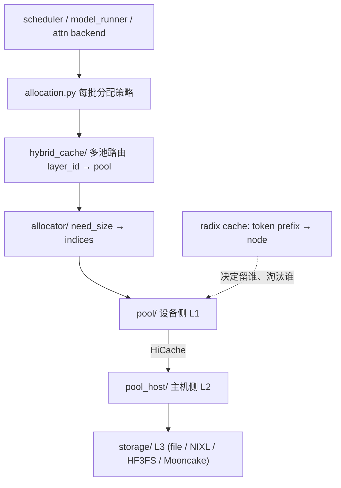

# 子文档：调度器、RadixAttention / 前缀缓存与 continuous batching

> ⚠️ **信息来源声明**：本文由 AI Agent 基于公开开源仓库源码只读精读整理。所有行为结论标注 `文件:行`，区分「代码事实」与「研究推断」。
>
> **调研日期**：2026-10-16
> **主文档**：[report.md](report.md)
> **版本**：`sgl-project/sglang` @ `2a08e261ecd4cdfb04ec354f9005f18b88108b7d`
> **证据标签**：单一主等级；本文一律 **`[精读原文（SGLang 源码 @ 本报告 SHA）]`**，涉及设计解释处标 **`[研究推断]`**。

---

## 1. 命名澄清：`RadixAttention` 在前缀复用里到底做什么

**代码事实**：本 commit 里名为 `RadixAttention` 的类在 `[radix_attention.py:98](<https://github.com/sgl-project/sglang/blob/2a08e261ecd4cdfb04ec354f9005f18b88108b7d/python/sglang/srt/layers/radix_attention.py>)` 附近定义，它是一个 **attention 层封装**（`nn.Module` 形态，`forward` 在 `:159`），职责是把 attention 后端（`get_attn_backend()`）的调用包装进模型层，并处理 CUDA graph / 编译相关细节。 **[精读原文（SGLang 源码 @ 本报告 SHA）]**

**它不做前缀匹配。** 前缀复用发生在这条链上：

```
scheduler.get_new_batch_prefill (scheduler.py:3969)
  → SchedulePolicy 的 LPM 排序 (schedule_policy.py:171, _compute_prefix_matches:342)
  → Req.init_next_round_input (schedule_batch.py:1660)
  → match_kv_cache (common.py:219)
  → tree_cache.match_prefix (base_prefix_cache.py:436 / radix_cache.py:364; 新树在 unified_radix_cache.py:585)
  → 命中节点上锁 inc_lock_ref (radix_cache.py:582)
```

**研究推断**：SGLang 早期把 "RadixAttention" 作为**整条 prefix-cache 注意力复用机制**的品牌名，现在它是一个具体的层类；机制本身已经迁到 `mem_cache/` + `managers/`。读代码时若按名字找机制，会找不到入口——这是本报告特意澄清的第一点。

---

## 2. 两代 radix 树实现

### 2.1 默认：`UnifiedRadixCache`

**代码事实**：`[registry.py:146](<https://github.com/sgl-project/sglang/blob/2a08e261ecd4cdfb04ec354f9005f18b88108b7d/python/sglang/srt/mem_cache/registry.py>)` 在常规情况下返回 `create_unified_radix_cache(ctx)`；该工厂在 `:191` 构造 `UnifiedRadixCache(params)`。 **[精读原文（SGLang 源码 @ 本报告 SHA）]**

### 2.2 ⚠️ 一个必须说明的冲突

**本节结论在两次阅读间发生了反转，记录在此以免误导读者。**

- **第一遍（按名字检索）**：我在 `python/sglang/srt/mem_cache/radix_cache.py` 读到完整的 `RadixCache` 实现（`TreeNode` / `match_prefix` / `_split_node` / `evict` / `inc_lock_ref`），并在 `test/registered/unit/mem_cache/` 下看到对应测试，初步判断它是主线实现。
- **第二遍（追 registry 调用者）**：`[registry.py:146](<https://github.com/sgl-project/sglang/blob/2a08e261ecd4cdfb04ec354f9005f18b88108b7d/python/sglang/srt/mem_cache/registry.py>)` 在非 pure-SWA、非 FlexKV 场景下返回 **`UnifiedRadixCache`**；`RadixCache` 只被 `pure_swa_radix_cache.py:9`、`flexkv_radix_cache.py:44` 继承/导入，以及 `schedule_policy.py:71` 导入其 `RadixKey`/`TreeNode` 类型。
- **最终结论**：**默认是 `UnifiedRadixCache`，`radix_cache.py` 是遗留实现**。`[registry.py:146](<https://github.com/sgl-project/sglang/blob/2a08e261ecd4cdfb04ec354f9005f18b88108b7d/python/sglang/srt/mem_cache/registry.py>)` + `[schedule_policy.py:71](<https://github.com/sgl-project/sglang/blob/2a08e261ecd4cdfb04ec354f9005f18b88108b7d/python/sglang/srt/managers/schedule_policy.py>)` **[精读原文（SGLang 源码 @ 本报告 SHA）]**

**为什么保留这段**：这正是"只靠名字和文件大小找主线"会踩的坑。仓库 README（`mem_cache/README.md`）确实写了"per-model variants (`radix_cache.py`, `pure_swa_radix_cache.py`) are **converging onto** the Unified Radix Cache"，但只有追到 registry 的 return 语句才能确认收敛已经发生。

### 2.3 关键数据结构对照

| 结构 | 遗留 `RadixCache` | 默认 `UnifiedRadixCache` |
|---|---|---|
| 节点类 | `TreeNode`（`[radix_cache.py:250](<https://github.com/sgl-project/sglang/blob/2a08e261ecd4cdfb04ec354f9005f18b88108b7d/python/sglang/srt/mem_cache/radix_cache.py>)`） | `UnifiedTreeNode`（`[unified_tree_core.py:112](<https://github.com/sgl-project/sglang/blob/2a08e261ecd4cdfb04ec354f9005f18b88108b7d/python/sglang/srt/mem_cache/unified_cache/unified_tree_core.py>)`） |
| 子节点容器 | `defaultdict(TreeNode)` | `dict`，注释明确"missing-key read must raise, never silently mint an unregistered node" |
| 数据存放 | `node.value: Optional[torch.Tensor]`（KV 槽位索引） | `node.component_data[ComponentType]`，每个 component 独立 `value` / `lock_ref` / `host_value` / `host_lock_ref` |
| 引用计数 | `node.lock_ref: int` 单份 | 每 component 一份 `lock_ref`（`ComponentData`） |
| 淘汰序 | `evictable_leaves: set` + 每次 evict 时 `heapq` 重建（`[radix_cache.py:552](<https://github.com/sgl-project/sglang/blob/2a08e261ecd4cdfb04ec354f9005f18b88108b7d/python/sglang/srt/mem_cache/radix_cache.py>)`） | 每 component 一条 `UnifiedLRUList` 双向链表，O(1) 插删（`[unified_tree_core.py:213](<https://github.com/sgl-project/sglang/blob/2a08e261ecd4cdfb04ec354f9005f18b88108b7d/python/sglang/srt/mem_cache/unified_cache/unified_tree_core.py>)`） |
| LRU 指针存储 | 无（用 `last_access_time` 比较） | `lru_prev`/`lru_next` 各是长度 `_NUM_COMPONENT_TYPES * 2` 的 list（device/host 分槽） |
| 树核心 | Python | Rust（`rust/sglang-radix-tree`），另有 Python 回退 |

### 2.4 逻辑键：`RadixKey`

**代码事实**：键不只是 token id 序列，还带三个正交维度——`extra_key`（LoRA / 命名空间隔离）、`cache_salt`（显式禁止共享）、`is_bigram`（EAGLE 场景下的 bigram 视图）。 **[精读原文（SGLang 源码 @ 本报告 SHA）]**

`match_prefix` 的 docstring 把语义写得很清楚（`[radix_cache.py:366](<https://github.com/sgl-project/sglang/blob/2a08e261ecd4cdfb04ec354f9005f18b88108b7d/python/sglang/srt/mem_cache/radix_cache.py>)`）：前导 token id 相同但 `extra_key` 不同的条目"intentionally kept disjoint and never share prefix nodes"，用于隔离 LoRA/适配器 ID、以及"不同 sampling salt、cache version、retrieval augmentation context"。

匹配入口先做三件事（`[radix_cache.py:400](<https://github.com/sgl-project/sglang/blob/2a08e261ecd4cdfb04ec354f9005f18b88108b7d/python/sglang/srt/mem_cache/radix_cache.py>)` 起）：bigram 视图转换 → 空键短路 → `page_aligned(page_size)` 截断到页对齐。 **[精读原文（SGLang 源码 @ 本报告 SHA）]**

---

## 3. 遗留 RadixCache 的运行时细节（不能直接代指默认 UnifiedRadixCache）

### 3.1 `match_prefix` 会改树

**代码事实**：`_match_prefix_helper` 在命中段**短于**子节点持有段时调用 `_split_node` 并 `break`（`[radix_cache.py:662](<https://github.com/sgl-project/sglang/blob/2a08e261ecd4cdfb04ec354f9005f18b88108b7d/python/sglang/srt/mem_cache/radix_cache.py>)`）。`_split_node` 把子节点切成两段：新节点继承前缀（`value = child.value[:split_len].clone()`），原节点保留后缀（`[radix_cache.py:677](<https://github.com/sgl-project/sglang/blob/2a08e261ecd4cdfb04ec354f9005f18b88108b7d/python/sglang/srt/mem_cache/radix_cache.py>)` 起）。 **[精读原文（SGLang 源码 @ 本报告 SHA）]**

**研究推断**：把一个**只读语义**的操作（查最长前缀）做成**结构性写操作**，是为了让后续匹配的边界更精确（docstring 原文："this structural refinement improves subsequent match efficiency and does not duplicate data"）。代价是：`match_prefix` 不是幂等的无副作用查询，`touch_prefix` 也不是只读保证：它在 `radix_cache.py:426` 调同一个 `_match_prefix_helper`，仍可分裂节点。该 API 跳过 MatchResult 等处理，不能把它当无副作用查询（`[radix_cache.py:419](<https://github.com/sgl-project/sglang/blob/2a08e261ecd4cdfb04ec354f9005f18b88108b7d/python/sglang/srt/mem_cache/radix_cache.py>)`）。

### 3.2 引用计数与可淘汰空间

**代码事实**：`inc_lock_ref` 沿 parent 链上行，把 `lock_ref` 从 0 变 1 的节点从 `evictable_size_` 挪到 `protected_size_`（`[radix_cache.py:582](<https://github.com/sgl-project/sglang/blob/2a08e261ecd4cdfb04ec354f9005f18b88108b7d/python/sglang/srt/mem_cache/radix_cache.py>)`）；`dec_lock_ref` 做反向操作，并在 `node.parent is None` 时断言"该请求持有的是另一棵树"（`[radix_cache.py:611](<https://github.com/sgl-project/sglang/blob/2a08e261ecd4cdfb04ec354f9005f18b88108b7d/python/sglang/srt/mem_cache/radix_cache.py>)`）。 **[精读原文（SGLang 源码 @ 本报告 SHA）]**

**研究推断**：`root_node.lock_ref = 1`（`[radix_cache.py:348](<https://github.com/sgl-project/sglang/blob/2a08e261ecd4cdfb04ec354f9005f18b88108b7d/python/sglang/srt/mem_cache/radix_cache.py>)`）让根永不被淘汰，同时使 `while node != self.root_node` 的上行循环天然终止。这是一个把"终止条件"编码进"保护条件"的紧凑写法，但这**不表示根占用 protected_size_**：`radix_cache.py:345-351` 的 root value 为空，计数初始化为零，上行循环也跳过 root。

### 3.3 淘汰：叶优先

**代码事实**：`evict` 只从 `evictable_leaves` 出发建堆（`[radix_cache.py:558](<https://github.com/sgl-project/sglang/blob/2a08e261ecd4cdfb04ec354f9005f18b88108b7d/python/sglang/srt/mem_cache/radix_cache.py>)`），逐个 pop、`free_segment`、`_delete_leaf`；若父节点变成无子且无锁，则把它**也推进堆**（`[radix_cache.py:573](<https://github.com/sgl-project/sglang/blob/2a08e261ecd4cdfb04ec354f9005f18b88108b7d/python/sglang/srt/mem_cache/radix_cache.py>)`）。 **[精读原文（SGLang 源码 @ 本报告 SHA）]**

**研究推断**：这是"从叶子向内逐层塌缩"的淘汰，保证了树上不会留下中间被掏空的段。`get_priority` 由 `eviction_strategy` 提供（`[radix_cache.py:311](<https://github.com/sgl-project/sglang/blob/2a08e261ecd4cdfb04ec354f9005f18b88108b7d/python/sglang/srt/mem_cache/radix_cache.py>)`），`get_eviction_strategy` 支持 LRU 之外策略（新树还支持 `tlru`，见 `[registry.py:272](<https://github.com/sgl-project/sglang/blob/2a08e261ecd4cdfb04ec354f9005f18b88108b7d/python/sglang/srt/mem_cache/registry.py>)` 对 `UnifiedRadixCache` 的强制要求）。

### 3.4 插入时会释放重复 KV

**代码事实**：`_insert_cache` 在插入后执行 `self.token_to_kv_pool_allocator.free_segment(kv_indices[req.kv.cache_protected_len : result.prefix_len], ...)`（`[radix_cache.py:504](<https://github.com/sgl-project/sglang/blob/2a08e261ecd4cdfb04ec354f9005f18b88108b7d/python/sglang/srt/mem_cache/radix_cache.py>)`），即把"这次重复算出来的前缀 KV 槽位"还给池子。 **[精读原文（SGLang 源码 @ 本报告 SHA）]**

**研究推断**：这解释了为什么 KV 池的 free 与 radix 树的 insert 必须**成对**出现在同一函数里——它们共享同一个不变式："树上每个被复用的前缀，在池子里只被引用一份"。

---

### 3.5 默认 UnifiedRadixCache 的对应路径

`unified_radix_cache.py:585-604` 的 `match_prefix` 先试 session shortcut，再调 TreeCore 并应用 cache actions、component finalizer 与 linker；`touch_prefix:609-615` 仍调用 TreeCore 并应用 actions，同样不能保证只读。`insert:623-644` 用 begin/resume/end 的步进接口在 barrier 应用 actions，异常清理在 `finally`；`evict:647-659` 委托 component-aware 的 `_evict`。这与遗留实现的单份 `lock_ref`、叶堆不同，默认实现的淘汰维护不能只引用上面的 `radix_cache.py`。

## 4. continuous batching 与重叠调度

### 4.1 两个事件循环

| 循环 | 位置 | 语义 |
|---|---|---|
| `event_loop_normal` | `[scheduler.py:1958](<https://github.com/sgl-project/sglang/blob/2a08e261ecd4cdfb04ec354f9005f18b88108b7d/python/sglang/srt/managers/scheduler.py>)` | 取批 → 跑批 → 立刻处理结果 |
| `event_loop_overlap` | `[scheduler.py:1993](<https://github.com/sgl-project/sglang/blob/2a08e261ecd4cdfb04ec354f9005f18b88108b7d/python/sglang/srt/managers/scheduler.py>)` | 取批 → 跑批入队 → 处理**上一批**结果 |

`enable_overlap` 的判定：`not disable_overlap_schedule and not use_mlx()`（`[scheduler.py:495](<https://github.com/sgl-project/sglang/blob/2a08e261ecd4cdfb04ec354f9005f18b88108b7d/python/sglang/srt/managers/scheduler.py>)`）。 **[精读原文（SGLang 源码 @ 本报告 SHA）]**

### 4.2 重叠调度的分支点

**代码事实**：`event_loop_overlap` 在启动当前批之前，先 `pop_and_process()` 处理上一批——但**不是无条件**：只有 `disable_overlap_for_batch` 为真时才提前处理；否则延后到跑完当前批（`[scheduler.py:2019](<https://github.com/sgl-project/sglang/blob/2a08e261ecd4cdfb04ec354f9005f18b88108b7d/python/sglang/srt/managers/scheduler.py>)` 起）。`disable_overlap_for_batch` 的定义在 `is_disable_overlap_for_batch`（`[scheduler.py:2068](<https://github.com/sgl-project/sglang/blob/2a08e261ecd4cdfb04ec354f9005f18b88108b7d/python/sglang/srt/managers/scheduler.py>)` 附近），核心条件是"连续两个 extend 批"。 **[精读原文（SGLang 源码 @ 本报告 SHA）]**

### 4.3 上一轮的 `seq_lens` 靠 FutureMap 才可见

**代码事实**：`run_batch` 在 overlap 分支里第一件事是 `self.future_map.resolve_seq_lens_cpu(batch)`，注释解释："Self-gates on `batch.spec_info.future_indices`; non-spec_v2 no-ops"（`[scheduler.py:4575](<https://github.com/sgl-project/sglang/blob/2a08e261ecd4cdfb04ec354f9005f18b88108b7d/python/sglang/srt/managers/scheduler.py>)`）。`FutureMap` 类定义在 `[overlap_utils.py:255](<https://github.com/sgl-project/sglang/blob/2a08e261ecd4cdfb04ec354f9005f18b88108b7d/python/sglang/srt/managers/overlap_utils.py>)`，`publish` 在 `:602`。 **[精读原文（SGLang 源码 @ 本报告 SHA）]**

**研究推断**：这是整个重叠调度成立的**核心不变式**——"本轮 CPU 侧看到的 `seq_lens` 是上一轮 GPU 侧算出来的结果，由 `future_indices`（= `req_pool_indices`）作为槽位键从前一轮 relay 过来"。所以 `future_indices` 与 `req_pool_indices` 目前被硬绑定（`[overlap_utils.py:594](<https://github.com/sgl-project/sglang/blob/2a08e261ecd4cdfb04ec354f9005f18b88108b7d/python/sglang/srt/managers/overlap_utils.py>)` 的注释 "FIXME: fi == batch.req_pool_indices; unify future_indices and req_pool_indices" 证实作者自己也认为这个耦合待清理）。

### 4.4 投机解码怎么插进重叠窗口

**代码事实**：`run_batch` 在 `batch.spec_algorithm` 非 none 时注入 `on_publish` 回调（`[scheduler.py:4595](<https://github.com/sgl-project/sglang/blob/2a08e261ecd4cdfb04ec354f9005f18b88108b7d/python/sglang/srt/managers/scheduler.py>)`）；worker 侧在 `[eagle_worker_v2.py:1424](<https://github.com/sgl-project/sglang/blob/2a08e261ecd4cdfb04ec354f9005f18b88108b7d/python/sglang/srt/speculative/eagle_worker_v2.py>)` 调用它，位置恰好在 `verify()` 之后、`_draft_extend_for_decode()` 之前，注释为 "Publish before draft_extend so the fence is at verify-end"。 **[精读原文（SGLang 源码 @ 本报告 SHA）]**

**研究推断**：这个插入点（`[eagle_worker_v2.py:1424](<https://github.com/sgl-project/sglang/blob/2a08e261ecd4cdfb04ec354f9005f18b88108b7d/python/sglang/srt/speculative/eagle_worker_v2.py>)`）的选择有明确动机——verify 一结束，`new_seq_lens` 就已知；而 draft_extend 还要跑一次草稿前向。若等 draft_extend 结束再 publish，调度线程的 `resolve_seq_lens_cpu`（`[scheduler.py:4575](<https://github.com/sgl-project/sglang/blob/2a08e261ecd4cdfb04ec354f9005f18b88108b7d/python/sglang/srt/managers/scheduler.py>)`）就会多等一个 draft_extend 的时长。把 publish 提前，等于**让调度准备与 draft_extend 重叠**，这是"投机解码与重叠调度共存"的机制落点。

### 4.5 三条硬约束（代码事实）

| 约束 | 位置 | 影响 |
|---|---|---|
| overlap 只支持 `topk == 1` | 文档 `docs/docs/advanced_features/speculative_decoding.mdx` 的 Overlap Scheduler 一节；代码侧 `[eagle_info.py:235](<https://github.com/sgl-project/sglang/blob/2a08e261ecd4cdfb04ec354f9005f18b88108b7d/python/sglang/srt/speculative/eagle_info.py>)` 的 `future_indices` 早退 | topk>1 不能开 overlap |
| topk>1 时 `select_top_k_tokens` 会重排行 | `[eagle_worker_v2.py:286](<https://github.com/sgl-project/sglang/blob/2a08e261ecd4cdfb04ec354f9005f18b88108b7d/python/sglang/srt/speculative/eagle_worker_v2.py>)` 注释 "topk == 1 only (select_top_k_tokens reorders rows, desyncing indices)" | 与槽位索引契约冲突 |
| 严格拒绝采样要求 `topk == 1` | `[speculative_hook.py:1143](<https://github.com/sgl-project/sglang/blob/2a08e261ecd4cdfb04ec354f9005f18b88108b7d/python/sglang/srt/arg_groups/speculative_hook.py>)` | 与上一条叠加 |

**合起来的研究推断**：`overlap 需要 topk=1` + `严格验证需要 topk=1` 这两条**方向相同**，所以它们并不冲突；真正冲突的是**"树状投机（topk>1）"与"重叠调度+严格验证"这两组**。而 SGLang 的自动调参对 Llama/Grok 给出 `topk=4`（`[speculative_hook.py:1090](<https://github.com/sgl-project/sglang/blob/2a08e261ecd4cdfb04ec354f9005f18b88108b7d/python/sglang/srt/arg_groups/speculative_hook.py>)`），意味着**默认不显式指定 topk 的 Llama 用户会默认落到不支持 overlap 的配置上**。文档对此有明确警告（"If you omit `--speculative-eagle-topk`, auto-tuning may pick `topk > 1` for some models (e.g. Llama). This is incompatible with the overlap scheduler and may not always trigger an immediate config error"）。 **[精读原文（官方文档）+ 研究推断]**

---

## 5. 为什么热点用 Rust 重写（以及它的代价）

**代码事实**：`create_tree_core` 的默认后端是 `"rust"`（`[tree_core_registry.py:1](<https://github.com/sgl-project/sglang/blob/2a08e261ecd4cdfb04ec354f9005f18b88108b7d/python/sglang/srt/mem_cache/unified_cache/tree_core_registry.py>)` 模块 docstring："selected by ... SGLANG_UNIFIED_RADIX_TREE_CORE_BACKEND (default \"rust\")"）。`_rust_fallback_reason` 列出回退条件：session radix cache、非 `{FULL, SWA, MAMBA}` 的自定义 component、`component_registry_override`、非 Linux、PyTorch 版本越界、设备非 cpu/cuda。 **[精读原文（SGLang 源码 @ 本报告 SHA）]**

Rust 侧节点用 hashbrown + `sha2` 做页哈希（`[node.rs:16](<https://github.com/sgl-project/sglang/blob/2a08e261ecd4cdfb04ec354f9005f18b88108b7d/rust/sglang-radix-tree/src/node.rs>)` 附近的 import），并有独立的 `unified_lru_list.rs`、`tests/`。 **[精读原文（SGLang 源码 @ 本报告 SHA）]**

**研究推断**：把"每步 decode 都要走一次"的树操作从 Python 对象搬到 Rust，收益直接对应每步 CPU 时间；但**代价是把一台机器的编译工具链（cargo/rustc、torch 版本）变成运行时前置条件**——`_rust_fallback_reason` 里的 6 类条件是这一代价的账本。对维护者的实际含义：**"为什么我的机器上跑的是 Python 树"这个问题，答案在这个函数里，而不是在配置里。**

---

## 6. 分层图（KV 内存侧）



该分层直接来自 `python/sglang/srt/mem_cache/README.md:9` 的原文 ASCII 图，本报告只是改写为 Mermaid。 **[精读原文（仓库文档）]**

同一 README 还给了两条本报告验证过的规则：**层次不得向上 import**（"pool/ and pool_host/ must not import allocator/, hybrid_cache/, or allocation.py"），以及**新类按基类归属而非名字**（"By base class, never by name"）。 **[精读原文（仓库文档）]**

---

## 7. 维护者笔记

1. **想改前缀匹配语义**：入口在 `RadixKey.match` / `match_at`（`[radix_cache.py:178](<https://github.com/sgl-project/sglang/blob/2a08e261ecd4cdfb04ec354f9005f18b88108b7d/python/sglang/srt/mem_cache/radix_cache.py>)`），但新树的对应实现在 `unified_tree_core.py`，**两处都要改**（迁移期双真相源）。
2. **想加新淘汰策略**：新树要求 `UnifiedRadixCache`（`[registry.py:272](<https://github.com/sgl-project/sglang/blob/2a08e261ecd4cdfb04ec354f9005f18b88108b7d/python/sglang/srt/mem_cache/registry.py>)` 显式校验），旧树的 `get_eviction_strategy` 不够。
3. **不要在 radix 树操作里做 D2H 同步**：树的每次匹配都在 decode 热路径上，`scheduler.py` 里对 `seq_lens_cpu` 的处理已经专门做了"让 backend 声明 `needs_cpu_seq_lens`"来避免多余同步（`docs/docs/advanced_features/speculative_decoding.mdx` 的 LiLiCorr 一节讨论了这一点）。
4. **调试顺序**：先确认 `tree_cache` 的实际类型（`UnifiedRadixCache` vs `PureSWARadixCache` vs FlexKV），再确认 TreeCore 后端（rust/python），最后才看算法。

---

> *数据截至 2026-10-16。*
